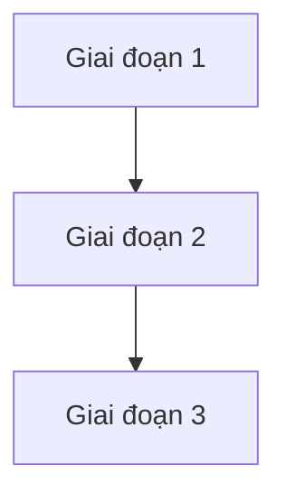

# Kế hoạch: [Tên Kế Hoạch]
> **Vị trí lưu trữ quy chuẩn:** `.agents/plans/YYYY-MM-DD_HHmm-plan-<tên-kế-hoạch>.md` (hoặc `YYYY-MM-DD-plan-<tên-kế-hoạch>.md`)  
> **Quy tắc:** Bắt buộc có tiền tố ngày tháng hoặc ngày giờ ở tên tệp (trừ khi người dùng chỉ định tên riêng). Đầu tệp bắt buộc ghi rõ mốc thời gian lập và cập nhật. Kế hoạch phải chia rõ ràng các giai đoạn (Phases), trong mỗi giai đoạn phân rã thành các task vi mô, và bắt buộc có cổng kiểm tra lại (Verification Loop) trước khi chuyển giai đoạn.

- ⏱️ **Thời gian lập kế hoạch:** [Thứ ..., DD/MM/YYYY, HH:MM (UTC+7)]
- ⏱️ **Thời gian cập nhật gần nhất:** [Thứ ..., DD/MM/YYYY, HH:MM (UTC+7)]

---

## 1. Tóm Tắt Mục Tiêu
- [Tóm tắt 1-2 câu ngắn gọn về mục tiêu cần đạt được trong kế hoạch này]

## 2. Danh Sách Tệp Sẽ Tạo & Chỉnh Sửa
- `/path/to/file1.ext` - [Mô tả vai trò]
- `/path/to/file2.ext` - [Mô tả vai trò]

## 3. Sơ Đồ Khối / Luồng Công Việc (Nếu có)

---

## 4. Lộ Trình Triển Khai Phân Tầng

### GIAI ĐOẠN 1: [Tên Giai Đoạn 1]
- [ ] **Task 1.1:** [Mô tả công việc cụ thể]
- [ ] **Task 1.2:** [Mô tả công việc cụ thể]
- 🔄 **Cổng Kiểm Tra Giai Đoạn 1 (Phase 1 Check Gate - Verification Loop):**
  - [ ] Chạy test suite giai đoạn 1 đạt tỷ lệ pass 100%.
  - [ ] Kiểm tra linter và typecheck không còn lỗi.
  - [ ] Đối soát kết quả thực tế với mục tiêu giai đoạn.

### GIAI ĐOẠN 2: [Tên Giai Đoạn 2]
- [ ] **Task 2.1:** [Mô tả công việc cụ thể]
- [ ] **Task 2.2:** [Mô tả công việc cụ thể]
- 🔄 **Cổng Kiểm Tra Giai Đoạn 2 (Phase 2 Check Gate - Verification Loop):**
  - [ ] Kiểm tra toàn bộ integration giữa các module.
  - [ ] Xác nhận không phát sinh lỗi hồi quy (regressions).
