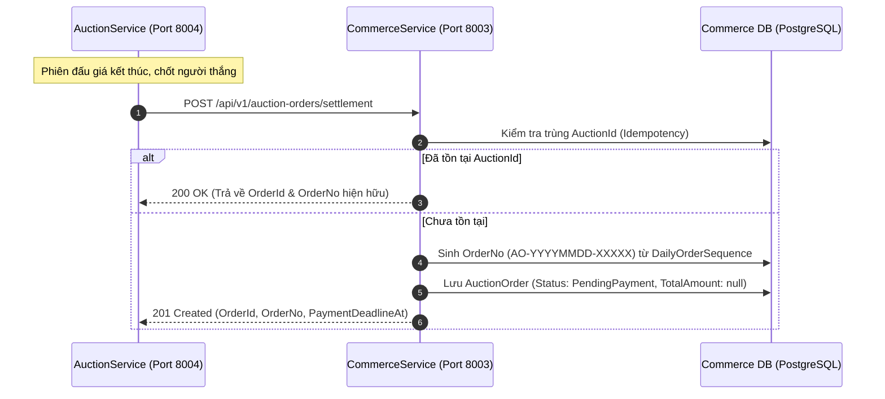
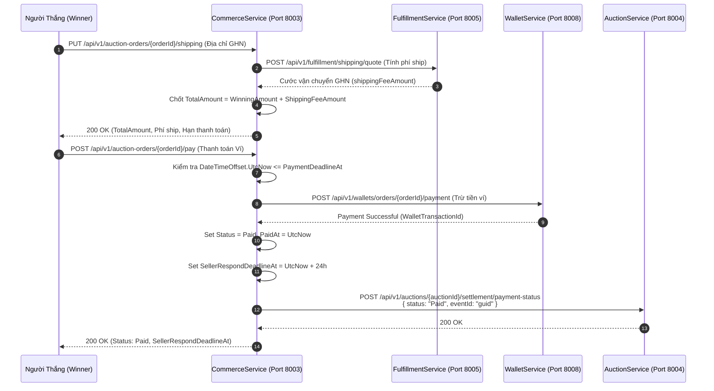
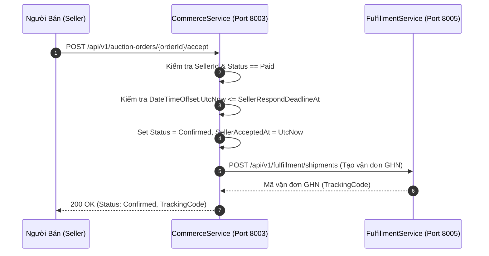
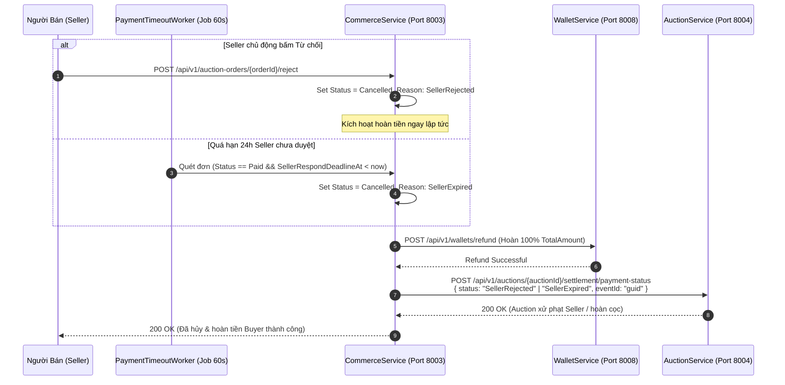
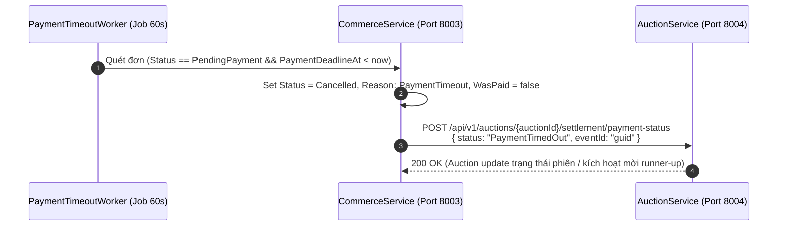

# HỢP ĐỒNG TÍCH HỢP REST API & TÀI LIỆU ĐỐI CHIẾU KỸ THUẬT

## COMMERCE SERVICE ↔ AUCTION SERVICE

> **Dự án:** Nexus Microservices Ecosystem  
> **Service gửi yêu cầu:** `CommerceService` (Port `8003`, Database `commerce_db:5435`)  
> **Service đối chiếu:** `AuctionService` (Port `8004`, Database `auction_db`)  
> **Mục tiêu:** Thống nhất hợp đồng RESTful API đồng bộ, chuyển dịch triệt để khỏi Message Broker/RabbitMQ, chuẩn hóa quy trình tạo đơn hàng đấu giá (`AuctionOrder`) từ settlement, quy trình thanh toán ví, quản lý thời hạn Seller duyệt/từ chối, quét hạn timeout nền (24h), tự động hoàn tiền cho Buyer và cơ chế gọi callback trạng thái thanh toán.  
> **Phiên bản tài liệu:** `v1.0.0` (Draft — Chờ thống nhất & nghiệm thu)  
> **Ngày lập:** 2026-11-09  

---

## MỤC LỤC

1. [Kiến trúc Tương tác & Bản đồ Điểm chạm Toàn trình](#1-kiến-trúc-tương-tác--bản-đồ-điểm-chạm-toàn-trình)
   * [1.1. Luồng 1: Chốt phiên đấu giá & Khởi tạo đơn hàng (Settlement)](#11-luồng-1-chốt-phiên-đấu-giá--khởi-tạo-đơn-hàng-settlement)
   * [1.2. Luồng 2: Buyer nhập địa chỉ ship & Thanh toán Ví (Pay Order)](#12-luồng-2-buyer-nhập-địa-chỉ-ship--thanh-toán-ví-pay-order)
   * [1.3. Luồng 3: Seller chấp nhận đơn & Tạo vận đơn giao hàng](#13-luồng-3-seller-chấp-nhận-đơn--tạo-vận-đơn-giao-hàng)
   * [1.4. Luồng 4: Seller từ chối hoặc Quá hạn duyệt (Hoàn tiền & Callback)](#14-luồng-4-seller-từ-chối-hoặc-quá-hạn-duyệt-hoàn-tiền--callback)
   * [1.5. Luồng 5: Buyer quá hạn thanh toán 24h (Payment Timeout Worker)](#15-luồng-5-buyer-quá-hạn-thanh-toán-24h-payment-timeout-worker)
2. [Chi tiết Hợp đồng REST API (API Specifications)](#2-chi-tiết-hợp-đồng-rest-api-api-specifications)
   * [2.1. API Tiếp nhận Settlement (Auction ➔ Commerce)](#21-api-tiếp-nhận-settlement-auction--commerce)
   * [2.2. API Callback Trạng thái Thanh toán (Commerce ➔ Auction)](#22-api-callback-trạng-thái-thanh-toán-commerce--auction)
   * [2.3. API Nhập địa chỉ & Báo giá vận chuyển (Buyer ➔ Commerce)](#23-api-nhập-địa-chỉ--báo-giá-vận-chuyển-buyer--commerce)
   * [2.4. API Thanh toán đơn đấu giá bằng Ví (Buyer ➔ Commerce)](#24-api-thanh-toán-đơn-đấu-giá-bằng-ví-buyer--commerce)
   * [2.5. API Seller chấp nhận đơn đấu giá (Seller ➔ Commerce)](#25-api-seller-chấp-nhận-đơn-đấu-giá-seller--commerce)
   * [2.6. API Seller từ chối đơn đấu giá (Seller ➔ Commerce)](#26-api-seller-từ-chối-đơn-đấu-giá-seller--commerce)
3. [Quy Tắc Nghiệp Vụ Cốt Lõi Cần Thống Nhất](#3-quy-tắc-nghiệp-vụ-cốt-lõi-cần-thống-nhất)
   * [3.1. Cơ chế Tiền cọc (Deposit) vs Số tiền Thanh toán đơn](#31-cơ-chế-tiền-cọc-deposit-vs-số-tiền-thanh-toán-đơn)
   * [3.2. Cơ chế Phí sàn (Platform Fee) & Tiền Seller thực nhận](#32-cơ-chế-phí-sàn-platform-fee--tiền-seller-thực-nhận)
   * [3.3. Thời hạn phản hồi của Seller (SellerRespondDeadlineAt)](#33-thời-hạn-phản-hồi-của-seller-sellerresponddeadlineat)
   * [3.4. Cơ chế Hoàn tiền Ví tự động & Idempotency](#34-cơ-chế-hoàn-tiền-ví-tự-động--idempotency)
4. [Bộ Câu Hỏi Kỹ Thuật Trọng Tâm Gửi Team Auction](#4-bộ-câu-hỏi-kỹ-thuật-trọng-tâm-gửi-team-auction)
   * [Nhóm 1: Schema Settlement & Quyền sở hữu tính hạn thanh toán](#nhóm-1-schema-settlement--quyền-sở-hữu-tính-hạn-thanh-toán)
   * [Nhóm 2: Enum Callback Trạng thái & Xử lý lỗi Callback](#nhóm-2-enum-callback-trạng-thái--xử-lý-lỗi-callback)
   * [Nhóm 3: Tiền cọc (Deposit) & Công thức Thanh toán thực tế](#nhóm-3-tiền-cọc-deposit--công-thức-thanh-toán-thực-tế)
   * [Nhóm 4: Phí nền tảng (Platform Fee)](#nhóm-4-phí-nền-tảng-platform-fee)
   * [Nhóm 5: Trải nghiệm người dùng (Frontend Flow & Redirection)](#nhóm-5-trải-nghiệm-người-dùng-frontend-flow--redirection)
   * [Nhóm 6: Cấu hình Mạng & Xác thực liên dịch vụ](#nhóm-6-cấu-hình-mạng--xác-thực-liên-dịch-vụ)
5. [Ma Trận Mã Lỗi Chuẩn (RFC 9110 Error Matrix)](#5-ma-trận-mã-lỗi-chuẩn-rfc-9110-error-matrix)

---

## 1. KIẾN TRÚC TƯƠNG TÁC & BẢN ĐỒ ĐIỂM CHẠM TOÀN TRÌNH

### 1.1. Luồng 1: Chốt phiên đấu giá & Khởi tạo đơn hàng (Settlement)



---

### 1.2. Luồng 2: Buyer nhập địa chỉ ship & Thanh toán Ví (Pay Order)



---

### 1.3. Luồng 3: Seller chấp nhận đơn & Tạo vận đơn giao hàng



---

### 1.4. Luồng 4: Seller từ chối hoặc Quá hạn duyệt (Hoàn tiền & Callback)



---

### 1.5. Luồng 5: Buyer quá hạn thanh toán 24h (Payment Timeout Worker)



---

## 2. CHI TIẾT HỢP ĐỒNG REST API (API SPECIFICATIONS)

### 2.1. API Tiếp nhận Settlement (Auction ➔ Commerce)

* **Mục đích:** Auction Service đẩy kết quả phiên đấu giá sang Commerce Service để khởi tạo đơn hàng chờ thanh toán.
* **Method:** `POST`
* **Route:** `/api/v1/auction-orders/settlement`
* **Xác thực / Headers:**
  * `Content-Type: application/json`
  * `X-Internal-Service-Key: <INTERNAL_KEY>` (nếu dùng cơ chế xác thực nội bộ)

#### Request Payload Schema:
```json
{
  "auctionId": "3fa85f64-5717-4562-b3fc-2c963f66afa6",
  "winningBidId": "4ba85f64-5717-4562-b3fc-2c963f66afa7",
  "winnerId": "5ca85f64-5717-4562-b3fc-2c963f66afa8",
  "sellerId": "6da85f64-5717-4562-b3fc-2c963f66afa9",
  "productId": "7ea85f64-5717-4562-b3fc-2c963f66afb0",
  "skuId": "8fa85f64-5717-4562-b3fc-2c963f66afb1",
  "productName": "Đồng hồ Vintage Omega Seamaster 1968",
  "imageUrl": "https://cdn.nexus.com/products/omega-1968.jpg",
  "skuAttributes": "{\"color\": \"Gold\", \"dial\": \"White\"}",
  "winningAmount": 15000000.00,
  "paymentDeadlineAt": "2026-11-10T20:00:00Z"
}
```

#### Quy tắc trường (Field Constraints):
| Tên trường | Kiểu dữ liệu | Bắt buộc | Diễn giải |
|---|---|---|---|
| `auctionId` | UUID | **Có** | Khóa định danh phiên đấu giá (Unique trong Commerce DB). |
| `winningBidId` | UUID | **Có** | Khóa định danh lượt đấu giá thắng. |
| `winnerId` | UUID | **Có** | Khóa định danh người mua thắng đấu giá (`BuyerId`). |
| `sellerId` | UUID | **Có** | Khóa định danh người bán. |
| `productId` | UUID | **Có** | ID sản phẩm gốc từ Catalog. |
| `skuId` | UUID | Không | ID phân loại hàng (nếu sản phẩm đấu giá có SKU). |
| `productName` | String | **Có** | Snapshot tên sản phẩm tại thời điểm chốt phiên (tối đa 255 ký tự). |
| `imageUrl` | String | Không | Snapshot URL ảnh đại diện sản phẩm. |
| `skuAttributes`| String (JSON) | Không | Snapshot thông số thuộc tính phân loại hàng. |
| `winningAmount`| Decimal(18,2) | **Có** | Giá trúng đấu giá cuối cùng (phải > 0). |
| `paymentDeadlineAt`| ISO-8601 UTC | Không | Hạn chót thanh toán (nếu null, Commerce tính `UtcNow + 24h`). |

#### Response thành công (HTTP 201 Created / 200 OK nếu idempotent trùng):
```json
{
  "orderId": "9aa85f64-5717-4562-b3fc-2c963f66afb2",
  "orderNo": "AO-20261109-00001",
  "auctionId": "3fa85f64-5717-4562-b3fc-2c963f66afa6",
  "winningAmount": 15000000.00,
  "paymentDeadlineAt": "2026-11-10T20:00:00Z",
  "status": "PendingPayment",
  "createdAt": "2026-11-09T20:00:00Z"
}
```

---

### 2.2. API Callback Trạng thái Thanh toán (Commerce ➔ Auction)

* **Mục đích:** Commerce Service chủ động gọi callback sang Auction Service khi phát sinh các sự kiện trạng thái quan trọng.
* **Method:** `POST`
* **Route:** `/api/v1/auctions/{auctionId}/settlement/payment-status`
* **Caller:** Commerce Service (`AuctionClient`)

#### Request Payload Schema:
```json
{
  "orderId": "9aa85f64-5717-4562-b3fc-2c963f66afb2",
  "winnerId": "5ca85f64-5717-4562-b3fc-2c963f66afa8",
  "status": "Paid",
  "eventId": "1ea85f64-5717-4562-b3fc-2c963f66afb9"
}
```

#### Bảng giá trị chuẩn của Enum `status`:
| Giá trị `status` | Thời điểm phát sinh tại Commerce | Hành động mong đợi phía Auction |
|---|---|---|
| `"Paid"` | Buyer thanh toán ví thành công 100% tiền đơn. | Cập nhật phiên sang trạng thái đã thanh toán; ghi nhận mốc thời gian hoàn thành nghĩa vụ của Winner. |
| `"SellerAccepted"` | Seller chấp nhận đơn trong 24h. | Gọi Catalog Service khóa/chốt vĩnh viễn sản phẩm đã bán (`mark-auctioned`). |
| `"SellerRejected"`| Seller chủ động bấm từ chối đơn hàng con. Commerce đã hoàn 100% tiền đơn về ví Buyer. | Cập nhật phiên sang trạng thái thất bại do Seller từ chối; đóng phiên hoặc cho phép Seller relist lại. *(Lưu ý: Auction Service KHÔNG xử lý điểm uy tín/phạt; việc trừ điểm uy tín Seller do Commerce Service phối hợp với User Service xử lý riêng qua `/api/v1/internal/users/penalties`).* |
| `"SellerExpired"` | Hết 24h duyệt (`SellerRespondDeadlineAt`), Seller không duyệt. Commerce tự hủy và hoàn 100% tiền ví Buyer. | Cập nhật phiên sang trạng thái thất bại do Seller quá hạn duyệt 24h; hoàn tất đóng phiên. *(Lưu ý: Việc xử phạt Seller do Commerce Service và User Service xử lý riêng).* |
| `"PaymentTimedOut"`| Hết 24h thanh toán (`PaymentDeadlineAt`), Buyer không trả tiền. Commerce tự hủy đơn chưa thanh toán. | Cập nhật phiên thất bại do Buyer quá hạn thanh toán 24h; kích hoạt luồng **Mời người về nhì** (Runner-up) hoặc đóng phiên. *(Lưu ý: Việc xử lý vi phạm của Buyer do Commerce Service và User Service xử lý riêng).* |

#### Response mong đợi từ Auction Service:
* HTTP Code: `200 OK`
* Response Body:
```json
{
  "success": true,
  "message": "Payment status callback received and processed successfully."
}
```

---

### 2.3. API Nhập địa chỉ & Báo giá vận chuyển (Buyer ➔ Commerce)

* **Method:** `PUT /api/v1/auction-orders/{auctionOrderId}/shipping`
* **Caller:** Authenticated Buyer (`currentUserId == auctionOrder.BuyerId`)
* **Request Body:**
```json
{
  "receiverName": "Nguyễn Văn A",
  "contactPhone": "0901234567",
  "street": "123 Lê Lợi",
  "ward": "Phường Bến Nghé",
  "district": "Quận 1",
  "province": "TP Hồ Chí Minh",
  "ghnDistrictId": 1442,
  "ghnWardCode": "20101"
}
```
* **Response (HTTP 200 OK):**
```json
{
  "orderId": "9aa85f64-5717-4562-b3fc-2c963f66afb2",
  "orderNo": "AO-20261109-00001",
  "winningAmount": 15000000.00,
  "shippingFeeAmount": 35000.00,
  "totalAmount": 15035000.00,
  "paymentDeadlineAt": "2026-11-10T20:00:00Z"
}
```

---

### 2.4. API Thanh toán đơn đấu giá bằng Ví (Buyer ➔ Commerce)

* **Method:** `POST /api/v1/auction-orders/{auctionOrderId}/pay`
* **Caller:** Authenticated Buyer (`currentUserId == auctionOrder.BuyerId`)
* **Request Body:** Rỗng `{}` (Khấu trừ ví theo `totalAmount` đã chốt).
* **Response (HTTP 200 OK):**
```json
{
  "orderId": "9aa85f64-5717-4562-b3fc-2c963f66afb2",
  "status": "Paid",
  "paidAt": "2026-11-09T20:45:00Z",
  "sellerRespondDeadlineAt": "2026-11-10T20:45:00Z",
  "walletTransactionId": "8ca85f64-5717-4562-b3fc-2c963f66afb7"
}
```

---

### 2.5. API Seller chấp nhận đơn đấu giá (Seller ➔ Commerce)

* **Method:** `POST /api/v1/auction-orders/{auctionOrderId}/accept`
* **Caller:** Authenticated Seller (`currentUserId == auctionOrder.SellerId`)
* **Request Body:**
```json
{
  "note": "Shop đã đóng gói hàng chuẩn bị bàn giao cho bưu tá"
}
```
* **Response (HTTP 200 OK):**
```json
{
  "orderId": "9aa85f64-5717-4562-b3fc-2c963f66afb2",
  "status": "Confirmed",
  "acceptedAt": "2026-11-09T21:00:00Z"
}
```

---

### 2.6. API Seller từ chối đơn đấu giá (Seller ➔ Commerce)

* **Method:** `POST /api/v1/auction-orders/{auctionOrderId}/reject`
* **Caller:** Authenticated Seller (`currentUserId == auctionOrder.SellerId`)
* **Request Body:**
```json
{
  "reasonCode": "SellerRejected",
  "reasonText": "Sản phẩm bị nứt vỡ trong kho bảo quản trước khi gửi"
}
```
* **Response (HTTP 200 OK):**
```json
{
  "orderId": "9aa85f64-5717-4562-b3fc-2c963f66afb2",
  "status": "Cancelled",
  "cancellationReason": "SellerRejected",
  "refundStatus": "Completed",
  "rejectedAt": "2026-11-09T21:05:00Z"
}
```

---

## 3. QUY TẮC NGHIỆP VỤ CỐT LÕI CẦN THỐNG NHẤT

### 3.1. Cơ chế Tiền cọc (Deposit) vs Số tiền Thanh toán đơn
* **Mô hình khuyến nghị (Tách bạch cọc và tiền hàng):**
  * Đơn hàng tại Commerce Service quản lý toàn vẹn giá trị hàng hóa: `TotalAmount = WinningAmount + ShippingFeeAmount`.
  * Buyer thanh toán đúng 100% giá trị đơn hàng tại Commerce Service.
  * Khi Commerce Service bắn callback `status: "Paid"` sang Auction Service, **Auction Service sẽ tự động hoàn 100% tiền cọc ban đầu** về Ví cho Buyer.
  * **Lợi ích:** Tránh rủi ro tính toán lệch tiền ship, không cần nghiệp vụ cấn trừ tiền cọc phức tạp giữa 2 Service, kế toán đối soát minh bạch 100%.

### 3.2. Cơ chế Phí sàn (Platform Fee) & Tiền Seller thực nhận
* `WinningAmount` = `SellerReceiveAmount` + `PlatformFeeAmount`.
* Ví dụ: Tỷ lệ phí sàn đấu giá là `5%`:
  * `PlatformFeeAmount = WinningAmount * 0.05`
  * `SellerReceiveAmount = WinningAmount - PlatformFeeAmount`
* Tiền ship (`ShippingFeeAmount`) do đơn vị vận chuyển thu, không cộng vào doanh thu tính phí sàn.

### 3.3. Thời hạn phản hồi của Seller (`SellerRespondDeadlineAt`)
* Quy định cứng: **24 giờ** kể từ thời điểm Buyer thanh toán thành công (`PaidAt`).
* Trong thời gian 24h này, nếu Seller bấm Accept $\rightarrow$ Đơn hàng chuyển sang `Confirmed` và tạo vận đơn GHN.
* Nếu hết 24h mà Seller không bấm Accept $\rightarrow$ Worker nền tự động hủy đơn, hoàn tiền 100% cho Buyer và báo `status: "SellerExpired"` cho Auction Service xử phạt.

### 3.4. Cơ chế Hoàn tiền Ví tự động & Idempotency
* Khi đơn hàng bị hủy bởi Seller từ chối hoặc quá hạn duyệt: Commerce Service gọi `_walletClient.RefundOrderPaymentAsync` với Idempotency Key duy nhất: `refund-auction-{orderId}`.
* Nếu cuộc gọi hoàn tiền ví thành công, Commerce lưu bản ghi `OrderRefund` với trạng thái `Completed`.
* Cuộc gọi callback sang Auction Service mang `eventId: Guid.NewGuid()` để Auction khử trùng lặp an toàn.

---

## 4. BỘ CÂU HỎI KỸ THUẬT TRỌNG TÂM GỬI TEAM AUCTION

Để sớm đóng băng Spec và đi vào triển khai, Commerce Service đề nghị Team Auction làm rõ và chốt 6 nhóm câu hỏi sau:

### Nhóm 1: Schema Settlement & Quyền sở hữu tính hạn thanh toán
1. **Payload `POST /api/v1/auction-orders/settlement`:**  
   Format đề xuất tại [Mục 2.1](#21-api-tiếp-nhận-settlement-auction--commerce) đã đầy đủ các trường của phiên đấu giá chưa? Có cần thêm trường nào (như `auctionTitle`, `depositAmount`, `categoryCode`...)?
2. **Ai làm chủ việc tính `paymentDeadlineAt`?**  
   * *(Khuyến nghị của Commerce):* Team Auction tính sẵn (`determinedAt + 24h`) và gửi sang trong payload; Commerce tôn trọng và dùng nguyên giá trị này để đếm ngược.

### Nhóm 2: Enum Callback Trạng thái & Xử lý lỗi Callback
1. **Enum `status` trong callback `POST /api/v1/auctions/{auctionId}/settlement/payment-status`:**  
   Bên cạnh `"Paid"`, `"SellerRejected"`, `"SellerExpired"`, khi **Buyer quá hạn 24h không thanh toán**, Auction muốn nhận giá trị nào: `"PaymentTimedOut"`, `"BuyerPaymentExpired"`, hay `"Cancelled"`?
2. **Nguyên tắc khi mạng chập chờn:**  
   Nếu Commerce gọi callback sang Auction bị lỗi (500 hoặc timeout), Commerce vẫn sẽ tiếp tục hoàn tiền ví cho Buyer và lưu job retry callback sau. Auction có đồng thuận phương án này không?

### Nhóm 3: Tiền cọc (Deposit) & Công thức Thanh toán thực tế
1. **Phương án xử lý tiền cọc:**  
   Auction đồng ý với **Phương án A** (Buyer trả 100% tiền đơn tại Commerce, sau đó Auction tự động hoàn trả cọc cho Winner) hay **Phương án B** (Cấn trừ cọc trực tiếp vào đơn hàng)?  
   *(Lưu ý: Nếu chọn Phương án B, Auction bắt buộc phải gửi trường `depositAmount` trong settlement payload).*
2. **Xử phạt Seller:**  
   Khi nhận callback `"SellerRejected"` hoặc `"SellerExpired"`, Auction Service sẽ trừ điểm uy tín hay có cơ chế phạt tiền cọc Seller để bồi thường cho Buyer không?

### Nhóm 4: Phí nền tảng (Platform Fee)
1. **Bên nào chịu trách nhiệm tính phí sàn?**  
   Auction Service gửi sẵn số tiền `platformFeeAmount` và `sellerReceiveAmount` sang, hay Commerce Service tự tính dựa vào tỷ lệ cấu hình hệ thống (mặc định 5%)?

### Nhóm 5: Trải nghiệm người dùng (Frontend Flow & Redirection)
1. **Sau khi chốt phiên:**  
   Giao diện Frontend của Winner sẽ tự động chuyển hướng (redirect) sang trang nào của Commerce để người mua nhập địa chỉ và thanh toán? (Ví dụ: `/orders/auction/{orderId}`).
2. **Cổng thao tác của Seller:**  
   Seller sẽ bấm Duyệt/Từ chối đơn tại trang Quản lý Bán hàng của Commerce hay tại trang Quản lý Đấu giá của Auction?

### Nhóm 6: Cấu hình Mạng & Xác thực liên dịch vụ
1. **URL nội bộ của Auction Service trong Docker Compose:**  
   Có phải là `http://auction-service:8004` không?
2. **Header xác thực giữa 2 Service:**  
   Khi 2 Service gọi REST trực tiếp cho nhau trong mạng Docker nội bộ, có yêu cầu header `X-Internal-Service-Key` không, hay sử dụng Service-to-Service Secret Token nào khác?

---

## 5. MA TRẬN MÃ LỖI CHUẨN (RFC 9110 ERROR MATRIX)

Toàn bộ API tuân thủ nghiêm ngặt quy chuẩn lỗi của CommerceService:
* Mã lỗi HTTP: Đúng chuẩn RESTful (400, 403, 404, 409).
* Error Code: `SCREAMING_SNAKE_CASE`.
* Error Message: 100% tiếng Anh, chuẩn Sentence case (chỉ viết hoa chữ cái đầu tiên).

| HTTP Status | Error Code (`SCREAMING_SNAKE_CASE`) | Error Message (`Sentence case`) | Tình huống kích hoạt |
|---|---|---|---|
| `400 Bad Request` | `VAL_INVALID_INPUT` | `One or more validation errors occurred.` | Payload settlement thiếu trường bắt buộc hoặc số tiền $\le 0$. |
| `400 Bad Request` | `SHIPPING_ADDRESS_REQUIRED` | `Shipping address must be submitted before paying for the auction order.` | Buyer bấm Pay khi chưa qua bước nhập địa chỉ giao hàng. |
| `400 Bad Request` | `PAYMENT_DEADLINE_EXPIRED` | `Auction payment deadline has expired.` | Buyer cố tình thanh toán khi đã quá 24h kể từ khi chốt phiên. |
| `400 Bad Request` | `SELLER_RESPOND_TIMEOUT` | `Seller response deadline has expired. Order is awaiting cancellation.` | Seller cố tình bấm duyệt khi đã quá 24h phản hồi. |
| `400 Bad Request` | `INVALID_STATUS` | `Auction order cannot be rejected in its current status.` | Seller từ chối đơn khi hàng đã xuất kho hoặc đã hoàn tất. |
| `403 Forbidden` | `FORBIDDEN` | `You do not have permission to manage this auction order.` | Caller không phải là Buyer hoặc Seller sở hữu đơn hàng. |
| `404 Not Found` | `AUCTION_ORDER_NOT_FOUND` | `Auction order not found.` | `orderId` không tồn tại trong hệ thống. |
| `409 Conflict` | `AUCTION_ALREADY_SETTLED` | `Auction order has already been created for this auction.` | Đơn hàng đã tồn tại cho `auctionId` này. |
