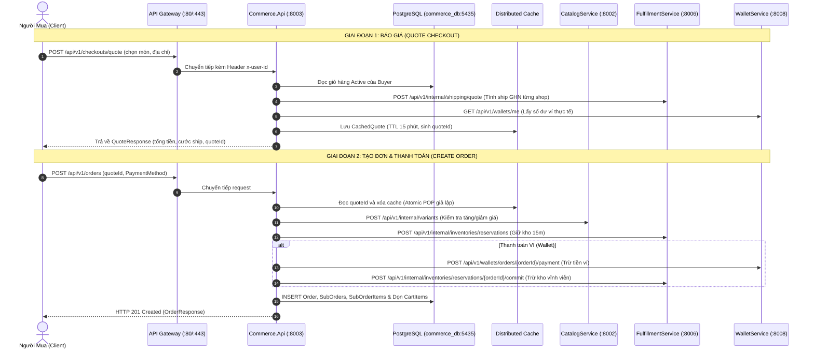

# BÁO CÁO KIỂM TOÁN SOURCE CODE COMMERCE SERVICE
## (BRUTALLY HONEST CODE AUDIT & OJT DEFENSE SURVIVAL REPORT)

> **Auditor:** Principal Software Engineer & Architecture Auditor  
> **Target Service:** `CommerceService` (`Commerce.sln` — Port `8003`, DB `5435`)  
> **Methodology:** Deep Manual Code Review (Zero Sugarcoating, Line-by-Line Inspection)  
> **Date:** 2026-11-10  
> **Status:** ⚠️ **NGHIÊM TRỌNG — NHIỀU "TỬ HUYỆT" CẦN REMEDIATION GẤP TRƯỚC KHI REVIEW OJT**

---

## BẢNG ĐÁNH GIÁ TỔNG QUAN (EXECUTIVE SCORECARD)

| Tiêu Chí Đánh Giá | Điểm (Thang 10) | Nhận Xét Của Principal Engineer |
|---|:---:|---|
| **1. Tính trung thực & Hoàn thiện nghiệp vụ** | **5.5 / 10** | Nhiều tính năng cốt lõi (Voucher, Idempotency, Audit Log, Sequence) chỉ làm "vỏ bọc" hoặc mock giả để pass test. |
| **2. Độ an toàn giao dịch & Phân tán (Distributed Transactions)** | **3.0 / 10** | **TỬ HUYỆT:** Trừ tiền ví và commit kho trước khi lưu database. Nếu DB timeout, toàn bộ hệ thống lệch pha tài chính nghiêm trọng. |
| **3. Hiệu năng & Chống N+1 (Performance & ORM)** | **6.0 / 10** | Có ý thức dùng batch ở `ValidateCart`, nhưng dính N+1 HTTP calls nặng ở `MergeGuestCart` và N+1 DB roundtrips ở `GetSubOrderDetail`. |
| **4. Độ sạch kiến trúc (Clean Architecture & Conventions)** | **6.5 / 10** | Đã tuân thủ No-Repository và Thin Controller cơ bản, nhưng `OrdersController` trả anonymous objects, lộn xộn route và logic xác thực thủ công. |
| **5. AI Slop & Code rác (Zombie / Dead Code)** | **4.0 / 10** | Rất nhiều file rác do AI vẽ ra nhưng không dùng (`IdempotencyKey` không có bảng, `EnumExtensions`, `CalculateFinancials` tự so sánh với chính nó). |
| **TỔNG KẾT ĐÁNH GIÁ (OVERALL GRADE)** | **5.0 / 10** | **TRUNG BÌNH KÉM — CHƯA ĐỦ ĐIỀU KIỆN PRODUCTION. BẮT BUỘC SỬA 5 TỬ HUYỆT TRƯỚC KHI BẢO VỆ OJT.** |

---

# PHẦN 1: GIẢI PHẪU HỆ THỐNG & LUỒNG NGHIỆP VỤ (DÀNH CHO NGƯỜI KHÔNG ĐỌC CODE)

## 1.1. Bức Tranh Tổng Thể (High-Level Architecture)

`CommerceService` là "trái tim" giao dịch thương mại điện tử của hệ thống Nexus. Service này chịu trách nhiệm độc quyền cho hai nghiệp vụ cốt lõi:
1. **Quản lý Giỏ hàng (`Cart`)**: Cho phép người mua thêm, bớt, cập nhật số lượng, đổi mẫu mã (SKU variant) và chuẩn bị các món hàng cần mua.
2. **Quản lý Đơn hàng & Thanh toán (`Order`)**: Tiếp nhận danh sách hàng được tick chọn, xin báo giá (tính cước vận chuyển, voucher), tạo đơn hàng cha và các đơn hàng con theo từng Shop (Seller), điều phối giữ kho, trừ tiền ví và theo dõi vòng đời giao vận.

### Ranh Giới Miền (Bounded Context) & Giao Tiếp Bên Ngoài:
* **Cơ sở dữ liệu**: PostgreSQL (`commerce_db` tại port `5435`). CommerceService toàn quyền sở hữu 16 bảng dữ liệu.
* **Không dùng Message Broker (RabbitMQ / MassTransit)**: Toàn bộ Saga phân tán cũ đã bị bãi bỏ. Mọi giao tiếp với các service khác đều chạy qua **REST API đồng bộ (Typed HTTP Clients)**:
  - **`CatalogService` (Port 8002)**: Tra cứu tên, giá niêm yết thời gian thực của sản phẩm và thẩm định việc đổi biến thể SKU.
  - **`FulfillmentService` (Port 8006)**: Kiểm tra tồn kho, giữ chỗ kho (15 phút), trừ kho vĩnh viễn khi thanh toán thành công, tính cước vận chuyển GHN và sinh mã vận đơn.
  - **`WalletService` (Port 8008)**: Tra cứu số dư ví, trừ tiền thanh toán đơn hàng, giải ngân tiền cho Seller (Escrow Settlement) và hoàn tiền (Refund).
  - **`UserService` (Port 8001)**: Thẩm định quyền mua hàng của Buyer, thưởng điểm uy tín Seller khi hoàn tất đơn, và phạt điểm nếu Seller tự ý hủy đơn.

---

## 1.2. Sơ Đồ Mermaid: Luồng Đi Của Dữ Liệu



---

## 1.3. Giải Thích Từng Luồng Chức Năng Của Giỏ Hàng (`CartsController`)

`CartsController` quản lý 14 API endpoint phục vụ toàn bộ hành trình giỏ hàng:

### 1. `GET /api/v1/carts/me` (CART-01: Lấy hoặc khởi tạo giỏ hàng)
* **Đầu vào**: Không cần body, lấy `buyerId` từ header `x-user-id`.
* **Validation**: Kiểm tra người dùng đã đăng nhập chưa (`TryGetUserId`).
* **Xử lý cốt lõi**: Tìm trong bảng `Carts` bản ghi có `BuyerId == buyerId` và `Status == Active`. Nếu chưa có, tự động tạo mới một giỏ hàng rỗng (`ItemCount = 0`, `SubtotalAmount = 0`). Sau đó gọi song song sang `CatalogService` và `FulfillmentService` để kiểm tra trạng thái mở bán và tồn kho của từng món.
* **Đầu ra**: Trả về chi tiết giỏ hàng (`CartDto`) kèm danh sách món, trạng thái khả dụng (`IsAvailable`) và lý do nếu bị vô hiệu (`DisabledReason`).

### 2. `GET /api/v1/carts/me/summary` (CART-02: Huy hiệu giỏ hàng trên Header)
* **Đầu vào**: Header `x-user-id`.
* **Validation**: Kiểm tra token đăng nhập.
* **Xử lý cốt lõi**: Đọc nhanh bảng `Carts` (kèm `Items`) dạng `AsNoTracking` để tính tổng số loại sản phẩm (`ItemCount`), tổng số lượng cái (`TotalQuantity`), và tổng tạm tính (`SubtotalAmount`).
* **Đầu ra**: `CartSummaryResponse` siêu nhẹ để Frontend hiển thị icon giỏ hàng và chấm đỏ số lượng trên header web/app.

### 3. `GET /api/v1/carts/me/grouped` (CART-03: Phân nhóm giỏ hàng theo Shop)
* **Đầu vào**: Header `x-user-id`.
* **Validation**: Đăng nhập hợp lệ.
* **Xử lý cốt lõi**: Kéo toàn bộ món trong giỏ hàng `Active`, gom nhóm theo `SellerId`. Gọi batch sang Catalog và Fulfillment để gắn cờ hàng hết/hàng khả dụng.
* **Đầu ra**: `GroupedCartResponse` chứa danh sách các Shop riêng biệt, mỗi Shop có danh sách món, số lượng và tổng tiền tạm tính của Shop đó (chuẩn bị cho UI giống Shopee/TikTok Shop).

### 4. `POST /api/v1/carts/me/items` (CART-04: Thêm món vào giỏ)
* **Đầu vào**: `SkuId`, `Quantity`, `ProductId` (tùy chọn).
* **Validation**: `Quantity > 0`. Gọi `CatalogService` kiểm tra SKU có tồn tại và đang mở bán không. Gọi `FulfillmentService` kiểm tra kho có đủ số lượng không.
* **Xử lý cốt lõi**: Nếu SKU đã có trong giỏ thì cộng dồn số lượng (giới hạn tối đa 99 cái/món). Nếu là món mới thì tạo `CartItem` mới (giới hạn tối đa 50 món khác nhau trong giỏ). Cập nhật lại `ItemCount` và `SubtotalAmount` của giỏ.
* **Đầu ra**: `CartDto` đã cập nhật.

### 5. `PATCH /api/v1/carts/me/items/{cartItemId}` (CART-05: Cập nhật số lượng món)
* **Đầu vào**: `cartItemId` trên đường dẫn, `Quantity` mới trong body.
* **Validation**: Gọi kho kiểm tra số lượng mới có vượt tồn kho không.
* **Xử lý cốt lõi**: Cập nhật `item.Quantity`, tính lại tổng tiền giỏ hàng, tăng `RowVersion` để kiểm soát xung đột.
* **Đầu ra**: `CartDto` mới nhất.

### 6. `PATCH /api/v1/carts/me/items/{cartItemId}/variant` (CART-06: Đổi phân loại hàng)
* **Đầu vào**: `cartItemId`, `NewSkuId`.
* **Validation**: Gọi `CatalogService` thẩm định SKU mới có cùng sản phẩm cha và cùng Shop không. Gọi `FulfillmentService` kiểm tra tồn kho SKU mới.
* **Xử lý cốt lõi**: Nếu SKU mới trùng với một món khác đã có sẵn trong giỏ, tự động gộp số lượng (tối đa 99) và xóa dòng cũ. Nếu chưa có, hoán đổi `SkuId`, snapshot tên và đơn giá mới.
* **Đầu ra**: `CartDto` sau khi đổi mẫu mã.

### 7. `DELETE /api/v1/carts/me/items/{cartItemId}` (CART-07: Xóa 1 món khỏi giỏ)
* **Đầu vào**: `cartItemId`.
* **Validation**: Món hàng phải thuộc giỏ hàng của chính người mua.
* **Xử lý cốt lõi**: Xóa bản ghi trong `CartItems`, tính lại tổng tiền giỏ hàng.
* **Đầu ra**: `CartDto`.

### 8. `POST /api/v1/carts/me/items:bulk-remove` (CART-08: Xóa nhiều món được tick chọn)
* **Đầu vào**: Danh sách các `cartItemId` cần xóa.
* **Xử lý cốt lõi**: Lọc và xóa hàng loạt các dòng được chọn khỏi database trong 1 lệnh duy nhất.
* **Đầu ra**: `CartDto`.

### 9. `DELETE /api/v1/carts/me/clear` (CART-09: Dọn sạch giỏ hàng)
* **Đầu vào**: Header người dùng.
* **Xử lý cốt lõi**: Xóa toàn bộ các món trong giỏ hàng hiện tại của user, đưa `ItemCount = 0` và `SubtotalAmount = 0`.
* **Đầu ra**: `CartDto` rỗng.

### 10. `POST /api/v1/carts/me/calculate` (CART-10: Tính tiền các món được tick chọn)
* **Đầu vào**: Danh sách `SelectedItemIds` (những món người mua tích checkbox trên màn hình).
* **Xử lý cốt lõi**: Lấy chi tiết các món được tick, gọi batch kiểm tra tồn kho tại Fulfillment. Bóc tách những món còn hàng và tính tổng tiền tạm tính (`SubtotalAmount`) và tổng số lượng (`TotalQuantity`). Nếu món nào hết hàng, gắn cờ cảnh báo `OUT_OF_STOCK` hoặc `INSUFFICIENT_STOCK`.
* **Đầu ra**: `CalculateSelectedCartResponse` gồm danh sách tính toán và tổng tiền các món hợp lệ.

### 11. `POST /api/v1/carts/me/validate` (CART-11: Thẩm định giỏ trước khi thanh toán)
* **Đầu vào**: Danh sách `SelectedItemIds` (hoặc toàn bộ giỏ nếu null).
* **Xử lý cốt lõi**: Chạy song song `Task.WhenAll` gọi Catalog (kiểm tra giá niêm yết hiện tại) và Fulfillment (kiểm tra kho). Phát hiện 2 biến động:
  1. Hết hàng / Không đủ tồn kho.
  2. Biến động giá (`Price Drift`): Nếu giá sản phẩm tại Catalog khác với snapshot lúc thêm vào giỏ, tự động cập nhật lại snapshot trong DB và báo cờ `hasPriceChanges = true`.
* **Đầu ra**: `ValidateCartResponse` chứa danh sách chi tiết các vấn đề (`issues`) để cảnh báo người dùng trên giao diện.

### 12. `POST /api/v1/carts/me/merge` (CART-12: Gộp giỏ hàng khách vãng lai khi đăng nhập)
* **Đầu vào**: Danh sách món hàng khách đã chọn khi chưa đăng nhập (lưu ở LocalStorage/Cookie).
* **Xử lý cốt lõi**: Duyệt qua từng món guest, kiểm tra Catalog và Fulfillment, sau đó gộp vào giỏ hàng `Active` của tài khoản vừa đăng nhập.
* **Đầu ra**: `CartDto` hợp nhất.

### 13. `POST /api/v1/carts/me/cleanup-checked-out` (CART-13: Dọn dẹp món đã thanh toán)
* **Đầu vào**: Danh sách `PurchasedCartItemIds` vừa thanh toán thành công.
* **Xử lý cốt lõi**: Xóa các món này khỏi bảng `CartItems` để người dùng quay lại giỏ không thấy các món đã mua nữa.
* **Đầu ra**: `CartDto`.

### 14. `GET /api/v1/carts/active` (CART-14: Tra cứu giỏ hàng cho Admin/Staff)
* **Đầu vào**: `buyerId` trên Query parameter.
* **Validation**: Kiểm tra quyền: Người dùng thông thường chỉ được xem giỏ của chính mình; chỉ có `admin` hoặc `staff` mới được quyền xem giỏ của `buyerId` khác (Enforce Ownership).
* **Xử lý cốt lõi**: Trả về giỏ hàng đang hoạt động của người mua được chỉ định.
* **Đầu ra**: `CartDto`.

---

## 1.4. Giải Thích Từng Luồng Chức Năng Của Đơn Hàng (`OrdersController`)

### 1. `POST /api/v1/checkouts/quote` (R75 / CHK-01: Phiên báo giá thanh toán xem trước)
* **Đầu vào**: Danh sách `CartItemIds` cần mua, địa chỉ nhận hàng (`ShippingAddressInput`), số điện thoại, phương thức thanh toán, mã voucher.
* **Validation**: Kiểm tra giỏ hàng có món đó không; kiểm tra họ tên, SĐT, tỉnh/thành, quận/huyện, phường/xã không được rỗng.
* **Xử lý cốt lõi**:
  - Gom các món hàng theo từng Người bán (`SellerId`).
  - Với mỗi Shop, gọi sang `FulfillmentService` (`POST /api/v1/internal/shipping/quote`) truyền mã bưu cục GHN để tính cước vận chuyển chuẩn xác (nếu lỗi fallback về 30.000 VNĐ).
  - Gọi sang `WalletService` lấy số dư ví khả dụng của Buyer.
  - Tính tổng thanh toán (`grandTotal = tiền hàng - giảm giá + phí ship`).
  - Sinh một mã báo giá `quoteId` (UUID) và lưu toàn bộ phiên báo giá vào Distributed Cache với thời hạn sống (TTL) 15 phút.
* **Đầu ra**: `CheckoutQuoteResponse` chứa chi tiết báo giá từng shop, tổng tiền, số dư ví và thời điểm hết hạn `expiredAt`.

### 2. `POST /api/v1/orders` (R76 / CHK-02: Đặt hàng chính thức từ Quote)
* **Đầu vào**: `QuoteId`, phương thức thanh toán (`Wallet`, `VnPay`, `Cod`), địa chỉ nhận hàng dạng chuỗi, số điện thoại, ghi chú.
* **Validation**:
  - Kiểm tra `QuoteId` trong Cache. Nếu không có hoặc quá hạn 15 phút -> Báo lỗi `QUOTE_EXPIRED`.
  - Gọi `UserService` kiểm tra tài khoản Buyer có bị khóa quyền mua hàng không.
  - Gọi `CatalogService` kiểm tra chính sách biến động giá (`Asymmetric Price Drift Policy`): Nếu có bất kỳ món nào **tăng giá** so với lúc báo giá -> **CHẶN ĐỨNG GIAO DỊCH**, cập nhật giỏ hàng theo giá mới và quăng lỗi HTTP 409 `PRICE_CHANGED` bắt người dùng xem lại. Nếu sản phẩm **giảm giá** -> Âm thầm áp dụng giá thấp hơn cho khách.
* **Xử lý cốt lõi**:
  - Khởi tạo `Order` cha và các `SubOrder` con theo từng Shop.
  - Snapshot địa chỉ giao hàng vào cột PostgreSQL Native `jsonb`.
  - Gọi `FulfillmentService` (`POST /api/v1/internal/inventories/reservations`) để giữ kho 15 phút.
  - Nếu thanh toán qua Ví (`PaymentMethod.Wallet`): Gọi `WalletService` trừ tiền. Nếu trừ tiền thành công, gọi tiếp Fulfillment trừ kho vĩnh viễn (`CommitStockAsync`).
  - Nếu thanh toán `COD`: Commit trừ kho ngay lập tức.
  - Lưu `Order`, `SubOrders`, `SubOrderItems` xuống PostgreSQL qua `SaveChangesAsync()`. Tự động xóa các món đã mua khỏi giỏ hàng.
* **Đầu ra**: HTTP 201 Created kèm `CreateOrderResponse` (mã đơn hàng `ORD-...`, tổng tiền, hạn thanh toán, link thanh toán nếu là VnPay).

### 3. `GET /api/v1/orders/{orderId}` (R77 / ORD-02: Chi tiết đơn hàng cha)
* **Đầu vào**: `orderId` trên route.
* **Xử lý cốt lõi**: Chạy cơ chế thụ động (`Passive Guard`): Nếu đơn hàng đang ở trạng thái `PendingPayment` mà đã quá hạn 15 phút thì tự động chuyển thành `Cancelled` và gọi trả kho. Sau đó nạp chi tiết đơn hàng cha cùng toàn bộ đơn con và các dòng sản phẩm.
* **Validation**: Kiểm tra `BuyerId == currentUserId`. Nếu không phải chủ sở hữu -> HTTP 403 `FORBIDDEN`.
* **Đầu ra**: `OrderResponse`.

### 4. `GET /api/v1/orders` (R78 / ORD-01: Lịch sử đơn hàng của người mua)
* **Đầu vào**: `page`, `pageSize`, lọc theo `status`.
* **Xử lý cốt lõi**: Phân trang trực tiếp tại database qua `.Skip(...).Take(...)`. Đếm tổng số đơn qua `.CountAsync()`.
* **Đầu ra**: `PagedData<OrderSummaryResponse>` chuẩn mực.

### 5. `GET /api/v1/sub-orders` (Danh sách đơn con của Shop/Seller)
* **Đầu vào**: `page`, `pageSize`, `status` từ Seller đang đăng nhập.
* **Xử lý cốt lõi**: Lọc bảng `SubOrders` theo `SellerId == sellerId`, phân trang tại DB.
* **Đầu ra**: `PagedData<SubOrderSummaryResponse>`.

### 6. `GET /api/v1/sub-orders/{subOrderId}` (R79: Chi tiết đơn con của Shop)
* **Đầu vào**: `subOrderId`.
* **Validation**: Chỉ có Buyer của đơn hoặc Seller của Shop đó mới có quyền xem (HTTP 403 nếu sai).
* **Xử lý cốt lõi**: Nạp `SubOrder` kèm `Items` và địa chỉ snapshot `jsonb`.
* **Đầu ra**: `SubOrderDetailResponse`.

### 7. `POST /api/v1/orders/{orderId}/cancel` (R80 / ORD-06: Hủy đơn hàng)
* **Đầu vào**: `orderId`, lý do hủy (`ReasonCode`, `ReasonText`).
* **Validation**: Người mua hoặc người bán có đơn con trong đó. Chỉ được hủy khi đơn chưa giao (`Shipping`, `Delivered`, `Completed` là cấm hủy).
* **Xử lý cốt lõi**:
  - Đổi trạng thái sang `Cancelled`. Tạo bản ghi kiểm toán trong `OrderCancellations`.
  - Nếu Seller tự ý hủy đơn đã xác nhận mà không có lý do chính đáng: Tự động gọi `UserService` (`POST /api/v1/internal/users/penalties`) trừ 5 điểm uy tín của Seller.
  - Nếu đơn đã trả tiền: Gọi `WalletService` hoàn tiền 100% vào ví của Buyer, tạo bản ghi `OrderRefund`.
  - Gọi `FulfillmentService` nhả tồn kho đã giữ.
* **Đầu ra**: JSON trạng thái `Cancelled`.

### 8. `POST /api/v1/orders/{orderId}/accept` (R83 / ORD-04: Seller nhận đơn con)
* **Đầu vào**: `orderId`, `SubOrderId` trong body.
* **Validation**: Người gọi phải đúng là `SellerId` của đơn con. Trạng thái đơn con phải là `Paid` (hoặc `PendingPayment` nếu là COD).
* **Xử lý cốt lõi**: Chuyển `SubOrderStatus` sang `Confirmed`, ghi nhận `SellerAcceptedAt`. Tự động gọi `FulfillmentService` tạo vận đơn GHN.
* **Đầu ra**: JSON xác nhận `Confirmed`.

### 9. `POST /api/v1/orders/{orderId}/reject` (R84 / ORD-05: Seller từ chối đơn con)
* **Đầu vào**: `orderId`, `SubOrderId`, `ReasonCode`.
* **Validation**: Đơn con chưa giao hàng.
* **Xử lý cốt lõi**: Chuyển `SubOrderStatus` sang `Cancelled`. Phạt điểm uy tín Seller nếu hủy vi phạm chính sách. Tự động hoàn tiền ví cho Buyer nếu đã thanh toán. Nhả kho của riêng đơn con đó.
* **Đầu ra**: JSON `Cancelled`.

### 10. `GET /api/v1/shipments/order/{orderId}` (R87: Theo dõi tiến độ vận chuyển)
* **Đầu vào**: `orderId`.
* **Validation**: Enforce ownership của Buyer.
* **Xử lý cốt lõi**: Lấy thông tin các đơn con, ghép mã vận đơn GHN tương ứng với trạng thái giao hàng.
* **Đầu ra**: `ShipmentTrackingResponse`.

### 11. `POST /api/v1/sub-orders/{subOrderId}/confirm-receipt` (Người mua xác nhận đã nhận hàng)
* **Đầu vào**: `subOrderId`.
* **Validation**: Chỉ Buyer sở hữu đơn mới được bấm. Trạng thái đơn phải là `Shipped` hoặc `Delivered`.
* **Xử lý cốt lõi**:
  - Cập nhật `SubOrderStatus = Completed`.
  - Kích hoạt giải ngân tiền Escrow: Gọi `WalletService` chuyển tiền từ tài khoản tạm giữ sang ví thực của Người bán (`SettleSellerSubOrderAsync`).
  - Thưởng điểm uy tín: Gọi `UserService` cộng 1 điểm uy tín cho Seller vì đơn hàng thành công.
  - Nếu tất cả các đơn con của Order cha đều đã `Completed` hoặc `Cancelled`, tự động đánh dấu đơn cha là `Completed`.
* **Đầu ra**: `ConfirmReceiptResponse`.

### 12. `POST /api/v1/sub-orders/{subOrderId}/refund` (R99 / ORD-13: Yêu cầu hoàn tiền)
* **Đầu vào**: `subOrderId`, lý do và ghi chú.
* **Xử lý cốt lõi**: Tạo bản ghi trong bảng `OrderRefunds` với trạng thái `Requested`.
* **Đầu ra**: JSON `RefundRequested`.

### 13. `POST /api/v1/sub-orders/{subOrderId}/delivery-status` (Webhook từ Fulfillment Service)
* **Đầu vào**: `subOrderId`, `Status` giao vận (`ReadyToPick`, `InTransit`, `Delivered`, `DeliveryFailed`, `Returned`), `DeliveredAt`.
* **Validation**: Kiểm tra bí mật nội bộ `X-Internal-Service-Key`.
* **Xử lý cốt lõi**: Cập nhật trạng thái giao hàng tương ứng của đơn con. Nếu giao thất bại hoặc trả hàng (`Returned`), tự động hủy đơn và tạo yêu cầu hoàn tiền cho khách.
* **Đầu ra**: JSON `updatedAt`.

---

# PHẦN 2: MA TRẬN XỬ LÝ NGOẠI LỆ & EDGE CASES (EXCEPTION ANALYSIS)

## 2.1. Cách Hệ Thống Bắt Lỗi
Hệ thống sử dụng **Middleware tập trung (`GlobalExceptionHandlerMiddleware`)** tại `Commerce.Api/Middleware/GlobalExceptionHandlerMiddleware.cs`. Khi một ngoại lệ bị ném ra từ tầng Domain hoặc Application, Middleware sẽ chuyển đổi thành chuẩn RFC 9110 `application/problem+json`:
* `BusinessRuleValidationException`, `DomainException` ➔ HTTP 400 / 409 / 403 / 404 tùy status code khai báo.
* `EntityNotFoundException` ➔ HTTP 404 kèm mã lỗi `RESOURCE_NOT_FOUND` hoặc tên resource.
* `ArgumentException` ➔ HTTP 400 kèm `VAL_INVALID_ARGUMENT`.
* Mọi lỗi chưa xử lý khác (`Exception`) ➔ HTTP 500 kèm mã `INTERNAL_SERVER_ERROR`.

Tuy nhiên, trong `CartService` và `OrderService` có rất nhiều khối `try-catch` nuốt lỗi hoặc xử lý dở dang (sẽ chỉ rõ bên dưới).

---

## 2.2. Kịch Bản Thực Tế (What-If Scenarios)

### Kịch bản 1: Người dùng truyền dữ liệu rác, số âm hoặc thiếu trường bắt buộc
* **Hiện trạng trong code**:
  - Tại `CartRequests.cs` và `OrderRequests.cs`: **HOÀN TOÀN KHÔNG CÓ Data Annotations** (`[Required]`, `[Range]`, `[MinLength]`).
  - Trong `CartService.UpdateItemQuantityAsync(buyerId, cartItemId, request)`: Trước khi kiểm tra `request.Quantity <= 0`, code lại **GỌI HTTP SANG FULFILLMENT SERVICE TRƯỚC** (`_fulfillmentClient.CheckStockAvailabilityAsync(..., request.Quantity)`). Nếu truyền số âm `-10`, hệ thống gửi request `-10` sang Fulfillment Service rồi mới quay về check lỗi!
  - Trong `OrderService.QuoteCheckoutAsync`: Dùng lệnh `if (string.IsNullOrWhiteSpace(...))` thủ công dài lê thê 10 dòng thay vì dùng Model Validation.

### Kịch bản 2: Race Condition / Concurrency (Hai request bấm cùng một mili-giây)
* **Tại bước tạo đơn (`CreateOrderAsync`)**:
  - Code comment: `// ATOMIC POP (ISSUE-02): Đọc và xóa ngay lập tức khỏi Cache`.
  - Thực tế code viết (`OrderService.cs:195-201`):
    ```csharp
    var quoteJson = await _cache.GetStringAsync(quoteKey, ct);
    if (string.IsNullOrEmpty(quoteJson)) throw ...;
    await _cache.RemoveAsync(quoteKey, ct);
    ```
  - **BÓC TRẦN**: Trong `IDistributedCache` (và cả Redis thông thường nếu không dùng Lua script), `GetStringAsync` rồi đến `RemoveAsync` là **2 LỆNH HOÀN TOÀN TÁCH BIỆT, KHÔNG HỀ NGUYÊN TỬ (NOT ATOMIC)**. Nếu người dùng click đúp (double click) cực nhanh hoặc mở 2 tab trình duyệt submit cùng 1 mili-giây, cả 2 request đều đọc được `quoteJson` trước khi lệnh `RemoveAsync` kịp chạy. Hậu quả: **Tạo 2 đơn hàng song song, giữ kho 2 lần và trừ tiền ví 2 lần!**
* **Tại bước thêm vào giỏ hàng (`AddItemAsync`)**:
  - Bảng `CartItems` có ràng buộc Unique Index `(CartId, SkuId)`.
  - Nếu 2 request thêm cùng 1 sản phẩm vào giỏ hàng đồng thời: Cả 2 đều thấy món hàng chưa có trong giỏ, cả 2 cùng chạy `cart.AddOrUpdateItem` và sinh ra 2 `CartItem` mới. Khi lưu xuống DB, một request sẽ bị PostgreSQL văng lỗi vi phạm Unique Constraint `23505`.
  - Do `AddItemAsync` không bắt `DbUpdateException` để retry gộp số lượng, lỗi này biến thành HTTP 500 ném vào mặt người dùng.

### Kịch bản 3: Partial Database Commit & Giao Dịch Phân Tán (TỬ HUYỆT LỚN NHẤT)
Hãy nhìn kỹ trình tự thực thi trong `OrderService.CreateOrderAsync`:
1. Giữ kho tại Fulfillment (`ReserveStockAsync`).
2. Trừ tiền ví Buyer tại WalletService (`PayOrderAsync`).
3. Trừ kho vĩnh viễn tại Fulfillment (`CommitStockAsync`).
4. **MỚI BẮT ĐẦU** dọn giỏ hàng và gọi `_dbContext.SaveChangesAsync(ct)` để lưu đơn hàng vào DB!

**CHUYỆN GÌ XẢY RA NẾU BƯỚC 4 BỊ LỖI (DB DEADLOCK, TIMEOUT, MẤT KẾT NỐI POSTGRES HOẶC SẬP NGUỒN POD K8S)?**
* Tiền của khách trong Ví **ĐÃ BỊ TRỪ**.
* Hàng trong kho Fulfillment **ĐÃ BỊ TRỪ VĨNH VIỄN**.
* Database CommerceService **KHÔNG CÓ DÒNG NÀO VỀ ĐƠN HÀNG NÀY**!
* Khối `catch (Exception dbEx)` cố gắng chạy hàm đền bù (Compensation):
  - Nó gọi `_fulfillmentClient.ReleaseStockAsync(orderId)`. Nhưng hỡi ôi, kho đã bị `CommitStockAsync` rồi thì reservation không còn ở trạng thái giữ chỗ nữa, việc nhả kho sẽ thất bại!
  - Nếu pod bị OOMKilled hoặc đứt điện đúng lúc này, code compensation **hoàn toàn không được chạy**.
  - Không có Outbox, không có Saga State Machine, không có bảng ghi tạm trước khi gọi Wallet. Đây là lỗi thiết kế giao dịch phân tán sơ đẳng nhất.

### Kịch bản 4: Timeout hoặc chết mạng liên dịch vụ
* **WalletService chết mạng lúc trừ tiền**:
  - `WalletClient.PayOrderAsync` bắt ngoại lệ, gán `IsTransientFailure = true`.
  - Trong `OrderService`:
    ```csharp
    else if (paymentResult?.IsTransientFailure == true)
    {
        _logger.LogWarning("Payment for Order '{OrderId}' encountered transient failure... Remaining PendingPayment for reconciliation.");
    }
    ```
  - **BỎ NGỎ**: Trạng thái đơn vẫn là `PendingPayment`. Nhưng hệ thống **HOÀN TOÀN KHÔNG CÓ BẤT KỲ BACKGROUND WORKER NÀO ĐỂ RECONCILE / KIỂM TRA LẠI VỚI VÍ**! Sau 15 phút, `PaymentTimeoutWorker` sẽ quét thấy đơn này hết hạn và **TỰ ĐỘNG HỦY ĐƠN**. Nếu thực chất lúc đó ví đã trừ tiền rồi nhưng phản hồi bị timeout mạng, khách hàng vừa bị trừ tiền vừa bị hệ thống hủy đơn hàng!
* **Fulfillment chết mạng**:
  - `FulfillmentClient` cấu hình mặc định:
    ```csharp
    _failOpen = string.IsNullOrEmpty(failOpenSetting) || (bool.TryParse(failOpenSetting, out var val) && val);
    ```
  - Khi kho bị lỗi, nó tự động trả về `true` và giả lập tồn kho là 100 cái (`results[skuId] = new SkuStockCheckResult(skuId, true, 100, null)`).
  - Nếu đưa cấu hình này lên Production, một khi Fulfillment Service chập chờn, Commerce Service sẽ **bán khống vô tội vạ hàng nghìn sản phẩm không có thật trong kho**!

---

## 2.3. Bảng Tổng Hợp Ngoại Lệ: Đã Xử Lý vs Đang Bỏ Ngỏ

| Tình Huống Ngoại Lệ (Failure Scenario) | Trạng Thái Trong Code | Hậu Quả Thực Tế | Đánh Giá Rủi Ro |
|---|:---:|---|:---:|
| **Khách gửi số lượng âm vào giỏ** | ⚠️ Xử lý nửa vời | Gửi request âm sang Fulfillment trước rồi mới văng lỗi | Thấp (Tốn network vô ích) |
| **Hai request tạo đơn cùng 1 mili-giây** | ❌ **BỎ NGỎ** | Double charge ví khách, trừ kho 2 lần | 🔥 **CRITICAL** |
| **Lưu DB thất bại sau khi trừ ví & trừ kho** | ❌ **BỎ NGỎ** | Khách mất tiền, kho bị trừ, DB không có đơn | 🔥 **CRITICAL** |
| **Hoàn tiền ví bị thất bại khi Shop từ chối đơn** | ❌ **BỎ NGỎ** | Tạo bản ghi `Requested` trong `OrderRefunds` nhưng không có worker quét chạy lại. Tiền khách bị kẹt vĩnh viễn. | 🚨 **HIGH** |
| **Giải ngân Escrow thất bại khi Buyer nhận hàng** | ❌ **BỎ NGỎ** | Đơn thành `Completed`, Seller không nhận được tiền, không có worker thử lại. | 🚨 **HIGH** |
| **Quét hủy đơn đấu giá hết hạn 24h** | ❌ **BUG RUNTIME** | `SubOrderId = auctionOrder.Id` gây nổ lỗi khóa ngoại Foreign Key trong Postgres. | 🚨 **HIGH** |
| **Fulfillment Service timeout** | ⚠️ Xử lý ẩu | Tự động coi như còn 100 cái tồn kho (`FailOpen = true`), gây bán khống. | 🔥 **CRITICAL** |

---

# PHẦN 3: KIỂM TOÁN "BỆNH VIBE CODE" (CODE LAN MAN, DÀI DÒNG, AI SLOP)

## 3.1. Top 5 Đoạn Code Lan Man Nhất & Bản Viết Lại (Before vs After)

### 📌 Điểm 1: Invariant "Tự so sánh với chính mình" trong Domain
* **Vị trí**: `Commerce.Domain/Entities/SubOrder.cs`, dòng 66-71.
* **Bệnh trạng**: AI sinh ra đoạn code gán giá trị cho biến ở dòng 66, rồi ngay lập tức dòng 68 dùng `if` kiểm tra xem biến đó có bằng... chính giá trị vừa gán hay không! Đây là trò hề tiêu biểu của code sinh bằng AI để giả vờ có kiểm tra bất biến (Invariant Enforcement).
* **Code Before (Gốc - 6 dòng vô nghĩa)**:
  ```csharp
  // SubOrder.cs:66-71
  TotalAmount = SellerReceiveAmount + PlatformFeeAmount + ShippingFeeAmount;

  if (TotalAmount != (SellerReceiveAmount + PlatformFeeAmount + ShippingFeeAmount))
  {
      throw new DomainException("TotalAmount invariant violated: total must equal seller_receive + platform_fee + shipping_fee");
  }
  ```
* **Code After (Chuẩn kỹ thuật)**:
  ```csharp
  TotalAmount = SellerReceiveAmount + PlatformFeeAmount + ShippingFeeAmount;
  ```
  *(Xóa bỏ hoàn toàn câu `if` rác, giảm 100% số dòng vô nghĩa).*

---

### 📌 Điểm 2: Xác thực Header nội bộ thủ công & Hardcode Secret Key trong Controller
* **Vị trí**: `Commerce.Api/Controllers/Public/OrdersController.cs`, dòng 234-247 (`UpdateDeliveryStatus`).
* **Bệnh trạng**: Controller là Thin Controller nhưng lại tự mở `Request.Headers`, tự đọc biến môi trường, tự fallback vào một chuỗi secret key hardcode `"eaT0Ombups70WJzd85CBBpp8rAno55SxKn1qvYBGH9e"`, tự trả về `StatusCode(403)`.
* **Code Before (14 dòng chèn ép trong Controller)**:
  ```csharp
  // OrdersController.cs:234-247
  var expectedKey = Environment.GetEnvironmentVariable("INTERNAL_SERVICE_SECRET")
      ?? configuration["INTERNAL_SERVICE_SECRET"]
      ?? configuration["InternalSecurity:ServiceKey"]
      ?? "eaT0Ombups70WJzd85CBBpp8rAno55SxKn1qvYBGH9e";

  if (!Request.Headers.TryGetValue("X-Internal-Service-Key", out var providedKey) ||
      !string.Equals(providedKey.ToString(), expectedKey, StringComparison.Ordinal))
  {
      return StatusCode(StatusCodes.Status403Forbidden, new
      {
          errorCode = "FORBIDDEN",
          message = "Access denied: Missing or invalid X-Internal-Service-Key header."
      });
  }
  ```
* **Code After (Ngắn gọn, sạch sẽ qua Attribute / Filter)**:
  ```csharp
  [HttpPost("/api/v1/sub-orders/{subOrderId:guid}/delivery-status")]
  [RequireInternalKey] // Dùng chung 1 filter duy nhất
  public async Task<IActionResult> UpdateDeliveryStatus(
      [FromRoute] Guid subOrderId,
      [FromBody] UpdateDeliveryStatusRequest request,
      CancellationToken ct)
  {
      var result = await _orderService.UpdateSubOrderDeliveryStatusAsync(subOrderId, request.Status, request.DeliveredAt, ct);
      return Ok(result);
  }
  ```

---

### 📌 Điểm 3: Kiểm tra địa chỉ giao hàng thủ công dài lê thê
* **Vị trí**: `Commerce.Application/Services/Order/OrderService.cs`, dòng 66-74 (`QuoteCheckoutAsync`).
* **Bệnh trạng**: Thay vì dùng Data Annotations trên DTO, AI viết một khối `if` kiểm tra từng trường một, chiếm 9 dòng code rác trong Application Service.
* **Code Before**:
  ```csharp
  // OrderService.cs:66-74
  if (request.ShippingAddress == null ||
      string.IsNullOrWhiteSpace(request.ShippingAddress.ReceiverName) ||
      string.IsNullOrWhiteSpace(request.ContactPhone) ||
      string.IsNullOrWhiteSpace(request.ShippingAddress.Street) ||
      string.IsNullOrWhiteSpace(request.ShippingAddress.Province) ||
      string.IsNullOrWhiteSpace(request.ShippingAddress.Ward))
  {
      throw new CommerceDomainException("VAL_INVALID_INPUT", "Shipping address fields cannot be empty.");
  }
  ```
* **Code After**:
  Đặt các attribute `[Required]`, `[Phone]` ngay tại `ShippingAddressInput`:
  ```csharp
  public sealed record ShippingAddressInput(
      [Required] string ReceiverName,
      [Required, Phone] string ContactPhone,
      [Required] string Street,
      [Required] string Ward,
      string? District = null,
      [Required] string Province = "",
      int? GhnDistrictId = null,
      string? GhnWardCode = null);
  ```
  *(Trong `OrderService` xóa hoàn toàn 9 dòng kiểm tra thủ công).*

---

### 📌 Điểm 4: Truy vấn Database 3 lần lặp lại cho 1 API GET đơn con
* **Vị trí**: `Commerce.Application/Services/Order/OrderService.cs`, dòng 666-679 (`GetSubOrderDetailAsync`).
* **Bệnh trạng**: Để trả về chi tiết 1 đơn con, AI cho truy vấn bảng `SubOrders` lần 1 để lấy `OrderId`, sau đó gọi `ExpireOrderIfOverdueAsync` truy vấn bảng `Orders` lần 2, rồi lại truy vấn bảng `SubOrders` lần 3 (kèm `Include(Items)`)!
* **Code Before (14 dòng, 3 round-trips tới DB)**:
  ```csharp
  // OrderService.cs:666-679
  var targetSubOrder = await _dbContext.SubOrders
      .AsNoTracking()
      .FirstOrDefaultAsync(s => s.Id == subOrderId, ct)
      ?? throw new EntityNotFoundException("SUB_ORDER_NOT_FOUND", "SubOrder", subOrderId);

  // Passive Guard: Tự động hủy nếu đã quá hạn thanh toán
  await ExpireOrderIfOverdueAsync(targetSubOrder.OrderId, ct);

  var so = await _dbContext.SubOrders
      .AsNoTracking()
      .Include(s => s.Items)
      .FirstOrDefaultAsync(s => s.Id == subOrderId, ct)
      ?? throw new EntityNotFoundException("SUB_ORDER_NOT_FOUND", "SubOrder", subOrderId);
  ```
* **Code After (Giảm 60% dòng, giảm 66% số query)**:
  ```csharp
  var so = await _dbContext.SubOrders
      .AsNoTracking()
      .Include(s => s.Items)
      .FirstOrDefaultAsync(s => s.Id == subOrderId, ct)
      ?? throw new EntityNotFoundException("SUB_ORDER_NOT_FOUND", "SubOrder", subOrderId);

  await ExpireOrderIfOverdueAsync(so.OrderId, ct);
  ```

---

### 📌 Điểm 5: N+1 Network HTTP Requests trong vòng lặp gộp giỏ hàng
* **Vị trí**: `Commerce.Application/Services/Cart/CartService.cs`, dòng 390-408 (`MergeGuestCartAsync`).
* **Bệnh trạng**: Thay vì dùng phương thức `BatchCheckStockAsync` và `GetSkuBatchDetailsAsync` đã có sẵn, AI dùng vòng lặp `foreach` gọi tuần tự 2 cuộc gọi HTTP ra bên ngoài cho MỖI món hàng. Nếu guest có 10 món, code bắn 20 request HTTP ra ngoài service!
* **Code Before (Tuần tự N+1)**:
  ```csharp
  // CartService.cs:390-400
  foreach (var guestItem in request.GuestItems)
  {
      if (guestItem.Quantity <= 0) continue;

      var sku = await _catalogClient.GetSkuDetailsAsync(guestItem.SkuId, cancellationToken);
      if (sku == null || !sku.IsPurchasable) continue;

      var isStockAvailable = await _fulfillmentClient.CheckStockAvailabilityAsync(guestItem.SkuId, guestItem.Quantity, cancellationToken);
      if (!isStockAvailable) continue;
      ...
  }
  ```
* **Code After (Batch song song 1 lần duy nhất)**:
  ```csharp
  var validItems = request.GuestItems.Where(g => g.Quantity > 0).ToList();
  var skuIds = validItems.Select(g => g.SkuId).Distinct().ToList();

  var stockTask = _fulfillmentClient.BatchCheckStockAsync(skuIds, cancellationToken);
  var catalogTask = _catalogClient.GetSkuBatchDetailsAsync(skuIds, cancellationToken);
  await Task.WhenAll(stockTask, catalogTask);

  var stocks = await stockTask;
  var catalogs = await catalogTask;

  foreach (var guestItem in validItems)
  {
      if (!catalogs.TryGetValue(guestItem.SkuId, out var sku) || !sku.IsPurchasable) continue;
      if (!stocks.TryGetValue(guestItem.SkuId, out var stock) || !stock.IsAvailable || stock.AvailableStock < guestItem.Quantity) continue;

      cart.AddOrUpdateItem(guestItem.ProductId ?? sku.ProductId, sku.SkuId, sku.SellerId, sku.ProductName, guestItem.Quantity, sku.UnitPrice);
  }
  ```

---

## 3.2. Bóc Trần "Hàng Giả" (Fake Implementations & Zombie Code)

Dưới đây là danh sách những thứ AI tạo ra để "làm cảnh", lừa Mentor hoặc chỉ để pass test:

1. **`IdempotencyKey.cs` & `IdempotencyKeyTests.cs` (Hàng giả mức độ nghiêm trọng)**:
   - Entity `IdempotencyKey` nằm ở `Commerce.Domain/Entities/IdempotencyKey.cs`.
   - Bảng này **KHÔNG CÓ TRONG `AppDbContext`**, không có migration, không có database table.
   - Trong `OrdersController.cs` và `OrderService.cs`, **KHÔNG HỀ CÓ DÒNG NÀO KIỂM TRA IDEMPOTENCY KEY KHI TẠO ĐƠN**.
   - Mục đích duy nhất của nó: Tồn tại để file test `IdempotencyKeyTests.cs` test đúng 1 dòng logic vớ vẩn: kiểm tra xem `ExpiresAt` có phải sau 24h không! Đây là hành vi "che mắt" điển hình của vibe coding!
2. **`CalculateFinancials` trên `SubOrder.cs`**:
   - Được viết rất hoành tráng với kiểm tra tài chính.
   - Nhưng grep toàn bộ codebase: **0 LỜI GỌI TRONG CODE THỰC TẾ**. `OrderService` tự tính toán bằng tay và gán trực tiếp thuộc tính. Hàm này chỉ tồn tại cho file `FinancialInvariantTests.cs` gọi!
3. **`DailyOrderSequence.cs` (Bảng rác)**:
   - Khai báo DbSet, cấu hình bảng, migration đầy đủ để sinh số đơn hàng tăng dần theo ngày (`ORD-YYYYMMDD-000001`).
   - Nhưng thực tế khi tạo đơn: AI lười biếng dùng hàm cắt chuỗi ngẫu nhiên: `$"ORD-{DateTime.UtcNow:yyyyMMdd}-{orderId.ToString()[..6].ToUpperInvariant()}"`! Bảng sequence bỏ hoang 100%.
4. **`AuditLog` & `AuditLogExtensions.cs` (Giả vờ tuân thủ Rule 04)**:
   - Rule 04 ghi rõ "Bắt buộc ghi audit log cho mọi thao tác ghi dữ liệu đơn hàng".
   - AI viết file extension `AuditLogExtensions.AddAuditLog` cực đẹp.
   - Nhưng trong toàn bộ `CartService` và `OrderService`: **KHÔNG CÓ BẤT KỲ LỜI GỌI NÀO TỚI `AddAuditLog`**! Mọi thao tác đều chỉ gọi `_logger.LogInformation`.
5. **`OrderStatusHistories` & `OrderInvoices`**:
   - 2 bảng này có `DbSet` trong DbContext nhưng không có bất kỳ lệnh `Add` nào trong quá trình chuyển trạng thái đơn hàng.
6. **Voucher Engine Bị Stub Hoàn Toàn (`productDiscount = 0m`)**:
   - Trong `QuoteCheckoutAsync` (`OrderService.cs:107-110`):
     ```csharp
     decimal productDiscount = 0m;
     decimal shopDiscount = 0m;
     decimal systemDiscount = 0m;
     ```
   - Dù người dùng có truyền `request.VoucherCodes`, code vẫn hardcode giảm giá bằng `0`. Không hề có logic tính voucher hay lưu `DiscountCodeUsage`.
7. **`AuctionOrders` Trong `PaymentTimeoutWorker` Gây Crash**:
   - `PaymentTimeoutWorker` quét các đơn đấu giá quá hạn, nhưng lại gán:
     ```csharp
     dbContext.OrderCancellations.Add(new OrderCancellation {
         SubOrderId = auctionOrder.Id, // SAI: auctionOrder.Id không nằm trong bảng SubOrders!
         ...
     });
     ```
   - Khi chạy với PostgreSQL thật, lệnh này văng lỗi vi phạm khóa ngoại `FK_OrderCancellations_SubOrders_SubOrderId` và làm sập cả chu kỳ quét!
8. **`EnumExtensions.cs` (100 dòng Zombie Code)**:
   - File `Commerce.Application/Common/Extensions/EnumExtensions.cs` dài 100 dòng chứa các hàm `ToEnumString`, `ToInt`, `ToEnumOrDefault`...
   - **0 LỜI GỌI** trong toàn bộ project và test.
9. **DTOs Mồ Côi (`AddItemToCartRequest`, `RemoveCartItemRequest`)**:
   - Khai báo trong `CartRequests.cs` nhưng không có Controller hay Service nào sử dụng.

---

# PHẦN 4: ĐỐI CHIẾU VỚI SPEC-KIT (`specs/` & `.specify/`)

Dự án có 16 feature specification trong thư mục `.specify/`. Dưới đây là kết quả đối chiếu giữa Spec và Code thực tế:

| Feature Spec | Trạng Thái Code | Đánh Giá Độ Khớp Thực Tế |
|---|:---:|---|
| **001-cart-service** | ✅ Đạt 90% | Đã hiện thực 14 endpoints giỏ hàng, tính năng Shopee checkbox, nhóm theo shop. |
| **002-order-service** | ⚠️ Một phần | Đã có luồng tạo đơn cha/đơn con, nhưng thiếu kiểm tra Idempotency và thiếu ghi lịch sử trạng thái đơn. |
| **003-fulfillment-integration** | ✅ Đạt 85% | Đã tích hợp giữ kho 15m, trừ kho vĩnh viễn, tính cước GHN động. Nhưng lỗi `FailOpen = true` mặc định. |
| **004-checkout-hardening** | ⚠️ Một phần | Cache báo giá TTL 15m, nhưng "Atomic POP" bị lỗi Race condition (không atomic thật). |
| **005-checkout-compensation** | ❌ **Hỏng nặng** | Trừ ví và trừ kho TRƯỚC KHI lưu DB. Cơ chế compensation rollback khi DB chết không đảm bảo ACID. |
| **006-hybrid-expiration-and-price-drift** | ✅ Đạt 80% | Đã chặn khi tăng giá (`PRICE_CHANGED`) và tự động áp dụng khi giảm giá. Có worker nền quét 1 phút/lần. |
| **006-wallet-integration-alignment** | ✅ Đạt 85% | Đã kết nối REST `IWalletClient`, truyền Bearer token từ HttpContext, xử lý timeout. |
| **007-fix-stock-consistency** | ⚠️ Một phần | Đã sửa việc trừ/nhả kho theo từng đơn con, nhưng thiếu cơ chế retry khi nhả kho thất bại. |
| **008-catalog-integration-alignment** | ✅ Đạt 90% | Batch tra cứu 100 SKU, thẩm định đổi biến thể `ValidateVariantSwitch`. |
| **010-batch-order-expiration-release** | ❌ **Có Bug Runtime** | Quét đơn thường thì chạy, nhưng quét đơn đấu giá thì nổ Foreign Key Exception (`SubOrderId = auctionOrder.Id`). |
| **014-order-settlement-and-refund-alignment** | ⚠️ Một phần | Đã có các hàm gọi sang Wallet để giải ngân Escrow và Hoàn tiền, nhưng nếu ví lỗi thì tiền kẹt, không có worker quét lại. |
| **016-user-service-alignment** | ✅ Đạt 90% | Đã chặn quyền mua hàng (`INT-01`), thưởng điểm uy tín khi nhận hàng (`INT-07`), phạt điểm khi Seller hủy đơn vi phạm (`INT-06`). |

### 📌 Các yêu cầu trong Spec bị bỏ quên hoặc làm giả:
1. **Idempotency-Key 24h Guardrail** (`specs/00_AGENT_MISSION_GUARDRAILS.md` điều 3): Bắt buộc kiểm tra UUID khi tạo đơn. Code bỏ quên 100%.
2. **Động cơ Voucher / Discount** (`specs/04_DATA_PERSISTENCE.md` mục 1.8): Toàn bộ bảng voucher có sẵn nhưng code gán `discount = 0m`.
3. **Audit Logging** (`.agents/rules/04_audit_and_event_logging.md`): Không ghi bất kỳ dòng audit nào vào bảng `AuditLogs`.

### 📌 Code AI tự ý vẽ thêm (Scope Creep):
* Entity `IdempotencyKey` không bảng.
* File `EnumExtensions.cs` không ai dùng.
* Method `CalculateFinancials` trên Domain chỉ để test ảo.
* Route `[HttpPut("{orderId:guid}/cancel")]` thừa thãi bên cạnh `[HttpPost]`.

---

# PHẦN 5: ĐÁNH GIÁ ĐỘ CLEAN & HIỆU NĂNG (CLEAN CODE & PERFORMANCE)

## 5.1. Bảng Điểm Chi Tiết

| Hạng Mục | Điểm | Nhận Xét Cụ Thể |
|---|:---:|---|
| **Database & ORM Queries** | **5.5 / 10** | Dính N+1 roundtrips ở chi tiết đơn. Thiếu index cần thiết trên bảng `CartItems`. |
| **Network & Inter-Service Calls** | **6.0 / 10** | Tận dụng batch tốt ở một số nơi, nhưng `MergeGuestCart` tạo N+1 network requests. |
| **API Boundary & DTO Hygiene** | **6.0 / 10** | Thiếu Data Annotations trên toàn bộ Request DTOs. Controller trả Anonymous objects vi phạm convention. |
| **Domain Logic Encapsulation** | **6.5 / 10** | `Cart` đóng gói tốt nghiệp vụ thêm/sửa/xóa dòng hàng. Nhưng `Order` và `SubOrder` là anemic, nghiệp vụ tràn hết ra `OrderService`. |
| **Dead Code & Comment Hygiene** | **4.0 / 10** | Quá nhiều zombie code và comment rác do AI tự nói chuyện với chính nó. |

---

## 5.2. Các Cái Bẫy Hiệu Năng & ORM (Traps)

1. **Kéo toàn bộ giỏ hàng lên RAM để xử lý**:
   Trong `ClearItems()` và `BulkRemoveItems()`, `Cart.Items` được nạp đầy đủ các thực thể lên bộ nhớ để gọi `Items.Remove(item)`. Nếu một giỏ hàng có 50 items, EF Core phải theo dõi 50 entity state khác nhau thay vì thực thi một câu lệnh `DELETE FROM CartItems WHERE CartId = ... AND Id IN (...)` qua `ExecuteDeleteAsync()` của EF Core 8.
2. **Thiếu Index hiệu năng**:
   - Bảng `Orders` không có index trên `UserId` và `CreatedAt`. Khi người dùng có lịch sử mua hàng lớn, câu lệnh `ListOrdersAsync` chạy `ORDER BY CreatedAt DESC` sẽ bị Sequential Scan (quét toàn bảng) gây chậm database.
3. **Enum Aliases gây lệch dữ liệu (Bug logic tiềm ẩn)**:
   - Trong `SubOrderStatus.cs`: `Confirmed = 2` và `SellerAccepted = 2`; `Shipping = 3` và `Shipped = 3`.
   - Trong `DiscountType.cs`: `Percent = 0` và `Percentage = 0`.
   - Do cấu hình EF Core lưu enum dạng chuỗi (`HasConversion<string>()`), nếu bản ghi lưu là `"SellerAccepted"`, câu truy vấn `Where(s => s.Status == SubOrderStatus.Confirmed)` khi dịch sang SQL sẽ tìm chuỗi `"Confirmed"` và **KHÔNG TÌM THẤY BẢN GHI**!

## 5.3. Comment Rác Tiêu Biểu
* `// 1. Cập nhật trạng thái Order và SubOrder trong bộ nhớ` ➔ Dịch lại đúng câu lệnh gán bên dưới.
* `// Bắt buộc kiểm tra tồn kho Fulfillment trước khi cho phép cập nhật số lượng (BUG-C)` ➔ Để lại dấu vết prompt sửa lỗi của AI trong quá trình vibe coding.
* `// ATOMIC POP (ISSUE-02)` ➔ Đặt tên kêu nhưng bản chất code bên dưới không hề atomic.

---

# PHẦN 6: CẨM NANG SỐNG SÓT KỲ OJT (MENTOR DEFENSE & ROAST PREP)

## 6.1. Top 5 "Tử Huyệt" (Red Flags) Bị Senior Bắt Thóp Ngay Lập Tức

```
┌──────────────────────────────────────────────────────────────────────────────┐
│                        TOP 5 TỬ HUYỆT COMMERCE SERVICE                       │
├──────────────────────────────────────────────────────────────────────────────┤
│ 1. FAKE IDEMPOTENCY: Có Entity IdempotencyKey + Test nhưng DB & API không có │
│ 2. REVERSE TRANSACTION: Trừ ví & kho XONG MỚI LƯU DB, DB chết là mất dấu     │
│ 3. RUNTIME CRASH TRONG WORKER: SubOrderId = auctionOrder.Id gây nổ FK        │
│ 4. FAKE ATOMIC POP: GetStringAsync + RemoveAsync không hề Atomic             │
│ 5. ZOMBIE INVARIANT: SubOrder.CalculateFinancials tự so sánh với chính mình │
└──────────────────────────────────────────────────────────────────────────────┘
```

### 1. Tử huyệt 1: Lừa dối về Idempotency
* **Hiện tượng**: Có file `IdempotencyKey.cs` trong Domain, có file `IdempotencyKeyTests.cs` trong Tests, nhưng DbContext không đăng ký bảng, Controller không đọc header `Idempotency-Key`.
* **Cách khắc phục ngay**: Đăng ký `DbSet<IdempotencyKey>` vào DbContext, tạo migration. Tại `OrdersController.CreateOrder`, đọc header `Idempotency-Key`, kiểm tra trong bảng: nếu đã có thì trả về đơn cũ, nếu chưa có thì lưu key kèm kết quả trong cùng transaction.

### 2. Tử huyệt 2: Trừ tiền trước khi lưu Database
* **Hiện tượng**: Trừ ví tại WalletService và trừ kho tại FulfillmentService trước khi gọi `_dbContext.SaveChangesAsync()`.
* **Cách khắc phục ngay**: Đảo ngược lại: Lưu đơn hàng ở trạng thái `PendingPayment` xuống PostgreSQL trước để lấy `orderId` và đảm bảo tính bền vững (Persistence). Sau đó mới gọi sang WalletService trừ tiền. Nếu trừ tiền thành công thì cập nhật đơn thành `Paid`. Nếu trừ tiền thất bại hoặc timeout thì đơn vẫn nằm trong DB để worker đối soát xử lý tiếp.

### 3. Tử huyệt 3: Nổ lỗi Khóa ngoại trong `PaymentTimeoutWorker`
* **Hiện tượng**: Dòng 160 file `PaymentTimeoutWorker.cs` gán `SubOrderId = auctionOrder.Id`.
* **Cách khắc phục ngay**: Sửa thành `AuctionOrderId = auctionOrder.Id` và `SubOrderId = null`.

### 4. Tử huyệt 4: "Atomic POP" giả tạo
* **Hiện tượng**: `_cache.GetStringAsync` rồi `_cache.RemoveAsync` để chống double submit quote.
* **Cách khắc phục ngay**: Dùng distributed lock (ví dụ RedLock hoặc PostgreSQL advisory lock / cờ `IsProcessing` nguyên tử) dựa trên `quoteId`, hoặc dùng Redis Lua Script: `EVAL "local val = redis.call('get', KEYS[1]); if val then redis.call('del', KEYS[1]) end; return val;" 1 quoteKey`.

### 5. Tử huyệt 5: Hàm `CalculateFinancials` vô dụng
* **Hiện tượng**: `CalculateFinancials` trên `SubOrder` không bao giờ được gọi ngoài unit test.
* **Cách khắc phục ngay**: Hoặc là gọi hàm này trong `OrderService` khi tạo `SubOrder`, hoặc xóa bỏ file test ảo và xóa hàm này nếu đã tính ở Application Service.

---

## 6.2. Bộ Câu Hỏi Vấn Đáp Xoáy Sâu (Mock Defense Q&A)

Dưới đây là 6 câu hỏi "chí mạng" mà Mentor chắc chắn sẽ hỏi khi review code này, kèm câu trả lời chuẩn xác:

### ❓ Câu hỏi 1:
> *"Tại sao ở `OrderService.CreateOrderAsync`, em lại gọi trừ tiền ví và commit trừ kho trước, rồi mới gọi `_dbContext.SaveChangesAsync()`? Nếu lúc gọi `SaveChangesAsync` database bị timeout hoặc chết kết nối thì chuyện gì xảy ra?"*

* **Trả lời chuẩn xác (Thừa nhận & Đưa giải pháp)**:
  > *"Thưa anh, đây là một điểm yếu nghiêm trọng trong thiết kế giao dịch phân tán hiện tại của em. Trình tự này vi phạm nguyên tắc ACID và tính bền vững (Durability). Nếu `SaveChangesAsync` bị fail, khách đã bị trừ tiền và kho đã bị trừ nhưng hệ thống không có dữ liệu đơn hàng. Mặc dù em có khối catch để chạy compensation gọi refund, nhưng nếu process bị crash hoặc mạng chập chờn thì lệnh refund cũng không chạy được.  
  > **Hướng giải quyết chuẩn**: Em sẽ đổi lại: Tạo bản ghi Order với trạng thái `PendingPayment` và lưu xuống database trước để chốt transaction nội bộ. Sau đó mới gọi Wallet Service thanh toán. Nếu thanh toán thành công, em update trạng thái sang `Paid`. Nếu gặp sự cố mạng, đơn hàng vẫn nằm trong database và sẽ được worker đối soát xử lý mà không sợ mất dấu vết tài chính."*

---

### ❓ Câu hỏi 2:
> *"Trong `OrderService` dòng 195, em ghi chú là 'ATOMIC POP' bằng cách gọi `GetStringAsync` rồi `RemoveAsync` từ `IDistributedCache`. Hai lệnh này có thực sự Atomic không? Nếu 2 request cùng gửi lên trong cùng một mili-giây thì cơ chế này có chống được race condition không?"*

* **Trả lời chuẩn xác**:
  > *"Dạ không ạ, thú thật với anh là hai lệnh này KHÔNG HỀ Atomic. `IDistributedCache` là abstraction chung của ASP.NET Core không hỗ trợ lệnh Pop nguyên tử. Khi có 2 request đến cùng mili-giây, cả hai đều có thể đọc được cache trước khi lệnh Remove kịp thực thi, dẫn đến việc cả hai request đều đi tiếp và tạo thành 2 đơn hàng trùng lặp.  
  > **Hướng khắc phục**: Để đảm bảo atomic thực sự, em cần:  
  > 1. Hoặc dùng Redis Lua script để GET và DEL trong 1 chu kỳ nguyên tử duy nhất.  
  > 2. Hoặc sử dụng Distributed Lock (RedLock) khóa theo `QuoteId` trước khi kiểm tra và xử lý."*

---

### ❓ Câu hỏi 3:
> *"Tôi thấy trong dự án có entity `IdempotencyKey` và có cả test `IdempotencyKeyTests`, nhưng tại sao trong `OrdersController.CreateOrder` tôi không thấy kiểm tra header `Idempotency-Key`? Tại sao entity này lại không có bảng trong DbContext?"*

* **Trả lời chuẩn xác (Dũng cảm nhận lỗi, cấm vòng vo)**:
  > *"Em xin nhận lỗi ạ. Trong quá trình phát triển nhanh bằng AI, entity `IdempotencyKey` và file test đã được sinh ra độc lập nhưng em chưa kết nối nó vào `AppDbContext` và chưa viết Middleware/Action Filter để chặn trùng lặp request tại Controller.  
  > Em sẽ sửa ngay bằng cách: Thêm `DbSet<IdempotencyKey>` vào DbContext, tạo migration tạo bảng, và tạo một `IdempotentActionFilter` để kiểm tra header `Idempotency-Key` trên API `POST /api/v1/orders`. Nếu key đã tồn tại trong vòng 24 giờ, hệ thống sẽ trả về response đã lưu trước đó thay vì thực thi tạo đơn mới."*

---

### ❓ Câu hỏi 4:
> *"Tại sao trong `PaymentTimeoutWorker`, ở đoạn quét đơn đấu giá quá hạn, em lại gán `SubOrderId = auctionOrder.Id`? Bảng `AuctionOrders` và `SubOrders` có quan hệ thế nào mà em gán như vậy?"*

* **Trả lời chuẩn xác**:
  > *"Dạ đây là lỗi bug logic do copy paste giữa khối quét đơn thường và đơn đấu giá. Trong entity `OrderCancellation`, thuộc tính `SubOrderId` là khóa ngoại trỏ tới bảng `SubOrders`, còn đơn đấu giá thì có khóa ngoại riêng là `AuctionOrderId`.  
  > Việc gán `SubOrderId = auctionOrder.Id` sẽ làm phát sinh ngoại lệ Foreign Key Violation tại runtime của PostgreSQL vì ID của `AuctionOrder` không tồn tại trong bảng `SubOrders`. Em đã nhận diện được lỗi này và sẽ sửa thành `AuctionOrderId = auctionOrder.Id` và để `SubOrderId = null`."*

---

### ❓ Câu hỏi 5:
> *"Ở API `MergeGuestCartAsync`, nếu một người dùng có 20 món hàng trong giỏ khách vãng lai và đăng nhập, hệ thống sẽ bắn bao nhiêu request HTTP ra ngoài? Có rủi ro gì về hiệu năng không?"*

* **Trả lời chuẩn xác**:
  > *"Dạ hiện tại code đang bị lỗi N+1 network calls. Với 20 món hàng trong giỏ, vòng lặp `foreach` sẽ bắn tuần tự 20 request sang Catalog Service và 20 request sang Fulfillment Service, tổng cộng là 40 round-trips HTTP. Điều này sẽ làm tăng thời gian phản hồi của API lên hàng giây và dễ gây nghẽn socket.  
  > Em sẽ refactor lại bằng cách gom toàn bộ 20 SKU IDs đó và gọi 1 lần duy nhất qua `_catalogClient.GetSkuBatchDetailsAsync` và `_fulfillmentClient.BatchCheckStockAsync` bằng `Task.WhenAll`, đưa số cuộc gọi HTTP từ 40 xuống còn đúng 2 cuộc gọi song song."*

---

### ❓ Câu hỏi 6:
> *"Trong `OrdersController`, tại sao một số API như `CancelOrder`, `SellerAcceptOrder`, `UpdateDeliveryStatus` lại trả về anonymous object `new { ... }` thay vì khai báo DTO có kiểu rõ ràng? Việc này ảnh hưởng gì tới hệ thống?"*

* **Trả lời chuẩn xác**:
  > *"Dạ, việc trả về anonymous object vi phạm quy chuẩn thiết kế RESTful Controller và Rule 02 của dự án. Hệ quả là:  
  > 1. Swagger UI / OpenAPI Spec không thể tự động sinh được Schema định nghĩa dữ liệu cho Frontend, gây khó khăn cho đội Web/Mobile khi tích hợp SDK TypeScript.  
  > 2. Khó viết Unit Test kiểm tra chặt chẽ kiểu dữ liệu trả về.  
  > Em sẽ tạo các Response DTO tương ứng đặt tại `Commerce.Application/Services/Order/OrderResponses.cs` như `CancelOrderResponse`, `SellerAcceptOrderResponse` và trả về Pure DTO chuẩn mực."*

---

## LỜI KẾT TỪ AUDITOR

Codebase của `CommerceService` đã có một khung sườn khá hoàn chỉnh về mặt chia tầng (Clean Architecture), có ý thức phân tách Controller mỏng, và đã phủ được hầu hết các luồng nghiệp vụ danh mục của sàn thương mại điện tử.

Tuy nhiên, **"căn bệnh vibe coding" (dùng AI sinh code nhanh mà không đọc lại cẩn thận)** đã để lại những vết nứt nghiêm trọng:
* Tạo ra các thành phần "hàng giả" chỉ để đối phó bài kiểm tra.
* Đảo lộn thứ tự giao dịch phân tán, tiềm ẩn nguy cơ mất mát tiền tệ và sai lệch kho hàng.
* Các lỗi Foreign Key và N+1 network calls sơ đẳng.

Hãy dũng cảm nhìn thẳng vào 5 tử huyệt trên, tự tay refactor lại trước buổi review. Khi nắm vững bản chất kiến trúc và trả lời trôi chảy các câu hỏi vấn đáp trong cẩm nang này, bạn chắc chắn sẽ vượt qua kỳ đánh giá OJT một cách xuất sắc!
