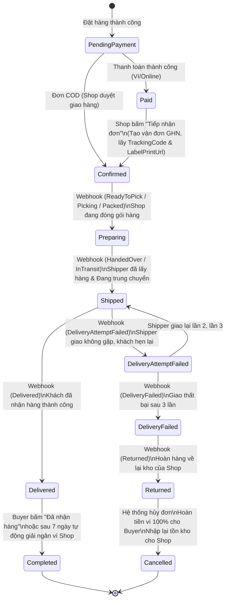

# ĐẶC TẢ NGHIỆP VỤ & HỢP ĐỒNG KỸ THUẬT: HỆ THỐNG GIAO VẬN VÀ THEO DÕI HÀNH TRÌNH ĐƠN HÀNG CHUẨN THỰC TẾ
## REAL-WORLD E-COMMERCE LOGISTICS & SHIPMENT TRACKING SPECIFICATION

> **Dự án:** Nexus Microservices Ecosystem  
> **Service thụ lý:** `CommerceService` (Port `8003`, DB `commerce_db:5435`)  
> **Service đối tác:** `FulfillmentService` (Port `8006`, DB `fulfillment_db`), `WalletService` (Port `8008`)  
> **Hãng vận chuyển đối soát:** Giao Hàng Nhanh (GHN)  
> **Phiên bản:** `v2.0.0-PROPOSED`  
> **Ngày lập:** 2026-11-12  
> **Trạng thái:** 📋 CHỜ PHÊ DUYỆT TRƯỚC KHI TRIỂN KHAI CODE  

---

## 1. MỤC TIÊU KINH DOANH & PHẠM VI NGHIỆP VỤ (BUSINESS CONTEXT & SCOPE)

### 1.1. Bối cảnh
Trong hệ sinh thái thương mại điện tử thực tế (tương tự Shopee, Lazada, TikTok Shop), khâu Giao vận (Logistics/Shipping) là mắt xích kết nối giữa Thế giới số (Digital Order) và Thế giới thực (Physical Package). Hiện tại, phân hệ CommerceService đang gặp một số hạn chế kỹ thuật:
1. **Thiếu lưu trữ định danh vận đơn thật**: Kết quả tạo vận đơn từ `FulfillmentService` (`TrackingCode`, `CarrierCode`, `LabelPrintUrl`) chưa được lưu bền vững vào `SubOrder`, dẫn đến việc hệ thống phải sinh mã vận đơn giả lập (`$"GHN-{so.SubOrderNo}"`).
2. **Mất liên kết nhãn in tem phiếu (`LabelPrintUrl`)**: Người bán (Seller) không thể lấy link tải file in tem phiếu dán thùng hàng sau khi tiếp nhận đơn.
3. **Thiếu dòng thời gian lịch sử hành trình (Tracking Timeline)**: Webhook trạng thái từ hãng vận chuyển gửi sang chưa được ghi nhận đầy đủ vào `OrderStatusHistory`, khiến Buyer/Seller không theo dõi được các mốc di chuyển của kiện hàng.
4. **Chưa đồng bộ trạng thái đơn cha (Master Order State Sync)**: Khi toàn bộ các đơn con của các shop đã giao thành công, đơn cha vẫn bị kẹt ở trạng thái `Paid`.
5. **Khối lượng sản phẩm chưa động hóa**: Cước vận chuyển đang ước lượng bằng khối lượng cố định 200g cho tất cả mặt hàng.
6. **Xử lý sự cố giao hàng chưa phân tầng**: Chưa tách bạch giữa giao thất bại tạm thời (khách hẹn lại lần 2, lần 3) và giao thất bại hoàn hàng dứt khoát (`Returned`).

### 1.2. Mục tiêu đạt được
- 100% dữ liệu vận chuyển là dữ liệu thật từ GHN (không mock, không sinh chuỗi giả).
- Seller lấy được mã vận đơn và link in tem vận chuyển ngay khi bấm "Tiếp nhận đơn".
- Buyer và Seller theo dõi được từng bước di chuyển của gói hàng qua Timeline trực quan.
- Tự động đồng bộ trạng thái đơn cha khi các đơn con hoàn tất.
- Quy trình đối soát hoàn tiền tự động khi giao hàng thất bại hoặc hoàn hàng về shop.

---

## 2. MA TRẬN TRẠNG THÁI & VÒNG ĐỜI GIAO VẬN (SHIPMENT LIFECYCLE STATE MACHINE)



### 2.1. Bảng ánh xạ 9 trạng thái giao vận từ Hãng GHN sang Commerce SubOrder

| STT | Trạng thái GHN / Webhook | Trạng thái SubOrder | Tác động dữ liệu Commerce | Mô tả hiển thị cho Người dùng |
|:---:|:---|:---|:---|:---|
| 1 | `Confirmed` / `Created` | `Confirmed` | Lưu `TrackingCode`, `CarrierCode`, `LabelPrintUrl`. Lưu `SellerAcceptedAt = UtcNow`. | "Người bán đã xác nhận đơn và đang chuẩn bị hàng." |
| 2 | `ReadyToPick` / `Picking` | `Confirmed` | Giữ trạng thái `Confirmed`. Ghi `OrderStatusHistory` mốc chuẩn bị. | "Đơn hàng đang được đóng gói và chờ shipper đến lấy." |
| 3 | `Packed` | `Confirmed` | Cập nhật `UpdatedAt`. Ghi `OrderStatusHistory`. | "Kiện hàng đã sẵn sàng để bàn giao cho đơn vị vận chuyển." |
| 4 | `HandedOver` | `Shipped` | Đổi `Status = Shipped`. Lưu `ShippedAt = UtcNow`. Ghi `OrderStatusHistory`. | "Đơn vị vận chuyển GHN đã tiếp nhận kiện hàng từ Shop." |
| 5 | `InTransit` | `Shipped` | Giữ `Status = Shipped`. Ghi `OrderStatusHistory` kèm địa điểm bưu cục. | "Kiện hàng đang được trung chuyển qua các bưu cục GHN." |
| 6 | `OutForDelivery` | `Shipped` | Ghi `OrderStatusHistory` kèm số điện thoại shipper (nếu có). | "Shipper đang trên đường giao hàng đến địa chỉ của bạn." |
| 7 | `DeliveryAttemptFailed` | `Shipped` | Giữ `Status = Shipped`. Ghi `OrderStatusHistory` lý do khách hẹn lại. | "Giao hàng không thành công lần 1. GHN sẽ liên hệ giao lại." |
| 8 | `Delivered` | `Delivered` | Đổi `Status = Delivered`. Lưu `DeliveredAt = UtcNow`. Kích hoạt nút xác nhận hoàn tất. | "Giao hàng thành công! Vui lòng kiểm tra và bấm 'Đã nhận hàng'." |
| 9 | `DeliveryFailed` / `Returned` | `Cancelled` | Đổi `Status = Cancelled`. Lưu `CancelledAt`. Tạo `OrderCancellation` & `OrderRefund`. | "Giao hàng thất bại sau 3 lần. Đơn hàng được hoàn về người bán." |

---

## 3. THAY ĐỔI MÔ HÌNH DỮ LIỆU (DATA MODEL CHANGES)

### 3.1. Mở rộng Entity `SubOrder`
Bổ sung các trường lưu trữ thông tin vận tải chính thức vào `Commerce.Domain/Entities/SubOrder.cs`:

```csharp
public class SubOrder : BaseEntity<Guid>
{
    // ... các trường tài chính và quan hệ hiện có ...

    /// <summary>Đơn vị vận chuyển (ví dụ: "GHN", "GHTK", "ShopeeExpress").</summary>
    public string? CarrierCode { get; set; }

    /// <summary>Mã vận đơn thật của hãng vận chuyển (ví dụ: "GHN-SGN-1029384").</summary>
    public string? TrackingCode { get; set; }

    /// <summary>Link URL file PDF in phiếu gửi hàng / barcode tem dán thùng.</summary>
    public string? LabelPrintUrl { get; set; }

    /// <summary>Thời gian dự kiến giao hàng do hãng vận chuyển tính toán.</summary>
    public DateTimeOffset? EstimatedDeliveryAt { get; set; }

    /// <summary>Cờ đánh dấu đơn cần tạo lại vận đơn nếu trước đó bị lỗi mạng GHN.</summary>
    public bool ShipmentPendingCreation { get; set; } = false;
}
```

### 3.2. Cấu hình Fluent API (`SubOrderConfiguration.cs`)
```csharp
builder.Property(x => x.CarrierCode).HasMaxLength(50);
builder.Property(x => x.TrackingCode).HasMaxLength(100);
builder.HasIndex(x => x.TrackingCode);
builder.Property(x => x.LabelPrintUrl).HasMaxLength(500);
builder.Property(x => x.EstimatedDeliveryAt);
builder.Property(x => x.ShipmentPendingCreation).HasDefaultValue(false);
```

### 3.3. Dòng thời gian lịch sử vận chuyển (`OrderStatusHistory`)
Kế thừa bảng `OrderStatusHistories` sẵn có để lưu giữ từng event từ webhook:
- `SubOrderId`: Id đơn con.
- `FromStatus`: Trạng thái cũ.
- `ToStatus`: Trạng thái mới.
- `ActorRole`: `OrderActorRole.System`.
- `Reason`: Mô tả chi tiết hành trình (ví dụ: `"Bưu cục GHN Quận 1 tiếp nhận kiện hàng"`).
- `CreatedAt`: Mốc thời gian thực tế xảy ra sự kiện do GHN ghi nhận.

---

## 4. ĐẶC TẢ CHI TIẾT 6 LUỒNG NGHIỆP VỤ CỐT LÕI (DETAILED FLOWS)

### Flow A: Shop Tiếp nhận đơn & Tạo Vận đơn Thật (Seller Order Acceptance)

```mermaid
sequenceDiagram
    autonumber
    actor Seller as Người bán (Shop)
    participant OrdersCtrl as OrdersController
    participant OrderSvc as OrderService
    participant FulClient as FulfillmentClient (8006)
    participant GHN as Hãng GHN API
    participant DB as PostgreSQL (commerce_db)

    Seller->>OrdersCtrl: POST /api/v1/orders/{orderId}/accept (SubOrderId)
    OrdersCtrl->>OrderSvc: SellerAcceptSubOrderAsync(sellerId, orderId, request)
    OrderSvc->>DB: Kiểm tra SubOrder hợp lệ (Status == Paid hoặc COD PendingPayment)
    
    OrderSvc->>FulClient: POST /api/v1/internal/shipments { subOrderId }
    FulClient->>GHN: Gọi API GHN tạo đơn giao vận
    GHN-->>FulClient: Trả về { trackingCode, carrierCode, labelPrintUrl }
    FulClient-->>OrderSvc: ShipmentCreationResult

    alt Tạo vận đơn thành công
        OrderSvc->>DB: Cập nhật: Status = Confirmed, SellerAcceptedAt = UtcNow\nCarrierCode = result.CarrierCode\nTrackingCode = result.TrackingCode\nLabelPrintUrl = result.LabelPrintUrl\nShipmentPendingCreation = false
        OrderSvc->>DB: Ghi nhận OrderStatusHistory (Paid -> Confirmed)
    else Hãng GHN bị nghẽn mạng / Timeout
        OrderSvc->>DB: Cập nhật: Status = Confirmed, SellerAcceptedAt = UtcNow\nShipmentPendingCreation = true
        Note over OrderSvc, DB: Không chặn Shop xác nhận đơn; lưu cờ để Worker thử lại sau
    end

    OrderSvc->>DB: SaveChangesAsync()
    OrderSvc-->>OrdersCtrl: Trả về SellerAcceptOrderResponse kèm TrackingCode & LabelPrintUrl
    OrdersCtrl-->>Seller: HTTP 200 OK (Kèm mã vận đơn và link in phiếu gửi)
```

---

### Flow B: Webhook Inbound Nhận Cập nhật Hành trình từ GHN (Carrier Status Callback)

* **Route tiếp nhận:** `POST /api/v1/sub-orders/{subOrderId}/delivery-status`
* **Xác thực:** Header `X-Internal-Service-Key: eaT0Ombups70WJzd85CBBpp8rAno55SxKn1qvYBGH9e`.
* **Payload từ Fulfillment:**
  ```json
  {
    "status": "InTransit",
    "carrierCode": "GHN",
    "trackingCode": "GHN-SGN-1029384",
    "note": "Kiện hàng đang trung chuyển tại bưu cục Tân Bình",
    "location": "Kho Tân Bình, TP. Hồ Chí Minh",
    "deliveredAt": "2026-11-12T14:30:00Z"
  }
  ```
* **Xử lý tại CommerceService:**
  1. Kiểm tra tồn tại `SubOrder` (hoặc `AuctionOrder`).
  2. Xác định trạng thái mới dựa theo ma trận Mục 2.1.
  3. Ghi nhận bản ghi `OrderStatusHistory` với thông tin chi tiết (`Note`, `Location`, timestamp).
  4. Nếu trạng thái là `HandedOver` hoặc `InTransit`:
     - Cập nhật `so.Status = SubOrderStatus.Shipped`.
     - Lưu `so.ShippedAt = timestamp`.
  5. Nếu trạng thái là `Delivered`:
     - Cập nhật `so.Status = SubOrderStatus.Delivered`.
     - Lưu `so.DeliveredAt = timestamp`.
     - **Kích hoạt kiểm tra Master Order:** Nếu toàn bộ các đơn con khác đã `Delivered`/`Completed`, tự động chuyển đơn cha `Order.Status = OrderStatus.Delivered`.
  6. Nếu trạng thái là `DeliveryFailed` hoặc `Returned`:
     - Chuyển `so.Status = SubOrderStatus.Cancelled`.
     - Lưu `so.CancelledAt = timestamp`.
     - Tạo `OrderCancellation` (Lý do `DeliveryFailed` hoặc `PackageReturned`).
     - **Tự động xử lý tiền ví:**
       - Nếu đơn COD (`WasPaid == false`): Không hoàn tiền, chỉ ghi nhận bom hàng.
       - Nếu đơn đã trả tiền (`WasPaid == true`): Tự động tạo `OrderRefund` trạng thái `Requested`, gọi `_walletClient.RefundSubOrderPaymentAsync` hoàn trả 100% tiền cho Buyer.
       - Gọi `_fulfillmentClient.ReleaseSubOrderStockAsync` để nhập trả hàng tồn về kho.

---

### Flow C: Tra cứu Hành trình Vận chuyển Chi tiết (Shipment Tracking Query)

* **Endpoint cho Buyer & Seller:** `GET /api/v1/sub-orders/{subOrderId}/shipments/timeline`
* **Quyền hạn (RBAC):** Chỉ Buyer sở hữu đơn hoặc Seller bán đơn con này mới có quyền truy cập.
* **Cấu trúc DTO trả về (Pure DTO):**
  ```json
  {
    "subOrderId": "3fa85f64-5717-4562-b3fc-2c963f66afa6",
    "subOrderNo": "SUB-20261112-001",
    "orderId": "b1a9e7bc-6b84-46d5-9e17-092347640841",
    "carrierCode": "GHN",
    "carrierName": "Giao Hàng Nhanh",
    "trackingCode": "GHN-SGN-1029384",
    "labelPrintUrl": "https://fulfillment.nexus.internal/labels/GHN-SGN-1029384.pdf",
    "currentStatus": "InTransit",
    "estimatedDeliveryAt": "2026-11-14T17:00:00Z",
    "shippingAddress": {
      "receiverName": "Nguyen Van A",
      "contactPhone": "0987654321",
      "fullAddressText": "Số 123 Đường Lê Lợi, Phường Bến Nghé, Quận 1, TP. Hồ Chí Minh"
    },
    "timeline": [
      {
        "status": "Confirmed",
        "title": "Shop đã xác nhận đơn",
        "description": "Người bán đang đóng gói sản phẩm và chuẩn bị bàn giao cho GHN.",
        "occurredAt": "2026-11-12T08:00:00Z"
      },
      {
        "status": "ReadyToPick",
        "title": "Chờ lấy hàng",
        "description": "Đơn hàng đã đóng gói xong, đang chờ shipper GHN đến lấy hàng.",
        "occurredAt": "2026-11-12T09:30:00Z"
      },
      {
        "status": "Shipped",
        "title": "Đã lấy hàng",
        "description": "Shipper GHN đã nhận hàng từ Shop và đưa về kho trung chuyển.",
        "occurredAt": "2026-11-12T11:00:00Z"
      },
      {
        "status": "InTransit",
        "title": "Đang vận chuyển",
        "description": "Kiện hàng đang trung chuyển tại bưu cục Tân Bình, TP. Hồ Chí Minh.",
        "occurredAt": "2026-11-12T14:30:00Z"
      }
    ]
  }
  ```

---

### Flow D: Tạo lại Vận đơn khi Sự cố Mạng (Shipment Retry Mechanism)

* **Vấn đề thực tế:** Nếu khi Shop bấm nhận đơn mà GHN bảo trì hoặc rớt mạng, Shop không thể bị kẹt đơn vĩnh viễn.
* **Giải pháp kép (Dual-layer Resilience):**
  1. **API Chủ động cho Shop:** Mở endpoint `POST /api/v1/sub-orders/{subOrderId}/shipments/retry`. Khi Shop vào chi tiết đơn thấy cờ `ShipmentPendingCreation = true` hoặc `TrackingCode == null`, Shop có nút bấm "Tạo lại vận đơn GHN".
  2. **Tiến trình Nền tự động (Background Worker):** Bổ sung hàm kiểm tra trong worker nền quét các SubOrder `Status == Confirmed` nhưng `TrackingCode == null` quá 5 phút để tự động gọi lại `CreateShipmentAsync`.

---

### Flow E: Báo giá Vận chuyển theo Trọng lượng Động (Dynamic Weight Quotation)

* **Hiện trạng:** Fix cứng 200g.
* **Quy chuẩn mới:**
  - Khối lượng được tính: `TotalWeightGrams = Sum(Item.Quantity * Item.UnitWeightGrams)`.
  - Giá trị tối thiểu cho mỗi kiện hàng: `Math.Max(100, TotalWeightGrams)`.
  - Nếu kiện hàng > 20kg hoặc cồng kềnh, Fulfillment Service tự động chuyển sang gói cước hàng nặng của GHN.
  - Kiểm tra tính hợp lệ của địa chỉ giao hàng (`GhnDistrictId > 0` và `GhnWardCode` không rỗng). Nếu thiếu, trả về thông báo lỗi thân thiện bằng tiếng Anh: `"Please provide a valid shipping district and ward to calculate delivery fee."`

---

## 5. MA TRẬN MÃ LỖI CHUẨN RFC 9110 (ERROR MATRIX)

Toàn bộ thông báo lỗi tuân thủ nghiêm ngặt 100% tiếng Anh, Sentence case, mã lỗi SCREAMING_SNAKE_CASE:

| HTTP Status | errorCode | message (English Sentence case) | Điều kiện kích hoạt |
|:---:|:---|:---|:---|
| `400` | `INVALID_SHIPPING_ADDRESS` | "Please select a valid district and ward for shipping fee calculation." | `GhnDistrictId <= 0` hoặc `GhnWardCode` rỗng. |
| `400` | `SHIPMENT_ALREADY_EXISTS` | "Shipment has already been created for this sub-order." | Shop gọi tạo lại vận đơn khi đơn đã có `TrackingCode`. |
| `400` | `INVALID_DELIVERY_STATUS` | "The provided delivery status is not supported." | Webhook gửi trạng thái không nằm trong danh mục hỗ trợ. |
| `403` | `FORBIDDEN` | "You do not have permission to view or manage this shipment." | Người dùng không phải là Buyer sở hữu hoặc Seller bán đơn này. |
| `403` | `FORBIDDEN` | "Access denied: Missing or invalid X-Internal-Service-Key header." | Webhook delivery-status thiếu hoặc sai key bảo mật. |
| `404` | `SUB_ORDER_NOT_FOUND` | "The requested sub-order was not found." | Không tìm thấy `subOrderId`. |
| `503` | `FULFILLMENT_SERVICE_UNAVAILABLE` | "Fulfillment logistics service is temporarily unreachable." | Hãng GHN hoặc Fulfillment Service gặp sự cố timeout/5xx. |

---

## 6. DANH MỤC FILE NỘI BỘ BỊ ẢNH HƯỞNG (IMPACT ANALYSIS)

| Tầng kiến trúc | Danh mục File | Chi tiết thay đổi |
|:---|:---|:---|
| **Domain** | `Commerce.Domain/Entities/SubOrder.cs` | Thêm `CarrierCode`, `TrackingCode`, `LabelPrintUrl`, `EstimatedDeliveryAt`, `ShipmentPendingCreation`. |
| **Domain** | `Commerce.Domain/Entities/AuctionOrder.cs` | Thêm `CarrierCode`, `TrackingCode`, `LabelPrintUrl`, `EstimatedDeliveryAt`. |
| **Infrastructure** | `Commerce.Infrastructure/Persistence/Configurations/SubOrderConfiguration.cs` | Cấu hình độ dài cột và index cho `TrackingCode`. |
| **Infrastructure** | `Commerce.Infrastructure/Persistence/Migrations/` | Thêm Migration `AddShipmentTrackingToSubOrder`. |
| **Application** | `Commerce.Application/Services/Order/OrderResponses.cs` | Cập nhật `SubOrderShipmentInfo`, thêm `ShipmentTimelineResponse`, `TimelineEventDto`. |
| **Application** | `Commerce.Application/Services/Order/IOrderService.cs` | Thêm `GetShipmentTimelineAsync`, `RetryCreateShipmentAsync`. |
| **Application** | `Commerce.Application/Services/Order/OrderService.cs` | Lưu tracking metadata thật, ghi `OrderStatusHistory` từ webhook, đồng bộ Master Order, xóa bỏ string format giả lập `GHN-SubOrderNo`. |
| **Api** | `Commerce.Api/Controllers/Public/OrdersController.cs` | Bổ sung endpoints: `GET /api/v1/sub-orders/{id}/shipments/timeline`, `POST /api/v1/sub-orders/{id}/shipments/retry`. |
| **Tests** | `tests/Commerce.UnitTests/` | Cập nhật bộ unit test kiểm thử lưu trữ vận đơn thật và timeline events. |

---

## 7. KẾ HOẠCH KIỂM CHỨNG & TIÊU CHÍ NGHIỆM THU (DEFINITION OF DONE)

1. **Khớp 100% hợp đồng**:
   - `SellerAcceptSubOrderAsync` gọi `CreateShipmentAsync` và lưu trữ thành công `TrackingCode`, `CarrierCode`, `LabelPrintUrl`.
   - `GetShipmentTrackingAsync` và `GetShipmentTimelineAsync` trả về đúng mã vận đơn thật do GHN cấp.
2. **Webhook & Timeline**:
   - Webhook `POST /api/v1/sub-orders/{subOrderId}/delivery-status` ghi nhận chính xác từng event vào `OrderStatusHistories`.
   - Master `Order.Status` tự động chuyển sang `Delivered` khi tất cả các đơn con hoàn tất.
3. **Chất lượng mã nguồn**:
   - `dotnet build Commerce.sln -c Release` thành công 100% (0 errors, 0 warnings).
   - Bộ Unit Test trong `Commerce.UnitTests` đạt tỷ lệ vượt qua 100%.
   - Không chứa bất kỳ liên kết hoặc tham chiếu nào ra ngoài CommerceService (Inward-Only).
