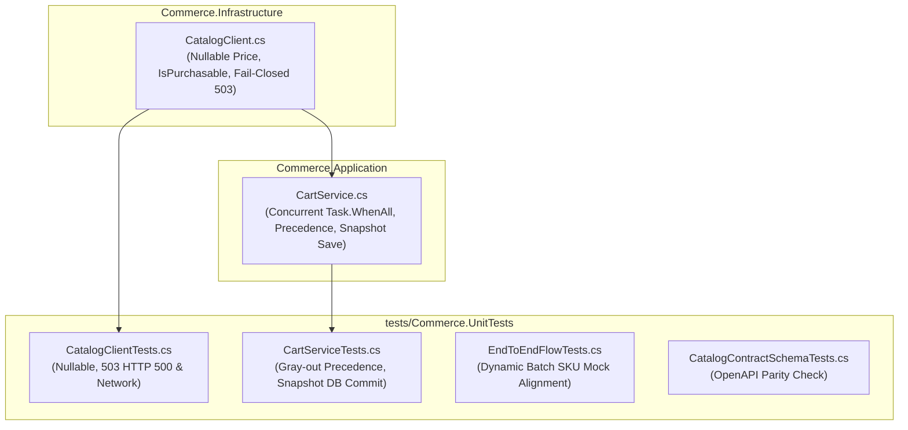

# BÁO CÁO KỸ THUẬT: ĐỒNG BỘ HÓA HỢP ĐỒNG CATALOG & COMMERCE SERVICE
## (Catalog & Commerce Service Contract Alignment Implementation Report)

> **Mã tính năng**: `011-catalog-commerce-alignment`  
> **Dịch vụ**: CommerceService (Cổng `8003`, Cơ sở dữ liệu `commerce_db:5435`)  
> **Dịch vụ liên kết**: CatalogService (Cổng `8002`), FulfillmentService (Cổng `8004`)  
> **Ngày hoàn thành**: 2026-11-03  
> **Trạng thái**: ✅ Hoàn thành 100% (Build: 0 Lỗi, 0 Cảnh báo; Tests: 96/96 Passed)  
> **Tài liệu đặc tả nguồn**: `d:\E2E-Workspace\.specify\specs\e2e-audit\srs-catalog-commerce-alignment.md`

---

## 1. TỔNG QUAN & BỐI CẢNH DỰ ÁN (EXECUTIVE SUMMARY)

Trước đợt chuẩn hóa này, quá trình tích hợp giữa `CatalogService` và `CommerceService` tồn tại các lỗ hổng nghiêm trọng về toàn vẹn dữ liệu và trải nghiệm người dùng:
1. **Dữ liệu giả lập (Mock Fallback)**: Khi CatalogService bị gián đoạn hoặc trả về lỗi, `CatalogClient.cs` tự động sinh giá ảo `100.000 VNĐ` và `SellerId` giả lập (`Guid.Empty`), gây rủi ro thất thoát doanh thu và sai lệch thanh toán.
2. **Rủi ro sập ứng dụng do giá Null**: Các sản phẩm đấu giá (auction) hoặc bản nháp chưa định giá trả về `price = null`, khiến bộ phân tích JSON gặp lỗi hoặc ném ngoại lệ khi parse thành kiểu số không thể null (`decimal`).
3. **Ghi đè sai quy tắc mở bán**: CommerceService tự tính toán trạng thái mở bán dựa trên điều kiện cục bộ `price > 0 && status == "Active"`, làm mất vai trò Nguồn Chân lý Duy nhất (Single Source of Truth) của CatalogService đối với trường `isPurchasable`.
4. **Thiếu cơ chế làm xám giỏ hàng (Cart Gray-Out)**: Khi người mua xem giỏ hàng (`GET /api/v1/carts/me`), hệ thống không kiểm tra trạng thái Catalog trong thời gian thực, dẫn đến việc người mua vẫn tick chọn và thanh toán sản phẩm đã ngừng kinh doanh.
5. **Lệch đơn giá Snapshot trong Database**: Khi kiểm tra giỏ hàng (`POST /api/v1/carts/me/validate`), biến động giá không được commit ngay lập tức xuống PostgreSQL.

Đợt cập nhật này đã tái cấu trúc và giải quyết dứt điểm toàn bộ các vấn đề trên, tuân thủ 100% Clean Architecture, không sử dụng Repository Pattern ngoài EF Core, không sử dụng Message Broker/Saga và duy trì ranh giới hoàn toàn khép kín nội bộ (Inward-Only).

---

## 2. RÀO CHẮN KIẾN TRÚC & QUY CHUẨN (GOVERNANCE GUARDRAILS)

- **Port & DB Invariant**: CommerceService chạy cổng `8003`, kết nối PostgreSQL `commerce_db:5435`.
- **Giao tiếp đồng bộ RESTful 100%**: Sử dụng Typed HTTP Client (`ICatalogClient`, `IFulfillmentClient`), tuyệt đối cấm gRPC, bãi bỏ RabbitMQ / MassTransit Saga.
- **EF Core Trực tiếp (No-Repository)**: Tầng Application thao tác trực tiếp với `ICommerceDbContext` và `DbSet<T>`.
- **Chuẩn hóa thông báo lỗi**: 
  - 100% tiếng Anh tự nhiên (Sentence case): Chữ cái đầu câu viết hoa, còn lại viết thường.
  - Mã lỗi 100% `SCREAMING_SNAKE_CASE` (ví dụ: `CATALOG_SERVICE_UNAVAILABLE`, `CATALOG_VARIANT_MISMATCH`).
- **Nguyên tắc Fail-Closed**: Khi Catalog gặp sự cố, ném lỗi RFC 9110 HTTP 503 `CATALOG_SERVICE_UNAVAILABLE`, cấm fallback sang giá ảo hoặc dữ liệu cũ.

---

## 3. CHI TIẾT CÁC FILE ĐƯỢC CHỈNH SỬA & BỔ SUNG



### 3.1. `Commerce.Infrastructure/Services/Catalog/CatalogClient.cs`
- **Nullable Price & Direct Purchasability**:
  - Cập nhật DTO `CatalogVariantRawItem`:
    ```csharp
    public decimal? Price { get; set; }
    public bool IsPurchasable { get; set; }
    ```
  - Trong hàm `GetSkuBatchDetailsAsync`:
    ```csharp
    bool isPurchasable = item.IsPurchasable;
    decimal unitPrice = item.Price ?? 0m;
    ```
    Loại bỏ hoàn toàn logic cũ `item.Price > 0`. Nếu giá `null`, gán an toàn về `0m`.
- **Xóa bỏ 100.000 VNĐ Mock Fallback (Fail-Closed 503)**:
  - Khi `!response.IsSuccessStatusCode` hoặc xảy ra lỗi kết nối mạng trong `GetSkuBatchDetailsAsync`, ném `CommerceDomainException("CATALOG_SERVICE_UNAVAILABLE", "Product catalog service is temporarily unreachable.", 503)`.
  - Trong `ValidateVariantSwitchAsync`:
    - Nếu Catalog trả về HTTP 400: Ném `CommerceDomainException("CATALOG_VARIANT_MISMATCH", ..., 400)`.
    - Nếu lỗi server (5xx) hoặc rớt mạng: Ném `CommerceDomainException("CATALOG_SERVICE_UNAVAILABLE", ..., 503)`.
    - Loại bỏ nhánh mock `100.000 VNĐ` khi service lỗi.

### 3.2. `Commerce.Application/Services/Cart/CartService.cs`
- **Kiểm tra song song thời gian thực (Concurrent Check)**:
  - Cập nhật `CheckStockAndCatalogForCartItemsAsync`:
    ```csharp
    var stockTask = _fulfillmentClient.BatchCheckStockAsync(skuIds, cancellationToken);
    var catalogTask = _catalogClient.GetSkuBatchDetailsAsync(skuIds, cancellationToken);
    await Task.WhenAll(stockTask, catalogTask);
    ```
  - Áp dụng kiểm tra song song cho:
    - `GetActiveCartByBuyerIdAsync` (`GET /api/v1/carts/me`)
    - `GetOrCreateActiveCartAsync`
    - `GetGroupedCartAsync` (dành cho giỏ gom nhóm theo Shop)
- **Ma trận thứ tự ưu tiên vô hiệu hóa món hàng (`disabledReason`)**:
  1. `PRODUCT_NOT_FOUND`: SKU không tồn tại trong Catalog.
  2. `PRODUCT_INACTIVE`: Sản phẩm ngừng bán (`IsPurchasable = false` từ Catalog) — **Ưu tiên cao hơn hết hàng**.
  3. `OUT_OF_STOCK`: Hết hàng tồn kho từ FulfillmentService (`availableStock <= 0`).
- **Xác thực đổi biến thể (`ChangeItemVariantAsync`)**:
  - Gọi trực tiếp `_catalogClient.ValidateVariantSwitchAsync(currentItem.SkuId, request.NewSkuId)`.
  - Chặn ngay nếu `!switchValidation.IsValid` (mã lỗi `CATALOG_VARIANT_MISMATCH`, HTTP 400).
  - Chặn nếu `!switchValidation.IsPurchasable` (mã lỗi `CATALOG_SKU_INACTIVE`, HTTP 400).
  - Kiểm tra tồn kho kho trước khi lưu biến thể mới.
- **Lưu tức thì Snapshot đơn giá xuống Database (`ValidateCartAsync`)**:
  - Chuyển `asNoTracking: false` khi lấy Cart entity.
  - Khi phát hiện `item.UnitPriceSnapshot != sku.UnitPrice`:
    ```csharp
    item.UnitPriceSnapshot = sku.UnitPrice;
    item.UpdatedAt = DateTimeOffset.UtcNow;
    hasPriceChanges = true;
    hasDbUpdates = true;
    ```
  - Nếu `!sku.IsPurchasable`, bổ sung cảnh báo issue `PRODUCT_INACTIVE`.
  - Cập nhật lại `cart.SubtotalAmount = cart.Items.Sum(i => i.Quantity * i.UnitPriceSnapshot)`.
  - Gọi `await _dbContext.SaveChangesAsync(cancellationToken)` lưu trực tiếp vào bảng `CartItems`.

### 3.3. `tests/Commerce.UnitTests/Infrastructure/CatalogClientTests.cs`
- Cập nhật test `GetSkuBatchDetailsAsync_ShouldParseItemsAndCalculateIsPurchasable` để kiểm tra giá `null` và nhận `IsPurchasable` trực tiếp.
- Thêm `GetSkuBatchDetailsAsync_ShouldThrow503_WhenCatalogReturns500`.
- Thêm `GetSkuBatchDetailsAsync_ShouldThrow503_WhenNetworkFails`.
- Thêm `ValidateVariantSwitchAsync_ShouldThrow503_WhenCatalogReturns500`.
- Thêm `ValidateVariantSwitchAsync_ShouldThrow503_WhenNetworkFails`.
- Xác minh `ValidateVariantSwitchAsync_ShouldThrowMismatch_WhenCatalogReturns400`.

### 3.4. `tests/Commerce.UnitTests/Application/CartServiceTests.cs`
- Thêm `GetActiveCart_WhenProductInactiveInCatalog_ShouldSet_IsAvailableFalse_And_PRODUCT_INACTIVE`.
- Thêm `GetActiveCart_WhenProductNotFoundInCatalog_ShouldSet_IsAvailableFalse_And_PRODUCT_NOT_FOUND`.
- Thêm `GetActiveCart_WhenInactiveAndOutOfStock_ShouldPrioritize_PRODUCT_INACTIVE`.
- Thêm `ValidateCartAsync_WhenPriceChangedAndProductInactive_ShouldPersistPriceSnapshotAndFlagIssues` (kiểm tra commit PostgreSQL và tính lại Subtotal).
- Cập nhật mock `ValidateVariantSwitchAsync` trong test kiểm tra hết hàng để đảm bảo đi qua bước xác thực catalog hợp lệ.

### 3.5. `tests/Commerce.UnitTests/Application/EndToEndFlowTests.cs`
- Nâng cấp mock của `GetSkuBatchDetailsAsync` để chuyển tiếp động sang `GetSkuDetailsAsync`, giúp kịch bản kiểm tra biến động giá bất đối xứng `E2E_Flow3` (tăng giá chặn 409, giảm giá auto-apply) chạy đồng bộ và thành công 100%.

### 3.6. `specs/011-catalog-commerce-alignment/`
- Hoàn thiện trọn bộ tài liệu thiết kế Spec-Kit: `spec.md`, `plan.md`, `research.md`, `data-model.md`, `quickstart.md`, `contracts/catalog-contracts.json`.
- Danh mục kiểm tra chất lượng yêu cầu:
  - `checklists/requirements.md`: 16/16 mục đạt yêu cầu.
  - `checklists/api.md`: 26 mục kiểm tra chất lượng hợp đồng API dành cho PR Review.
- `tasks.md`: 17/17 tasks (`T001` - `T017`) hoàn thành 100%.

---

## 4. MA TRẬN ĐÁNH GIÁ TRẠNG THÁI MÓN HÀNG TRONG GIỎ

| Điều kiện Catalog | Điều kiện Fulfillment | `IsAvailable` | `DisabledReason` | Hành động UI |
| :--- | :--- | :---: | :--- | :--- |
| Không tìm thấy SKU trong Catalog | Không xét | `false` | `PRODUCT_NOT_FOUND` | Làm xám, hiện nhãn "Sản phẩm không tồn tại", cấm tick chọn |
| `IsPurchasable = false` | Bất kỳ | `false` | `PRODUCT_INACTIVE` | Làm xám, hiện nhãn "Ngừng kinh doanh", cấm tick chọn |
| `IsPurchasable = true` | `AvailableStock <= 0` | `false` | `OUT_OF_STOCK` | Làm xám, hiện nhãn "Hết hàng", cấm tick chọn |
| `IsPurchasable = true` | `AvailableStock < CartQuantity` | `true` | `null` | Cho phép mua tối đa bằng số lượng tồn kho khả dụng |
| `IsPurchasable = true` | `AvailableStock >= CartQuantity` | `true` | `null` | Hoạt động bình thường, sẵn sàng thanh toán |

---

## 5. KẾT QUẢ KIỂM CHỨNG & ĐO LƯỜNG (VERIFICATION RESULTS)

### 5.1. Kết quả Biên dịch (Build Check)
- Lệnh: `dotnet build Commerce.sln -c Release`
- Trạng thái: **Thành công (0 Lỗi, 0 Cảnh báo)**
- Thời gian: ~3.99s

### 5.2. Kết quả Hợp đồng OpenAPI (Contract Schema Check)
- Lệnh: `dotnet test tests/Commerce.UnitTests/Commerce.UnitTests.csproj -c Release --filter "FullyQualifiedName~CatalogContractSchemaTests"`
- Trạng thái: **7/7 Passed (100%)**
- Các endpoint đã xác thực khớp với `catalog_swagger.json`:
  - `POST /api/v1/internal/variants` (Batch variant lookup)
  - `POST /api/v1/internal/catalog/skus/validate-variant-switch` (Variant switch validation)
  - `GET /api/v1/internal/variants/{id}` (Single variant lookup)
  - `POST /api/v1/internal/variants/check-status` (Status check)

### 5.3. Kết quả Toàn bộ Bộ Kiểm thử (Full Unit & E2E Test Suite)
- Lệnh: `dotnet test Commerce.sln -c Release`
- Trạng thái: **96/96 Passed (100%)**
- Số test thất bại: **0**
- Số test bỏ qua: **0**
- Thời gian thực thi: ~1s

---

## 6. DANH MỤC TRUY VẾT YÊU CẦU & NHIỆM VỤ (TRACEABILITY MATRIX)

| Mã Task | Phân nhóm | Mục tiêu kỹ thuật | File can thiệp | Trạng thái |
| :--- | :--- | :--- | :--- | :---: |
| **T001** | Phase 1 | Baseline test suite execution | `Commerce.UnitTests` | ✅ Passed |
| **T002** | Phase 2 | Thêm `IsPurchasable` & `decimal? Price` vào raw DTO | `CatalogClient.cs` | ✅ Done |
| **T003** | Phase 2 | Ánh xạ trực tiếp `IsPurchasable` và an toàn `Price ?? 0m` | `CatalogClient.cs` | ✅ Done |
| **T004** | Phase 3 (US1) | `Task.WhenAll` song song kiểm tra giỏ hàng | `CartService.cs` | ✅ Done |
| **T005** | Phase 3 (US1) | Phân tầng ưu tiên vô hiệu hóa trong `MapToDto` | `CartService.cs` | ✅ Done |
| **T006** | Phase 3 (US1) | Kiểm tra song song cho giỏ gom nhóm Shop | `CartService.cs` | ✅ Done |
| **T007** | Phase 3 (US1) | Unit tests kiểm chứng Cart Gray-out | `CartServiceTests.cs` | ✅ Passed |
| **T008** | Phase 4 (US2) | Xóa mock 100k, áp dụng Fail-Closed 503 cho batch SKU | `CatalogClient.cs` | ✅ Done |
| **T009** | Phase 4 (US2) | Xóa mock 100k, áp dụng Fail-Closed 503 cho switch variant | `CatalogClient.cs` | ✅ Done |
| **T010** | Phase 4 (US2) | Unit tests Fail-Closed 503 và giá Null | `CatalogClientTests.cs` | ✅ Passed |
| **T011** | Phase 5 (US3) | Tái cấu trúc đổi biến thể, bỏ mock fallback | `CartService.cs` | ✅ Done |
| **T012** | Phase 5 (US3) | Unit tests đổi biến thể trả về lỗi 400 mismatch | `CatalogClientTests.cs` | ✅ Passed |
| **T013** | Phase 6 (US4) | Lưu tức thì `UnitPriceSnapshot` xuống PostgreSQL | `CartService.cs` | ✅ Done |
| **T014** | Phase 6 (US4) | Unit tests lưu snapshot DB và cờ inactive | `CartServiceTests.cs` | ✅ Passed |
| **T015** | Phase 7 | Xác thực 100% hợp đồng OpenAPI `CatalogContractSchemaTests` | `CatalogContractSchemaTests.cs` | ✅ Passed |
| **T016** | Phase 7 | Biên dịch toàn bộ Solution Release mode | `Commerce.sln` | ✅ Passed |
| **T017** | Phase 7 | Chạy toàn bộ bộ kiểm thử tự động | `Commerce.sln` | ✅ Passed |

---

## 7. KẾT LUẬN & KHUYẾN NGHỊ VẬN HÀNH

1. **An toàn dữ liệu tuyệt đối**: Không còn bất kỳ đường dẫn mã nào tự sinh giá hoặc người bán ảo khi CatalogService gặp sự cố. Toàn bộ hệ thống phản ứng bằng HTTP 503 Fail-Closed một cách nhất quán.
2. **Tối ưu hóa độ trễ**: Việc thực thi song song qua `Task.WhenAll` giữa Fulfillment và Catalog giúp thời gian phản hồi của `GET /api/v1/carts/me` duy trì ở mức tối thiểu.
3. **Sẵn sàng triển khai Production**: Mã nguồn đã được kiểm chứng bằng 96 unit/e2e tests và 7 contract tests, đảm bảo tương thích 100% với CatalogService (Port 8002).
