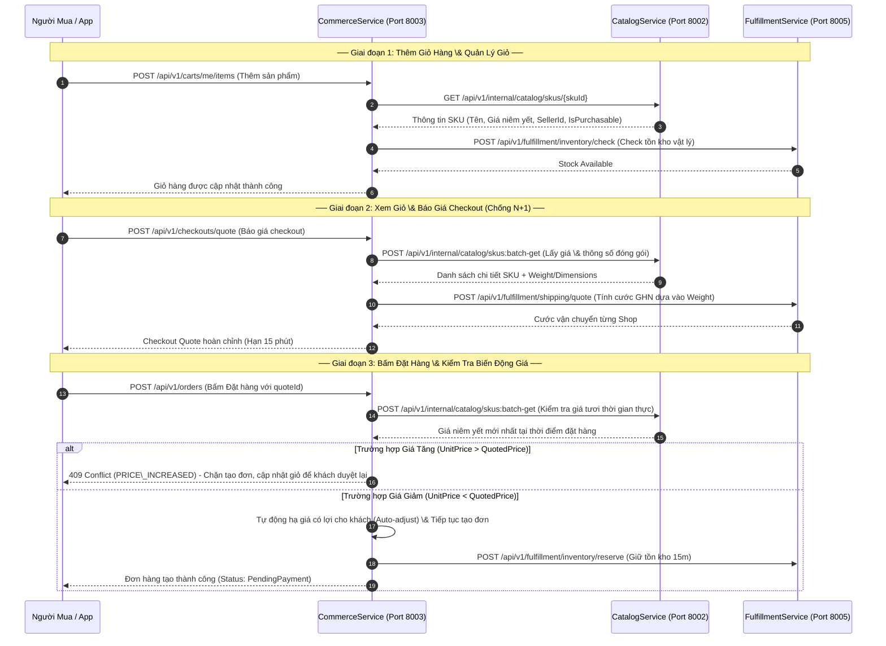
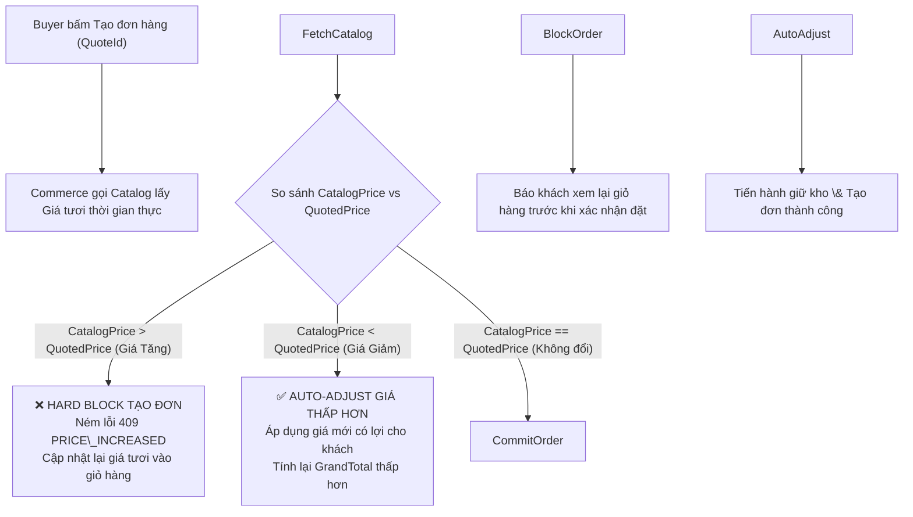

# HỢP ĐỒNG TÍCH HỢP REST API \& TÀI LIỆU ĐỐI CHIẾU KỸ THUẬT

## COMMERCE SERVICE ↔ CATALOG SERVICE

> \*\*Dự án:\*\* Nexus Microservices Ecosystem  
> \*\*Service gửi yêu cầu:\*\* `CommerceService` (Port `8003`, DB `commerce\_db`)  
> \*\*Service đối chiếu:\*\* `CatalogService` (Port `8002`, DB `catalog\_db`)  
> \*\*Mục tiêu:\*\* Thống nhất hợp đồng RESTful API, cơ chế tra cứu Master Data sản phẩm/SKU, chính sách biến động giá bất đối xứng (Asymmetric Price Drift), dữ liệu trọng lượng/kích thước phục vụ vận chuyển GHN, và bãi bỏ triệt để việc giữ kho tại Catalog (chuyển giao sang Fulfillment).  
> \*\*Phiên bản tài liệu:\*\* `v1.0.0` (Draft - Chờ thống nhất \& nghiệm thu)  
> \*\*Ngày lập:\*\* 2026-11-02  

\---

## MỤC LỤC

1. [Kiến trúc Tương tác \& Bản đồ Điểm chạm](#1-kiến-trúc-tương-tác--bản-đồ-điểm-chạm)
2. [Chi tiết Hợp đồng REST API (API Specifications)](#2-chi-tiết-hợp-đồng-rest-api-api-specifications)

   * [2.1. Tra cứu chi tiết 1 SKU (Single SKU Lookup)](#21-tra-cứu-chi-tiết-1-sku-single-sku-lookup)
   * [2.2. Batch tra cứu nhiều SKU (Batch SKU Details - Chống N+1)](#22-batch-tra-cứu-nhiều-sku-batch-sku-details---chống-n1)
   * [2.3. Xác thực đổi phân loại hàng trong giỏ (Variant Switch Validation)](#23-xác-thực-đổi-phân-loại-hàng-trong-giỏ-variant-switch-validation)
   * [2.4. Lấy thông số trọng lượng \& kích thước giao vận (Logistics Shipping Specs)](#24-lấy-thông-số-trọng-lượng--kích-thước-giao-vận-logistics-shipping-specs)
3. [Quy Tắc Nghiệp Vụ Cốt Lõi Cần Thống Nhất](#3-quy-tắc-nghiệp-vụ-cốt-lõi-cần-thống-nhất)

   * [3.1. Chính sách Biến động Giá Bất Đối Xứng (Asymmetric Price Drift Policy)](#31-chính-sách-biến-động-giá-bất-đối-xứng-asymmetric-price-drift-policy)
   * [3.2. Vòng đời Trạng thái Mở bán (IsPurchasable Lifecycle)](#32-vòng-đời-trạng-thái-mở-bán-ispurchasable-lifecycle)
   * [3.3. Bãi bỏ hoàn toàn luồng giữ kho tại Catalog](#33-bãi-bỏ-hoàn-toàn-luồng-giữ-kho-tại-catalog)
4. [Bộ Câu Hỏi Kỹ Thuật Trọng Tâm Gửi Team Catalog](#4-bộ-câu-hỏi-kỹ-thuật-trọng-tâm-gửi-team-catalog)

   * [Nhóm 1: Batch API \& Hiệu năng hệ thống](#nhóm-1-batch-api--hiệu-năng-hệ-thống)
   * [Nhóm 2: Dữ liệu Logistics (Trọng lượng \& Kích thước GHN)](#nhóm-2-dữ-liệu-logistics-trọng-lượng--kích-thước-ghn)
   * [Nhóm 3: Cơ chế Cache, TTL \& Tính nhất quán của Giá](#nhóm-3-cơ-chế-cache-ttl--tính-nhất-quán-của-giá)
   * [Nhóm 4: Chuẩn hóa Xác thực \& Headers liên service](#nhóm-4-chuẩn-hóa-xác-thực--headers-liên-service)
5. [Ma Trận Mã Lỗi Chuẩn (RFC 9110 Error Matrix)](#5-ma-trận-mã-lỗi-chuẩn-rfc-9110-error-matrix)

\---

## 1\. KIẾN TRÚC TƯƠNG TÁC \& BẢN ĐỒ ĐIỂM CHẠM



\---

## 2\. CHI TIẾT HỢP ĐỒNG REST API (API SPECIFICATIONS)

Toàn bộ các endpoint giao tiếp nội bộ chạy trên giao thức `HTTP/1.1` hoặc `HTTP/2`, sử dụng `Content-Type: application/json`.

\---

### 2.1. Tra cứu chi tiết 1 SKU (Single SKU Lookup)

* **Mục đích sử dụng tại Commerce:**

  * Khách thêm món mới vào giỏ hàng (`POST /api/v1/carts/me/items`).
  * Kiểm tra tính hợp lệ khi xem chi tiết 1 món trong giỏ.
* **HTTP Method \& Route:** `GET /api/v1/internal/catalog/skus/{skuId}`
* **Header yêu cầu:**

  * `Accept: application/json`
  * `X-Internal-Service-Key: <internal\_key>` (nếu có bật kiểm tra liên service)
* **Path Parameters:**

  * `skuId` (`uuid`, bắt buộc): ID định danh phân loại hàng (SKU).
* **Response Body thành công (`200 OK`):**

```json
  {
    "skuId": "9b1deb4d-3b7d-4bad-9bdd-2b0d7b3dcb6d",
    "productId": "4a2b91c8-1122-3344-5566-778899aabbcc",
    "sellerId": "11111111-2222-3333-4444-555555555555",
    "productName": "Áo thun Polo Nam Thể Thao Cao Cấp",
    "skuName": "Xanh Navy / Size L",
    "skuCode": "POLO-NAVY-L",
    "thumbnailUrl": "https://cdn.nexus.com/images/products/polo-navy-l.jpg",
    "unitPrice": 185000.00,
    "originalPrice": 250000.00,
    "isPurchasable": true,
    "status": "Active",
    "weightGrams": 250,
    "lengthCm": 20,
    "widthCm": 15,
    "heightCm": 3,
    "attributes": \[
      { "name": "Màu sắc", "value": "Xanh Navy" },
      { "name": "Kích cỡ", "value": "L" }
    ]
  }
  ```

* **Mã lỗi phản hồi:**

  * `404 Not Found`:

&#x20;   ```json
    {
      "errorCode": "CATALOG\_SKU\_NOT\_FOUND",
      "message": "Product SKU was not found in catalog."
    }
    ```

  * `400 Bad Request` (Nếu sản phẩm bị cấm hoặc ngừng kinh doanh):

&#x20;   ```json
    {
      "errorCode": "CATALOG\_SKU\_INACTIVE",
      "message": "Product SKU is inactive or suspended from sales."
    }
    ```

\---

### 2.2. Batch tra cứu nhiều SKU (Batch SKU Details - Chống N+1)

* **Mục đích sử dụng tại Commerce:**

  * **Cực kỳ quan trọng**: Khi Buyer xem giỏ hàng (`GET /api/v1/carts/me`), tính tiền (`POST /api/v1/carts/me/calculate`), lấy báo giá checkout (`POST /api/v1/checkouts/quote`), hoặc đặt hàng (`POST /api/v1/orders`).
  * Thay vì gửi 10 HTTP requests cho 10 món trong giỏ, Commerce chỉ gửi **DUY NHẤT 1 request** để lấy toàn bộ thông tin giá tươi và trạng thái.
* **HTTP Method \& Route:** `POST /api/v1/internal/catalog/skus:batch-get`
* **Request Body:**

```json
  {
    "skuIds": \[
      "9b1deb4d-3b7d-4bad-9bdd-2b0d7b3dcb6d",
      "c3a5e8f1-4455-6677-8899-001122334455",
      "d4e6f9a2-5566-7788-99aa-112233445566"
    ]
  }
  ```

* **Response Body thành công (`200 OK`):**

```json
  {
    "items": \[
      {
        "skuId": "9b1deb4d-3b7d-4bad-9bdd-2b0d7b3dcb6d",
        "productId": "4a2b91c8-1122-3344-5566-778899aabbcc",
        "sellerId": "11111111-2222-3333-4444-555555555555",
        "productName": "Áo thun Polo Nam Thể Thao Cao Cấp",
        "skuName": "Xanh Navy / Size L",
        "thumbnailUrl": "https://cdn.nexus.com/images/products/polo-navy-l.jpg",
        "unitPrice": 185000.00,
        "isPurchasable": true,
        "status": "Active",
        "weightGrams": 250,
        "lengthCm": 20,
        "widthCm": 15,
        "heightCm": 3
      },
      {
        "skuId": "c3a5e8f1-4455-6677-8899-001122334455",
        "productId": "7b8c9d0e-2233-4455-6677-8899aabbccdd",
        "sellerId": "22222222-3333-4444-5555-666666666666",
        "productName": "Quần Short Thể Thao Co Giãn",
        "skuName": "Đen / Size XL",
        "thumbnailUrl": "https://cdn.nexus.com/images/products/short-black-xl.jpg",
        "unitPrice": 120000.00,
        "isPurchasable": false,
        "status": "Inactive",
        "inactiveReason": "Product has been discontinued by seller"
      }
    ],
    "notFoundSkuIds": \[
      "d4e6f9a2-5566-7788-99aa-112233445566"
    ]
  }
  ```

\---

### 2.3. Xác thực đổi phân loại hàng trong giỏ (Variant Switch Validation)

* **Mục đích sử dụng tại Commerce:**

  * Khách hàng muốn đổi phân loại hàng trực tiếp trong giỏ (`PATCH /api/v1/carts/me/items/{cartItemId}/variant`), ví dụ: Đổi từ áo Màu Đen/Size M sang Màu Trắng/Size L.
  * Cần đảm bảo `newSkuId` **phải thuộc cùng một Sản phẩm (`productId`) và cùng Người bán (`sellerId`)**, đồng thời lấy ngay đơn giá snapshot của SKU mới.
* **HTTP Method \& Route:** `POST /api/v1/internal/catalog/skus/validate-variant-switch`
* **Request Body:**

```json
  {
    "currentSkuId": "9b1deb4d-3b7d-4bad-9bdd-2b0d7b3dcb6d",
    "newSkuId": "8a0cea3c-2a6c-3a9c-8acc-1a0c6a2cba5c"
  }
  ```

* **Response Body thành công (`200 OK`):**

```json
  {
    "isValid": true,
    "productId": "4a2b91c8-1122-3344-5566-778899aabbcc",
    "sellerId": "11111111-2222-3333-4444-555555555555",
    "newSkuId": "8a0cea3c-2a6c-3a9c-8acc-1a0c6a2cba5c",
    "newSkuName": "Trắng / Size L",
    "newUnitPrice": 195000.00,
    "isPurchasable": true,
    "weightGrams": 250
  }
  ```

* **Mã lỗi phản hồi:**

  * `400 Bad Request` (Nếu 2 SKU không cùng 1 sản phẩm gốc):

&#x20;   ```json
    {
      "errorCode": "CATALOG\_VARIANT\_MISMATCH",
      "message": "New SKU does not belong to the same parent product."
    }
    ```

\---

### 2.4. Lấy thông số trọng lượng \& kích thước giao vận (Logistics Shipping Specs)

* **Mục đích sử dụng tại Commerce:**

  * Khi Commerce chuẩn bị payload gọi sang `FulfillmentService` để tính cước GHN động hoặc tạo vận đơn GHN.
  * GHN yêu cầu bắt buộc: `weight` (gram), `length` (cm), `width` (cm), `height` (cm).
* **HTTP Method \& Route:** `POST /api/v1/internal/catalog/skus/shipping-specs:batch-get`
* **Request Body:**

```json
  {
    "skuIds": \[
      "9b1deb4d-3b7d-4bad-9bdd-2b0d7b3dcb6d",
      "c3a5e8f1-4455-6677-8899-001122334455"
    ]
  }
  ```

* **Response Body thành công (`200 OK`):**

```json
  {
    "specs": \[
      {
        "skuId": "9b1deb4d-3b7d-4bad-9bdd-2b0d7b3dcb6d",
        "weightGrams": 250,
        "lengthCm": 20,
        "widthCm": 15,
        "heightCm": 3
      },
      {
        "skuId": "c3a5e8f1-4455-6677-8899-001122334455",
        "weightGrams": 300,
        "lengthCm": 25,
        "widthCm": 18,
        "heightCm": 4
      }
    ]
  }
  ```

\---

## 3\. QUY TẮC NGHIỆP VỤ CỐT LÕI CẦN THỐNG NHẤT

### 3.1. Chính sách Biến động Giá Bất Đối Xứng (Asymmetric Price Drift Policy)

Khi khách hàng bấm Đặt hàng (`POST /api/v1/orders`), Commerce Service sẽ so sánh giữa **Giá đã báo trong Checkout Quote (`QuotedPrice`)** và **Giá niêm yết thời gian thực từ Catalog (`CatalogPrice`)**:

$$\\Delta P = \\text{CatalogPrice} - \\text{QuotedPrice}$$



1. **Trường hợp Giá Tăng ($\\Delta P > 0$)**:

   * **Xử lý:** Chặn đứng tạo đơn ngay lập tức (Hard Block). Tuyệt đối không tự ý trừ thêm tiền của khách.
   * **Hành động tại Commerce:** Trả về HTTP `409 Conflict` với mã lỗi `PRICE\_INCREASED`, đồng thời tự động cập nhật lại đơn giá mới (`freshSkuPrices`) vào các `CartItem` trong giỏ để khách chủ động duyệt lại.
2. **Trường hợp Giá Giảm ($\\Delta P < 0$)**:

   * **Xử lý:** Tự động áp dụng giá mới thấp hơn (Auto-adjust) và tiếp tục luồng tạo đơn.
   * **Hành động tại Commerce:** Giảm tổng tiền thanh toán, ghi nhận danh sách `priceDrops` trong payload kết quả để thông báo tin vui cho người mua.
3. **Trường hợp SKU bị Khóa / Ngừng bán (`isPurchasable == false`)**:

   * Chặn tạo đơn, trả về HTTP `400 Bad Request` với mã `CATALOG\_SKU\_INACTIVE`.

\---

### 3.2. Vòng đời Trạng thái Mở bán (IsPurchasable Lifecycle)

Một SKU được xem là hợp lệ để thêm vào giỏ và đặt hàng khi và chỉ khi thỏa mãn đồng thời:

1. Sản phẩm cha (`Product`) có trạng thái: `status == "Active"`.
2. Bản thân phân loại hàng (`SKU`) có trạng thái: `status == "Active"`.
3. Cờ `isPurchasable == true`.
4. Cửa hàng bán sản phẩm (`Seller`) đang hoạt động bình thường (không bị đóng băng do vi phạm).

Nếu rơi vào các trạng thái: `Draft`, `PendingApproval`, `Inactive`, `Suspended`, `Banned`, `Deleted` $\\rightarrow$ Catalog bắt buộc trả về `isPurchasable: false` kèm `inactiveReason`.

\---

### 3.3. Bãi bỏ hoàn toàn luồng giữ kho tại Catalog

> \[!IMPORTANT]
> \*\*Xác lập ranh giới trách nhiệm kiến trúc (Architectural Boundary):\*\*
> - \*\*Catalog Service\*\* sở hữu: Master Data sản phẩm, Phân loại SKU, Giá niêm yết, Trạng thái kinh doanh, Hình ảnh, Trọng lượng \& Kích thước.
> - \*\*Fulfillment Service\*\* sở hữu: Tồn kho vật lý (Physical warehouse stock), Giữ tồn kho tạm thời (Stock reservation - TTL 15m), Trừ kho (Commit stock), Hoàn kho (Release stock).
> - \*\*Hành động:\*\* Commerce đề nghị Catalog \*\*loại bỏ hoặc ngưng sử dụng endpoint cũ `POST /api/v1/products/reserve`\*\*. Commerce sẽ gọi trực tiếp sang `FulfillmentService` (Port 8005) để quản lý tồn kho.

\---

## 4\. BỘ CÂU HỎI KỸ THUẬT TRỌNG TÂM GỬI TEAM CATALOG

Để đảm bảo việc tích hợp thông suốt, đề nghị Team Catalog phản hồi và làm rõ 4 nhóm câu hỏi sau:

### Nhóm 1: Batch API \& Hiệu năng hệ thống

1. **Catalog đã có sẵn endpoint Batch (`POST /api/v1/internal/catalog/skus:batch-get`) chưa?**

   * Nếu chưa có, thời gian dự kiến bàn giao là khi nào?
   * Giới hạn tối đa số lượng `skuIds` trong một batch request là bao nhiêu? (Commerce đề xuất tối đa **100 SKUs/request** để phục vụ giỏ hàng lớn).
2. **Khi một SKU trong mảng `skuIds` không tồn tại:**

   * Catalog trả về lỗi 404 cho toàn bộ request, hay trả về `200 OK` kèm mảng `notFoundSkuIds` như hợp đồng tại Mục 2.2? (Commerce khuyến nghị trả về partial success kèm `notFoundSkuIds` để tránh làm chết cả giỏ hàng).

### Nhóm 2: Dữ liệu Logistics (Trọng lượng \& Kích thước GHN)

3. **Trường `weightGrams` và kích thước (`length`, `width`, `height`) hiện đã có trong schema của Catalog chưa?**

   * Khi Seller đăng bán sản phẩm mới, các trường này là bắt buộc (`required`) hay tùy chọn (`optional`)?
   * Nếu Seller không nhập, Catalog có giá trị mặc định (default fallback) là bao nhiêu? (Commerce đề xuất fallback: `weightGrams = 200g`, `length = 10cm`, `width = 10cm`, `height = 5cm` để không bị GHN từ chối tính cước).

### Nhóm 3: Cơ chế Cache, TTL \& Tính nhất quán của Giá

4. **Cơ chế Cache giá niêm yết tại Catalog được thiết kế như thế nào?**

   * Catalog có cache giá SKU trên Redis không? TTL là bao lâu?
   * Khi Shop đổi giá trên Seller Portal, cache Redis có bị invalidate ngay lập tức không?
   * Endpoint internal dành cho Commerce gọi kiểm tra giá có bypass cache để lấy giá tươi nhất từ Database không?

### Nhóm 4: Chuẩn hóa Xác thực \& Headers liên service

5. **Cơ chế xác thực cho các cuộc gọi nội bộ giữa Commerce và Catalog:**

   * Hiện tại Catalog đang dùng xác thực qua Header `X-Internal-Service-Key`, Forward Bearer JWT của người dùng, hay không yêu cầu xác thực trong private network nội bộ?
   * Định dạng mã định danh `skuId` và `productId` phía Catalog cam kết tuân thủ chuẩn **UUID v4** (`Guid`) 100% đúng không?

\---

## 5\. MA TRẬN MÃ LỖI CHUẨN (RFC 9110 ERROR MATRIX)

Mọi mã lỗi trả về trong giao tiếp giữa Commerce và Catalog đều tuân thủ nguyên tắc: **100% SCREAMING\_SNAKE\_CASE cho ErrorCode** và **100% English Sentence case cho Error Message**:

|HTTP Status|ErrorCode|Ý Nghĩa Nghiệp Vụ|Hành Động Xử Lý Tại Commerce|
|-|-|-|-|
|**`404 Not Found`**|`CATALOG\_SKU\_NOT\_FOUND`|SKU không tồn tại trong hệ thống Catalog|Chặn thêm giỏ hàng / Tự động đánh dấu xóa khỏi giỏ|
|**`400 Bad Request`**|`CATALOG\_SKU\_INACTIVE`|Sản phẩm hoặc SKU đang bị ẩn, khóa hoặc ngừng bán|Làm xám sản phẩm trong giỏ, chặn không cho checkout|
|**`409 Conflict`**|`PRICE\_INCREASED`|Giá niêm yết thời gian thực cao hơn giá đã báo|Chặn tạo đơn hàng, cập nhật giỏ hàng và báo khách duyệt lại|
|**`400 Bad Request`**|`CATALOG\_VARIANT\_MISMATCH`|SKU mới không thuộc cùng sản phẩm gốc khi đổi variant|Báo lỗi không cho đổi phân loại hàng|
|**`400 Bad Request`**|`VAL\_INVALID\_INPUT`|Danh sách SKU rỗng hoặc format UUID không hợp lệ|Kiểm tra và chuẩn hóa payload trước khi gửi|
|**`503 Service Unavailable`**|`CATALOG\_SERVICE\_UNAVAILABLE`|Catalog bị quá tải, lỗi mạng hoặc timeout|Trả lỗi 503 cho client kèm thông báo thử lại sau|


