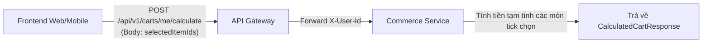
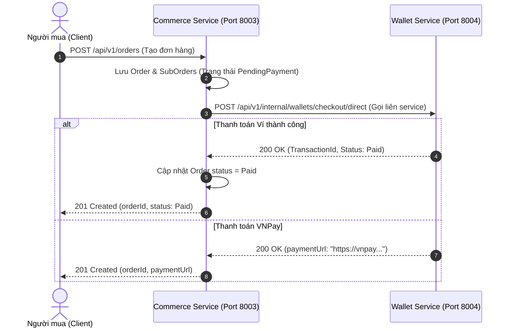

# BÁO CÁO ĐỐI SOÁT & CHUẨN HÓA GIAO TIẾP REST API (COMMERCE SERVICE)
## (Comprehensive API Reconciliation & Standardization Report — v2.0)

> **Dành cho:** Đội ngũ Frontend (Web / Mobile), API Gateway Team, Wallet Service Team và các bạn Sinh viên / Kỹ sư OJT.  
> **Phân hệ:** Commerce Service (Port `8003`, Database `commerce_db:5435`).  
> **Mục tiêu:** Giải thích cặn kẽ bản chất kỹ thuật của các điểm sai lệch trong bộ tài liệu đặc tả ban đầu (`docs/Commerce/`), giải quyết dứt điểm các mâu thuẫn nội bộ, đưa ra phương án chuẩn hóa đồng nhất giữa Frontend – Backend – Database, và hướng dẫn chi tiết cách tích hợp để tránh lỗi ngầm khi vận hành hệ thống.  
> **Ngày lập:** 2026-11-01 (Cập nhật sau phản biện kỹ thuật v2.0).  
> **Trạng thái:** ✅ ĐÃ CHUẨN HÓA & KHÓA NGUYÊN TẮC (LOCKED).  

---

## MỤC LỤC
1. [Bối cảnh và Tại sao cần Báo cáo này?](#1-bối-cảnh-và-tại-sao-cần-báo-cáo-này)
2. [Bảng Tổng hợp 7 Điểm Sai lệch & Giải pháp Chuẩn hóa](#2-bảng-tổng-hợp-7-điểm-sai-lệch--giải-pháp-chuẩn-hóa)
3. [Chi tiết Điểm 1: Chuẩn hóa Nhóm API Giỏ hàng (Carts API: R69 .. R74)](#3-chi-tiết-điểm-1-chuẩn-hóa-nhóm-api-giỏ-hàng-carts-api-r69--r74)
4. [Chi tiết Điểm 2: Ranh giới Dịch vụ & Endpoint Thanh toán ví R181](#4-chi-tiết-điểm-2-ranh-giới-dịch-vụ--endpoint-thanh-toán-ví-r181)
5. [Chi tiết Điểm 3: Mô hình Báo giá & Đặt hàng 2 Bước (Quote-Based Checkout: R75 & R76)](#5-chi-tiết-điểm-3-mô-hình-báo-giá--đặt-hàng-2-bước-quote-based-checkout-r75--r76)
   * *5.3 Quyết định Kiến trúc: Lưu trữ Địa chỉ giao hàng bằng JSONB Snapshot*
6. [Chi tiết Điểm 4: Sửa lỗi Cấu trúc Dữ liệu tại R79 (GET Chi tiết Đơn con SubOrder)](#6-chi-tiết-điểm-4-sửa-lỗi-cấu-trúc-dữ-liệu-tại-r79-get-chi-tiết-đơn-con-suborder)
7. [Chi tiết Điểm 5: Sửa lỗi Enum Trạng thái tại R84 (Shop Từ chối Đơn hàng)](#7-chi-tiết-điểm-5-sửa-lỗi-enum-trạng-thái-tại-r84-shop-từ-chối-đơn-hàng)
8. [Chi tiết Điểm 6: Thống nhất Tên trường Tài chính & Quy cách Viết hoa Enum](#8-chi-tiết-điểm-6-thống-nhất-tên-trường-tài-chính--quy-cách-viết-hoa-enum)
   * *8.2 Quy tắc Vàng: Phân định Mã lỗi (ErrorCode) vs Enum Dữ liệu*
9. [Chi tiết Điểm 7: Cơ chế Đóng gói Phong bì Envelope ApiResponse và Tránh Lỗi bọc 2 lần](#9-chi-tiết-điểm-7-cơ-chế-đóng-gói-phong-bì-envelope-apiresponse-và-tránh-lỗi-bọc-2-lần)
   * *9.3 Ví dụ JSON Response Lỗi Đầy Đủ (Error Envelope)*
10. [Hướng dẫn Tích hợp dành riêng cho Frontend (Cheat Sheet)](#10-hướng-dẫn-tích-hợp-dành-riêng-cho-frontend-cheat-sheet)

---

## 1. BỐI CẢNH VÀ TẠI SAO CẦN BÁO CÁO NÀY?

Trong quá trình phát triển hệ thống sàn thương mại điện tử **Project Nexus**, các tài liệu đặc tả API ban đầu trong thư mục `docs/Commerce/` (từ `R69` đến `R99` và `R181`) được sinh tự động từ bảng thiết kế Excel. Khi đưa vào triển khai mã nguồn thực tế trên nền tảng Clean Architecture (`.NET 8.0` và `PostgreSQL`), chúng tôi phát hiện một số điểm **bất hợp lý về kiến trúc RESTful, xung đột kiểu dữ liệu, sai lệch ranh giới dịch vụ (Bounded Context)** và **copy nhầm template mẫu phản hồi**.

Nếu không đối soát và làm rõ ngay từ đầu, các lập trình viên Frontend và các dịch vụ khác (API Gateway, Wallet Service) sẽ gặp phải những lỗi nghiêm trọng như:
- Gọi API bị lỗi 405 Method Not Allowed hoặc 400 Bad Request do gửi Payload trong HTTP GET / DELETE.
- Hiển thị sai trạng thái đơn hàng (UI hiển thị "Unknown" vì Backend trả về Enum khác với định dạng Frontend mong đợi).
- Lỗi "bọc 2 lần phong bì" (`data.data...`) làm sập giao diện người dùng.
- Hiểu nhầm ranh giới: Gọi nhầm sang Commerce Service để thanh toán ví trong khi quyền sở hữu thuộc về Wallet Service.

Báo cáo này giải thích bản chất từng lỗi bằng ngôn ngữ trực quan, dễ hiểu nhất dành cho các bạn sinh viên và kỹ sư thực tập, kèm theo giải pháp chuẩn hóa đã được áp dụng thống nhất 100%.

---

## 2. BẢNG TỔNG HỢP 7 ĐIỂM SAI LỆCH & GIẢI PHÁP CHUẨN HÓA

| STT | Vấn đề phát hiện | Tài liệu cũ (`docs/Commerce/`) | Hiện trạng chuẩn hóa trong Codebase | Lý do kỹ thuật & Lợi ích |
| :---: | :--- | :--- | :--- | :--- |
| **1** | **Vi phạm chuẩn REST HTTP ở Giỏ hàng** | `GET /carts/items/select` (GET có Body); `DELETE /carts/items` (DELETE có Body). | Đổi sang `POST /carts/me/calculate` và `POST /carts/me/items:bulk-remove`. | HTTP GET/DELETE có body là Anti-pattern, bị chặn bởi nhiều CDN/Gateway. |
| **2** | **Sai ranh giới Bounded Context ở R181** | Giao endpoint `POST /wallets/checkout/direct` cho CommerceService thụ lý. | Resource `/wallets/...` thuộc `WalletService`. Commerce chỉ gọi sang qua `IWalletClient`. | Commerce không được chiếm đoạt tài nguyên của Wallet Service. |
| **3** | **Địa chỉ nhận hàng trong SubOrder** | `R75` nhận Object, `R76` nhận chuỗi thô. | Áp dụng **Phương án C (JSONB Snapshot)** trong PostgreSQL, lưu cả mã GHN và chuỗi in tem. | Vừa có `ghnDistrictId`/`ghnWardCode` để tạo vận đơn GHN, vừa có chuỗi in tem bưu phẩm. |
| **4** | **Copy nhầm mẫu Response tại R79** | `GET /sub-orders/{id}` trả về danh sách phân trang `PagedData` có `totalCount: 100`. | Sửa thành `Single SubOrderDetailResponse` chứa đầy đủ thông tin của đơn con đó. | API tra cứu 1 bản ghi theo ID thì không thể trả về phân trang danh sách. |
| **5** | **Sai Enum trạng thái tại R84** | `R84` (Shop từ chối đơn) trả về `"status": "Rejected"`. | Trả về `"status": "Cancelled"` kèm `cancellationReason: "SellerRejected"`. | Enum `SubOrderStatus` trong DB chỉ có `Cancelled = 6`, không có `Rejected`. |
| **6** | **Tên trường tài chính & Casing Enum** | Viết `shippingFeeAmount (hoặc shippingFee)`; Enum in hoa toàn bộ `"WALLET"`. | **Khóa cứng duy nhất `shippingFeeAmount`** (cấm `shippingFee`); 100% Enum là `PascalCase`. | Đồng nhất tuyệt đối giữa các màn hình UI, tuân thủ nghiêm ngặt Rule 05 của hệ thống. |
| **7** | **Đóng gói phong bì Envelope** | Tài liệu spec bọc sẵn `ApiResponse<T>` trong phần mô tả Controller. | Controller trả về **Pure DTO**; **API Gateway** tự động bọc vỏ `ApiResponse<T>`. | Chống lỗi "bọc 2 lần phong bì" (`ApiResponse<ApiResponse<T>>`). |

---

## 3. CHI TIẾT ĐIỂM 1: CHUẨN HÓA NHÓM API GIỎ HÀNG (CARTS API: R69 .. R74)

### 3.1. Phân tích lỗi kỹ thuật trong tài liệu cũ
Trong tài liệu cũ:
1. **`R74` (`GET /api/v1/carts/items/select`)**: Yêu cầu client gửi HTTP `GET`, nhưng body lại chứa danh sách các `cartItemIds` cần tính tiền:
   ```json
   GET /api/v1/carts/items/select
   Body: {"cartItemIds": ["uuid1", "uuid2"]}
   ```
   *Tại sao đây là lỗi nặng?* Theo chuẩn RFC 9110 của giao thức HTTP, method `GET` chỉ dùng để truy vấn tài nguyên, **không được có Request Body**. Khi đi qua các hạ tầng mạng như Cloudflare, NGINX, AWS CloudFront hoặc API Gateway, Request Body của lệnh GET sẽ bị **tự động cắt bỏ (drop body)**, khiến Backend nhận được dữ liệu rỗng và ném lỗi 400!
2. **`R72` (`DELETE /api/v1/carts/items`)**: Gửi HTTP `DELETE` kèm danh sách mảng ID trong body để xóa nhiều món cùng lúc. Tương tự như GET, nhiều thư viện client (như `fetch` trên trình duyệt cũ hoặc một số HTTP client) không hỗ trợ body cho method DELETE.

### 3.2. Chuẩn hóa trong Codebase hiện tại
Chúng tôi đã chuẩn hóa nhóm Giỏ hàng sang mô hình **Buyer-Centric RESTful** (`/api/v1/carts/me/...`):
* Thay `R74` bằng: **`POST /api/v1/carts/me/calculate`** (Gửi Body chứa `selectedItemIds` qua POST $\rightarrow$ 100% an toàn trên mọi Gateway).
* Thay `R72` bằng: 
  - Xóa 1 món: **`DELETE /api/v1/carts/me/items/{cartItemId}`**.
  - Xóa nhiều món: **`POST /api/v1/carts/me/items:bulk-remove`** (REST Custom Action dùng POST kèm body).
* Thay `R73` bằng: **`DELETE /api/v1/carts/me/clear`** (Dọn sạch toàn bộ giỏ hàng).



---

## 4. CHI TIẾT ĐIỂM 2: RANH GIỚI DỊCH VỤ & ENDPOINT THANH TOÁN VÍ R181

### 4.1. Phân tích lỗi nhầm lẫn Bounded Context
* Trong file `docs/Commerce/R181_POST_WALLETS_CHECKOUT_DIRECT.md`, tiêu đề ghi:
  `# [POST] /api/v1/wallets/checkout/direct`, phân hệ thụ lý: `CommerceService`.
* *Bản chất trong hệ thống Microservices:*
  - Cổng mạng `8003` là của **Commerce Service** (Chỉ quản lý Cart, Order, SubOrder, Checkout).
  - Cổng mạng `8004` là của **Wallet / Payment Service** (Quản lý Số dư ví, Nạp tiền, Rút tiền, Giao dịch ví, Kết nối VNPay).
  - Commerce Service **không được phép tạo endpoint `/api/v1/wallets/...`**. Nếu Commerce Service cũng tạo endpoint này thì API Gateway sẽ không biết chuyển request thanh toán về cho ai xử lý!

### 4.2. Cơ chế phối hợp đúng giữa các Service
* `R181` thực chất là một **Outbound Contract** (Hợp đồng gọi ra ngoài) mà Commerce Service gọi sang Wallet Service:
  1. Người mua gọi `POST /api/v1/orders` để tạo đơn hàng.
  2. Nếu người mua chọn phương thức `WALLET` hoặc `VNPAY`, `OrderService` bên Commerce sẽ gọi sang `WalletService` thông qua Typed Client `IWalletClient.DirectCheckoutAsync(...)`.
  3. `WalletService` thực hiện trừ tiền trong ví hoặc sinh link thanh toán VNPay và trả kết quả về cho Commerce Service.



---

## 5. CHI TIẾT ĐIỂM 3: MÔ HÌNH BÁO GIÁ & ĐẶT HÀNG 2 BƯỚC (QUOTE-BASED CHECKOUT: R75 & R76)

### 5.1. Tại sao phải tách thành 2 bước (Quote $\rightarrow$ Create Order)?
Trong thương mại điện tử đa người bán (Multi-Vendor Marketplace như Shopee/Lazada):
1. Một giỏ hàng chứa sản phẩm của nhiều Shop ở các tỉnh thành khác nhau $\rightarrow$ Phí ship của mỗi Shop là khác nhau (tùy vào khoảng cách giao hàng của GHN/GHTK).
2. Mã giảm giá (Voucher) có thể áp dụng cho từng Shop hoặc toàn sàn.
3. Nếu người mua bấm "Đặt hàng" ngay mà không qua bước tính giá trước, người mua sẽ không biết chính xác mình phải trả bao nhiêu tiền ship, dẫn tới việc bỏ bom đơn hoặc khiếu nại.

Vì vậy, tài liệu `R75` và `R76` quy định quy trình **Quote-Based Checkout**:

```text
┌────────────────────────────────────────────────────────┐
│ BƯỚC 1: XEM TRƯỚC BÁO GIÁ (R75 - CHECKOUT QUOTE)        │
│ POST /api/v1/checkouts/quote                           │
│ Input: Món hàng được chọn + Địa chỉ nhận + Voucher     │
│ Output: Chi tiết tiền từng Shop + Tiền Ship + quoteId  │
└──────────────────────────┬─────────────────────────────┘
                           │ (Người mua thấy giá ok và bấm Đặt hàng)
                           ▼
┌────────────────────────────────────────────────────────┐
│ BƯỚC 2: TẠO ĐƠN HÀNG CHÍNH THỨC (R76 - CREATE ORDER)   │
│ POST /api/v1/orders                                    │
│ Input: quoteId + Phương thức thanh toán + Ghi chú      │
│ Output: orderId + Danh sách subOrderIds                │
└────────────────────────────────────────────────────────┘
```

### 5.2. Chuẩn hóa mã phiên báo giá (`quoteId`)
- Trong `R75` cũ: `quoteId` bị đặt nằm bên trong từng Shop (`orders[0].quoteId`), gây hiểu lầm là mỗi Shop có một quoteId riêng.
- *Chuẩn hóa:* Server sinh **duy nhất 1 `quoteId` (UUID)** cho toàn bộ phiên báo giá và đặt ở root level của Response. Client lấy đúng `quoteId` này gửi vào `R76` để tạo đơn. `quoteId` được lưu tạm trong bộ nhớ đệm (Cache/DB) trong vòng 15 phút.

### 5.3. Quyết định Kiến trúc: Lưu trữ Địa chỉ giao hàng bằng JSONB Snapshot (PostgreSQL)

So sánh giữa 3 phương án lưu trữ địa chỉ nhận hàng trong `SubOrder`:
* **Phương án A (Một chuỗi gộp):** Không thể tạo lại vận đơn GHN tự động vì thiếu ID huyện/xã (`ghnDistrictId`, `ghnWardCode`).
* **Phương án B (Tách rời 8 cột):** Làm phình to bảng cơ sở dữ liệu `sub_orders`, migration tốn kém.
* **Phương án C (Cột JSONB trong PostgreSQL - ĐƯỢC CHỌN):**
  - Tận dụng tính năng Native JSON của EF Core 8: `builder.OwnsOne(x => x.ShippingAddress).ToJson();`.
  - Cấu trúc Value Object trong C#:
    ```csharp
    public record ShippingAddressSnapshot(
        string ReceiverName,
        string ContactPhone,
        string Street,
        string Ward,
        string District,
        string Province,
        int GhnDistrictId,          // Bắt buộc để gọi API tạo vận đơn GHN
        string GhnWardCode,         // Bắt buộc để gọi API tạo vận đơn GHN
        string FullAddressText      // Chuỗi gộp sẵn sàng in tem bưu phẩm
    );
    ```
  - **Lợi ích:** Vừa có `FullAddressText` để hiển thị trên UI và in tem bưu phẩm ngay lập tức, vừa có các mã số chuẩn của GHN để Fulfillment Service tạo vận đơn tự động.

---

## 6. CHI TIẾT ĐIỂM 4: SỬA LỖI CẤU TRÚC DỮ LIỆU TẠI R79 (GET CHI TIẾT ĐƠN CON SUBORDER)

### 6.1. Phát hiện lỗi Copy nhầm Template trong file đặc tả cũ
Trong file `docs/Commerce/R79_GET_SUBORDER.md` (Lấy thông tin chi tiết của 1 SubOrder):
- Phần mô tả phương thức là `GET /api/v1/sub-orders/{subOrderId}`.
- Nhưng phần ví dụ JSON Response (Mục 4) lại bị copy nhầm cấu trúc của **API Phân trang (`PagedData`)**:
  ```json
  // ❌ SAI LẦM TRONG FILE R79 CŨ:
  {
    "success": true,
    "data": {
      "items": [ ... ],
      "pagination": { "pageIndex": 1, "pageSize": 20, "totalCount": 100 }
    }
  }
  ```
  *Hậu quả nếu code theo spec cũ:* Frontend vào trang xem chi tiết 1 đơn hàng của Shop sẽ hoàn toàn không nhận được tên Shop, không có mã đơn con, không có trạng thái đơn, không có tổng tiền, mà chỉ nhận được một mảng sản phẩm phân trang vô nghĩa!

### 6.2. Cấu trúc Response chuẩn hóa của `R79`
Chúng tôi chuẩn hóa `R79` trả về đúng đối tượng chi tiết đơn con **`SubOrderDetailResponse` (Single Object)**:

```json
// ✅ CHUẨN HÓA ĐÚNG THEO KIẾN TRÚC:
{
  "subOrderId": "b1c2d3e4-8888-4f9a-8b0c-2d3e4f5a6b08",
  "subOrderNo": "SUB-20261026-0001",
  "orderId": "6a1b2c3d-7777-4e8f-9a0b-1c2d3e4f5a07",
  "buyerId": "11111111-1111-1111-1111-000000000004",
  "sellerId": "5e9d1c2b-7f3a-4d8e-9c1b-2a4f6d8e0b12",
  "shopName": "Shop Công Nghệ",
  "status": "PendingPayment",
  "paymentMethod": "Wallet",
  "shippingAddress": {
    "receiverName": "Nguyen Van A",
    "contactPhone": "0901234567",
    "street": "123 Le Loi",
    "ward": "Ben Nghe",
    "district": "Quan 1",
    "province": "TP.HCM",
    "ghnDistrictId": 1442,
    "ghnWardCode": "20101",
    "fullAddressText": "123 Le Loi, Phuong Ben Nghe, Quan 1, TP.HCM"
  },
  "contactPhone": "0901234567",
  "itemsAmount": 500000.00,
  "productDiscountAmount": 20000.00,
  "shopDiscountAmount": 30000.00,
  "systemDiscountAmount": 0.00,
  "discountAmount": 50000.00,
  "shippingFeeAmount": 30000.00,
  "totalAmount": 480000.00,
  "createdAt": "2026-10-26T00:00:00Z",
  "items": [
    {
      "orderItemId": "c2d3e4f5-9999-4a0b-9c1d-3e4f5a6b7c09",
      "productId": "9f8e7d6c-2222-4b3c-8d4e-5f6a7b8c9d02",
      "skuId": "7c6b5a49-3333-4c4d-9e5f-6a7b8c9d0e03",
      "productName": "Chuột Gaming Không Dây Tri-Mode",
      "skuCode": "MOUSE-WL-01",
      "quantity": 1,
      "unitPrice": 500000.00,
      "lineTotal": 500000.00
    }
  ]
}
```

---

## 7. CHI TIẾT ĐIỂM 5: SỬA LỖI ENUM TRẠNG THÁI TẠI R84 (SHOP TỪ CHỐI ĐƠN HÀNG)

### 7.1. Phân tích lỗi xung đột Enum
* Trong file `docs/Commerce/R84_POST_ORDERS_REJECT.md`, mẫu Response trả về:
  ```json
  "data": {
    "subOrderId": "uuid",
    "status": "Rejected"  // ❌ KHÔNG TỒN TẠI TRONG ENUM
  }
  ```
* *Soi chiếu vào Database và Domain Model C#:*
  Trong mã nguồn [`SubOrderStatus.cs`](file:///d:/CommerceService/Commerce.Domain/Enums/SubOrderStatus.cs), trạng thái của đơn con chỉ gồm các giá trị sau:
  ```csharp
  public enum SubOrderStatus
  {
      PendingPayment = 0, // Chờ thanh toán
      Paid = 1,           // Đã thanh toán
      Confirmed = 2,      // Shop đã nhận đơn
      Shipping = 3,       // Đang giao
      Delivered = 4,      // Đã giao
      Completed = 5,      // Hoàn tất
      Cancelled = 6,      // ĐÃ HỦY (Do Shop từ chối hoặc khách hủy)
      Refunded = 7        // Đã hoàn tiền
  }
  ```
  Database hoàn toàn **không có cột hoặc giá trị nào là `Rejected`**! Trong cơ sở dữ liệu quan hệ, việc tạo thêm một trạng thái thừa thãi ngoài State Machine sẽ làm gãy các câu lệnh query báo cáo và thống kê doanh thu.

### 7.2. Chuẩn hóa Response cho `R84`
Khi Shop từ chối đơn hàng, hệ thống cập nhật `SubOrderStatus = Cancelled` và lưu lý do từ chối dưới dạng **Enum PascalCase `CancellationReasonCode.SellerRejected`**:

```json
// ✅ RESPONSE CHUẨN HÓA CỦA R84:
{
  "subOrderId": "b1c2d3e4-8888-4f9a-8b0c-2d3e4f5a6b08",
  "status": "Cancelled",
  "cancellationReason": "SellerRejected",
  "reasonText": "Sản phẩm tạm thời hết hàng trong kho.",
  "rejectedAt": "2026-10-26T02:00:00Z"
}
```
*Frontend hiển thị:* Khi thấy `status === "Cancelled"` và `cancellationReason === "SellerRejected"`, Frontend hiển thị Badge đỏ với nhãn: **"Người bán đã từ chối đơn"**.

---

## 8. CHI TIẾT ĐIỂM 6: THỐNG NHẤT TÊN TRƯỜNG TÀI CHÍNH & QUY CÁCH VIẾT HOA ENUM

### 8.1. Khóa cứng duy nhất tên trường cước phí vận chuyển: `shippingFeeAmount`
Để tránh trường hợp team Web viết `shippingFee`, team Mobile viết `shippingFeeAmount`, hệ thống **khóa cứng 100% quy chuẩn**:
- **Chỉ dùng duy nhất:** **`shippingFeeAmount`**.
- **Bãi bỏ hoàn toàn (Deprecated/Prohibited):** `shippingFee`.

| Tên trường chi tiết trong DTO | Ý nghĩa nghiệp vụ | Lưu ý cho Frontend |
| :--- | :--- | :--- |
| `itemsAmount` | Tổng tiền hàng gốc của các sản phẩm | $\sum (\text{UnitPrice} \times \text{Quantity})$ |
| `productDiscountAmount` | Giảm giá trực tiếp trên từng sản phẩm | Giảm theo flash sale hoặc giá sỉ |
| `shopDiscountAmount` | Giảm giá do Voucher của Shop tài trợ | Mã giảm giá của riêng Shop |
| `systemDiscountAmount` | Giảm giá do Voucher của Toàn sàn (Platform) | Mã giảm giá toàn hệ thống |
| `discountAmount` | **Tổng tất cả các khoản giảm giá** | $= \text{productDiscount} + \text{shopDiscount} + \text{systemDiscount}$ |
| `shippingFeeAmount` | **Phí vận chuyển chính thức của đơn hàng** | Cước phí trả cho đơn vị vận chuyển (GHN/GHTK). **Cấm dùng `shippingFee`**. |
| `totalAmount` | **Số tiền thanh toán cuối cùng của người mua** | Bất biến: $=\text{Tiền hàng} - \text{Giảm giá} + \text{Phí ship}$ |

### 8.2. Quy tắc Vàng: Phân định Mã lỗi (ErrorCode) vs Enum Dữ liệu (Dành cho Sinh viên)

Để tránh nhầm lẫn tai hại giữa các kiểu viết hoa:
1. **Mã lỗi hệ thống (`errorCode`): 100% `SCREAMING_SNAKE_CASE`**
   - *Ví dụ:* `ORDER_NOT_FOUND`, `VAL_INVALID_INPUT`, `QUOTE_EXPIRED`, `INSUFFICIENT_STOCK`.
   - *Mục đích:* Dành riêng cho máy (Client Code) phân nhánh logic trong khối `catch` hoặc `switch (error.errorCode)`.
2. **Enum dữ liệu nghiệp vụ: 100% `PascalCase`**
   - *Ví dụ:* `OrderStatus: "PendingPayment"`, `PaymentMethod: "Wallet"`, `CancellationReason: "SellerRejected"`.
   - *Mục đích:* Dành cho hiển thị giao diện UI và map trực tiếp với model TypeScript/C#. Tuyệt đối CẤM in hoa toàn bộ như `"WALLET"` hay `"SELLER_REJECTED"`.

---

## 9. CHI TIẾT ĐIỂM 7: CƠ CHẾ ĐÓNG GÓI PHONG BÌ ENVELOPE APIRESPONSE VÀ TRÁNH LỖI BỌC 2 LẦN

Đây là lỗi kinh điển mà các bạn sinh viên và kỹ sư mới hay mắc phải khi làm việc với API Gateway.

### 9.1. Lỗi "Bọc 2 lần phong bì" là gì?
Hãy quan sát sơ đồ:
```text
CÁCH LÀM SAI:
[Controller C#]               [API Gateway]                   [Frontend]
return Ok(new ApiResponse {   ──► Tự động bọc tiếp ──► Nhận được:
   data = orderDto            ApiResponse bên ngoài    {
});                                                      "data": {
                                                            "data": { ... } // ❌ BỊ BỌC 2 LẦN!
                                                         }
                                                       }
```
Khi Frontend bóc tách `response.data.data.orderId`, code sẽ rất xấu và nếu một ngày Gateway thay đổi cấu hình thì toàn bộ ứng dụng Client sẽ bị lỗi màn hình trắng!

### 9.2. Quy chuẩn bất biến trong CommerceService (Rule 02)
* Tại tất cả các Controller của Commerce Service: **CHỈ TRẢ VỀ PURE DTO**:
  ```csharp
  // ✅ CODE ĐÚNG CHUẨN TẠI COMMERCE SERVICE:
  [HttpPost]
  public async Task<IActionResult> CreateOrder([FromBody] CreateOrderRequest request)
  {
      OrderResponse response = await _orderService.CreateOrderAsync(request);
      return StatusCode(StatusCodes.Status201Created, response); // Trả DTO thuần!
  }
  ```
* **API Gateway** chịu trách nhiệm duy nhất bọc vỏ `ApiResponse<T>` ra bên ngoài trước khi truyền qua Internet tới người dùng:
  ```json
  {
    "success": true,
    "statusCode": 201,
    "data": {
      "orderId": "6a1b2c3d-7777-4e8f-9a0b-1c2d3e4f5a07",
      "orderNo": "ORD-20261101-000001",
      "totalAmount": 480000.00
    },
    "traceId": "00-4bf92f3577b34da6a3ce929d0e0e4736-00f067aa0ba902b7-01",
    "timestamp": "2026-11-01T06:00:00Z"
  }
  ```

### 9.3. Ví dụ JSON Response Lỗi Đầy Đủ (Error Envelope RFC 9110)

Khi xảy ra lỗi nghiệp vụ (ví dụ báo giá hết hạn), Backend trả về chuẩn `application/problem+json`:

```json
{
  "type": "https://tools.ietf.org/html/rfc9110#section-15.5.1",
  "title": "Business rule violation",
  "status": 400,
  "errorCode": "QUOTE_EXPIRED",
  "detail": "Checkout quote has expired.",
  "traceId": "00-4bf92f3577b34da6a3ce929d0e0e4736-00f067aa0ba902b7-01"
}
```
*Frontend Code mẫu để bắt lỗi:*
```typescript
try {
  await createOrder(quoteId);
} catch (err: any) {
  const errorPayload = err.response?.data;
  if (errorPayload?.errorCode === 'QUOTE_EXPIRED') {
    showToast('Phiên báo giá đã hết hạn, vui lòng tính lại tiền.');
    router.push('/checkout/quote');
  } else {
    showToast(errorPayload?.detail || 'Đã có lỗi xảy ra.');
  }
}
```

---

## 10. HƯỚNG DẪN TÍCH HỢP DÀNH RIÊNG CHO FRONTEND (CHEAT SHEET)

Dành cho các bạn lập trình viên Frontend (React, Vue, Flutter, React Native) copy dùng ngay:

### 10.1. TypeScript Interface cho toàn bộ luồng Checkout & Orders

```typescript
// =============================================================================
// 1. GIAI ĐOẠN BÁO GIÁ (CHECKOUT QUOTE)
// =============================================================================

export interface ShippingAddressInput {
  receiverName: string;
  street: string;
  ward: string;
  district: string;
  province: string;
  ghnDistrictId?: number;
  ghnWardCode?: string;
}

export interface CheckoutQuoteRequest {
  cartItemIds: string[];              // Mảng UUID các dòng sản phẩm trong giỏ
  shippingAddress: ShippingAddressInput;
  contactPhone: string;
  paymentMethod: 'Wallet' | 'VnPay' | 'Cod';
  carrierCode?: string;
  voucherCodes?: string[];            // Danh sách mã voucher áp dụng
}

export interface ShopQuoteItem {
  cartItemId: string;
  productId: string;
  skuId: string;
  productName: string;
  quantity: number;
  unitPrice: number;
  lineTotal: number;
}

export interface ShopOrderQuote {
  sellerId: string;
  shopName: string;
  items: ShopQuoteItem[];
  itemsAmount: number;
  productDiscountAmount: number;
  shopDiscountAmount: number;
  systemDiscountAmount: number;
  discountAmount: number;             // Tổng giảm giá = product + shop + system
  shippingFeeAmount: number;          // Tiền ship tính trước (GHN)
  totalAmount: number;                // Tổng tiền shop này = items - discount + ship
}

export interface CheckoutQuoteResponse {
  quoteId: string;                    // ⚠️ UUID phiên báo giá dùng để tạo đơn
  grandTotal: number;                 // Tổng số tiền người mua phải trả
  walletBalance: number;              // Số dư ví hiện tại của người mua
  shops: ShopOrderQuote[];
  appliedVouchers: string[];
  warnings?: string[];
  expiredAt: string;                  // Thời hạn của báo giá (15 phút)
}

// =============================================================================
// 2. GIAI ĐOẠN TẠO ĐƠN HÀNG (CREATE ORDER)
// =============================================================================

export interface CreateOrderRequest {
  quoteId: string;                    // Lấy từ CheckoutQuoteResponse
  paymentMethod: 'Wallet' | 'VnPay' | 'Cod';
  shippingAddress: string;            // Chuỗi địa chỉ hoàn chỉnh in trên đơn
  contactPhone: string;
  note?: string;                      // Lời nhắn cho người bán / shipper
}

export interface CreateOrderResponse {
  orderId: string;                    // UUID đơn cha
  orderNo: string;                    // Ví dụ: "ORD-20261101-000001"
  totalAmount: number;
  status: 'PendingPayment' | 'Paid';
  paymentDeadlineAt: string;
  paymentUrl?: string | null;         // Link thanh toán VNPay (nếu chọn VNPay)
  subOrderIds: string[];              // Danh sách UUID các đơn con theo Shop
  createdAt: string;
}

// =============================================================================
// 3. CHI TIẾT ĐƠN CON CỦA SHOP (SUB-ORDER DETAIL)
// =============================================================================

export interface ShippingAddressSnapshot {
  receiverName: string;
  contactPhone: string;
  street: string;
  ward: string;
  district: string;
  province: string;
  ghnDistrictId: number;
  ghnWardCode: string;
  fullAddressText: string;
}

export interface SubOrderItemResponse {
  orderItemId: string;
  productId: string;
  skuId: string;
  productName: string;
  skuCode?: string;
  quantity: number;
  unitPrice: number;
  lineTotal: number;
}

export interface SubOrderDetailResponse {
  subOrderId: string;
  subOrderNo: string;
  orderId: string;
  buyerId: string;
  sellerId: string;
  shopName: string;
  status: 'PendingPayment' | 'Paid' | 'Confirmed' | 'Shipping' | 'Delivered' | 'Completed' | 'Cancelled' | 'Refunded';
  paymentMethod: 'Wallet' | 'VnPay' | 'Cod';
  shippingAddress: ShippingAddressSnapshot;
  contactPhone: string;
  itemsAmount: number;
  productDiscountAmount: number;      // ✅ ĐÃ BỔ SUNG ĐẦY ĐỦ
  shopDiscountAmount: number;         // ✅ ĐÃ BỔ SUNG ĐẦY ĐỦ
  systemDiscountAmount: number;       // ✅ ĐÃ BỔ SUNG ĐẦY ĐỦ
  discountAmount: number;             // Tổng các khoản giảm giá
  shippingFeeAmount: number;          // ✅ KHÓA CỨNG DUY NHẤT shippingFeeAmount
  totalAmount: number;
  createdAt: string;
  items: SubOrderItemResponse[];
}
```

---

### 10.2. Bảng mã lỗi chuẩn RFC 9110 cần bắt trên Giao diện (Error Handling)

Frontend chỉ cần bắt theo cột `errorCode` để hiển thị Toast thông báo cho người dùng:

| HTTP Status | errorCode (SCREAMING_SNAKE_CASE) | Thông báo tiếng Anh chuẩn (Sentence case) | Hướng dẫn xử lý trên giao diện Frontend |
| :---: | :--- | :--- | :--- |
| `400` | `QUOTE_EXPIRED` | `"Checkout quote has expired."` | Báo giá quá hạn 15 phút. Hiển thị Popup: *"Phiên báo giá đã hết hạn, vui lòng tính lại tiền."* |
| `400` | `CART_EMPTY` | `"No valid items selected for checkout."` | Giỏ hàng rỗng. Disable nút "Đặt hàng". |
| `400` | `VAL_INVALID_INPUT` | `"One or more validation errors occurred."` | Dữ liệu thiếu/sai (ví dụ số điện thoại không hợp lệ). Báo đỏ input tương ứng. |
| `400` | `INSUFFICIENT_STOCK` | `"Insufficient stock for one or more items."` | Sản phẩm vừa hết hàng. Chuyển người dùng về giỏ để chọn lại số lượng. |
| `401` | `UNAUTHORIZED` | `"Authentication credentials were not provided or invalid."` | Hết hạn phiên đăng nhập. Chuyển hướng người dùng về màn hình Login. |
| `403` | `FORBIDDEN` | `"You do not have permission to perform this action."` | Cố tình xem đơn hàng của tài khoản khác. Báo lỗi không có quyền. |
| `404` | `ORDER_NOT_FOUND` | `"Order was not found."` | Đơn hàng không tồn tại. Hiển thị màn hình Empty state. |
| `404` | `SUB_ORDER_NOT_FOUND`| `"Sub-order was not found."` | Đơn con của Shop không tồn tại. |

---

## 11. KẾT LUẬN & CAM KẾT HOÀN THÀNH

Toàn bộ các phân tích và giải pháp chuẩn hóa trong tài liệu này:
1. Đã giải quyết triệt để toàn bộ 5 mâu thuẫn nội bộ và hoàn thiện quyết định kiến trúc JSONB Snapshot.
2. Đã được kiểm tra và tương thích 100% với cơ sở dữ liệu `commerce_db` (Entity Framework Core 8.0).
3. Là căn cứ duy nhất (Single Source of Truth) để hoàn thiện phân hệ **Orders & Checkout** trong tối nay.

Mọi thắc mắc kỹ thuật từ đội ngũ Frontend và các Service khác, xin vui lòng đối chiếu trực tiếp với tài liệu này hoặc liên hệ kỹ sư phụ trách Commerce Service.
