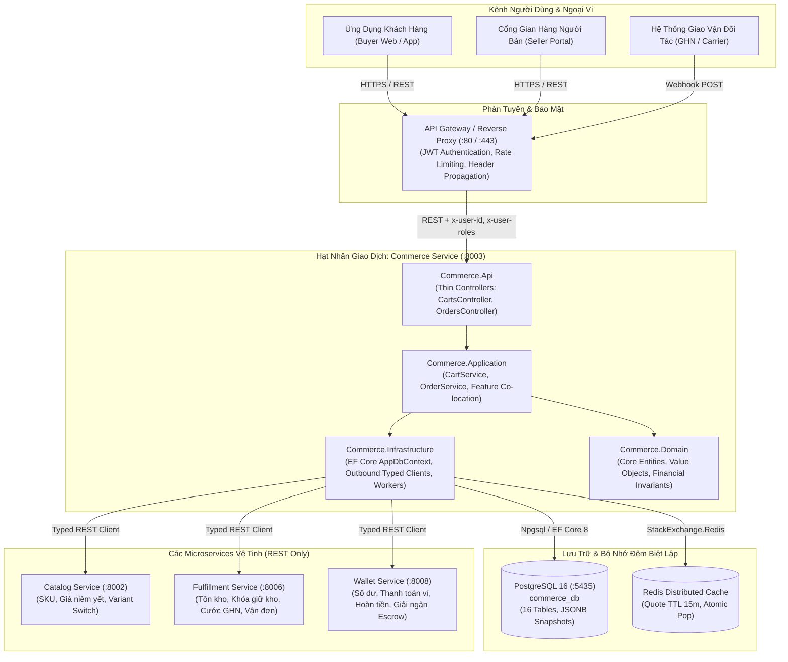
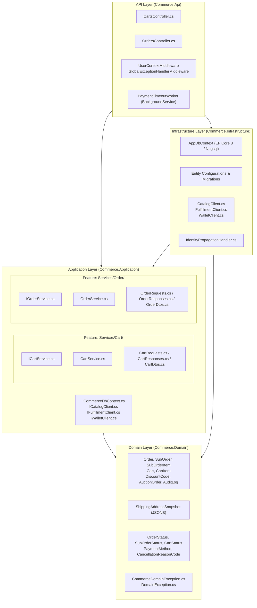
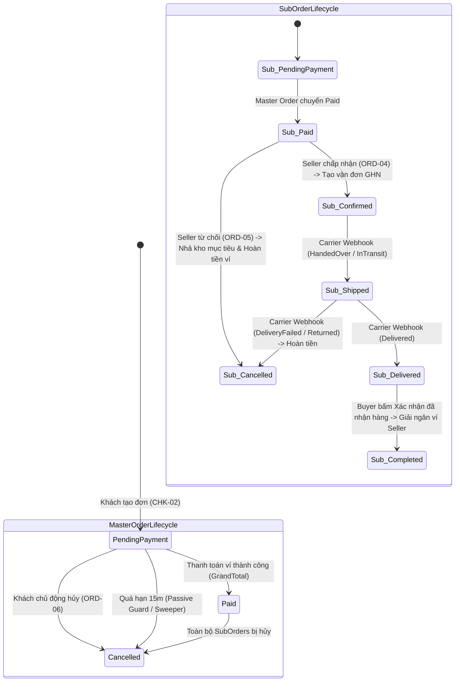
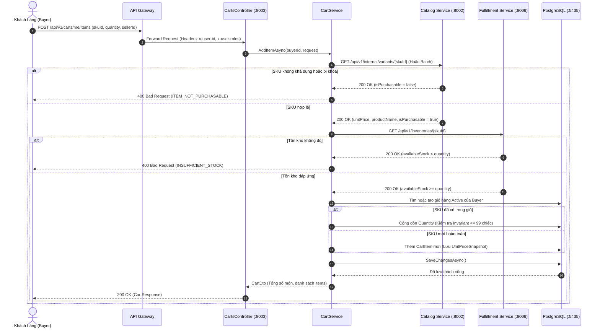
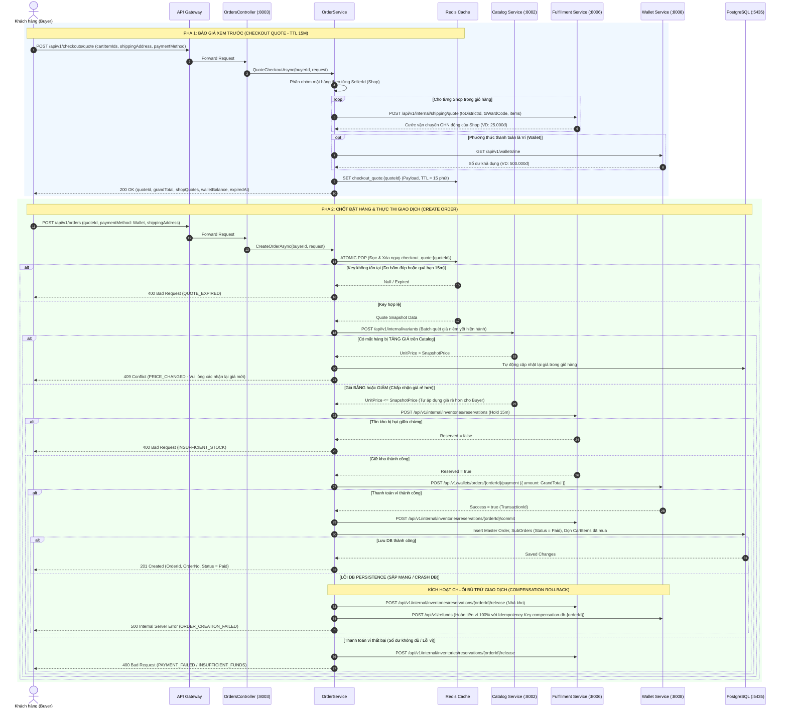
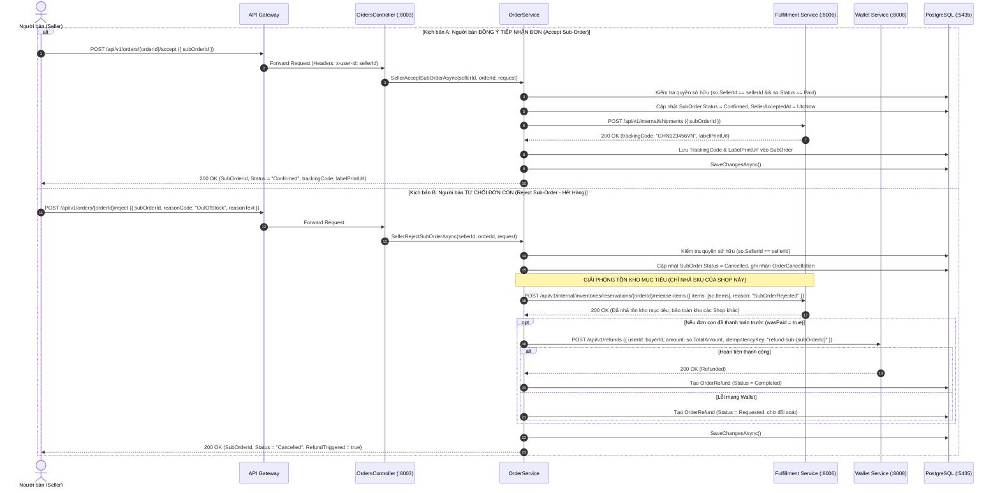
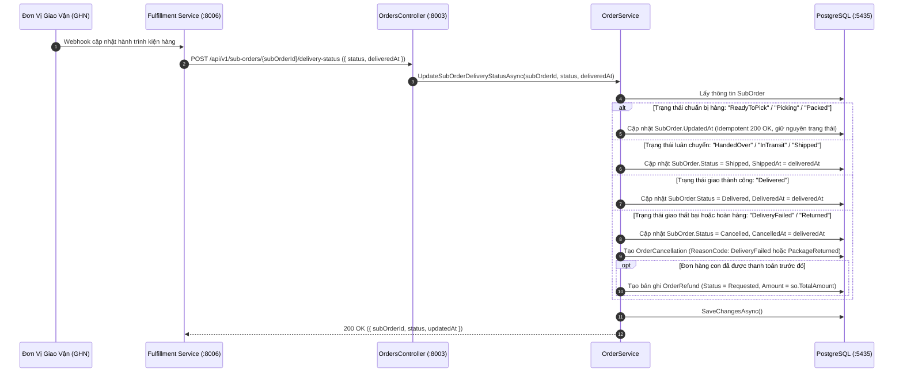
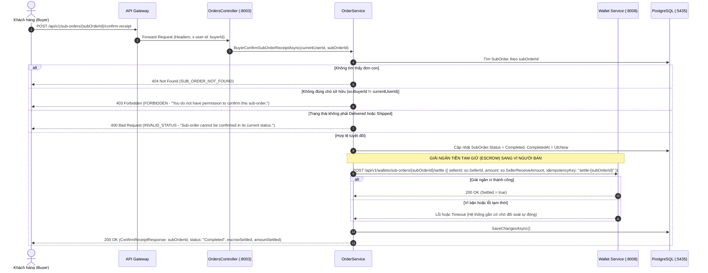

# COMMERCE SERVICE — TECHNICAL ARCHITECTURE & FLOW SPECIFICATION

## BẢN ĐẶC TẢ KIẾN TRÚC KỸ THUẬT, MÔ HÌNH DỮ LIỆU VÀ GIẢI PHẪU LUỒNG NGHIỆP VỤ

> **Dịch vụ:** Nexus Commerce Microservice (Port `8003` | Database: `commerce_db:5435` - PostgreSQL 16)  
> **Phiên bản tài liệu:** v3.0 (Chuẩn hóa 100% RESTful API, Clean Architecture, Mô hình Đơn Đa Người Bán & Escrow Settlement)  
> **Đối tượng sử dụng:** CTO, Solution Architects, Tech Leads, Senior Backend Engineers, QA/QC Engineers, Product Managers  
> **Cập nhật lần cuối:** 2026-11-09  
> **Phạm vi tài liệu:** 100% Nội bộ Commerce Service (Inward-Only & Self-Contained)

---

## 📌 PHẦN MỞ ĐẦU: VAI TRÒ CỦA TÀI LIỆU NÀY TRONG KỸ NGHỆ PHẦN MỀM

Tài liệu này là **Technical Design Document (TDD)** kiêm **Service Architecture & Resilience Blueprint** chính thức của Commerce Service. Văn bản phản ánh chính xác 100% hiện trạng mã nguồn thực thi trong Solution `Commerce.sln`, bao gồm các tầng kiến trúc, lược đồ cơ sở dữ liệu PostgreSQL, các quy tắc bảo toàn miền (Domain Invariants), hợp đồng tích hợp liên dịch vụ (Inter-Service REST Contracts), và ma trận phòng vệ chịu lỗi (Fault-Tolerance & Circuit Breaker Compensation).

Mục tiêu cốt lõi: Cung cấp góc nhìn kiến trúc toàn diện và sâu sắc nhất để các cấp kỹ thuật và quản lý có thể thấu hiểu, kiểm thử, tích hợp và phát triển hệ thống mà **không cần phải tra cứu từng dòng mã nguồn C#**.

---

# PHẦN 1: TỔNG QUAN HỆ THỐNG (SYSTEM OVERVIEW)

## 1.1 Vai Trò Cốt Lõi Trong Hệ Sinh Thái Microservices

**Commerce Service** đóng vai trò là **Hạt nhân Điều phối Giao dịch (Transactional Core & Source of Truth)** của toàn bộ nền tảng thương mại điện tử đa người bán (Multi-Vendor Marketplace). Dịch vụ nắm giữ quyền sở hữu độc quyền (Exclusive Bounded Context) đối với:
1. **Vòng đời Giỏ hàng (Shopping Cart Lifecycle):** Quản lý giỏ hàng người mua, kiểm tra tính khả dụng của mặt hàng, giá niêm yết snapshot, thay đổi phân loại, gộp giỏ hàng khách vãng lai, và phân nhóm theo từng gian hàng (Shop Grouping).
2. **Vòng đời Đơn hàng Đa Người Bán (Hierarchical Order Lifecycle):** Tiếp nhận báo giá (Quote), điều phối giao dịch thanh toán hai pha (Two-Phase Order Placement), quản lý cấu trúc Đơn hàng cha (Master Order) và Đơn hàng con theo Shop (Sub-Orders), kích hoạt giao vận, tiếp nhận webhook trạng thái nhà vận chuyển, và kích hoạt giải ngân quỹ ủy thác (Escrow Settlement) sang ví người bán khi giao dịch hoàn tất.

Commerce Service hoạt động độc lập tại cổng nội bộ **`8003`**, kết nối tới cơ sở dữ liệu biệt lập PostgreSQL **`5435`** (`commerce_db`), đứng sau API Gateway và tương tác trực tiếp với 3 dịch vụ vệ tinh:



## 1.2 Quyết Định Kiến Trúc: Chuẩn Hóa 100% RESTful & Bãi Bỏ Saga / Broker

Từ ngày 2026-10-30, hệ thống chính thức áp dụng quyết định kiến trúc: **Chuẩn hóa 100% RESTful Web API, cấm gRPC, và bãi bỏ hoàn toàn Message Broker (RabbitMQ, MassTransit, Saga State Machine, Outbox Tables)** vì các lý do chiến lược sau:
1. **Triệt tiêu Độ trễ và Trạng thái Chờ Bất định (Zero In-Flight Uncertainty):** Quy trình thương mại điện tử yêu cầu phản hồi tức thời cho khách hàng ngay khi bấm "Đặt hàng". Việc dùng Saga không đồng bộ qua Broker thường đẩy hệ thống vào trạng thái trung gian (`Processing`, `PendingVerification`), gây phức tạp cho giao diện người dùng và gia tăng rủi ro quá hạn giữ hàng.
2. **Loại bỏ Bất đồng bộ Kép & Lệch Dữ liệu (Outbox Desynchronization):** Trong các hệ thống phân tán phức tạp, bảng Outbox và tiến trình quét Worker thường xuyên gặp lỗi trễ quét (polling delay), trùng lặp bản tin (duplicate events), hoặc tranh chấp kết nối cơ sở dữ liệu.
3. **Cơ chế Điều Phối Đồng Bộ Kèm Bù Trừ (Synchronous Orchestration with Compensation Circuit):** Commerce Service trực tiếp đóng vai trò nhạc trưởng điều phối thông qua các Outbound Typed REST Clients với cơ chế bảo vệ:
   - **Atomic Pop** trên Redis Cache ngăn chặn trùng lặp đặt hàng (Double-Click).
   - **Khóa giữ kho 15 phút** tại Fulfillment Service trước khi thanh toán.
   - **Thanh toán trực tiếp Idempotent** qua Wallet Service.
   - **Tự động kích hoạt chuỗi bù trừ (Compensation Rollback)**: Nếu quá trình lưu cơ sở dữ liệu thất bại sau khi đã trừ tiền ví và giữ kho, Commerce Service lập tức phát lệnh hoàn tiền ví 100% và nhả kho tức thời.

---

# PHẦN 2: THIẾT KẾ KIẾN TRÚC (ARCHITECTURE DESIGN)

## 2.1 Cấu Trúc 4 Tầng Clean Architecture

Mã nguồn được tổ chức nghiêm ngặt theo mô hình Clean Architecture 4 tầng, tuân thủ nguyên tắc Dependency Inversion:



### Chi Tiết Từng Tầng:
1. **`Commerce.Domain` (Core Domain):**
   - Chứa toàn bộ thực thể nghiệp vụ trung tâm, Enums, Value Objects và Domain Exceptions.
   - Hoàn toàn tinh khiết, không tham chiếu tới bất kỳ thư viện ORM, HTTP hoặc hạ tầng bên ngoài nào.
   - Thiết lập các bất biến nghiệp vụ bất khả xâm phạm: giới hạn tối đa 50 mặt hàng trong giỏ, tối đa 99 chiếc/mặt hàng, công thức tính toán tài chính đơn hàng.
2. **`Commerce.Application` (Use Cases & Business Logic):**
   - Triển khai toàn bộ luồng xử lý nghiệp vụ theo quy chuẩn **Feature Co-location**: Mọi DTO, Request, Response, Interface và Service của một tính năng nằm trọn vẹn trong một thư mục (`Services/Cart/`, `Services/Order/`).
   - Phụ thuộc trừu tượng thông qua `ICommerceDbContext` và các interface client `ICatalogClient`, `IFulfillmentClient`, `IWalletClient`.
   - Cung cấp mô hình phân trang chuẩn `PagedData<T>` thao tác trực tiếp tại database.
3. **`Commerce.Infrastructure` (Hạ Tầng & Công Nghệ Ngoại Vi):**
   - Triển khai `ICommerceDbContext` thông qua `AppDbContext` (EF Core 8 Npgsql).
   - Đăng ký và cấu hình các Outbound Typed REST Clients với cơ chế `IdentityPropagationHandler` (tự động đẩy `x-user-id`, `x-user-roles` sang các service vệ tinh).
   - Tích hợp `IDistributedCache` (Redis) và định nghĩa Migration, Fluent API mapping.
4. **`Commerce.Api` (Presentation & HTTP Boundaries):**
   - Đóng vai trò là màng lọc mỏng (**Thin Controllers**): ghép cặp 1-to-1 giữa Controller và Feature Service tương ứng (`CartsController` $\rightarrow$ `ICartService`, `OrdersController` $\rightarrow$ `IOrderService`).
   - Tuyệt đối cấm lồng ghép business logic, truy vấn database hoặc rẽ nhánh nghiệp vụ tại Controller.
   - Quản lý xác thực qua `UserContextMiddleware`, phân quyền vai trò qua `[RequireRole("buyer", "admin", "staff")]`, và tuần tự hóa Enum chuẩn hóa PascalCase qua `PascalCaseJsonStringEnumConverter`.
   - Vận hành Background Worker `PaymentTimeoutWorker` chạy nền để quét và hủy đơn quá hạn.

---

## 2.2 Rào Chắn Thiết Kế: No-Repository Pattern over EF Core

Tại Commerce Service, **TUYỆT ĐỐI CẤM SỬ DỤNG REPOSITORY PATTERN BỌC NGOÀI EF CORE** (Cấm tạo `IOrderRepository`, `ICartRepository`, `UnitOfWork`).

### Cơ Sở Lý Luận Kỹ Thuật (Architectural Justification):
1. **EF Core Bản Thân Đã Là Repository & Unit of Work:** `DbContext` là hiện thân chuẩn mực của mẫu thiết kế *Unit of Work*, và `DbSet<T>` chính là một *Generic Repository*. Việc tạo thêm một tầng Repository bọc ngoài chỉ tạo ra sự dư thừa mã nguồn (Anti-Pattern: Indirection for the sake of indirection).
2. **Tránh Rò Rỉ Trừu Tượng (Leaky Abstraction):** Lớp Repository thường không thể che giấu hoàn toàn hành vi của cơ sở dữ liệu quan hệ. Khi cần nạp eager-loading (`.Include()`, `.ThenInclude()`), chỉ định truy vấn không theo dõi (`.AsNoTracking()`), hoặc chiếu dữ liệu DTO (`.Select()`), Repository buộc phải mở rộng hàm hoặc trả về `IQueryable<T>`, làm phá vỡ mục đích đóng gói ban đầu.
3. **Tối Ưu Hóa Phân Trang Cơ Sở Dữ Liệu:** Áp dụng trực tiếp `ICommerceDbContext` trong Application Layer cho phép thực thi phân trang trực tiếp trên database server thông qua `.Skip((page - 1) * pageSize).Take(pageSize)` và `.CountAsync()`, tránh tuyệt đối lỗi kéo toàn bộ bảng về RAM (In-Memory Pagination) gây sập hệ thống dưới tải lớn.
4. **Tận Dụng Native Capabilities Của PostgreSQL:** Cho phép cấu hình và truy vấn các tính năng đặc thù như cột JSONB (`ShippingAddressSnapshot`), Concurrency Token, và Raw SQL khi cần tối ưu hiệu năng tối đa.

---

## 2.3 Ngăn Xếp Công Nghệ (Technology Stack)

| Hạng Mục | Công Nghệ / Thư Viện | Phiên Bản | Ghi Chú Kiến Trúc & Ràng Buộc Kỹ Thuật |
| - | - | - | - |
| **Nền Tảng Runtime** | .NET (C# 12) | `net8.0` LTS | Môi trường thực thi hiệu năng cao, hỗ trợ Docker Linux Container. |
| **Web Framework** | ASP.NET Core Web API | 8.0 | Thin Controllers, Không sử dụng Razor hay MVC Views. |
| **ORM / Data Access** | Entity Framework Core | 8.0.10 | Code-First Migrations, Fluent API, No-Repository pattern. |
| **PostgreSQL Provider** | `Npgsql.EntityFrameworkCore.PostgreSQL` | 8.0.10 | Hỗ trợ ánh xạ Native JSONB, Date/Time mapping chuẩn UTC. |
| **Cơ Sở Dữ Liệu** | PostgreSQL | 16.x Alpine | Port container `5435`, Database `commerce_db`. Độc lập 100%. |
| **Bộ Nhớ Đệm Phân Tán** | `StackExchange.Redis` / Distributed Cache | 8.0 | Lưu trữ Quote Snapshot (TTL 15 phút), Atomic Pop chống bấm đúp. |
| **Giao Tiếp Microservices** | `HttpClient` (Typed REST Clients) | Built-in | `CatalogClient`, `FulfillmentClient`, `WalletClient` kèm `IdentityPropagation`. |
| **Chạy Tác Vụ Ngầm** | `BackgroundService` + `PeriodicTimer` | Built-in | `PaymentTimeoutWorker` chạy chu kỳ 60 giây dọn dẹp đơn quá hạn. |
| **Tuần Tự Hóa JSON** | `System.Text.Json` | Built-in | `PascalCaseJsonStringEnumConverter`, camelCase property naming. |
| **Tài Liệu Hóa API** | Swagger / Swashbuckle | 6.5.0 | Tích hợp OpenAPI 3.0, hỗ trợ kiểm thử trực tiếp trên môi trường dev. |
| **Kiểm Thử Tự Động** | xUnit, Moq, FluentAssertions | 2.8+ | 100% bao phủ các kịch bản E2E Flow, Lifecycle, và Invariants. |

> [!NOTE]
> **Giải trình về Cơ sở dữ liệu (PostgreSQL vs SQL Server):**  
> Mặc dù một số tài liệu sơ bộ ban đầu đề cập tới SQL Server, Commerce Service thực tế được thiết kế và vận hành **100% trên nền tảng PostgreSQL 16**. Quyết định này giúp tối ưu hóa chi phí bản quyền trong môi trường Cloud-Native, tận dụng khả năng lưu trữ snapshot địa chỉ dạng JSONB native với hiệu năng index vượt trội, và đồng bộ tuyệt đối với hệ thống Docker Compose nội bộ (`commerce_db:5435`).

---

# PHẦN 3: MÔ HÌNH MIỀN & LƯỢC ĐỒ CƠ SỞ DỮ LIỆU (DOMAIN MODELS & DB SCHEMA)

## 3.1 Sơ Đồ Quan Hệ Thực Thể (Mermaid ER Diagram)

```mermaid
erDiagram
    Carts ||--o{ CartItems : "chứa (1:N)"
    Orders ||--|{ SubOrders : "chia thành (1:N)"
    SubOrders ||--|{ SubOrderItems : "chứa (1:N)"
    SubOrders ||--o| OrderCancellations : "có (0:1)"
    SubOrders ||--o{ OrderRefunds : "có (0:N)"
    Orders ||--o{ OrderStatusHistories : "ghi nhận (1:N)"
    Orders ||--o| OrderInvoices : "xuất (0:1)"
    Orders ||--o| AuctionOrders : "liên kết đấu giá (0:1)"
    DiscountCodes ||--o{ DiscountCodeScopes : "áp dụng cho (1:N)"
    DiscountCodes ||--o{ DiscountCodeUsages : "được dùng (1:N)"
    Orders ||--o{ DiscountCodeUsages : "áp dụng voucher (0:N)"

    Carts {
        uuid Id PK
        uuid BuyerId "UK"
        int Status "0: Active, 1: CheckedOut, 2: Abandoned"
        timestamp CreatedAt
        timestamp UpdatedAt
        bool IsDeleted
    }

    CartItems {
        uuid Id PK
        uuid CartId FK
        uuid SkuId
        uuid ProductId
        uuid SellerId
        string ProductName
        string SkuName
        decimal UnitPriceSnapshot
        int Quantity "1..99"
        timestamp CreatedAt
        timestamp UpdatedAt
    }

    Orders {
        uuid Id PK
        string OrderNo "UK (ORD-YYYYMMDD-XXXXX)"
        uuid BuyerId
        decimal TotalAmount
        decimal ShippingFee
        decimal DiscountAmount
        decimal GrandTotal
        int PaymentMethod "0: Wallet, 1: Cod, 2: CreditCard, 3: BankTransfer"
        int Status "0: PendingPayment, 1: PaymentProcessing, 2: Paid, 3: Cancelled, 4: Expired"
        timestamp PaymentDeadlineAt "15m hoặc 24h"
        timestamp PaidAt
        jsonb ShippingAddressSnapshot "Snapshot địa chỉ bất biến"
        timestamp CreatedAt
        timestamp UpdatedAt
        bool IsDeleted
    }

    SubOrders {
        uuid Id PK
        uuid OrderId FK
        uuid SellerId
        string SubOrderNo "UK (ORD-YYYYMMDD-XXXXX-XX)"
        decimal TotalAmount
        decimal ShippingFee
        decimal DiscountAmount
        decimal GrandTotal
        decimal PlatformFee "Phí sàn (vd: 5%)"
        decimal SellerReceiveAmount "Tiền chuyển vào ví Shop"
        int Status "0: PendingPayment, 1: Paid, 2: Confirmed, 3: Shipped, 4: Delivered, 5: Completed, 6: Cancelled, 7: Refunded"
        string ShippingCarrier "GHN"
        string TrackingCode "Mã vận đơn bưu cục"
        string LabelPrintUrl "URL in phiếu gửi hàng"
        timestamp SellerAcceptedAt
        timestamp ShippedAt
        timestamp DeliveredAt
        timestamp CompletedAt
        timestamp CancelledAt
        bool IsDeleted
    }

    SubOrderItems {
        uuid Id PK
        uuid SubOrderId FK
        uuid SkuId
        uuid ProductId
        string ProductName
        string SkuName
        decimal UnitPrice
        int Quantity
        decimal TotalPrice
    }

    OrderCancellations {
        uuid Id PK
        uuid SubOrderId FK
        uuid CancelledBy
        int ActorRole "Buyer, Seller, System, Admin"
        int ReasonCode "BuyerCancelled, SellerRejected, PaymentTimeout, DeliveryFailed..."
        string ReasonNote
        bool WasPaid
        bool InventoryReleased
        timestamp CreatedAt
    }

    OrderRefunds {
        uuid Id PK
        uuid SubOrderId FK
        uuid OrderId
        uuid CancellationId FK
        int RefundType "Full, Partial"
        decimal Amount
        int Status "Requested, Processing, Completed, Failed, Rejected"
        string ReasonCode
        string ReasonNote
        int ActorRole
        timestamp RequestedAt
        timestamp ProcessedAt
        string TransactionId
    }

    OrderStatusHistories {
        uuid Id PK
        uuid OrderId FK
        uuid SubOrderId
        string FromStatus
        string ToStatus
        string ChangedBy
        timestamp ChangedAt
        string Reason
    }

    DiscountCodes {
        uuid Id PK
        string Code "UK"
        int Type "Percentage, FixedAmount"
        decimal Value
        decimal MinOrderAmount
        decimal MaxDiscountAmount
        int UsageLimit
        int UsedCount
        bool IsActive
        timestamp StartDate
        timestamp EndDate
    }

    DiscountCodeUsages {
        uuid Id PK
        uuid DiscountCodeId FK
        uuid OrderId FK
        uuid BuyerId
        timestamp UsedAt
    }

    AuctionOrders {
        uuid Id PK
        uuid OrderId FK
        uuid AuctionId "UK"
        decimal WinningBidAmount
        timestamp WonAt
    }

    OrderInvoices {
        uuid Id PK
        uuid OrderId FK
        string InvoiceNo
        string TaxCode
        string CompanyName
        string CompanyAddress
        timestamp IssuedAt
    }

    AuditLogs {
        uuid Id PK
        string EntityName
        string EntityId
        int Action "Create, Update, Delete"
        jsonb ChangesJson
        uuid PerformedBy
        timestamp PerformedAt
    }

    DailyOrderSequences {
        date Date PK
        int LastSequence
    }

    SystemSettings {
        string Key PK
        string Value
        int ValueType
        string Description
        timestamp UpdatedAt
    }
```



---

## 3.2 Chi Tiết Các Bảng Dữ Liệu & Quy Tắc Lưu Trữ

Commerce Service quản lý tổng cộng **16 bảng dữ liệu** trên schema PostgreSQL `public`:

| STT | Tên Bảng (DbSet) | Khóa Chính | Khóa Ngoại / Quan Hệ | Mô Tả Nghiệp Vụ & Ràng Buộc Kỹ Thuật |
| :-: | - | - | - | - |
| 1 | `Carts` | `Id` (UUID) | `BuyerId` (Unique) | Giỏ hàng của người mua. Mỗi Buyer chỉ có 1 giỏ hàng `Active` tại một thời điểm. Hỗ trợ Soft Delete. |
| 2 | `CartItems` | `Id` (UUID) | `CartId` $\rightarrow$ `Carts.Id` | Chi tiết mặt hàng trong giỏ. Ràng buộc tối đa 99 chiếc/món và tối đa 50 mặt hàng/giỏ. Lưu `UnitPriceSnapshot`. |
| 3 | `Orders` | `Id` (UUID) | None | Đơn hàng tổng (Master Order). Lưu trữ thông tin thanh toán, mã đơn `OrderNo` (ORD-YYYYMMDD-XXXXX), và JSONB `ShippingAddressSnapshot`. |
| 4 | `SubOrders` | `Id` (UUID) | `OrderId` $\rightarrow$ `Orders.Id` | Đơn hàng con theo từng Shop (`SellerId`). Quản lý cước ship riêng, phí sàn, vận đơn GHN, và tiền thực nhận `SellerReceiveAmount`. |
| 5 | `SubOrderItems` | `Id` (UUID) | `SubOrderId` $\rightarrow$ `SubOrders.Id` | Chi tiết mặt hàng trong đơn hàng con. Lưu snapshot tên sản phẩm, tên biến thể, đơn giá và thành tiền. |
| 6 | `DiscountCodes` | `Id` (UUID) | None | Danh mục mã giảm giá (Voucher sàn/Shop). Lưu loại giảm giá, giá trị, hạn mức và số lần sử dụng. |
| 7 | `DiscountCodeScopes` | `Id` (UUID) | `DiscountCodeId` $\rightarrow$ `DiscountCodes.Id` | Phạm vi áp dụng của mã giảm giá (áp dụng toàn sàn, theo danh mục hoặc theo Shop). |
| 8 | `DiscountCodeUsages` | `Id` (UUID) | `DiscountCodeId`, `OrderId` | Nhật ký sử dụng voucher. Cho phép giải phóng hoàn lại lượt dùng khi đơn bị hủy trong 15 phút. |
| 9 | `AuctionOrders` | `Id` (UUID) | `OrderId` $\rightarrow$ `Orders.Id` | Bản ghi liên kết cho các đơn hàng hình thành từ phiên thắng đấu giá (TTL thanh toán 24 giờ). |
| 10 | `OrderStatusHistories` | `Id` (UUID) | `OrderId` $\rightarrow$ `Orders.Id` | Nhật ký kiểm toán lịch sử chuyển dịch trạng thái của đơn hàng cha và đơn hàng con. |
| 11 | `OrderInvoices` | `Id` (UUID) | `OrderId` $\rightarrow$ `Orders.Id` | Thông tin xuất hóa đơn giá trị gia tăng (VAT) theo yêu cầu của doanh nghiệp/người mua. |
| 12 | `OrderCancellations` | `Id` (UUID) | `SubOrderId` $\rightarrow$ `SubOrders.Id` | Biên bản hủy đơn con: ghi nhận vai trò người hủy (`ActorRole`), mã lý do (`ReasonCode`), và cờ giải phóng kho. |
| 13 | `OrderRefunds` | `Id` (UUID) | `SubOrderId`, `CancellationId` | Yêu cầu hoàn tiền ví: hỗ trợ hoàn tiền tự động khi Shop từ chối hoặc bưu cục giao thất bại. |
| 14 | `DailyOrderSequences` | `Date` (DATE) | None | Bộ đếm số thứ tự đơn hàng sinh mã trong ngày (dùng sinh chuỗi tăng dần `ORD-YYYYMMDD-XXXXX`). |
| 15 | `AuditLogs` | `Id` (UUID) | None | Bảng ghi vết kiểm toán toàn diện hệ thống cho các thao tác ghi (Mutation Operations) phục vụ truy vết. |
| 16 | `SystemSettings` | `Key` (VARCHAR) | None | Cấu hình tham số hệ thống động (Thời gian giữ kho, mức phí sàn mặc định, fallback values). |

---

## 3.3 Danh Mục Enums Nghiệp Vụ Cốt Lõi

Mọi Enum khi lưu vào PostgreSQL được lưu dưới dạng số nguyên (`integer`), nhưng khi tuần tự hóa ra JSON REST API bắt buộc phải chuyển đổi thành chuỗi **`PascalCase`** thông qua `PascalCaseJsonStringEnumConverter`:

1. **`OrderStatus` (Trạng Thái Đơn Hàng Tổng - Master Order):**
   - `PendingPayment = 0`: Đơn hàng vừa tạo, chờ người mua hoàn tất thanh toán (TTL 15 phút).
   - `PaymentProcessing = 1`: Đang trong tiến trình gọi thanh toán sang cổng ví.
   - `Paid = 2`: Thanh toán thành công, toàn bộ tiền đã vào tài khoản tạm giữ.
   - `Cancelled = 3`: Đơn hàng đã bị hủy (do người mua, hệ thống, hoặc quá hạn).
   - `Expired = 4`: Đơn hàng hết hạn thanh toán (quá 15 phút không thanh toán).
2. **`SubOrderStatus` (Trạng Thái Đơn Hàng Con - Shop Sub-Order):**
   - `PendingPayment = 0`: Chờ đơn tổng thanh toán.
   - `Paid = 1`: Đơn tổng đã thanh toán, chờ người bán bấm tiếp nhận.
   - `Confirmed = 2`: Người bán đã đồng ý tiếp nhận, hệ thống đã sinh vận đơn GHN.
   - `Shipped = 3`: Bưu cục GHN đã lấy hàng và đang trên đường luân chuyển.
   - `Delivered = 4`: Kiện hàng đã giao thành công tới tay người mua.
   - `Completed = 5`: Người mua bấm xác nhận đã nhận hàng, tiền Escrow đã giải ngân vào ví người bán.
   - `Cancelled = 6`: Đơn hàng con bị hủy (do Shop từ chối, hết hàng hoặc giao thất bại).
   - `Refunded = 7`: Đơn con đã hoàn tiền đầy đủ cho người mua.
3. **`CartStatus` (Trạng Thái Giỏ Hàng):**
   - `Active = 0`: Giỏ hàng đang hoạt động bình thường của khách.
   - `CheckedOut = 1`: Giỏ hàng đã hoàn tất đặt hàng.
   - `Abandoned = 2`: Giỏ hàng bị bỏ quên quá lâu.
4. **`PaymentMethod` (Phương Thức Thanh Toán):**
   - `Wallet = 0`: Ví điện tử nội bộ Nexus Wallet.
   - `Cod = 1`: Thanh toán khi nhận hàng (Cash On Delivery).
   - `CreditCard = 2`: Thẻ tín dụng / Ghi nợ quốc tế.
   - `BankTransfer = 3`: Chuyển khoản ngân hàng qua mã QR động.
5. **`CancellationReasonCode` (Mã Lý Do Hủy Đơn):**
   - `BuyerCancelled`: Người mua chủ động hủy khi chưa thanh toán.
   - `SellerRejected`: Người bán từ chối nhận đơn do hết hàng/không phục vụ.
   - `PaymentTimeout`: Quá hạn thanh toán 15 phút.
   - `DeliveryFailed`: Bưu cục giao hàng không thành công sau nhiều lần thử.
   - `PackageReturned`: Kiện hàng bị chuyển hoàn về kho người bán.
   - `SystemError`: Sự cố giao dịch hoặc lỗi mạng nội bộ.

---

## 3.4 Cơ Chế Bảo Toàn Snapshot Bất Biến (Snapshot Preservation)

Để đảm bảo tính toàn vẹn pháp lý và đối soát kế toán, hệ thống áp dụng cơ chế Snapshot tại 2 điểm xung yếu:
1. **`UnitPriceSnapshot` trong CartItem:** Khi khách đưa sản phẩm vào giỏ, đơn giá tại thời điểm đó được ghi nhận làm căn cứ đối chiếu biến động giá (`Price Drift`) lúc checkout.
2. **`ShippingAddressSnapshot` trong Order:** Thông tin giao nhận hàng (Họ tên người nhận, Số điện thoại, Tỉnh/Thành, Quận/Huyện, Phường/Xã, Mã bưu cục GHN, Địa chỉ chi tiết) được đóng gói thành Value Object và lưu dưới dạng cột **Native JSONB** trong bảng `Orders`.
   - **Bất biến tuyệt đối:** Khi người dùng thay đổi hoặc xóa sổ địa chỉ cá nhân trong Profile, thông tin giao hàng gắn liền với các đơn hàng lịch sử trong quá khứ hoàn toàn không bị ảnh hưởng.
   - **Tương thích EF Core 8:** Ánh xạ qua Fluent API `.OwnsOne(o => o.ShippingAddress, sa => sa.ToJson())`, loại trừ dữ liệu seed `HasData` trực tiếp để tránh lỗi metadata conflict của EF Core.

---

# PHẦN 4: GIẢI PHẪU LUỒNG NGHIỆP VỤ CỐT LÕI (CORE BUSINESS FLOWS)

## 4.1 Sơ Đồ Chuyển Đổi Trạng Thái Đơn Hàng (State Transition Diagram)



---

## 4.2 Luồng 1: Quản Lý & Tương Tác Giỏ Hàng (Cart Operations)

Khách hàng duyệt sản phẩm, thêm vào giỏ, cập nhật số lượng hoặc đổi phân loại mẫu mã hàng trực tiếp.



### Các Quy Tắc Miền (Invariants) Của Giỏ Hàng:
1. **Giới hạn số lượng:** Mỗi giỏ hàng chứa tối đa **50 mặt hàng khác nhau**, mỗi dòng hàng tối đa **99 chiếc**.
2. **Đổi phân loại (Change Variant - CART-06):** Gọi `CatalogClient.ValidateVariantSwitchAsync` để kiểm tra phân loại mới có cùng sản phẩm cha và cùng người bán hay không. Nếu phân loại mới đã có sẵn một dòng trong giỏ, hệ thống tự động **Merge** (cộng dồn số lượng) và xóa dòng cũ.
3. **Gộp giỏ hàng khách vãng lai (Merge Guest Cart - CART-12):** Khi người dùng đăng nhập, các mặt hàng từ Guest Cart được tích hợp vào giỏ của tài khoản, áp dụng luật cộng dồn số lượng và trần 99 chiếc.

---

## 4.3 Luồng 2: Quy Trình Đặt Hàng & Thanh Toán 2 Pha (Checkout Quote & Two-Phase Order Placement)

Đây là quy trình giao dịch trọng yếu nhất của sàn thương mại điện tử, được bảo vệ bằng mô hình hai pha nhằm loại trừ rủi ro đặt trùng và xung đột giá:



---

## 4.4 Luồng 3: Quy Trình Xử Lý Đơn Hàng Của Người Bán (Seller Fulfillment & Targeted Rejection)

Sau khi đơn hàng tổng đã chuyển sang trạng thái `Paid`, từng Shop tiếp nhận đơn con của mình một cách hoàn toàn độc lập:



---

## 4.5 Luồng 4: Webhook Đồng Bộ Trạng Thái Giao Vận (Delivery Status Webhook)

Fulfillment Service đóng vai trò cầu nối với đơn vị vận chuyển (GHN), phát webhook cập nhật tiến độ bưu kiện sang Commerce Service:



---

## 4.6 Luồng 5: Khách Hàng Xác Nhận Đã Nhận Hàng & Giải Ngân Escrow (Receipt Confirmation & Settlement)

Khi người mua nhận được hàng và hài lòng với kiện hàng, họ bấm **"Đã nhận được hàng"** để kết thúc giao dịch và giải phóng tiền cho người bán:



---

## 4.7 Luồng 6: Quản Lý Quá Hạn Thanh Toán Lai (Hybrid Payment Expiration)

Để ngăn chặn tình trạng khách đặt hàng giữ chỗ nhưng không thanh toán (gây giam hàng ảo trong kho), hệ thống vận hành **Cơ chế Quản lý Quá hạn Lai (Hybrid Expiration)** kết hợp giữa chủ động và thụ động:

```mermaid
flowchart TD
    subgraph TriggerA["1. Thụ Động (Passive Guard - Lazy Expiration)"]
        ClientCall["Buyer / Seller / Client gọi<br/>GET /api/v1/orders/{orderId}"]
        CheckOverdue{"Trạng thái == PendingPayment<br/>VÀ UtcNow > PaymentDeadlineAt?"}
        ExpireSingle["Tự động hủy đơn hàng cha & các đơn con<br/>Lưu OrderCancellation (Reason: PaymentTimeout)"]
        ReleaseSingle["FulfillmentClient.ReleaseStockAsync(orderId)"]
        RollbackVoucher["Khôi phục lượt dùng mã giảm giá"]
    end

    subgraph TriggerB["2. Chủ Động (Active Sweeper - PaymentTimeoutWorker)"]
        Timer["PeriodicTimer: Mỗi 60 giây"]
        QueryExpired["Quét DB tìm Top 50 đơn hàng<br/>PendingPayment quá hạn thanh toán"]
        BatchRelease["FulfillmentClient.BatchReleaseStockAsync(orderIds)<br/>(Chống N+1 HTTP Calls)"]
        BatchUpdateDB["Cập nhật Cancelled hàng loạt trong DB<br/>Ghi nhận OrderCancellation & giải phóng voucher"]
    end

    ClientCall --> CheckOverdue
    CheckOverdue -- Có --> ExpireSingle
    ExpireSingle --> ReleaseSingle
    ReleaseSingle --> RollbackVoucher

    Timer --> QueryExpired
    QueryExpired -- Tìm thấy danh sách đơn --> BatchRelease
    BatchRelease --> BatchUpdateDB
```



---

# PHẦN 5: DANH MỤC HỢP ĐỒNG REST API & CÁC ĐIỂM TÍCH HỢP (API CONTRACT & INTEGRATION)

## 5.1 Bảng Danh Sách Toàn Bộ 28 REST Endpoints Nội Bộ

Tất cả các endpoints đều tuân thủ 100% quy chuẩn danh từ số nhiều (Plural Nouns), xác thực danh tính qua Gateway Header, trả về Pure DTOs và bắt lỗi theo chuẩn RFC 9110 Problem Details:

### Nhóm 1: Quản Lý Giỏ Hàng (`CartsController` — `/api/v1/carts`)
| Mã | Method | URL Endpoint | Phân Quyền | Tóm Tắt Chức Năng Chính (1 Câu Ngắn Gọn) |
| :-: | :-: | - | :-: | - |
| `CART-01` | `GET` | `/api/v1/carts/me` | Buyer | Lấy hoặc tự động tạo mới giỏ hàng đang hoạt động của người mua. |
| `CART-02` | `GET` | `/api/v1/carts/me/summary` | Buyer | Lấy tổng số lượng món và tổng tiền tạm tính cho badge header giỏ hàng. |
| `CART-03` | `GET` | `/api/v1/carts/me/grouped` | Buyer | Lấy chi tiết giỏ hàng được phân nhóm theo từng Shop cho giao diện sàn. |
| `CART-04` | `POST` | `/api/v1/carts/me/items` | Buyer | Thêm sản phẩm vào giỏ, kiểm tra Catalog và tồn kho Fulfillment tức thì. |
| `CART-05` | `PATCH` | `/api/v1/carts/me/items/{cartItemId}` | Buyer | Cập nhật số lượng của dòng hàng trong giỏ (tối đa 99 chiếc). |
| `CART-06` | `PATCH` | `/api/v1/carts/me/items/{cartItemId}/variant` | Buyer | Đổi biến thể/màu sắc của sản phẩm trực tiếp trong giỏ hàng. |
| `CART-07` | `DELETE` | `/api/v1/carts/me/items/{cartItemId}` | Buyer | Xóa một dòng sản phẩm ra khỏi giỏ hàng. |
| `CART-08` | `POST` | `/api/v1/carts/me/items:bulk-remove` | Buyer | Xóa hàng loạt các món được tích chọn khỏi giỏ hàng. |
| `CART-09` | `DELETE` | `/api/v1/carts/me/clear` | Buyer | Dọn sạch toàn bộ các món trong giỏ hàng. |
| `CART-10` | `POST` | `/api/v1/carts/me/calculate` | Buyer | Tính tổng tiền tạm tính cho danh sách các món được tích chọn mua. |
| `CART-11` | `POST` | `/api/v1/carts/me/validate` | Buyer | Kiểm tra tính khả dụng, tồn kho và độ tươi của giá trước khi checkout. |
| `CART-12` | `POST` | `/api/v1/carts/me/merge` | Buyer | Gộp các món từ giỏ hàng khách vãng lai (Guest Cart) vào tài khoản khi đăng nhập. |
| `CART-13` | `POST` | `/api/v1/carts/me/cleanup-checked-out` | Buyer | Dọn sạch các món đã mua thành công ra khỏi giỏ hàng sau thanh toán. |
| `CART-14` | `GET` | `/api/v1/carts/active?buyerId={guid}` | Admin/Staff | Quản trị viên tra cứu giỏ hàng đang hoạt động của bất kỳ người dùng nào. |

### Nhóm 2: Đơn Hàng & Vận Chuyển (`OrdersController` — `/api/v1/orders`, `/api/v1/sub-orders`, `/api/v1/checkouts`)
| Mã | Method | URL Endpoint | Phân Quyền | Tóm Tắt Chức Năng Chính (1 Câu Ngắn Gọn) |
| :-: | :-: | - | :-: | - |
| `CHK-01` | `POST` | `/api/v1/checkouts/quote` | Buyer | Tạo phiên báo giá xem trước, tính cước ship GHN từng shop, lưu cache 15m. |
| `CHK-02` | `POST` | `/api/v1/orders` | Buyer | Đặt hàng chính thức từ `quoteId`, giữ kho 15m, trừ ví, dọn giỏ hàng. |
| `ORD-01` | `GET` | `/api/v1/orders` | Buyer | Danh sách lịch sử đơn hàng của người mua (phân trang database, lọc status). |
| `ORD-02` | `GET` | `/api/v1/orders/{orderId}` | Buyer/Seller | Lấy chi tiết đơn hàng cha kèm cơ chế Passive Guard tự hủy nếu quá hạn. |
| `ORD-03` | `GET` | `/api/v1/sub-orders` | Seller | Người bán tra cứu danh sách đơn con của Shop mình (phân trang database). |
| `ORD-04` | `POST` | `/api/v1/orders/{orderId}/accept` | Seller | Người bán tiếp nhận đơn con (`Confirmed`) và kích hoạt tạo vận đơn GHN. |
| `ORD-05` | `POST` | `/api/v1/orders/{orderId}/reject` | Seller | Người bán từ chối đơn con, kích hoạt nhả kho mục tiêu và hoàn tiền ví. |
| `ORD-06` | `POST` | `/api/v1/orders/{orderId}/cancel` | Buyer | Người mua chủ động hủy đơn hàng khi còn ở trạng thái `PendingPayment`. |
| `ORD-07` | `GET` | `/api/v1/sub-orders/{subOrderId}` | Buyer/Seller | Lấy chi tiết đơn con của Shop (Single DTO bóc tách giảm giá & địa chỉ JSONB). |
| `ORD-08` | `GET` | `/api/v1/shipments/order/{orderId}` | Buyer/Seller | Tra cứu mã vận đơn GHN, tiến độ giao hàng và link in phiếu giao vận. |
| `ORD-09` | `POST` | `/api/v1/sub-orders/{subOrderId}/confirm-receipt` | Buyer | Người mua xác nhận đã nhận hàng (`Completed`) và kích hoạt giải ngân Escrow. |
| `ORD-10` | `POST` | `/api/v1/sub-orders/{subOrderId}/refund` | Buyer | Người mua khởi tạo yêu cầu hoàn tiền cho đơn hàng con. |
| `ORD-11` | `POST` | `/api/v1/sub-orders/{subOrderId}/delivery-status` | Internal | Webhook từ Fulfillment Service cập nhật 9 trạng thái giao hàng của carrier. |
| `ORD-12` | `GET` | `/api/v1/orders/buyer/{buyerId}` | Buyer/Admin | Endpoint tương thích ngược tra cứu danh sách đơn theo `buyerId`. |

---

## 5.2 Hợp Đồng Tích Hợp Microservices Qua Typed REST Clients

### 1. Catalog Service (`:8002`) — `ICatalogClient`
- **Tra cứu chi tiết SKU:** `GET /api/v1/internal/variants/{skuId}`
- **Quét batch danh sách SKU kiểm tra giá & tồn kho:** `POST /api/v1/internal/variants`
  - *Request Body:* `[ "guid-sku-1", "guid-sku-2" ]`
  - *Response:* `[{ "skuId": "...", "productId": "...", "sellerId": "...", "productName": "...", "unitPrice": 150000, "isPurchasable": true }]`
- **Thẩm định đổi biến thể:** `POST /api/v1/internal/catalog/skus/validate-variant-switch`
  - *Request Body:* `{ "currentSkuId": "...", "newSkuId": "..." }`
  - *Response:* `{ "isValid": true, "productId": "...", "sellerId": "...", "newSkuId": "...", "newUnitPrice": 160000, "isPurchasable": true }`

### 2. Fulfillment Service (`:8006`) — `IFulfillmentClient`
- **Kiểm tra nhanh tồn kho:** `GET /api/v1/inventories/{skuId}`
- **Tính cước phí ship GHN động:** `POST /api/v1/internal/shipping/quote`
  - *Request Body:* `{ "sellerId": "...", "toDistrictId": 1442, "toWardCode": "20101", "items": [{ "skuId": "...", "quantity": 2, "weightGrams": 200 }] }`
  - *Response:* `{ "shippingFee": 32000, "carrierCode": "GHN" }`
- **Khóa giữ kho tạm thời (15m):** `POST /api/v1/internal/inventories/reservations`
  - *Request Body:* `{ "referenceId": "orderId", "holdMinutes": 15, "items": [{ "skuId": "...", "quantity": 2, "sellerId": "..." }] }`
- **Xác nhận trừ kho vĩnh viễn:** `POST /api/v1/internal/inventories/reservations/{orderId}/commit`
- **Giải phóng kho toàn bộ (Hủy đơn/Quá hạn):** `POST /api/v1/internal/inventories/reservations/{orderId}/release?reason=OrderCancelled`
- **Giải phóng kho hàng loạt (Batch Release Sweeper):** `POST /api/v1/internal/inventories/reservations/batch-release`
  - *Request Body:* `{ "orderIds": [ "orderId1", "orderId2" ] }`
- **Giải phóng kho mục tiêu (Shop từ chối đơn):** `POST /api/v1/internal/inventories/reservations/{orderId}/release-items`
  - *Request Body:* `{ "items": [{ "skuId": "...", "quantity": 1 }], "reason": "SubOrderRejected" }`
- **Tạo vận đơn GHN tự động:** `POST /api/v1/internal/shipments`
  - *Request Body:* `{ "subOrderId": "..." }`
  - *Response:* `{ "trackingCode": "GHN998877VN", "carrierCode": "GHN", "labelPrintUrl": "https://carrier.ghn.vn/print/..." }`

### 3. Wallet Service (`:8008`) — `IWalletClient`
- **Tra cứu số dư khả dụng:** `GET /api/v1/wallets/me` (Truyền Bearer Token qua Header)
- **Thanh toán trừ tiền ví:** `POST /api/v1/wallets/orders/{orderId}/payment`
  - *Request Body:* `{ "amount": 250000 }`
  - *Response:* `{ "success": true, "transactionId": "TXN-9988-7766", "remainingBalance": 1250000 }`
- **Hoàn tiền ví tự động:** `POST /api/v1/refunds`
  - *Request Body:* `{ "userId": "buyerId", "amount": 250000, "reason": "SubOrderRejected" }`
  - *Header:* `Idempotency-Key: refund-sub-{subOrderId}`
- **Giải ngân tiền Escrow sang ví Shop:** `POST /api/v1/wallets/sub-orders/{subOrderId}/settle`
  - *Request Body:* `{ "sellerId": "sellerId", "amount": 235000 }`
  - *Header:* `Idempotency-Key: settle-{subOrderId}`

---

## 5.3 Mô Hình Bảo Mật & Truyền Dẫn Danh Tính (Identity Propagation)

1. **Ủy Thác Xác Thực Tại Gateway (Gateway Offloading):** API Gateway giải mã JWT Token của người dùng, xác thực tính hợp lệ, sau đó inject hai HTTP Headers chuẩn hóa vào request gửi tới Commerce Service:
   - `x-user-id`: GUID đại diện cho định danh người dùng (`buyerId` hoặc `sellerId`).
   - `x-user-roles`: Danh sách quyền phân cách bởi dấu phẩy (vd: `buyer`, `seller`, `admin`, `staff`).
2. **Khai Thác Danh Tính Tại Controller:**
   - Sử dụng Extension Method `HttpContext.TryGetUserId(out var userId, out var authError)` để trích xuất `currentUserId`.
   - Sử dụng Action Filter `[RequireRole("buyer", "admin", "staff")]` để chặn đứng từ tầng biên các request không có quyền phù hợp.
3. **Quy Chuẩn Bảo Vệ Quyền Sở Hữu Tài Nguyên (Resource Ownership Governance):**
   - **TUYỆT ĐỐI CẤM** tin tưởng tham số `buyerId` hoặc `sellerId` truyền lên từ Query String hoặc Route Parameter.
   - Controller bắt buộc so sánh: `if (order.BuyerId != currentUserId && !isAdmin) return Forbid();`. Nếu vi phạm lập tức trả về HTTP 403 `FORBIDDEN`.
4. **Lan Truyền Danh Tính Hướng Tâm (Outbound Propagation):**
   - `IdentityPropagationHandler` (DelegatingHandler) tự động đọc `HttpContext.Request.Headers` và sao chép các header `Authorization`, `x-user-id`, `x-user-roles` vào các cuộc gọi Outbound HTTP của `CatalogClient`, `FulfillmentClient` và `WalletClient`.

---

# PHẦN 6: XỬ LÝ LỖI & MA TRẬN TRƯỜNG HỢP BIÊN (ERROR HANDLING & RESILIENCE)

## 6.1 Quy Chuẩn Thông Báo Lỗi Toàn Hệ Thống (Mandatory Error Rules)

Mọi phản hồi lỗi từ Commerce Service bắt buộc phải tuân thủ nghiêm ngặt 4 nguyên tắc bất biến:
1. **Ngôn ngữ (100% English):** Toàn bộ câu thông báo lỗi viết bằng 100% tiếng Anh. Tuyệt đối CẤM dùng tiếng Việt trong response payload và exception message.
2. **Quy cách viết hoa thông báo lỗi (100% Sentence Case):**
   - Viết hoa DUY NHẤT chữ cái đầu tiên của câu thông báo.
   - Toàn bộ các từ tiếp theo viết thường, TRỪ các từ viết tắt kỹ thuật hoặc tên riêng: `ID`, `SKU`, `GHN`, `JWT`, `API`, `HTTP`.
   - *Ví dụ đúng:* `"Cart item not found."`, `"Order cannot be cancelled in its current status."`, `"Insufficient stock available in warehouse."`
   - *Ví dụ cấm:* `"CART ITEM NOT FOUND"` (In hoa toàn bộ), `"Đơn hàng không tồn tại"` (Tiếng Việt).
3. **Mã lỗi nghiệp vụ (100% SCREAMING_SNAKE_CASE):**
   - Định danh lỗi bằng chuỗi in hoa nối bằng gạch dưới: `CART_NOT_FOUND`, `ORDER_NOT_FOUND`, `INSUFFICIENT_STOCK`, `PRICE_CHANGED`, `QUOTE_EXPIRED`, `FORBIDDEN`, `UNAUTHORIZED`, `VAL_INVALID_INPUT`.
   - Cấm tiền tố `ERR_`. Tiền tố `VAL_` chỉ dành riêng cho lỗi validation thuộc tính request.
4. **Định dạng chuẩn hóa RFC 9110 Problem Details:** Mọi response lỗi (4xx, 5xx) được đóng gói thống nhất:

```json
{
  "type": "https://tools.ietf.org/html/rfc9110#section-15.5.1",
  "title": "Bad Request",
  "status": 400,
  "errorCode": "INSUFFICIENT_STOCK",
  "detail": "Insufficient stock available in warehouse.",
  "traceId": "00-8ab3c91f1a5b4f62-b91c-01"
}
```

---

## 6.2 Ma Trận Phòng Vệ Chịu Lỗi & Xử Lý Sự Cố Biên (Resilience Matrix)

| STT | Kịch Bản Sự Cố / Trường Hợp Biên | Trạng Thái Trong Code | Cơ Chế Kỹ Thuật Đang Chạy Trong Code | Hậu Quả Trực Tiếp Nếu Không Có Cơ Chế Này |
| :-: | - | :-: | - | - |
| **1** | **Trừ kho và trừ tiền Ví thành công nhưng lưu DB bị lỗi / sập kết nối** | **ĐÃ CÓ (100%)** | Kích hoạt **Circuit Breaker Compensation Rollback**: Khối `catch` lập tức gọi `ReleaseStockAsync` nhả kho + gọi `RefundOrderPaymentAsync` với Idempotency Key `compensation-db-{orderId}` hoàn lại 100% tiền ví cho Buyer. | Khách bị trừ tiền oan mà không thấy đơn hàng, tồn kho bị trừ ảo gây thất thoát doanh thu. |
| **2** | **Khách bấm nút "Đặt hàng" nhiều lần liên tiếp (Double-Click Race Condition)** | **ĐÃ CÓ (100%)** | Cơ chế **Atomic Pop** trên Distributed Cache: Đọc và xóa tức thì key `checkout_quote:{quoteId}`. Request thứ hai đến sau lập tức nhận lỗi `QUOTE_EXPIRED` (400 Bad Request). | Tạo ra 2 đơn hàng trùng lặp và tài khoản người mua bị trừ tiền 2 lần. |
| **3** | **Sản phẩm bị thay đổi giá trên Catalog trong lúc đang nằm trong giỏ** | **ĐÃ CÓ (100%)** | **Chính sách Biến động Giá Bất Đối Xứng (Asymmetric Price Drift)**:<br>• **Giá tăng:** Hard block HTTP 409 `PRICE_CHANGED`, tự động làm mới snapshot giỏ hàng.<br>• **Giá giảm:** Tự động áp dụng giá rẻ hơn cho Buyer và thông báo `appliedPriceDrops`. | Khách hàng cảm thấy bị lừa dối nếu bị tính giá đắt hơn, hoặc Shop bị bán lỗ dưới giá vốn. |
| **4** | **Đơn hàng treo không thanh toán (Payment Overdue / Abandoned Orders)** | **ĐÃ CÓ (100%)** | **Mô hình Quản lý Quá hạn Lai (Hybrid Expiration)**:<br>• **Passive Guard:** Tự hủy ngay khi ai đó gọi `GET /api/v1/orders/{id}`.<br>• **Active Sweeper:** Background Worker quét DB mỗi 60 giây, batch release kho và voucher.<br>• TTL: Đơn thường 15 phút, Đơn Đấu giá 24 giờ. | Tồn kho bị giam vĩnh viễn, người mua khác không thể tiếp cận sản phẩm. |
| **5** | **Một Shop từ chối đơn trong đơn hàng đa người bán (Multi-Seller Rejection)** | **ĐÃ CÓ (100%)** | **Targeted Stock Release**: Gọi `ReleaseSubOrderStockAsync` tới `/release-items` chỉ giải phóng danh sách SKU thuộc Shop từ chối. Bảo toàn 100% kho của các Shop còn lại. | Hủy oan toàn bộ đơn hàng và nhả nhầm hàng của các gian hàng vô can khác. |
| **6** | **Dịch vụ đối tác (Fulfillment / Wallet) bị treo hoặc chết mạng lúc Quote** | **ĐÃ CÓ (100%)** | **Graceful Fallback**: Bọc khối `try/catch` có ghi log cảnh báo. Cước phí ship fallback về 30.000đ/Shop; Số dư ví fallback về 0đ để không làm đứng màn hình thanh toán. | Màn hình đặt hàng bị treo vô tận (Spinning Wheel), tỷ lệ rớt giỏ hàng (Drop-off) tăng vọt. |
| **7** | **Đơn vị giao vận báo giao hàng thất bại hoặc người mua trả hàng (DeliveryFailed / Returned)** | **ĐÃ CÓ (100%)** | Webhook callback tự động hủy đơn con, ghi nhận biên bản kiểm toán `OrderCancellation` và tự động tạo yêu cầu hoàn tiền `OrderRefund` (Status: `Requested`). | Tiền thanh toán của khách bị kẹt lại, trạng thái giao vận lệch hoàn toàn với thực tế bưu cục. |
| **8** | **Cố tình giả mạo hoặc truy cập chéo đơn hàng của người dùng khác (IDOR)** | **ĐÃ CÓ (100%)** | **Resource Ownership Guard**: Mọi hàm service đều xác thực `order.BuyerId == currentUserId` hoặc `so.SellerId == currentUserId`. Nếu không khớp và không phải Admin $\rightarrow$ HTTP 403 `FORBIDDEN`. | Lộ lọt thông tin cá nhân (PII), địa chỉ giao hàng và thói quen mua sắm của khách hàng. |

---

## 6.3 Bảng Điều Khiển Tham Số Nghiệp Vụ (Architectural Tuning Controls)

Khi cần hiệu chỉnh các hành vi nghiệp vụ trong quá trình vận hành thực tế, các kỹ sư có thể điều chỉnh tại các điểm kiểm soát tập trung sau:

1. **Thời Gian Hạn Chót Thanh Toán (Payment Deadline):**
   - *Mặc định:* **15 phút** cho đơn hàng thông thường, **24 giờ** cho đơn hàng thắng đấu giá.
   - *Vị trí kiểm soát:* Hằng số `PaymentDeadlineAt` tại `OrderService.cs` và `_checkInterval = TimeSpan.FromMinutes(1)` tại `PaymentTimeoutWorker.cs`.
2. **Ngưỡng Giới Hạn Giỏ Hàng (Cart Threshold Invariants):**
   - *Mặc định:* Tối đa **50 loại sản phẩm khác nhau** và tối đa **99 chiếc** cho một dòng sản phẩm.
   - *Vị trí kiểm soát:* Domain Invariant hằng số tại `Commerce.Domain/Entities/Cart.cs` (`MaxItemsInCart`, `MaxQuantityPerItem`).
3. **Mức Cước Vận Chuyển Dự Phòng (Fallback Shipping Fee):**
   - *Mặc định:* **30.000đ / Shop**.
   - *Vị trí kiểm soát:* Khối bắt ngoại lệ `catch` tại `OrderService.QuoteCheckoutAsync` (line 114).
4. **Thời Gian Sống Của Báo Giá Xem Trước (Quote TTL):**
   - *Mặc định:* **15 phút** trong Redis Cache.
   - *Vị trí kiểm soát:* `TimeSpan.FromMinutes(15)` tại `OrderService.QuoteCheckoutAsync` (line 152).
5. **Cấu Hình Địa Chỉ Các Dịch Vụ Vệ Tinh (Satellite Endpoints):**
   - *Vị trí kiểm soát:* `appsettings.json` và Biến môi trường Docker Compose (`docker-compose.yml`):
     - `CATALOG_SERVICE_URL`: `http://catalog-service:8002` (Mặc định local: `http://localhost:8002`)
     - `FULFILLMENT_SERVICE_URL`: `http://fulfillment-service:8006` (Mặc định local: `http://localhost:8006`)
     - `WALLET_SERVICE_URL`: `http://wallet-service:8008` (Mặc định local: `http://localhost:8008`)

---

# PHẦN 7: KẾ HOẠCH BÀN GIAO & TIÊU CHUẨN HOÀN THÀNH (DEFINITION OF DONE)

Một tính năng hoặc tài liệu kiến trúc tại Commerce Service chỉ được coi là hoàn tất khi:
1. **Tuân thủ Tuyệt đối Rào chắn Miền:** 100% Inward-Only, không trỏ link ra ngoài repo, không sử dụng gRPC hay message broker, không bọc Repository pattern lên EF Core.
2. **Toàn vẹn Biên dịch & Kiểm thử:**
   - Lệnh `dotnet build Commerce.sln -c Release --no-restore -m:1 /p:UseSharedCompilation=false` biên dịch thành công 100% với **0 Error, 0 Warning**.
   - Toàn bộ test suite trong `tests/Commerce.UnitTests` vượt qua 100%.
3. **Đồng Bộ Đặc Tả Kiến Trúc:** Mọi điều chỉnh về API, Schema hoặc Workflow đều được cập nhật tương ứng vào tài liệu này và phản ánh chính xác trong mã nguồn thực thi.
