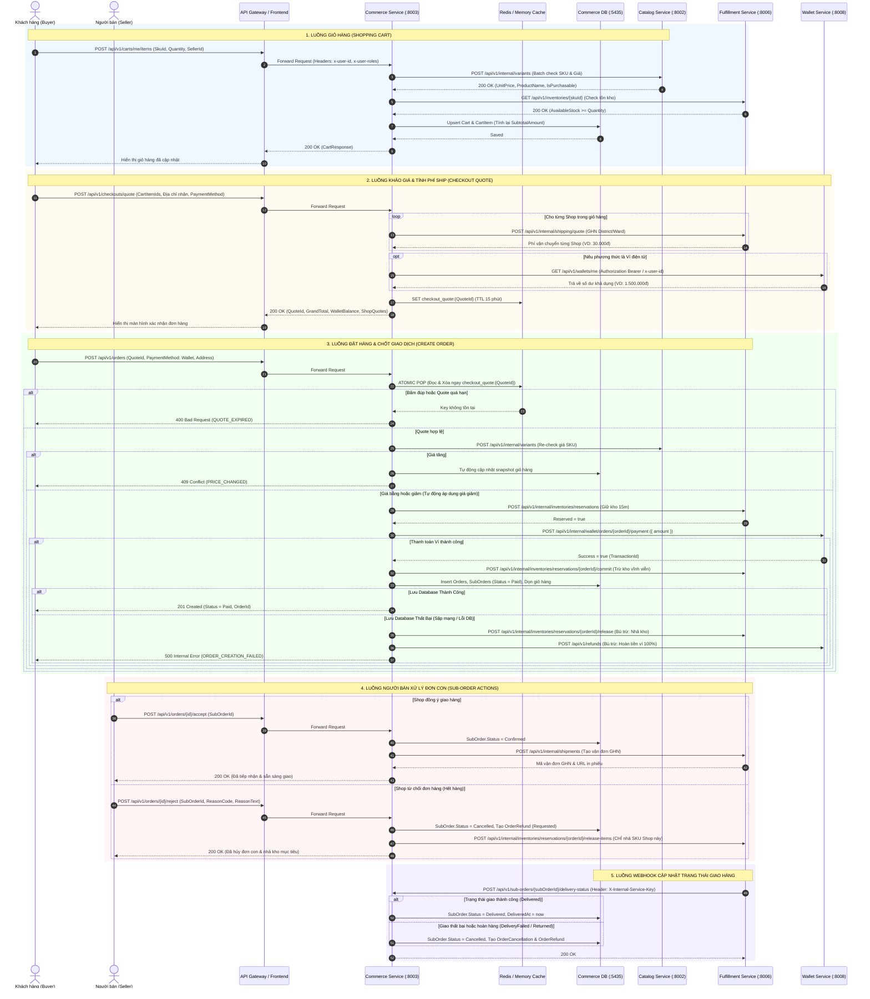

# COMMERCE SERVICE — TECHNICAL ARCHITECTURE & FLOW SPECIFICATION

## BẢN ĐẶC TẢ KIẾN TRÚC KỸ THUẬT, BẢN ĐỒ GIAO TIẾP VÀ ANATOMY LUỒNG NGHIỆP VỤ

> **Dự án:** Nexus Commerce Microservice  
> **Cổng dịch vụ (Port):** `8003` | **Database:** `commerce_db:5435` (PostgreSQL 16)  
> **Phiên bản tài liệu:** v2.2 (Đồng bộ RESTful Nội bộ, Identity Propagation & E2E Delivery Status Webhook)  
> **Đối tượng sử dụng:** CTO, Solution Architects, Tech Leads, Senior Engineers, QA Engineers, Product Managers  
> **Cập nhật lần cuối:** 2026-11-05  

---

## 📌 PHẦN MỞ ĐẦU: TÀI LIỆU NÀY LÀ GÌ TRONG CÔNG NGHIỆP PHẦN MỀM?

Tài liệu này là **Technical Design Document (TDD) / Service Blueprint** kiêm **Resilience & Fault-Tolerance Specification** cho Commerce Service. Nó mô tả chính xác 100% hiện trạng mã nguồn thực thi, ranh giới phân định microservices và các cơ chế bảo toàn bất biến nghiệp vụ.

**Giá trị cốt lõi của tài liệu:** Giúp Ban lãnh đạo (CTO/PM) và các bên liên quan (Frontend/DevOps/QA) **nắm bắt 100% bức tranh vận hành và logic nghiệp vụ của Commerce Service mà không cần phải đọc bất kỳ dòng code C# nào**.

---

# PHẦN 1: BẢN ĐỒ GIAO TIẾP (SERVICE COMMUNICATION MAP)

Commerce Service đóng vai trò là hạt nhân điều phối giao dịch (Transactional Core) của sàn thương mại điện tử, đứng giữa người dùng (Buyer/Seller) và 3 hệ thống vệ tinh: **Catalog Service** (Sản phẩm - Port 8002), **Fulfillment Service** (Kho & Giao vận - Port 8006) và **Wallet Service** (Thanh toán Ví - Port 8008).

---

## 1.1 Sơ Đồ Trình Tự Tương Tác Tổng Quan (Mermaid Sequence Diagram)



---

## 1.2 Danh Sách Toàn Bộ REST Endpoints của Commerce Service

Mọi endpoint tuân thủ chuẩn RESTful danh từ số nhiều, phân quyền qua `RequireRoleAttribute`, DTO thuần túy (Pure DTOs) và mã lỗi chuẩn `SCREAMING_SNAKE_CASE`:

### Nhóm 1: Quản lý Giỏ Hàng (`CartsController` — `/api/v1/carts`)
| Mã | Method | URL Endpoint | Quyền (Actor) | Chức Năng Chính (1 Câu Ngắn Gọn) |
| :-: | :-: | - | :-: | - |
| `CART-01` | `GET` | `/api/v1/carts/me` | Buyer | Lấy hoặc tự động tạo giỏ hàng đang hoạt động của người mua. |
| `CART-02` | `GET` | `/api/v1/carts/me/summary` | Buyer | Lấy badge số lượng món và tổng tiền tạm tính cho Header. |
| `CART-03` | `GET` | `/api/v1/carts/me/grouped` | Buyer | Lấy giỏ hàng phân nhóm theo từng Người bán (Shop) cho giao diện sàn. |
| `CART-04` | `POST` | `/api/v1/carts/me/items` | Buyer | Thêm sản phẩm SKU vào giỏ, kiểm tra Catalog và tồn kho Fulfillment. |
| `CART-05` | `PATCH` | `/api/v1/carts/me/items/{cartItemId}` | Buyer | Cập nhật số lượng của một dòng sản phẩm (tối đa 99 chiếc). |
| `CART-06` | `PATCH` | `/api/v1/carts/me/items/{cartItemId}/variant` | Buyer | Đổi phân loại (variant/size/màu) trực tiếp trong giỏ hàng. |
| `CART-07` | `DELETE` | `/api/v1/carts/me/items/{cartItemId}` | Buyer | Xóa một dòng sản phẩm khỏi giỏ hàng. |
| `CART-08` | `POST` | `/api/v1/carts/me/items:bulk-remove` | Buyer | Xóa hàng loạt các món được tích chọn trong giỏ. |
| `CART-09` | `DELETE` | `/api/v1/carts/me/clear` | Buyer | Dọn sạch toàn bộ sản phẩm đang có trong giỏ hàng. |
| `CART-10` | `POST` | `/api/v1/carts/me/calculate` | Buyer | Tính tổng tiền tạm tính cho các món được tick chọn (Shopee Checkbox). |
| `CART-11` | `POST` | `/api/v1/carts/me/validate` | Buyer | Kiểm tra tồn kho hàng loạt và độ tươi của giá trước khi checkout. |
| `CART-12` | `POST` | `/api/v1/carts/me/merge` | Buyer | Gộp các món từ giỏ khách vãng lai (Guest Cart) vào giỏ tài khoản khi đăng nhập. |
| `CART-13` | `POST` | `/api/v1/carts/me/cleanup-checked-out` | Buyer | Dọn sạch các món đã mua thành công sau thanh toán. |
| `CART-14` | `GET` | `/api/v1/carts/active?buyerId={guid}` | Admin/Staff | Quản trị viên tra cứu giỏ hàng đang hoạt động của bất kỳ người mua nào. |

### Nhóm 2: Đơn Hàng & Vận Chuyển (`OrdersController` — `/api/v1/orders`)
| Mã | Method | URL Endpoint | Quyền (Actor) | Chức Năng Chính (1 Câu Ngắn Gọn) |
| :-: | :-: | - | :-: | - |
| `R75 / CHK-01` | `POST` | `/api/v1/checkouts/quote` | Buyer | Báo giá thanh toán xem trước, tính cước ship GHN, lấy số dư ví, lưu cache 15 phút. |
| `R76 / CHK-02` | `POST` | `/api/v1/orders` | Buyer | Tạo đơn hàng chính thức từ `quoteId`, giữ kho 15m, trừ ví, dọn giỏ hàng. |
| `R77 / ORD-02` | `GET` | `/api/v1/orders/{orderId}` | Buyer/Seller | Lấy chi tiết đơn hàng cha kèm cơ chế Passive Guard tự hủy nếu quá hạn. |
| `R78 / ORD-01` | `GET` | `/api/v1/orders` | Buyer | Lịch sử đơn hàng của tôi (hỗ trợ phân trang DB và lọc theo trạng thái). |
| `R79 / ORD-02B`| `GET` | `/api/v1/sub-orders/{subOrderId}` | Buyer/Seller | Lấy chi tiết đơn con của Shop (Single DTO bóc tách giảm giá & địa chỉ JSONB). |
| `R80 / ORD-06` | `POST` | `/api/v1/orders/{orderId}/cancel` | Buyer | Người mua chủ động hủy đơn khi còn ở trạng thái `PendingPayment`. |
| `R83 / ORD-04` | `POST` | `/api/v1/orders/{orderId}/accept` | Seller | Người bán tiếp nhận đơn con (`Confirmed`) và kích hoạt tạo vận đơn GHN. |
| `R84 / ORD-05` | `POST` | `/api/v1/orders/{orderId}/reject` | Seller | Người bán từ chối đơn con (`Cancelled`), nhả kho mục tiêu và tạo yêu cầu hoàn tiền. |
| `R87 / ORD-08` | `GET` | `/api/v1/shipments/order/{orderId}` | Buyer/Seller | Tra cứu mã vận đơn GHN, tiến độ giao hàng và link in phiếu giao vận. |
| `R99 / ORD-13` | `POST` | `/api/v1/sub-orders/{subOrderId}/refund` | Buyer | Khởi tạo yêu cầu hoàn tiền cho đơn hàng con. |
| `WEBHOOK` | `POST` | `/api/v1/sub-orders/{subOrderId}/delivery-status` | Internal | Webhook từ Fulfillment Service cập nhật 9 trạng thái giao hàng của carrier. |
| `LEGACY` | `GET` | `/api/v1/orders/buyer/{buyerId}` | Buyer/Admin | Endpoint tương thích ngược tra cứu danh sách đơn theo `buyerId`. |

---

# PHẦN 2: GIẢI PHẪU CHI TIẾT TỪNG FLOW (FLOW-BY-FLOW ANATOMY)

---

### Flow 1: Thêm Sản Phẩm Vào Giỏ Hàng (Add Item to Cart)

* **1. Mục đích:** Kích hoạt khi khách bấm **"Thêm vào giỏ hàng"** hoặc **"Mua ngay"**.
* **2. Đầu vào:**
  * `POST /api/v1/carts/me/items`
  * Headers: `x-user-id: <guid>`, `x-user-roles: buyer`
  * Body: `{ "skuId": "...", "quantity": 2, "sellerId": "..." }`
* **3. Kịch bản xử lý & Giao tiếp:**
  * **Bước 1 — Catalog Service (`:8002`):** Gọi `POST /api/v1/internal/variants` để lấy giá niêm yết hiện hành, tên sản phẩm và xác nhận `isPurchasable == true`.
  * **Bước 2 — Fulfillment Service (`:8006`):** Gọi `GET /api/v1/inventories/{skuId}` để xác nhận tồn kho khả dụng `availableStock >= quantity`. Nếu thiếu tồn kho $\rightarrow$ Trả HTTP 400 `INSUFFICIENT_STOCK`.
  * **Bước 3 — Database:** Tìm hoặc tạo mới `Cart`, cập nhật `CartItem` (nếu SKU đã tồn tại thì cộng dồn số lượng, tối đa 99 chiếc), lưu `UnitPriceSnapshot` và tính lại `SubtotalAmount`.
* **4. Đầu ra:** HTTP 200 OK kèm `CartResponse`.

---

### Flow 2: Đổi Phân Loại Hàng Trong Giỏ (Change Item Variant)

* **1. Mục đích:** Đổi màu sắc/size số trực tiếp trong giỏ hàng.
* **2. Đầu vào:**
  * `PATCH /api/v1/carts/me/items/{cartItemId}/variant`
  * Body: `{ "newSkuId": "..." }`
* **3. Kịch bản xử lý & Giao tiếp:**
  * **Bước 1 — Kiểm tra CartItem:** Tìm dòng hàng trong DB theo `cartItemId`.
  * **Bước 2 — Catalog Service (`:8002`):** Gọi `POST /api/v1/internal/catalog/skus/validate-variant-switch` truyền `{ currentSkuId, newSkuId }`. Xác nhận biến thể mới thuộc cùng sản phẩm cha và cùng người bán.
  * **Bước 3 — Gộp dòng (Merge Invariant):** Nếu biến thể mới đã có một dòng khác trong giỏ, tự động dồn số lượng và xóa dòng cũ. Cập nhật lại giá snapshot và tổng tiền giỏ hàng.
* **4. Đầu ra:** HTTP 200 OK kèm giỏ hàng mới nhất.

---

### Flow 3: Khảo Giá & Chuẩn Bị Đặt Hàng (Checkout Quote)

* **1. Mục đích:** Kích hoạt khi người mua chọn các món trong giỏ và vào màn hình Xác nhận Đặt hàng.
* **2. Đầu vào:**
  * `POST /api/v1/checkouts/quote`
  * Body: `{ "cartItemIds": [...], "shippingAddress": { "receiverName", "contactPhone", "province", "district", "ward", "ghnDistrictId", "ghnWardCode" }, "paymentMethod": "Wallet" }`
* **3. Kịch bản xử lý & Giao tiếp:**
  * **Bước 1 — Phân nhóm Shop:** Gom các món theo từng `SellerId`.
  * **Bước 2 — Fulfillment Service (`:8006`):** Với mỗi Shop, gửi `POST /api/v1/internal/shipping/quote` truyền `{ sellerId, toDistrictId, toWardCode, items: [{ skuId, quantity, weightGrams: 200 }] }` để tính cước GHN động.
  * **Bước 3 — Wallet Service (`:8008`):** Gọi `GET /api/v1/wallets/me` lấy số dư khả dụng thực tế của người mua.
  * **Bước 4 — Khóa Cache:** Sinh `QuoteId = Guid.NewGuid()`, lưu snapshot vào `IDistributedCache` với key `checkout_quote:{QuoteId}` và `TTL = 15 phút`.
* **4. Đầu ra:** HTTP 200 OK (`quoteId`, `grandTotal`, `walletBalance`, `shops: [...]`, `expiredAt`).

---

### Flow 4: Tạo Đơn Hàng & Chốt Thanh Toán (Create Order & Pay)

* **1. Mục đích:** Kích hoạt khi người mua nhấn **"Đặt hàng ngay"**.
* **2. Đầu vào:**
  * `POST /api/v1/orders`
  * Body: `{ "quoteId": "...", "paymentMethod": "Wallet", "shippingAddress": "...", "contactPhone": "..." }`
* **3. Kịch bản xử lý & Giao tiếp:**
  * **Bước 1 — Atomic Pop:** Đọc và xóa tức thì key `checkout_quote:{quoteId}` khỏi Cache. Nếu không có $\rightarrow$ Trả HTTP 400 `QUOTE_EXPIRED` (chặn đứng double-click).
  * **Bước 2 — Asymmetric Price Drift:** Batch gọi Catalog `POST /api/v1/internal/variants` quét giá hiện hành:
    * Có món tăng giá $\rightarrow$ Hard block HTTP 409 `PRICE_CHANGED`, tự refresh giá giỏ hàng.
    * Chỉ giảm giá hoặc giữ nguyên $\rightarrow$ Tự động áp dụng giá rẻ hơn, gom vào `appliedPriceDrops`.
  * **Bước 3 — Fulfillment Service (`:8006`):** Giữ kho tạm thời 15 phút: `POST /api/v1/internal/inventories/reservations` với body `{ referenceId: orderId, holdMinutes: 15, items: [...] }`.
  * **Bước 4 — Wallet Service (`:8008`):** Gọi `POST /api/v1/internal/wallet/orders/{orderId}/payment` với body `{ amount: grandTotal }`.
    * Thành công $\rightarrow$ Ghi nhận `TransactionId`, gọi Fulfillment `POST /api/v1/internal/inventories/reservations/{orderId}/commit` để trừ kho vĩnh viễn, đặt trạng thái `Status = Paid`.
    * Lỗi tạm thời / dứt khoát $\rightarrow$ Giữ trạng thái `PendingPayment`.
  * **Bước 5 — Database & Compensation Rollback:** Lưu `Order`, `SubOrders` và xóa món đã mua khỏi giỏ hàng. Nếu `SaveChangesAsync()` phát sinh lỗi sập DB $\rightarrow$ Kích hoạt chuỗi bù trừ: Gọi Fulfillment nhả kho + gọi Wallet hoàn tiền ví 100%.
* **4. Đầu ra:** HTTP 201 Created (`orderId`, `orderNo`, `totalAmount`, `status`, `subOrderIds`).

---

### Flow 5: Tra Cứu Đơn Hàng & Bảo Vệ Thụ Động (Order Details & Passive Guard)

* **1. Mục đích:** Khi người dùng xem chi tiết đơn hàng hoặc lịch sử mua sắm.
* **2. Đầu vào:** `GET /api/v1/orders/{orderId}`
* **3. Kịch bản xử lý:**
  * **Bước 1 — Passive Guard (Lazy Expiration):** Nếu đơn đang `PendingPayment` và `UtcNow > PaymentDeadlineAt` (quá 15 phút):
    * Tự động chuyển `Order.Status = Cancelled`, `SubOrder.Status = Cancelled`.
    * Ghi log `OrderCancellation` (Lý do: `PaymentTimeout`).
    * Gọi Fulfillment Service `POST /api/v1/internal/inventories/reservations/{orderId}/release?reason=OrderCancelled` giải phóng kho.
    * Giải phóng voucher giữ chỗ trong `DiscountCodeUsages`.
  * **Bước 2 — Kiểm tra quyền sở hữu:** Nếu `order.BuyerId != currentUserId` và không phải Admin $\rightarrow$ Trả HTTP 403 `FORBIDDEN`.
* **4. Đầu ra:** HTTP 200 OK chi tiết đơn hàng.

---

### Flow 6: Người Bán Tiếp Nhận Đơn Hàng (Seller Accept Sub-Order)

* **1. Mục đích:** Shop xác nhận đơn hàng con và chuẩn bị xuất kho.
* **2. Đầu vào:**
  * `POST /api/v1/orders/{orderId}/accept`
  * Body: `{ "subOrderId": "..." }`
* **3. Kịch bản xử lý:**
  * Thẩm định quyền sở hữu shop (`so.SellerId == currentSellerId`) và trạng thái (`so.Status == Paid` hoặc COD).
  * Cập nhật `SubOrder.Status = Confirmed`, ghi nhận `SellerAcceptedAt = UtcNow`.
  * Gọi Fulfillment Service: `POST /api/v1/internal/shipments` truyền `{ subOrderId }` để sinh vận đơn GHN tự động.
* **4. Đầu ra:** HTTP 200 OK (`{ subOrderId, status: "Confirmed", acceptedAt }`).

---

### Flow 7: Người Bán Từ Chối Đơn Con (Seller Reject Sub-Order)

* **1. Mục đích:** Shop hết hàng hoặc không thể phục vụ đơn con.
* **2. Đầu vào:**
  * `POST /api/v1/orders/{orderId}/reject`
  * Body: `{ "subOrderId": "...", "reasonCode": "OutOfStock", "reasonText": "Hết size L màu đen" }`
* **3. Kịch bản xử lý:**
  * Chuyển `SubOrder.Status = Cancelled`, các shop khác trong đơn cha vẫn giữ nguyên trạng thái.
  * Nếu đơn đã thanh toán (`wasPaid == true`), tạo bản ghi `OrderRefund` (Status: `Requested`, Amount: `so.TotalAmount`).
  * **Targeted Stock Release:** Gọi Fulfillment Service:
    ```http
    POST /api/v1/internal/inventories/reservations/{orderId}/release-items
    Content-Type: application/json

    {
      "items": [{ "skuId": "...", "quantity": 1 }],
      "reason": "SubOrderRejected"
    }
    ```
    Chỉ nhả đúng các món thuộc shop từ chối, bảo toàn 100% tồn kho của các shop khác.
* **4. Đầu ra:** HTTP 200 OK.

---

### Flow 8: Webhook Cập Nhật Trạng Thái Giao Vận (Delivery Status Webhook)

* **1. Mục đích:** Đơn vị giao vận (GHN) thông báo trạng thái kiện hàng thông qua Fulfillment Service.
* **2. Đầu vào:**
  * `POST /api/v1/sub-orders/{subOrderId}/delivery-status`
  * Header: `X-Internal-Service-Key: <secret>`
  * Body: `{ "status": "Delivered", "deliveredAt": "2026-11-05T09:00:00Z" }`
* **3. Kịch bản xử lý theo 9 trạng thái:**
  * `ReadyToPick`, `Picking`, `Packed`: Cập nhật timestamp chuẩn bị hàng (Idempotent 200 OK).
  * `HandedOver`, `InTransit`, `Shipped`: Chuyển `SubOrderStatus.Shipped`.
  * `Delivered`: Chuyển `SubOrderStatus.Delivered`, lưu `DeliveredAt`.
  * `Cancelled`: Chuyển `SubOrderStatus.Cancelled`, lưu `CancelledAt`.
  * `DeliveryFailed`, `Returned`: Chuyển `SubOrderStatus.Cancelled`, ghi nhận `OrderCancellation` (Lý do: `DeliveryFailed` hoặc `PackageReturned`), tự động tạo `OrderRefund` nếu đơn đã thanh toán trước đó.
* **4. Đầu ra:** HTTP 200 OK (`{ subOrderId, status, updatedAt }`).

---

# PHẦN 3: BẢNG KIỂM TRA XỬ LÝ SỰ CỐ & TRƯỜNG HỢP BIÊN (ROLLBACK & EDGE CASES AUDIT)

| STT | Tình Huống Sự Cố / Trường Hợp Biên | Hệ Thống Đã Xử Lý Chưa? | Cơ Chế Kỹ Thuật Đang Chạy Trong Code | Hậu Quả Nếu Không Có |
| :-: | - | :-: | - | - |
| **1** | **Trừ kho và trừ tiền Ví thành công nhưng lưu DB bị lỗi / crash kết nối** | **ĐÃ CÓ (100%)** | Kích hoạt **Circuit Breaker Compensation Rollback**: Gọi `ReleaseStockAsync` nhả kho + gọi `RefundOrderPaymentAsync` với Idempotency Key `compensation-db-{orderId}` hoàn lại 100% tiền ví. | Khách bị trừ tiền mà không có đơn hàng, kho bị trừ ảo gây thất thoát. |
| **2** | **Khách bấm nút Đặt hàng 2 lần liên tiếp (Double-Click Race Condition)** | **ĐÃ CÓ (100%)** | Cơ chế **Atomic Pop** trên Distributed Cache: Đọc và xóa ngay lập tức `checkout_quote:{id}`. Request thứ hai đến sau bị ném lỗi `QUOTE_EXPIRED` ngay lập tức. | Tạo ra 2 đơn hàng trùng lặp, trừ tiền ví 2 lần. |
| **3** | **Sản phẩm bị thay đổi giá trên Catalog trong lúc đang nằm trong giỏ** | **ĐÃ CÓ (100%)** | **Chính sách Biến động Giá Bất Đối Xứng**:<br>• **Giá tăng:** Hard block HTTP 409 `PRICE_CHANGED` + tự refresh giá giỏ hàng.<br>• **Giá giảm:** Tự động áp dụng giá rẻ hơn cho khách và thông báo `appliedPriceDrops`. | Khách mua bị mua hớ hoặc người bán bị bán lỗ do chênh lệch giá cũ/mới. |
| **4** | **Đơn hàng treo không thanh toán (Payment Overdue / Abandoned Orders)** | **ĐÃ CÓ (100%)** | **Mô hình Quản lý Quá hạn Lai (Hybrid Expiration)**:<br>• **Passive Guard:** Tự hủy ngay khi có ai gọi `GET /orders/{id}`.<br>• **Active Sweeper:** Background Worker quét DB mỗi 60 giây, batch release kho và voucher.<br>• Đơn thường: TTL 15 phút. Đơn Đấu giá: TTL 24 giờ. | Tồn kho bị giam vĩnh viễn, khách hàng khác không thể mua được hàng. |
| **5** | **Một Shop từ chối đơn trong đơn hàng đa người bán (Multi-Seller)** | **ĐÃ CÓ (100%)** | **Targeted Stock Release**: Gọi `ReleaseSubOrderStockAsync` tới `/release-items` chỉ giải phóng danh sách SKU thuộc Shop từ chối. Giữ nguyên kho của các Shop còn lại. | Hủy oan đơn và nhả nhầm hàng của các Shop vô can khác trong đơn. |
| **6** | **Dịch vụ đối tác (Fulfillment / Wallet) bị treo hoặc chết mạng lúc Quote** | **ĐÃ CÓ (100%)** | **Graceful Fallback**: Bọc khối `try/catch` có ghi log. Phí ship fallback về 30.000đ tiêu chuẩn; Số dư ví fallback về 0đ để không làm đứng màn hình thanh toán. | Màn hình Checkout bị treo vĩnh viễn, khách không thể mua hàng. |
| **7** | **Giao hàng thất bại hoặc người mua trả hàng (DeliveryFailed / Returned)** | **ĐÃ CÓ (100%)** | Webhook callback tự động hủy đơn con, ghi nhận vết kiểm toán `OrderCancellation` và tạo yêu cầu hoàn tiền `OrderRefund` (Status: `Requested`). | Tiền thanh toán của khách bị kẹt, trạng thái đơn lệch với carrier. |

---

# PHẦN 4: BẢNG ĐIỀU KHIỂN DÀNH CHO QUẢN TRỊ VIÊN & VIBE CODING (VIBE CODING CONTROLS)

Khi cần điều chỉnh các quy luật nghiệp vụ, bạn chỉ cần ra lệnh cho AI điều chỉnh tại các điểm kiểm soát sau:

1. **Thay đổi Thời gian Chờ Thanh toán (Payment Timeout):**
   * *Mặc định:* 15 phút cho đơn thường, 24 giờ cho đơn đấu giá.
   * *Vị trí kiểm soát:* Hằng số `PaymentDeadlineAt` tại `OrderService.cs` và chu kỳ lặp `_checkInterval` tại `PaymentTimeoutWorker.cs`.
2. **Thay đổi Chính sách Biến động Giá (Price Drift Policy):**
   * *Mặc định:* Tăng giá thì chặn (`PRICE_CHANGED`); Giảm giá thì tự động áp dụng.
   * *Vị trí kiểm soát:* Khối kiểm tra `skuInfo.UnitPrice` tại `OrderService.cs` (lines 200–240).
3. **Thay đổi Mức Phí Ship Dự Phòng Khi Lỗi Mạng:**
   * *Mặc định:* `30.000đ / Shop`.
   * *Vị trí kiểm soát:* Khối fallback tại `OrderService.cs` (line 114).
4. **Thay đổi Giới hạn Số lượng Món Trong Giỏ:**
   * *Mặc định:* Tối đa 50 loại sản phẩm khác nhau và tối đa 99 chiếc cho một món.
   * *Vị trí kiểm soát:* Domain Invariant tại `Commerce.Domain/Entities/Cart.cs` (`MaxItemsInCart = 50`, `MaxQuantityPerItem = 99`).
5. **Cấu hình Địa chỉ và Port Các Dịch Vụ Vệ Tinh:**
   * *Vị trí kiểm soát:* `Commerce.Infrastructure/DependencyInjection.cs`:
     * `WALLET_SERVICE_URL` (Port 8008)
     * `CATALOG_SERVICE_URL` (Port 8002)
     * `FULFILLMENT_SERVICE_URL` (Port 8006)
