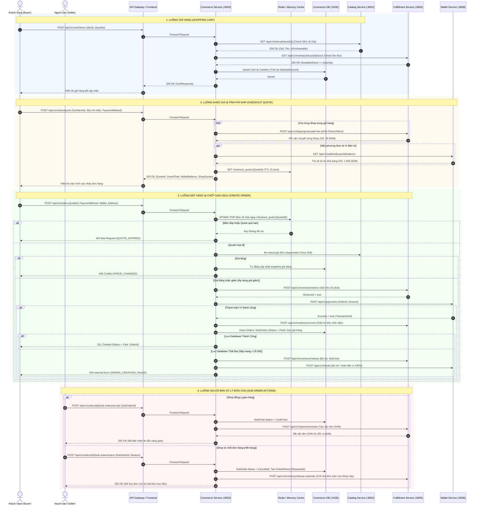

# COMMERCE SERVICE — TECHNICAL ARCHITECTURE \& FLOW SPECIFICATION

## BẢN ĐẶC TẢ KIẾN TRÚC KỸ THUẬT, BẢN ĐỒ GIAO TIẾP VÀ ANATOMY LUỒNG NGHIỆP VỤ

> \*\*Dự án:\*\* Nexus Commerce Microservice  
> \*\*Cổng dịch vụ (Port):\*\* `8003` | \*\*Database:\*\* `commerce\_db:5435` (PostgreSQL 16)  
> \*\*Phiên bản tài liệu:\*\* v2.0 (Đã hoàn thiện Checkout Hardening, Circuit Breaker Compensation \& E2E Testing)  
> \*\*Đối tượng sử dụng:\*\* CTO, Solution Architects, Tech Leads, Senior Engineers, QA Engineers, Product Managers  

\---

## 📌 PHẦN MỞ ĐẦU: TÀI LIỆU NÀY LÀ GÌ TRONG CÔNG NGHIỆP PHẦN MỀM?

Trong ngành công nghiệp phát triển phần mềm chuẩn quốc tế (đặc biệt tại các tập đoàn công nghệ như Google, Amazon, Microsoft, Grab, Shopee), tài liệu chứa các nội dung này được gọi là:

1. **Technical Design Document (TDD)** hoặc **Software Design Description (SDD)** / **Design Doc**:

   * Đây là tên gọi phổ biến nhất. Tài liệu này đặc tả chi tiết kiến trúc dịch vụ, sơ đồ tương tác đa hệ thống, cấu trúc dữ liệu, và phương án xử lý sự cố trước/sau khi lập trình.
2. **Service Blueprint / End-to-End System Flow Specification**:

   * Bản thiết kế chi tiết hành trình dữ liệu (data journey) xuyên suốt qua các ranh giới dịch vụ (Bounded Contexts), làm rõ ai gọi ai, dữ liệu gửi đi/nhận về là gì, và trạng thái thay đổi ở từng trạm.
3. **Resilience \& Fault-Tolerance Specification (Kiểm toán Chịu lỗi \& Bù trừ Sự cố)**:

   * Tài liệu kiểm định các trường hợp biên (Edge Cases), cơ chế hoàn tác phân tán (Compensating Transactions), và đảm bảo tính bất biến tài chính (Financial \& Inventory Invariants).

**Giá trị cốt lõi của tài liệu:** Giúp Ban lãnh đạo (CTO/PM) và các bên liên quan (Frontend/DevOps/QA) **nắm bắt 100% bức tranh vận hành và logic nghiệp vụ của Commerce Service mà không cần phải đọc bất kỳ dòng code C# nào**.

\---

# PHẦN 1: BẢN ĐỒ GIAO TIẾP (SERVICE COMMUNICATION MAP)

Commerce Service đóng vai trò là hạt nhân điều phối giao dịch (Transactional Core) của sàn thương mại điện tử, đứng giữa người dùng (Buyer/Seller) và 4 hệ thống vệ tinh: **Catalog Service** (Sản phẩm), **Fulfillment Service** (Kho \& Giao vận), **Wallet Service** (Thanh toán Ví) và **Payment Gateway** (VNPay).

\---

## 1.1 Sơ Đồ Trình Tự Tương Tác Tổng Quan (Mermaid Sequence Diagram)



\---

## 1.2 Danh Sách Toàn Bộ REST Endpoints của Commerce Service

Toàn bộ API của Commerce Service tuân thủ 100% quy chuẩn RESTful số nhiều, định dạng JSON PascalCase cho Enum và mã lỗi `SCREAMING\_SNAKE\_CASE`:

|Phân Nhóm|Method|URL Endpoint|Quyền (Actor)|Chức Năng Chính (1 Câu Ngắn Gọn)|
|-|:-:|-|:-:|-|
|**Giỏ hàng**|`POST`|`/api/v1/carts/items`|Buyer|Thêm sản phẩm vào giỏ, kiểm tra SKU Catalog và tồn kho Fulfillment.|
|**Giỏ hàng**|`GET`|`/api/v1/carts`|Buyer|Lấy giỏ hàng đang hoạt động, tự động phân nhóm sản phẩm theo người bán.|
|**Giỏ hàng**|`PUT`|`/api/v1/carts/items/{itemId}/variant`|Buyer|Đổi phân loại (variant) của sản phẩm trong giỏ và cập nhật giá mới.|
|**Giỏ hàng**|`PATCH`|`/api/v1/carts/items/{itemId}`|Buyer|Cập nhật số lượng của một món trong giỏ (tối đa 99 món).|
|**Giỏ hàng**|`DELETE`|`/api/v1/carts/items/{itemId}`|Buyer|Xóa một sản phẩm cụ thể khỏi giỏ hàng.|
|**Giỏ hàng**|`DELETE`|`/api/v1/carts/items?clearAll=true`|Buyer|Xóa sạch toàn bộ sản phẩm đang có trong giỏ hàng.|
|**Đơn hàng**|`POST`|`/api/v1/orders/quote`|Buyer|Khảo giá thanh toán, tính ship GHN đa shop, lấy số dư ví và lưu cache 15 phút.|
|**Đơn hàng**|`POST`|`/api/v1/orders`|Buyer|Tạo đơn hàng chính thức từ báo giá, khóa kho, trừ ví và dọn dẹp giỏ hàng.|
|**Đơn hàng**|`GET`|`/api/v1/orders/{orderId}`|Buyer/Seller|Lấy chi tiết đơn hàng kèm cơ chế Passive Guard tự hủy nếu quá hạn thanh toán.|
|**Đơn hàng**|`POST`|`/api/v1/orders/{orderId}/cancel`|Buyer|Người mua chủ động hủy đơn khi đơn còn ở trạng thái chờ thanh toán.|
|**Đơn con**|`POST`|`/api/v1/orders/{orderId}/sub-orders/accept`|Seller|Người bán tiếp nhận đơn con đã thanh toán và kích hoạt tạo vận đơn GHN.|
|**Đơn con**|`POST`|`/api/v1/orders/{orderId}/sub-orders/reject`|Seller|Người bán từ chối đơn con, kích hoạt nhả kho mục tiêu và yêu cầu hoàn tiền.|
|**Vận chuyển**|`GET`|`/api/v1/orders/{orderId}/shipments`|Buyer/Seller|Tra cứu danh sách vận đơn GHN, mã vận đơn và link in phiếu giao vận.|

\---

# PHẦN 2: GIẢI PHẪU CHI TIẾT TỪNG FLOW (FLOW-BY-FLOW ANATOMY)

\---

### Flow 1: Thêm Sản Phẩm Vào Giỏ Hàng (Add Item to Cart)

* **1. Mục đích \& Khi nào chạy:** Kích hoạt khi người dùng bấm nút **"Thêm vào giỏ hàng"** hoặc **"Mua ngay"** tại trang chi tiết sản phẩm.
* **2. Đầu vào (Incoming Request):**

  * `POST /api/v1/carts/items`
  * Header: `Authorization: Bearer <JWT>` $\\rightarrow$ Commerce Service trích xuất `BuyerId`.
  * Request Body:

&#x20;   ```json
    {
      "skuId": "3fa85f64-5717-4562-b3fc-2c963f66afa6",
      "quantity": 2,
      "sellerId": "7ca85f64-5717-4562-b3fc-2c963f66af11"
    }
    ```

* **3. Kịch bản xử lý từng bước \& Giao tiếp liên Service:**

  * **Bước 1 - Kiểm tra Catalog Service (:8002):**

    * *Gọi API:* `GET /api/v1/internal/skus/{skuId}`
    * *Nhận về:* Thông tin SKU gồm `UnitPrice`, `ProductName`, `IsPurchasable`.
    * *Xử lý sự cố:* Nếu SKU không tồn tại $\\rightarrow$ Trả HTTP 404 `CATALOG\_SKU\_NOT\_FOUND`. Nếu SKU bị ẩn/ngừng bán $\\rightarrow$ Trả HTTP 400 `CATALOG\_SKU\_INACTIVE`. Nếu Catalog chết $\\rightarrow$ Trả HTTP 500, giỏ hàng không bị sửa đổi.
  * **Bước 2 - Kiểm tra tồn kho Fulfillment Service (:8005):**

    * *Gọi API:* `GET /api/v1/inventory/skus/{skuId}/stock`
    * *Nhận về:* `{ "availableStock": 50 }`
    * *Xử lý sự cố:* Nếu `availableStock < quantity` $\\rightarrow$ Trả HTTP 400 `INSUFFICIENT\_STOCK`.
  * **Bước 3 - Thao tác Database Commerce:**

    * Bảng `Carts`: Tìm giỏ hàng hiện tại của `BuyerId` (nếu chưa có thì tự động tạo mới). Cập nhật `ItemCount`, `SubtotalAmount` và `LastActivityAt`.
    * Bảng `CartItems`: Nếu SKU này đã có sẵn trong giỏ $\\rightarrow$ Dồn số lượng (`item.Quantity += quantity`, kiểm tra không vượt quá 99 món). Nếu SKU mới $\\rightarrow$ Tạo mới bản ghi `CartItem` kèm snapshot giá `UnitPriceSnapshot`.
* **4. Đầu ra trả về (Outgoing Response):**

  * *Thành công (HTTP 200 OK):* Toàn bộ giỏ hàng `CartResponse` phân nhóm theo từng shop.
  * *Thất bại:* HTTP 400 (`INSUFFICIENT\_STOCK`, `MAX\_QUANTITY\_EXCEEDED`), HTTP 404 (`CATALOG\_SKU\_NOT\_FOUND`).

\---

### Flow 2: Đổi Phân Loại Sản Phẩm Trong Giỏ (Change Item Variant)

* **1. Mục đích \& Khi nào chạy:** Khi người dùng mở giỏ hàng và chọn đổi màu sắc/size số trực tiếp trong giỏ mà không cần quay lại trang chi tiết.
* **2. Đầu vào (Incoming Request):**

  * `PUT /api/v1/carts/items/{itemId}/variant`
  * Request Body:

&#x20;   ```json
    {
      "newSkuId": "8ba85f64-5717-4562-b3fc-2c963f66af99"
    }
    ```

* **3. Kịch bản xử lý từng bước \& Giao tiếp liên Service:**

  * **Bước 1 - Kiểm tra Database Commerce:** Tìm `CartItem` theo `itemId`. Nếu không tìm thấy $\\rightarrow$ Báo lỗi HTTP 404 `CART\_ITEM\_NOT\_FOUND`.
  * **Bước 2 - Gọi Catalog Service:** Lấy giá và tên của `newSkuId`. Xác nhận thuộc cùng Shop người bán.
  * **Bước 3 - Cập nhật Database:**

    * Nếu `newSkuId` đã có một dòng khác trong giỏ $\\rightarrow$ Tự động gộp số lượng của 2 dòng lại với nhau và xóa bớt dòng cũ.
    * Cập nhật `UnitPriceSnapshot` theo giá của SKU mới và tính lại `SubtotalAmount` toàn giỏ hàng.
* **4. Đầu ra trả về:** HTTP 200 OK kèm giỏ hàng mới nhất.

\---

### Flow 3: Khảo Giá \& Chuẩn Bị Đặt Hàng (Checkout Quote)

* **1. Mục đích \& Khi nào chạy:** Kích hoạt khi người dùng tích chọn các món trong giỏ và bấm nút **"Mua hàng / Tiến hành thanh toán"**.
* **2. Đầu vào (Incoming Request):**

  * `POST /api/v1/orders/quote`
  * Request Body:

&#x20;   ```json
    {
      "cartItemIds": \["item\_uuid\_1", "item\_uuid\_2"],
      "shippingAddress": {
        "receiverName": "Nguyen Van A",
        "contactPhone": "0901234567",
        "detailAddress": "123 Le Loi",
        "ward": "Phường Bến Nghé",
        "district": "Quận 1",
        "province": "TP. Hồ Chí Minh",
        "ghnDistrictId": 1442,
        "ghnWardCode": "20101"
      },
      "paymentMethod": "Wallet",
      "voucherCodes": \[]
    }
    ```

* **3. Kịch bản xử lý từng bước \& Giao tiếp liên Service:**

  * **Bước 1 - Gom nhóm theo Shop:** Tải các `CartItemIds` hợp lệ từ DB, phân nhóm các món theo từng `SellerId`.
  * **Bước 2 - Gọi Fulfillment Service (:8005) tính phí ship GHN:**

    * Với mỗi Shop, gửi `ShopShippingQuoteRequest` chứa địa chỉ kho người bán và địa chỉ nhận của khách.
    * Nhận về: Phí ship từng Shop (ví dụ Shop A: 30.000đ, Shop B: 30.000đ).
    * *Xử lý lỗi mạng:* Nếu Fulfillment timeout $\\rightarrow$ Tự động fallback về mức phí ship tiêu chuẩn dự phòng (30.000đ/shop) để khách hàng không bị nghẽn thanh toán.
  * **Bước 3 - Gọi Wallet Service (:8008) lấy số dư ví:**

    * Gọi `GET /api/v1/wallets/{buyerId}/balance`.
    * Nhận về: Số dư thực tế trong ví (ví dụ `1.500.000đ`).
    * *Xử lý lỗi mạng:* Nếu Wallet lỗi $\\rightarrow$ Fallback về `0đ` và cảnh báo người dùng.
  * **Bước 4 - Khóa Báo Giá vào Distributed Cache:**

    * Sinh mã `QuoteId = UUID.NewGuid()`.
    * Lưu toàn bộ kết quả tính toán vào `IDistributedCache` (Redis/Memory) với key `checkout\_quote:{QuoteId}` và `TTL = 15 phút`.
* **4. Đầu ra trả về (HTTP 200 OK):**

  * `quoteId`: Mã định danh báo giá được server bảo chứng.
  * `grandTotal`: Tổng số tiền thanh toán (Tiền hàng + Toàn bộ phí ship các shop - Khuyến mãi).
  * `walletBalance`: Số dư ví hiện tại của người mua để Frontend hiển thị gợi ý nạp thêm tiền nếu thiếu.
  * `shops`: Chi tiết bóc tách từng shop.

\---

### Flow 4: Tạo Đơn Hàng \& Thanh Toán (Create Order \& Pay)

* **1. Mục đích \& Khi nào chạy:** Kích hoạt khi khách hàng bấm nút **"Đặt hàng ngay"** tại màn hình Checkout.
* **2. Đầu vào (Incoming Request):**

  * `POST /api/v1/orders`
  * Request Body:

&#x20;   ```json
    {
      "quoteId": "quote\_uuid\_here",
      "paymentMethod": "Wallet",
      "shippingAddress": "123 Le Loi, P. Ben Nghe, Q.1, TP.HCM",
      "contactPhone": "0901234567"
    }
    ```

* **3. Kịch bản xử lý từng bước \& Giao tiếp liên Service:**

  * **Bước 1 - Cơ chế Chống Submit Đúp (Atomic Pop):**

    * Đọc và xóa tức thì key `checkout\_quote:{quoteId}` khỏi Cache.
    * Nếu không tìm thấy key (do hết hạn 15 phút hoặc do khách bấm đúp nút đặt hàng) $\\rightarrow$ Chặn ngay với lỗi HTTP 400 `QUOTE\_EXPIRED`.
  * **Bước 2 - Kiểm tra biến động giá bất đối xứng (Asymmetric Price Drift):**

    * Quét giá thực tế hiện hành của từng SKU từ Catalog Service:

      * **Nếu có món TĂNG GIÁ:** Tự động đồng bộ giá mới vào bảng `CartItems`, chặn giao dịch và trả về HTTP 409 `PRICE\_CHANGED`.
      * **Nếu có món GIẢM GIÁ:** Tự động áp dụng giá mới thấp hơn, tính lại tổng tiền có lợi cho khách và gom vào danh sách `appliedPriceDrops`.
  * **Bước 3 - Khóa tồn kho tại Fulfillment Service (:8005):**

    * Gửi lệnh `ReserveStockAsync(orderId, items, ttlMinutes: 15)`.
    * Nếu tồn kho không đủ $\\rightarrow$ Dừng lại báo lỗi HTTP 400 `INSUFFICIENT\_STOCK`.
  * **Bước 4 - Thanh toán Ví điện tử tại Wallet Service (:8008):**

    * Nếu `PaymentMethod == Wallet`, gọi `PayOrderAsync(orderId, grandTotal)`.
    * Nếu thanh toán thành công $\\rightarrow$ Ghi nhận `TransactionId`, gọi Fulfillment `CommitStockAsync(orderId)` để trừ kho vĩnh viễn, đặt trạng thái đơn là `Paid`.
    * Nếu ví thiếu tiền hoặc lỗi dứt khoát $\\rightarrow$ Giữ trạng thái đơn là `PendingPayment`.
  * **Bước 5 - Thao tác Database \& Dọn dẹp giỏ hàng:**

    * Lưu `Order` vào bảng `Orders` (Status: `Paid` hoặc `PendingPayment`).
    * Phân tách và lưu từng `SubOrder` theo từng Shop vào bảng `SubOrders`.
    * Xóa sạch các món đã mua khỏi bảng `CartItems`.
    * *Bù trừ khẩn cấp (Circuit Breaker):* Nếu `SaveChangesAsync()` phát sinh lỗi sập mạng/crash DB $\\rightarrow$ Kích hoạt chuỗi hoàn tác: Nhả kho và hoàn tiền ví 100% (Xem chi tiết tại Phần 3).
* **4. Đầu ra trả về:**

  * *Thành công (HTTP 201 Created):*

&#x20;   ```json
    {
      "orderId": "order\_uuid",
      "orderNo": "ORD-20261102-1234",
      "totalAmount": 560000.0,
      "status": "Paid",
      "paymentDeadlineAt": "2026-11-02T13:15:00Z",
      "subOrderIds": \["sub\_order\_1", "sub\_order\_2"],
      "appliedPriceDrops": null
    }
    ```

\---

### Flow 5: Tra Cứu Chi Tiết Đơn Hàng \& Bảo Vệ Thụ Động (Order Details \& Passive Guard)

* **1. Mục đích \& Khi nào chạy:** Kích hoạt khi người dùng xem trang "Chi tiết đơn hàng" hoặc mở lịch sử đơn hàng.
* **2. Đầu vào (Incoming Request):**

  * `GET /api/v1/orders/{orderId}`
* **3. Kịch bản xử lý từng bước \& Giao tiếp liên Service:**

  * **Bước 1 - Kích hoạt Passive Guard (Tự động hủy đơn quá hạn):**

    * Kiểm tra nếu đơn hàng đang ở trạng thái `PendingPayment` và thời điểm hiện tại `DateTimeOffset.UtcNow > PaymentDeadlineAt` (quá 15 phút):

      * Tự động chuyển `Order.Status = Cancelled` và các `SubOrder.Status = Cancelled`.
      * Ghi log bản ghi `OrderCancellation` (Actor: `System`, Reason: `PaymentTimeout`).
      * Gọi Fulfillment Service `ReleaseStockAsync(orderId)` nhả toàn bộ hàng trả lại cho kho.
  * **Bước 2 - Kiểm tra quyền sở hữu (Security Ownership Check):**

    * Nếu `order.BuyerId != currentUserId` và người gọi không phải Quản trị viên $\\rightarrow$ Chặn với lỗi HTTP 403 `FORBIDDEN`.
* **4. Đầu ra trả về (HTTP 200 OK):** Toàn bộ thông tin chi tiết đơn hàng, danh sách đơn con, địa chỉ giao nhận và trạng thái giao hàng.

\---

### Flow 6: Người Bán Tiếp Nhận Đơn Hàng (Seller Accept Sub-Order)

* **1. Mục đích \& Khi nào chạy:** Khi Shop mở Kênh Người Bán (Seller Portal), thấy đơn con mới và bấm **"Xác nhận đơn \& Chuẩn bị hàng"**.
* **2. Đầu vào (Incoming Request):**

  * `POST /api/v1/orders/{orderId}/sub-orders/accept`
  * Request Body: `{ "subOrderId": "sub\_order\_uuid" }`
* **3. Kịch bản xử lý từng bước \& Giao tiếp liên Service:**

  * **Bước 1 - Thẩm định quyền \& Trạng thái:**

    * Kiểm tra `subOrder.SellerId == currentSellerId`.
    * Đối với đơn thanh toán online: Bắt buộc `subOrder.Status == Paid`. Nếu còn `PendingPayment` $\\rightarrow$ Chặn ngay với lỗi HTTP 400 `INVALID\_STATUS`.
  * **Bước 2 - Cập nhật Database:**

    * Cập nhật `SubOrder.Status = Confirmed`.
    * Ghi nhận mốc thời gian `SellerAcceptedAt = UtcNow`.
  * **Bước 3 - Gọi Fulfillment Service (:8005) tạo vận đơn GHN:**

    * Gửi yêu cầu sinh vận đơn `CreateShipmentAsync(subOrderId)`.
    * Nhận về mã vận đơn GHN chính thức và URL in phiếu giao nhận.
* **4. Đầu ra trả về:** HTTP 200 OK.

\---

### Flow 7: Người Bán Từ Chối Đơn Con (Seller Reject Sub-Order)

* **1. Mục đích \& Khi nào chạy:** Khi Shop phát hiện sản phẩm bị rách, hỏng hoặc hết hàng trong kho vật lý và bấm **"Từ chối đơn hàng"**.
* **2. Đầu vào (Incoming Request):**

  * `POST /api/v1/orders/{orderId}/sub-orders/reject`
  * Request Body:

&#x20;   ```json
    {
      "subOrderId": "sub\_order\_a\_id",
      "reasonCode": "OUT\_OF\_STOCK",
      "reasonText": "Hết màu đen size XL"
    }
    ```

* **3. Kịch bản xử lý từng bước \& Giao tiếp liên Service:**

  * **Bước 1 - Cập nhật trạng thái SubOrder A:**

    * Chuyển `SubOrder\_A.Status = Cancelled`.
    * **Đơn của các Shop khác giữ nguyên vẹn:** `SubOrder\_B` vẫn giữ trạng thái `Paid` và tiếp tục giao bình thường.
  * **Bước 2 - Tạo yêu cầu hoàn tiền:**

    * Nếu đơn con này đã được thanh toán (`wasPaid == true`), tạo bản ghi `OrderRefund` với `Amount = so.TotalAmount`, trạng thái `Requested`, lý do `SELLER\_REJECTED`.
  * **Bước 3 - Nhả tồn kho có mục tiêu (Targeted Stock Release):**

    * Gửi lệnh `ReleaseSubOrderStockAsync(subOrderAId, itemsOfShopA)`.
    * **TUYỆT ĐỐI CHỈ** nhả tồn kho của các sản phẩm thuộc đúng Shop A. Hàng của Shop B không bị giải phóng nhầm.
* **4. Đầu ra trả về:** HTTP 200 OK.

\---

# PHẦN 3: BẢNG KIỂM TRA XỬ LÝ SỰ CỐ \& TRƯỜNG HỢP BIÊN (ROLLBACK \& EDGE CASES AUDIT)

Bảng đối chiếu kỹ thuật trả lời trực diện các câu hỏi vận hành sống còn theo đúng hiện trạng mã nguồn của Commerce Service:

|STT|Tình Huống Sự Cố / Trường Hợp Biên|Hệ Thống Đã Xử Lý Chưa?|Cơ Chế Kỹ Thuật Đang Chạy Trong Code|Hậu Quả Nếu Không Có|
|:-:|-|:-:|-|-|
|**1**|**Trừ kho và trừ tiền Ví thành công nhưng lưu DB bị lỗi / sập kết nối**|**ĐÃ CÓ (100%)**|Kích hoạt **Circuit Breaker Compensation Rollback**: Gọi `ReleaseStockAsync` nhả kho + gọi `RefundOrderPaymentAsync` với Idempotency Key `compensation-db-{orderId}` hoàn lại 100% tiền vào ví.|Khách bị trừ tiền mà không có đơn hàng, kho bị trừ ảo gây thất thoát.|
|**2**|**Khách bấm nút Đặt hàng 2 lần liên tiếp (Double-Click Race Condition)**|**ĐÃ CÓ (100%)**|Cơ chế **Atomic Pop** trên Distributed Cache: Đọc và xóa ngay lập tức `checkout\_quote:{id}`. Request thứ hai đến sau trong tích tắc sẽ bị ném lỗi `QUOTE\_EXPIRED` ngay từ cửa.|Tạo ra 2 đơn hàng trùng lặp, trừ tiền ví 2 lần.|
|**3**|**Sản phẩm bị thay đổi giá trên Catalog trong lúc đang nằm trong giỏ**|**ĐÃ CÓ (100%)**|**Chính sách Biến động Giá Bất Đối Xứng**:<br>• **Giá tăng:** Hard block HTTP 409 `PRICE\_CHANGED` + tự động cập nhật giá mới vào giỏ.<br>• **Giá giảm:** Tự động áp dụng giá rẻ hơn cho khách và thông báo `appliedPriceDrops`.|Khách mua bị mua hớ hoặc người bán bị bán lỗ do chênh lệch giá cũ/mới.|
|**4**|**Đơn hàng treo không thanh toán (Payment Overdue / Abandoned Orders)**|**ĐÃ CÓ (100%)**|**Mô hình Quản lý Quá hạn Lai (Hybrid Expiration)**:<br>• **Passive Guard:** Tự hủy ngay khi có bất kỳ ai gọi `GET /orders/{id}`.<br>• **Active Sweeper:** Background Worker quét DB mỗi 60 giây.<br>• Đơn thường: TTL 15 phút. Đơn Đấu giá: TTL 24 giờ.|Tồn kho bị giam vĩnh viễn, khách hàng khác không thể mua được hàng.|
|**5**|**Một Shop từ chối đơn trong đơn hàng đa người bán (Multi-Seller)**|**ĐÃ CÓ (100%)**|**Targeted Stock Release**: Chỉ gọi `ReleaseSubOrderStockAsync` giải phóng danh sách SKU thuộc Shop từ chối. Giữ nguyên kho và quy trình giao vận của các Shop còn lại.|Hủy oan đơn và nhả nhầm hàng của các Shop vô can khác trong đơn.|
|**6**|**Dịch vụ đối tác (Fulfillment / Wallet) bị treo hoặc chết mạng lúc Quote**|**ĐÃ CÓ (100%)**|**Graceful Fallback**: Bọc khối `try/catch` có ghi log. Phí ship fallback về 30.000đ tiêu chuẩn; Số dư ví fallback về 0đ để không làm đứng màn hình thanh toán.|Màn hình Checkout bị treo vĩnh viễn, khách không thể mua hàng.|

\---

# PHẦN 4: BẢNG ĐIỀU KHIỂN DÀNH CHO QUẢN TRỊ VIÊN \& VIBE CODING (VIBE CODING CONTROLS)

Khi bạn muốn điều chỉnh quy luật nghiệp vụ của Commerce Service, bạn **không cần đọc code**, chỉ cần ra lệnh cho AI điều chỉnh tại các điểm kiểm soát sau:

1. **Thay đổi Thời gian Chờ Thanh toán (Payment Timeout):**

   * *Mặc định:* 15 phút cho đơn thường, 24 giờ cho đơn đấu giá.
   * *Vị trí kiểm soát:* Hằng số `PaymentDeadlineAt` tại `OrderService.cs` và chu kỳ lặp `Period` tại `PaymentTimeoutWorker.cs`.
2. **Thay đổi Chính sách Biến động Giá (Price Drift Policy):**

   * *Mặc định:* Tăng giá thì chặn; Giảm giá thì tự động cho qua.
   * *Vị trí kiểm soát:* Khối kiểm tra `skuInfo.UnitPrice` tại `OrderService.cs` (lines 200–235). Bạn có thể yêu cầu: *"Cho phép dung sai tăng giá dưới 5%"* hoặc *"Giá giảm cũng phải thông báo xác nhận"*.
3. **Thay đổi Mức Phí Ship Dự Phòng Khi Lỗi Mạng:**

   * *Mặc định:* `30.000đ / Shop`.
   * *Vị trí kiểm soát:* Khối fallback tại `OrderService.cs` (line 123) và `ExternalClientFaultTests.cs`.
4. **Thay đổi Giới hạn Số lượng Món Trong Giỏ:**

   * *Mặc định:* Tối đa 50 loại sản phẩm khác nhau và tối đa 99 chiếc cho một món.
   * *Vị trí kiểm soát:* Domain Invariant tại `Cart.cs` (`MaxItemsInCart = 50`, `MaxQuantityPerItem = 99`).

\---

*Bản tài liệu đặc tả kiến trúc được chuẩn hóa phục vụ báo cáo kỹ thuật và kiểm toán hệ sinh thái Commerce Service.*

