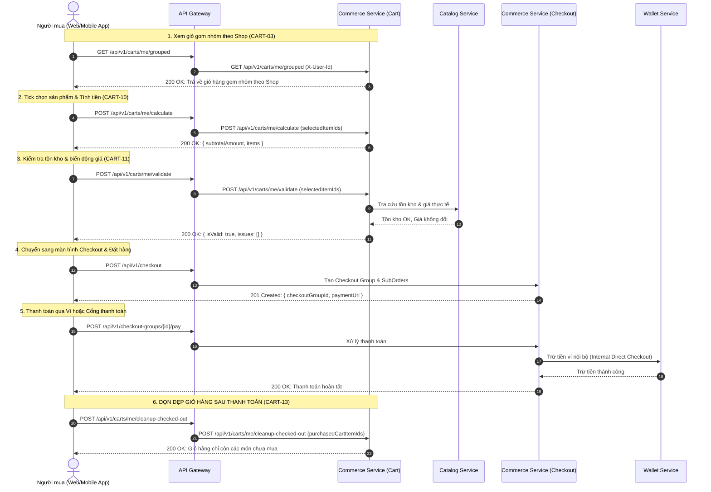

# COMMERCE SERVICE — CART REST API CONTRACT & INTEGRATION SPECIFICATION

> **Version:** 2.1.0 (Chuẩn hóa liền mạch User Journey)  
> **Service:** CommerceService (`Commerce.Api`)  
> **Bounded Context:** Cart & Shopping Session Management  
> **Default Port:** `8003` (Container & Localhost)  
> **Base Path:** `/api/v1/carts`  
> **Protocol:** HTTP/1.1 & HTTP/2 RESTful Web API  
> **Target Audiences:** API Gateway Team, Frontend Web & Mobile Teams, Catalog Service Team, Checkout & Order Service Team  
> **Last Updated:** 2026-11-01  

---

## 1. TỔNG QUAN VÀ QUY ƯỚC CHUNG (ARCHITECTURAL OVERVIEW)

### 1.1. Bounded Context & Trách nhiệm dịch vụ
Commerce Service (phân hệ Cart) chịu trách nhiệm:
1. **Lưu trữ & Quản lý giỏ hàng** của người mua (Buyer) theo mô hình Get-or-Create (1 Buyer sở hữu tối đa 1 Giỏ hàng `ACTIVE`).
2. **Kiểm soát tính hợp lệ của sản phẩm**: Giới hạn tối đa 100 loại mặt hàng (distinct items) và tối đa 99 đơn vị/món.
3. **Phân nhóm đa người bán (Multi-Vendor Grouping)**: Tự động gom nhóm các dòng sản phẩm theo `SellerId` / Tên Shop.
4. **Kiểm tra tồn kho & biến động giá trước Checkout (Pre-checkout Validation)**: Đối soát dữ liệu thực tế từ Catalog Service để cảnh báo người dùng.
5. **Dọn dẹp món đã mua sau khi hoàn tất thanh toán (Post-checkout Cleanup)**: Loại bỏ các sản phẩm đã thanh toán thành công, giữ nguyên các sản phẩm chưa mua.

> [!IMPORTANT]
> **Ranh giới phân định Cart vs Checkout**:
> - **Ghi chú đơn hàng / Lời nhắn cho Shop** thuộc Bounded Context của **Checkout / Order** (`SubOrder.buyer_note`), **KHÔNG** lưu trong Cart.
> - **Trạng thái giỏ hàng**: Giỏ hàng **KHÔNG** chuyển sang trạng thái `CHECKED_OUT` khi người mua mới bấm "Đặt hàng". Giỏ hàng vẫn duy trì `ACTIVE` và chỉ bị thanh trừng các món đã thanh toán thông qua endpoint `POST /api/v1/carts/me/cleanup-checked-out`.

---

### 1.2. Bảng đối chiếu mã Endpoint liền mạch (Seamless Code Mapping)
Danh mục mã endpoint được chuẩn hóa liền mạch từ `CART-01` đến `CART-14` theo trình tự nghiệp vụ tự nhiên (User Journey):

| Mã mới | Method | Path | Tên chức năng / Nghiệp vụ | Mã cũ (Legacy) |
| :---: | :--- | :--- | :--- | :---: |
| **`CART-01`** | `GET` | `/api/v1/carts/me` | Lấy hoặc khởi tạo giỏ hàng người mua | `CART-01` |
| **`CART-02`** | `GET` | `/api/v1/carts/me/summary` | Badge số lượng & tổng tiền tạm tính cho Header | `CART-08` |
| **`CART-03`** | `GET` | `/api/v1/carts/me/grouped` | Giỏ hàng gom nhóm theo từng Shop (Multi-Vendor) | `CART-11` |
| **`CART-04`** | `POST` | `/api/v1/carts/me/items` | Thêm sản phẩm (SKU) vào giỏ hàng | `CART-02` |
| **`CART-05`** | `PATCH` | `/api/v1/carts/me/items/{cartItemId}` | Cập nhật số lượng của dòng sản phẩm (1–99) | `CART-03` |
| **`CART-06`** | `PATCH` | `/api/v1/carts/me/items/{cartItemId}/variant` | Đổi phân loại hàng trực tiếp trong giỏ (Smart Merge) | `CART-12` |
| **`CART-07`** | `DELETE` | `/api/v1/carts/me/items/{cartItemId}` | Xóa một món khỏi giỏ hàng | `CART-04` |
| **`CART-08`** | `POST` | `/api/v1/carts/me/items:bulk-remove` | Xóa hàng loạt món được chọn | `CART-05` |
| **`CART-09`** | `DELETE` | `/api/v1/carts/me/clear` | Dọn sạch toàn bộ giỏ hàng | `CART-05 (Shortcut)` |
| **`CART-10`** | `POST` | `/api/v1/carts/me/calculate` | Tính tiền các món được tick chọn (Shopee Checkbox) | `CART-09` |
| **`CART-11`** | `POST` | `/api/v1/carts/me/validate` | Kiểm tra tồn kho & biến động giá trước checkout | `CART-06` |
| **`CART-12`** | `POST` | `/api/v1/carts/me/merge` | Gộp giỏ khách vãng lai sau khi đăng nhập | `CART-10` |
| **`CART-13`** | `POST` | `/api/v1/carts/me/cleanup-checked-out` | Xóa món đã mua sau khi hoàn tất thanh toán | `CART-15` |
| **`CART-14`** | `GET` | `/api/v1/carts/active?buyerId={guid}` | Quản trị tra cứu giỏ hàng người mua | `CART-ADM` |

---

### 1.3. Quy chuẩn Header từ API Gateway (Authentication & Identity)
Toàn bộ request từ Storefront Web / Mobile App khi đi qua API Gateway bắt buộc phải được giải mã JWT và forward các Header sau vào Commerce Service:

| Header Name | Type | Required | Description | Example |
| :--- | :--- | :---: | :--- | :--- |
| `X-User-Id` | UUID (v4) | **Yes** | ID của người dùng xác thực từ Claim `sub` | `11111111-1111-1111-1111-111111111111` |
| `X-User-Roles` | String | **Yes** | Danh sách vai trò của người dùng (phân tách bởi dấu phẩy) | `buyer` hoặc `buyer,seller` hoặc `admin` |
| `X-User-Email` | String | No | Email người dùng (phục vụ audit/log) | `buyer@example.com` |
| `X-Internal-Service-Key` | String | Conditional | Token xác thực nội bộ liên service (dành cho Service-to-Service) | `sec_commerce_internal_key_...` |
| `Content-Type` | String | **Yes** (cho POST/PATCH) | MIME type dữ liệu gửi lên | `application/json` |
| `Accept` | String | **Yes** | MIME type dữ liệu nhận về | `application/json` |

---

### 1.4. Phong bì phản hồi dữ liệu (Response Envelope Conventions)

#### 1.4.1. Phản hồi thành công từ Commerce Service (Pure DTO)
Tại tầng Controller nội bộ, Commerce Service trả về trực tiếp DTO kèm HTTP Status chuẩn (RFC 9110). Khi chuyển tiếp ra ngoài Storefront Client, API Gateway sẽ bọc vào phong bì thống nhất:

```json
{
  "success": true,
  "data": { ... },
  "error": null,
  "timestamp": "2026-11-01T03:30:00.000Z",
  "traceId": "00-4bf92f3577b34da6a3ce929d0e0e4736-00f067aa0ba902b7-01"
}
```

#### 1.4.2. Phản hồi lỗi chuẩn (RFC 9110 Problem Details)
Khi có lỗi nghiệp vụ hoặc dữ liệu không hợp lệ, Commerce Service trả về HTTP Status tương ứng (`400`, `401`, `403`, `404`, `500`) với Content-Type `application/problem+json`:

```json
{
  "type": "https://tools.ietf.org/html/rfc9110#section-15.5.1",
  "title": "Business rule violation",
  "status": 400,
  "errorCode": "CART_ITEM_LIMIT_EXCEEDED",
  "detail": "Maximum quantity allowed per item is 99.",
  "traceId": "00-4bf92f3577b34da6a3ce929d0e0e4736-00f067aa0ba902b7-01"
}
```

* **Quy chuẩn Message**: 100% tiếng Anh, chuẩn Sentence case (viết hoa chữ đầu tiên, giữ nguyên từ viết tắt kỹ thuật như `SKU`, `ID`, `UUID`).
* **Quy chuẩn ErrorCode**: 100% `SCREAMING_SNAKE_CASE` (ví dụ `CART_NOT_FOUND`, `VAL_INVALID_INPUT`).
* **Quy chuẩn Serialization**: 100% Enum trả về dưới dạng chuỗi `PascalCase` (`"Active"`, `"CheckedOut"`, `"Abandoned"`).

---

## 2. ĐẶC TẢ CHI TIẾT CÁC ENDPOINT (THEO LUỒNG NGHIỆP VỤ)

---

### NHÓM 1: XEM & TÓM TẮT GIỎ HÀNG (BROWSE & DISCOVER)

#### CART-01: Lấy hoặc khởi tạo giỏ hàng người mua (Get or Create My Cart)
Tự động lấy giỏ hàng đang `ACTIVE` của người mua đăng nhập. Nếu người mua chưa từng có giỏ hàng, hệ thống sẽ tự động tạo một giỏ hàng rỗng và trả về ngay lập tức (Get-or-Create pattern).

* **Method / Path:** `GET /api/v1/carts/me`
* **Quyền hạn (Role):** `buyer`, `admin`, `staff`
* **Headers:**
  ```http
  X-User-Id: 11111111-1111-1111-1111-111111111111
  X-User-Roles: buyer
  ```

##### Success Response (200 OK)
```json
{
  "id": "c1111111-1111-1111-1111-111111111111",
  "buyerId": "11111111-1111-1111-1111-111111111111",
  "status": "Active",
  "itemCount": 2,
  "subtotalAmount": 1500000.00,
  "items": [
    {
      "id": "item-0001-0000-0000-000000000001",
      "productId": "p1111111-0000-0000-0000-000000000001",
      "skuId": "sku00001-0000-0000-0000-000000000001",
      "sellerId": "s1111111-0000-0000-0000-000000000001",
      "productName": "Áo Thun Cotton Oversize - Đen / L",
      "quantity": 2,
      "unitPriceSnapshot": 250000.00,
      "lineTotal": 500000.00,
      "addedAt": "2026-11-01T02:00:00Z"
    },
    {
      "id": "item-0002-0000-0000-000000000002",
      "productId": "p2222222-0000-0000-0000-000000000002",
      "skuId": "sku00002-0000-0000-0000-000000000002",
      "sellerId": "s2222222-0000-0000-0000-000000000002",
      "productName": "Bàn Phím Cơ Không Dây Tri-Mode",
      "quantity": 1,
      "unitPriceSnapshot": 1000000.00,
      "lineTotal": 1000000.00,
      "addedAt": "2026-11-01T02:15:00Z"
    }
  ],
  "lastActivityAt": "2026-11-01T02:15:00Z"
}
```

---

#### CART-02: Tóm tắt giỏ hàng hiển thị Badge Header (Cart Summary)
Endpoint siêu nhẹ được tối ưu riêng cho Header Icon / Badge số lượng trên giao diện Web và Mobile, không cần load toàn bộ thông tin chi tiết từng mặt hàng.

* **Method / Path:** `GET /api/v1/carts/me/summary`
* **Quyền hạn (Role):** `buyer`, `admin`, `staff`

##### Success Response (200 OK)
```json
{
  "cartId": "c1111111-1111-1111-1111-111111111111",
  "totalDistinctItems": 2,
  "totalQuantity": 3,
  "estimatedSubtotal": 1500000.00
}
```

---

#### CART-03: Phân nhóm giỏ theo Shop (Group by Seller)
Endpoint phục vụ trực tiếp cho màn hình Giỏ hàng sàn thương mại điện tử đa người bán: Tự động gom nhóm toàn bộ sản phẩm theo từng Shop (`SellerId`), tính tổng tiền và số lượng riêng cho từng Shop, hỗ trợ chọn sản phẩm theo Shop.

* **Method / Path:** `GET /api/v1/carts/me/grouped`
* **Quyền hạn (Role):** `buyer`, `admin`, `staff`

##### Success Response (200 OK)
```json
{
  "cartId": "c1111111-1111-1111-1111-111111111111",
  "buyerId": "11111111-1111-1111-1111-111111111111",
  "totalDistinctItems": 2,
  "totalQuantity": 3,
  "subtotalAmount": 1500000.00,
  "shops": [
    {
      "sellerId": "s1111111-0000-0000-0000-000000000001",
      "shopName": "Shop s1111111-0000-0000-0000-000000000001",
      "distinctItemCount": 1,
      "totalQuantity": 2,
      "shopSubtotal": 500000.00,
      "items": [
        {
          "id": "item-0001-0000-0000-000000000001",
          "productId": "p1111111-0000-0000-0000-000000000001",
          "skuId": "sku00001-0000-0000-0000-000000000001",
          "sellerId": "s1111111-0000-0000-0000-000000000001",
          "productName": "Áo Thun Cotton Oversize - Đen / L",
          "quantity": 2,
          "unitPriceSnapshot": 250000.00,
          "lineTotal": 500000.00,
          "addedAt": "2026-11-01T02:00:00Z"
        }
      ]
    },
    {
      "sellerId": "s2222222-0000-0000-0000-000000000002",
      "shopName": "Shop s2222222-0000-0000-0000-000000000002",
      "distinctItemCount": 1,
      "totalQuantity": 1,
      "shopSubtotal": 1000000.00,
      "items": [
        {
          "id": "item-0002-0000-0000-000000000002",
          "productId": "p2222222-0000-0000-0000-000000000002",
          "skuId": "sku00002-0000-0000-0000-000000000002",
          "sellerId": "s2222222-0000-0000-0000-000000000002",
          "productName": "Bàn Phím Cơ Không Dây Tri-Mode",
          "quantity": 1,
          "unitPriceSnapshot": 1000000.00,
          "lineTotal": 1000000.00,
          "addedAt": "2026-11-01T02:15:00Z"
        }
      ]
    }
  ]
}
```

---

### NHÓM 2: THAO TÁC MẶT HÀNG TRONG GIỎ (ITEM MUTATIONS)

#### CART-04: Thêm sản phẩm vào giỏ hàng (Add Item to Cart)
Thêm một sản phẩm (theo biến thể `skuId`) vào giỏ hàng. Dịch vụ sẽ gọi đồng bộ sang Catalog Service để kiểm tra tồn kho, trạng thái bán và lấy đơn giá thực tế tại thời điểm thêm vào giỏ. Nếu SKU đã có trong giỏ, số lượng sẽ được cộng dồn (tối đa 99).

* **Method / Path:** `POST /api/v1/carts/me/items`
* **Quyền hạn (Role):** `buyer`
* **Request Body:**
```json
{
  "skuId": "sku00001-0000-0000-0000-000000000001",
  "quantity": 2,
  "productId": "p1111111-0000-0000-0000-000000000001"
}
```
* **Validation Rules:**
  - `skuId`: Bắt buộc, định dạng UUID hợp lệ.
  - `quantity`: Số nguyên từ `1` đến `99`.
  - Giới hạn giỏ hàng: Tối đa 100 mặt hàng khác nhau, tối đa 99 đơn vị/mặt hàng.

##### Success Response (200 OK)
Trả về đối tượng `CartResponse` đầy đủ đã được cập nhật.

##### Error Responses
* `400 Bad Request` — `CART_LIMIT_EXCEEDED`: Giỏ hàng đã đạt giới hạn tối đa 100 loại mặt hàng.
* `400 Bad Request` — `CART_ITEM_LIMIT_EXCEEDED`: Số lượng mặt hàng vượt quá 99 đơn vị.
* `400 Bad Request` — `CATALOG_SKU_NOT_FOUND`: Phân loại hàng không tồn tại trong Catalog.
* `400 Bad Request` — `CATALOG_SKU_INACTIVE`: Phân loại hàng đang tạm ngưng kinh doanh.

---

#### CART-05: Cập nhật số lượng mặt hàng (Update Item Quantity)
Cập nhật trực tiếp số lượng của một dòng sản phẩm theo `cartItemId`.

* **Method / Path:** `PATCH /api/v1/carts/me/items/{cartItemId}`
* **Quyền hạn (Role):** `buyer`
* **URL Parameter:** `cartItemId` (UUID) — ID của dòng mặt hàng trong giỏ.
* **Request Body:**
```json
{
  "cartItemId": "item-0001-0000-0000-000000000001",
  "quantity": 5
}
```

##### Success Response (200 OK)
Trả về đối tượng `CartResponse` mới nhất.

##### Error Responses
* `404 Not Found` — `CART_ITEM_NOT_FOUND`: Dòng sản phẩm không tồn tại trong giỏ.
* `400 Bad Request` — `CART_ITEM_LIMIT_EXCEEDED`: Số lượng yêu cầu nhỏ hơn 1 hoặc lớn hơn 99.

---

#### CART-06: Đổi phân loại hàng trực tiếp trong giỏ (Change SKU Variant)
Cho phép người mua đổi biến thể của sản phẩm ngay tại màn hình giỏ hàng (ví dụ: đổi Áo màu Đen Size L sang Áo màu Trắng Size M) mà không cần phải xóa món cũ.
* **Cơ chế gộp thông minh (Smart Merging)**: Nếu biến thể mới đã tồn tại sẵn trong giỏ, hệ thống sẽ tự động gộp số lượng của 2 dòng thành một (tối đa 99) và xóa dòng thừa.

* **Method / Path:** `PATCH /api/v1/carts/me/items/{cartItemId}/variant`
* **Quyền hạn (Role):** `buyer`
* **URL Parameter:** `cartItemId` (UUID)
* **Request Body:**
```json
{
  "newSkuId": "sku00001-0000-0000-0000-000000000099"
}
```

##### Success Response (200 OK)
Trả về đối tượng `CartResponse` mới nhất với đơn giá snapshot và tên sản phẩm đã cập nhật theo SKU mới.

##### Error Responses
* `404 Not Found` — `CART_ITEM_NOT_FOUND`: Món hàng không tồn tại trong giỏ.
* `400 Bad Request` — `CATALOG_SKU_NOT_FOUND`: Biến thể SKU mới không tồn tại trong Catalog.
* `400 Bad Request` — `CATALOG_SKU_INACTIVE`: Biến thể SKU mới đã ngưng kinh doanh.

---

#### CART-07: Xóa một món khỏi giỏ hàng (Remove Single Item)
Xóa hoàn toàn một dòng sản phẩm khỏi giỏ hàng.

* **Method / Path:** `DELETE /api/v1/carts/me/items/{cartItemId}`
* **Quyền hạn (Role):** `buyer`
* **URL Parameter:** `cartItemId` (UUID)

##### Success Response (200 OK)
Trả về đối tượng `CartResponse` sau khi đã xóa và tính toán lại `subtotalAmount` và `itemCount`.

##### Error Responses
* `404 Not Found` — `CART_ITEM_NOT_FOUND`: Dòng sản phẩm không tồn tại trong giỏ.

---

#### CART-08: Xóa hàng loạt món được chọn (Bulk Remove Selected Items)
Xóa danh sách các mặt hàng theo mảng `cartItemIds`.

* **Method / Path:** `POST /api/v1/carts/me/items:bulk-remove`
* **Quyền hạn (Role):** `buyer`
* **Request Body:**
```json
{
  "cartItemIds": [
    "item-0001-0000-0000-000000000001",
    "item-0002-0000-0000-000000000002"
  ],
  "clearAll": false
}
```

##### Success Response (200 OK)
Trả về đối tượng `CartResponse` mới nhất.

---

#### CART-09: Dọn sạch toàn bộ giỏ hàng (Clear Entire Cart)
Shortcut tiện lợi dọn sạch 100% sản phẩm có trong giỏ hàng người mua.

* **Method / Path:** `DELETE /api/v1/carts/me/clear`
* **Quyền hạn (Role):** `buyer`

##### Success Response (200 OK)
Trả về đối tượng `CartResponse` rỗng (`itemCount: 0`, `subtotalAmount: 0.00`, `items: []`).

---

### NHÓM 3: TÍNH TOÁN, ĐỐI SOÁT & CHUẨN BỊ CHECKOUT

#### CART-10: Tính tiền các món được tick chọn (Calculate Selected Items)
Mô phỏng trải nghiệm chọn sản phẩm kiểu Shopee/TikTok Shop: Người mua tick/untick từng sản phẩm trong giỏ và client gọi API này để hiển thị tổng tiền tạm tính realtime của các món được chọn.

* **Method / Path:** `POST /api/v1/carts/me/calculate`
* **Quyền hạn (Role):** `buyer`
* **Request Body:**
```json
{
  "selectedItemIds": [
    "item-0001-0000-0000-000000000001"
  ]
}
```

##### Success Response (200 OK)
```json
{
  "selectedItemCount": 1,
  "totalQuantity": 2,
  "subtotalAmount": 500000.00,
  "items": [
    {
      "cartItemId": "item-0001-0000-0000-000000000001",
      "skuId": "sku00001-0000-0000-0000-000000000001",
      "productName": "Áo Thun Cotton Oversize - Đen / L",
      "quantity": 2,
      "unitPrice": 250000.00,
      "lineTotal": 500000.00
    }
  ]
}
```

---

#### CART-11: Kiểm tra trước thanh toán (Pre-checkout Validation)
Bắt buộc gọi trước khi chuyển người mua sang bước Đặt hàng (Checkout). Endpoint này gọi Catalog Service để đối soát realtime:
1. Sản phẩm có bị hết hàng không? Số lượng tồn kho hiện tại còn bao nhiêu?
2. Giá bán có bị biến động so với thời điểm cho vào giỏ không?

* **Method / Path:** `POST /api/v1/carts/me/validate`
* **Quyền hạn (Role):** `buyer`
* **Request Body:**
```json
{
  "selectedItemIds": [
    "item-0001-0000-0000-000000000001",
    "item-0002-0000-0000-000000000002"
  ]
}
```
*(Nếu `selectedItemIds` để rỗng hoặc `null`, hệ thống sẽ tự động validate toàn bộ các món đang có trong giỏ).*

##### Success Response (200 OK) — Khi có cảnh báo (Warning/Issues)
```json
{
  "isValid": false,
  "hasPriceChanges": true,
  "hasStockIssues": true,
  "issues": [
    {
      "cartItemId": "item-0001-0000-0000-000000000001",
      "skuId": "sku00001-0000-0000-0000-000000000001",
      "issueType": "PRICE_CHANGED",
      "message": "Price has changed from 250,000 to 280,000.",
      "oldPrice": 250000.00,
      "newPrice": 280000.00,
      "availableStock": 50,
      "requestedQuantity": 2
    },
    {
      "cartItemId": "item-0002-0000-0000-000000000002",
      "skuId": "sku00002-0000-0000-0000-000000000002",
      "issueType": "INSUFFICIENT_STOCK",
      "message": "Only 0 items available in stock.",
      "oldPrice": null,
      "newPrice": null,
      "availableStock": 0,
      "requestedQuantity": 1
    }
  ]
}
```

---

#### CART-12: Gộp giỏ hàng khách vãng lai (Merge Guest Cart)
Dành cho người dùng thêm hàng vào giỏ lúc chưa đăng nhập (lưu `localStorage`/`IndexedDB` phía Client). Khi người dùng đăng nhập thành công, Frontend gọi API này để gộp các món vào giỏ hàng server của tài khoản.

* **Method / Path:** `POST /api/v1/carts/me/merge`
* **Quyền hạn (Role):** `buyer`
* **Request Body:**
```json
{
  "guestItems": [
    {
      "skuId": "sku00003-0000-0000-0000-000000000003",
      "quantity": 1,
      "productId": "p3333333-0000-0000-0000-000000000003"
    }
  ]
}
```

##### Success Response (200 OK)
Trả về đối tượng `CartResponse` sau khi đã gộp và kiểm tra giới hạn giỏ.

---

### NHÓM 4: DỌN DẸP SAU THANH TOÁN & QUẢN TRỊ

#### CART-13: Dọn dẹp món đã mua sau thanh toán (Cleanup Checked Out Items)
Endpoint nội bộ liên dịch vụ (Inter-Service) hoặc do Frontend gọi ngay sau khi nhận được tín hiệu thanh toán đơn hàng thành công từ Checkout/Payment Service. API này sẽ xóa các `cartItemId` đã thanh toán ra khỏi giỏ hàng, bảo lưu lại những sản phẩm chưa được chọn mua.

* **Method / Path:** `POST /api/v1/carts/me/cleanup-checked-out`
* **Quyền hạn (Role):** `buyer`, `admin`, `staff`
* **Request Body:**
```json
{
  "purchasedCartItemIds": [
    "item-0001-0000-0000-000000000001"
  ]
}
```

##### Success Response (200 OK)
Trả về đối tượng `CartResponse` chỉ còn chứa các sản phẩm chưa thanh toán.

---

#### CART-14: Tra cứu giỏ hàng đang hoạt động (Get Active Cart by Buyer ID)
Dành cho nhân viên Chăm sóc khách hàng (CS/Support) hoặc Quản trị viên (Admin) tra cứu giỏ hàng của bất kỳ người mua nào thông qua `buyerId`.

* **Method / Path:** `GET /api/v1/carts/active?buyerId={guid}`
* **Quyền hạn (Role):** `admin`, `staff` (hoặc `buyer` tra cứu chính mình)
* **Query Parameter:** `buyerId` (UUID)

##### Success Response (200 OK)
Trả về đối tượng `CartResponse`. Nếu người mua chưa có giỏ hàng, trả về `404 Not Found`.

---

## 3. QUY TRÌNH PHỐI HỢP LIÊN DỊCH VỤ (INTER-SERVICE FLOWS)

### Luồng mua hàng hoàn chỉnh (Storefront Checkout to Cart Cleanup)



---

## 4. TỪ ĐIỂN MÃ LỖI CHUẨN (STANDARD ERROR CODE DICTIONARY)

Mọi phản hồi lỗi từ Cart API đều tuân thủ RFC 9110 Problem Details:

| Error Code | HTTP Status | Detail Description / Example Message |
| :--- | :---: | :--- |
| `CART_NOT_FOUND` | 404 | `"Active cart not found for the specified buyer."` |
| `CART_ITEM_NOT_FOUND` | 404 | `"Cart item was not found."` |
| `CART_LIMIT_EXCEEDED` | 400 | `"Cart cannot exceed 100 distinct items."` |
| `CART_ITEM_LIMIT_EXCEEDED` | 400 | `"Maximum quantity allowed per item is 99."` |
| `CATALOG_SKU_NOT_FOUND` | 400 | `"SKU does not exist in catalog."` |
| `CATALOG_SKU_INACTIVE` | 400 | `"SKU is currently unavailable or inactive."` |
| `VAL_INVALID_INPUT` | 400 | `"One or more validation errors occurred."` |
| `VAL_INVALID_ARGUMENT` | 400 | `"Quantity must be greater than zero."` |
| `UNAUTHORIZED` | 401 | `"Authentication credentials were not provided or invalid."` |
| `FORBIDDEN` | 403 | `"You do not have permission to access or modify this cart."` |
| `INTERNAL_SERVER_ERROR` | 500 | `"An internal server error occurred. Please try again later."` |

---

## 5. MÔ HÌNH DỮ LIỆU ĐỐI SOÁT CLIENT (TYPESCRIPT / OPENAPI SCHEMAS)

```typescript
// 1. Chi tiết một dòng sản phẩm
export interface CartItemResponse {
  id: string;                  // UUID dòng giỏ hàng
  productId: string;           // UUID sản phẩm cha
  skuId: string;               // UUID biến thể hàng
  sellerId: string;            // UUID của người bán / shop
  productName: string;         // Tên sản phẩm + biến thể
  quantity: number;            // Số lượng (1 - 99)
  unitPriceSnapshot: number;   // Đơn giá tại thời điểm thêm vào giỏ
  lineTotal: number;           // quantity * unitPriceSnapshot
  addedAt: string;             // ISO-8601 Timestamp
}

// 2. Chi tiết Giỏ hàng hoàn chỉnh (CART-01, CART-04, CART-05, CART-06, CART-07, CART-08, CART-09, CART-12, CART-13, CART-14)
export interface CartResponse {
  id: string;                  // UUID giỏ hàng
  buyerId: string;             // UUID người mua sở hữu
  status: 'Active' | 'CheckedOut' | 'Abandoned';
  itemCount: number;           // Tổng số mặt hàng khác nhau
  subtotalAmount: number;      // Tổng tiền tạm tính toàn giỏ
  items: CartItemResponse[];
  lastActivityAt: string;      // ISO-8601 Timestamp
}

// 3. Tóm tắt huy hiệu giỏ hàng Badge Header (CART-02)
export interface CartSummaryResponse {
  cartId: string;
  totalDistinctItems: number;  // Số loại món khác nhau (hiển thị trên badge đỏ)
  totalQuantity: number;       // Tổng số lượng đơn vị hàng
  estimatedSubtotal: number;   // Tổng tiền ước tính
}

// 4. Giỏ hàng gom nhóm theo Shop Multi-Vendor (CART-03)
export interface ShopCartGroupResponse {
  sellerId: string;
  shopName: string;
  distinctItemCount: number;
  totalQuantity: number;
  shopSubtotal: number;
  items: CartItemResponse[];
}

export interface GroupedCartResponse {
  cartId: string;
  buyerId: string;
  totalDistinctItems: number;
  totalQuantity: number;
  subtotalAmount: number;
  shops: ShopCartGroupResponse[];
}

// 5. Tính toán các món được tick chọn (CART-10)
export interface CalculatedCartItem {
  cartItemId: string;
  skuId: string;
  productName: string;
  quantity: number;
  unitPrice: number;
  lineTotal: number;
}

export interface CalculateSelectedCartResponse {
  selectedItemCount: number;
  totalQuantity: number;
  subtotalAmount: number;
  items: CalculatedCartItem[];
}

// 6. Cảnh báo đối soát trước Checkout (CART-11)
export interface CartItemIssue {
  cartItemId: string;
  skuId: string;
  issueType: 'PRICE_CHANGED' | 'INSUFFICIENT_STOCK' | 'PRODUCT_UNAVAILABLE';
  message: string;
  oldPrice?: number | null;
  newPrice?: number | null;
  availableStock?: number | null;
  requestedQuantity?: number | null;
}

export interface ValidateCartResponse {
  isValid: boolean;
  hasPriceChanges: boolean;
  hasStockIssues: boolean;
  issues: CartItemIssue[];
}
```

---
*Tài liệu này là hợp đồng giao tiếp chính thức (Single Source of Truth) giữa Commerce Service và toàn bộ hệ thống.*
