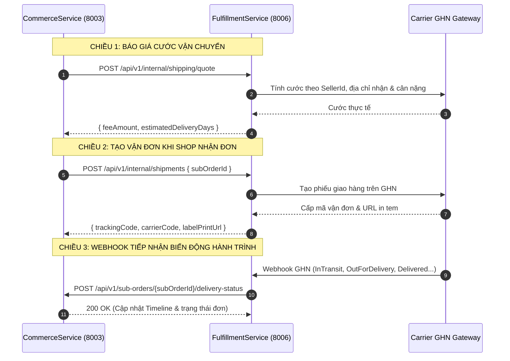

# HỢP ĐỒNG KỸ THUẬT & BIÊN BẢN ĐỐI CHIẾU REST API (LOGISTICS & SHIPMENT TRACKING)
## COMMERCE SERVICE ↔ FULFILLMENT SERVICE (THE GOLDEN STANDARD v2.0)

> **Dự án:** Nexus Microservices Ecosystem  
> **Service gửi yêu cầu:** `CommerceService` (Port `8003`, DB `commerce_db:5435`)  
> **Service tiếp nhận đối chiếu:** `FulfillmentService` (Port `8006`, DB `fulfillment_db`)  
> **Người tiếp nhận & ký duyệt:** Anh Ngô Nhựt Minh — Fulfillment Service Lead  
> **Phiên bản hợp đồng:** `v2.0.0-LOGISTICS-ALIGNMENT`  
> **Ngày lập:** 2026-11-12  
> **Trạng thái:** 📋 **GỬI ĐỐI TÁC XÁC NHẬN & PHÊ DUYỆT ĐỒNG NHẤT**  

---

## 1. MỤC TIÊU & TÔN CHỈ THỐNG NHẤT

Biên bản hợp đồng kỹ thuật này nhằm chuẩn hóa dứt điểm và đồng nhất 100% giữa hai phân hệ **CommerceService** và **FulfillmentService** trong toàn bộ quy trình:
1. **Tạo vận đơn thật**: Đồng nhất cấu trúc trả về mã vận đơn (`trackingCode`), đơn vị vận chuyển (`carrierCode`) và link in phiếu gửi hàng (`labelPrintUrl`) do GHN cấp.
2. **Theo dõi dòng thời gian (Tracking Timeline)**: Chuẩn hóa payload webhook mà Fulfillment bắn sang Commerce khi có biến động giao vận từ GHN, bảo đảm ghi nhận đầy đủ mốc thời gian, địa điểm trung chuyển và trạng thái.
3. **Bảo mật liên dịch vụ**: Sử dụng header bảo mật nội bộ `X-Internal-Service-Key` cho cả 2 chiều Outbound và Inbound.
4. **Nguyên tắc Safe Idempotency & Fail-Closed**: Chống tạo trùng vận đơn trên GHN khi gọi retry, và bảo đảm tính toàn vẹn dữ liệu khi có sự cố mạng.

---

## 2. MA TRẬN CÁC ENDPOINT TÍCH HỢP LIÊN DỊCH VỤ



---

## 3. CHI TIẾT ĐẶC TẢ HỢP ĐỒNG TỪNG ENDPOINT

### 3.1. [OUTBOUND] Tạo Vận đơn Giao hàng khi Shop tiếp nhận đơn

* **HTTP Method:** `POST`
* **URL:** `/api/v1/internal/shipments`
* **Caller:** `CommerceService` $\rightarrow$ **Receiver:** `FulfillmentService`
* **Header bắt buộc:**
  ```http
  X-Internal-Service-Key: eaT0Ombups70WJzd85CBBpp8rAno55SxKn1qvYBGH9e
  Content-Type: application/json
  ```
* **Request Payload (Commerce gửi sang):**
  ```json
  {
    "subOrderId": "3fa85f64-5717-4562-b3fc-2c963f66afa6"
  }
  ```
* **Response Payload (Fulfillment trả về - 200 OK):**
  ```json
  {
    "subOrderId": "3fa85f64-5717-4562-b3fc-2c963f66afa6",
    "trackingCode": "GHN-SGN-1029384",
    "carrierCode": "GHN",
    "labelPrintUrl": "https://fulfillment.nexus.internal/labels/GHN-SGN-1029384.pdf",
    "estimatedDeliveryAt": "2026-11-14T17:00:00Z"
  }
  ```
* **Cam kết Lũy đẳng (Safe Idempotency):**
  - Nếu `subOrderId` này đã từng tạo vận đơn trên GHN, Fulfillment **bắt buộc trả về đúng bản ghi cũ** (`200 OK`), **tuyệt đối không gọi sang GHN tạo vận đơn mới trùng lặp**.
* **Xử lý sự cố (Error Handling):**
  - Nếu GHN gặp sự cố kết nối: Fulfillment trả về HTTP `503 Service Unavailable` (`errorCode: "CARRIER_SERVICE_UNAVAILABLE"`). Commerce sẽ lưu cờ `ShipmentPendingCreation = true` để tiến trình nền tự động thử lại sau 5 phút.

---

### 3.2. [OUTBOUND] Báo giá Cước Vận chuyển Động theo Trọng lượng Thực tế

* **HTTP Method:** `POST`
* **URL:** `/api/v1/internal/shipping/quote`
* **Caller:** `CommerceService` $\rightarrow$ **Receiver:** `FulfillmentService`
* **Header bắt buộc:** `X-Internal-Service-Key`
* **Request Payload (Commerce gửi sang):**
  ```json
  {
    "sellerId": "9b1deb4d-3b7d-4bad-9bdd-2b0d7b3dcb6d",
    "ghnDistrictId": 1442,
    "ghnWardCode": "20101",
    "items": [
      {
        "skuId": "e3a1f802-5c8e-4b69-8d62-7f91c98a5e12",
        "quantity": 2,
        "weightGrams": 500
      }
    ]
  }
  ```
* **Response Payload (Fulfillment trả về - 200 OK):**
  ```json
  {
    "sellerId": "9b1deb4d-3b7d-4bad-9bdd-2b0d7b3dcb6d",
    "feeAmount": 28500.00,
    "carrierCode": "GHN",
    "estimatedDeliveryDays": 2
  }
  ```
* **Ràng buộc:**
  - Nếu `ghnDistrictId` hoặc `ghnWardCode` không tồn tại trong danh mục GHN: Fulfillment trả về HTTP `400 Bad Request` (`errorCode: "SHIPPING_QUOTE_FAILED"`).

---

### 3.3. [INBOUND] Webhook Cập nhật Trạng thái Vận chuyển từ Hãng GHN

* **HTTP Method:** `POST`
* **URL:** `/api/v1/sub-orders/{subOrderId}/delivery-status`
* **Caller:** `FulfillmentService` $\rightarrow$ **Receiver:** `CommerceService`
* **Header bắt buộc:**
  ```http
  X-Internal-Service-Key: eaT0Ombups70WJzd85CBBpp8rAno55SxKn1qvYBGH9e
  Content-Type: application/json
  ```
* **Path Parameter:**
  - `subOrderId`: Định danh duy nhất của đơn hàng con (UUIDv4).
* **Request Payload (Fulfillment gửi sang Commerce):**
  ```json
  {
    "status": "InTransit",
    "carrierCode": "GHN",
    "trackingCode": "GHN-SGN-1029384",
    "note": "Kiện hàng đang trung chuyển tại bưu cục Tân Bình, TP. HCM",
    "location": "Kho trung chuyển Tân Bình, TP. HCM",
    "deliveredAt": "2026-11-12T14:30:00Z"
  }
  ```
  *(Lưu ý về tính tương thích ngược: Trường `status` là bắt buộc; các trường `carrierCode`, `trackingCode`, `note`, `location`, `deliveredAt` là tùy chọn. Nếu Fulfillment gửi null, Commerce vẫn tự động map text mặc định phù hợp).*
* **Response Payload (Commerce phản hồi lại - 200 OK):**
  ```json
  {
    "subOrderId": "3fa85f64-5717-4562-b3fc-2c963f66afa6",
    "status": "InTransit",
    "updatedAt": "2026-11-12T14:30:02Z"
  }
  ```

---

## 4. MA TRẬN 9 CHUỖI TRẠNG THÁI GIAO VẬN THỐNG NHẤT (STATUS ENUM MATRIX)

Hai bên cam kết tuần tự hóa chuỗi trạng thái (`status`) theo chuẩn **PascalCase**, không gửi số nguyên và không gửi chữ thường:

| Giá trị chuỗi `status` | Ý nghĩa nghiệp vụ thực tế | Hành động của CommerceService |
|:---|:---|:---|
| `"ReadyToPick"` | Shop đóng gói xong, chờ GHN đến lấy | Ghi nhận sự kiện Timeline (giữ trạng thái `Confirmed`). |
| `"Picking"` | Shipper GHN đang trên đường tới Shop lấy hàng | Ghi nhận sự kiện Timeline. |
| `"Packed"` | Kiện hàng đã được dán tem niêm phong | Ghi nhận sự kiện Timeline. |
| `"HandedOver"` | Bưu tá GHN đã nhận hàng từ tay Shop | Chuyển `SubOrder.Status = Shipped`, lưu `ShippedAt`. |
| `"InTransit"` | Hàng đang trung chuyển liên tỉnh / bưu cục | Ghi nhận sự kiện Timeline kèm `location`. |
| `"OutForDelivery"` | Shipper đang đi phát hàng cho người mua | Ghi nhận sự kiện Timeline (sắp giao đến nơi). |
| `"DeliveryAttemptFailed"` | Giao không thành công lần 1/lần 2 (khách hẹn lại) | Giữ `Status = Shipped`, ghi nhận lý do hẹn lại vào Timeline. |
| `"Delivered"` | Giao hàng thành công đến tay người mua | Chuyển `SubOrder.Status = Delivered`, lưu `DeliveredAt`. Tự động kiểm tra và chuyển đơn cha sang `Delivered`. |
| `"DeliveryFailed"` | Giao thất bại dứt khoát sau 3 lần phát | Chuyển sang hoàn hàng về shop. |
| `"Returned"` | Kiện hàng đã hoàn trả về lại kho của Shop | Chuyển `Status = Cancelled`. Tự động hoàn 100% tiền ví cho Buyer và nhả tồn kho. |

---

## 5. [OUTBOUND] Nhập lại kho khi Kiện hàng bị Hoàn về Shop (Return Stock Release)

Khi đơn hàng bị `Returned` (giao không thành công, hoàn hàng về Shop):
* **HTTP Method:** `POST`
* **URL:** `/api/v1/internal/inventories/reservations/{orderId}/release-items`
* **Caller:** `CommerceService` $\rightarrow$ **Receiver:** `FulfillmentService`
* **Header bắt buộc:** `X-Internal-Service-Key`
* **Path Parameter:** `{orderId}` (Master Order Id).
* **Payload:**
  ```json
  {
    "items": [
      { "skuId": "e3a1f802-5c8e-4b69-8d62-7f91c98a5e12", "quantity": 2 }
    ],
    "reason": "PackageReturned"
  }
  ```
* **Mục đích:** Hoàn trả lại số lượng tồn kho vật lý của các mặt hàng bị hoàn về kho của Shop, sẵn sàng cho khách hàng khác mua.

---

## 6. PHIẾU XÁC NHẬN ĐỒNG THUẬN KỸ THUẬT (SIGN-OFF & APPROVAL)

Kính gửi: **Anh Ngô Nhựt Minh — Lead Phân hệ Fulfillment Service**  
Vui lòng kiểm tra và xác nhận các tiêu chí kỹ thuật dưới đây trước khi CommerceService triển khai code:

- [ ] **Tiêu chí 1:** Endpoint `POST /api/v1/internal/shipments` đã sẵn sàng trả về đủ `trackingCode`, `carrierCode`, `labelPrintUrl` và cam kết Lũy đẳng (không tạo trùng mã vận đơn GHN khi retry).
- [ ] **Tiêu chí 2:** Endpoint `POST /api/v1/internal/shipping/quote` chấp nhận tham số `weightGrams` của từng item để tính cước cồng kềnh chính xác.
- [ ] **Tiêu chí 3:** Webhook `POST /api/v1/sub-orders/{subOrderId}/delivery-status` sẽ gửi đúng các chuỗi trạng thái PascalCase theo Bảng Mục 4.
- [ ] **Tiêu chí 4:** Header bảo mật liên dịch vụ được cố định: `X-Internal-Service-Key: eaT0Ombups70WJzd85CBBpp8rAno55SxKn1qvYBGH9e`.

---

| ĐẠI DIỆN COMMERCE SERVICE | ĐẠI DIỆN FULFILLMENT SERVICE |
|:---:|:---:|
| *(Chữ ký & Họ tên)* | *(Chữ ký & Họ tên)* |
| **Trạng thái:** `Đã sẵn sàng triển khai mã nguồn` | **Trạng thái:** `Chờ ký duyệt đồng thuận` |
| **Đại diện:** Kỹ sư Trưởng Commerce Service | **Đại diện:** Ngô Nhựt Minh — Lead Fulfillment |
| **Ngày lập:** 2026-11-12 | **Ngày xác nhận:** 2026-11-12 |
