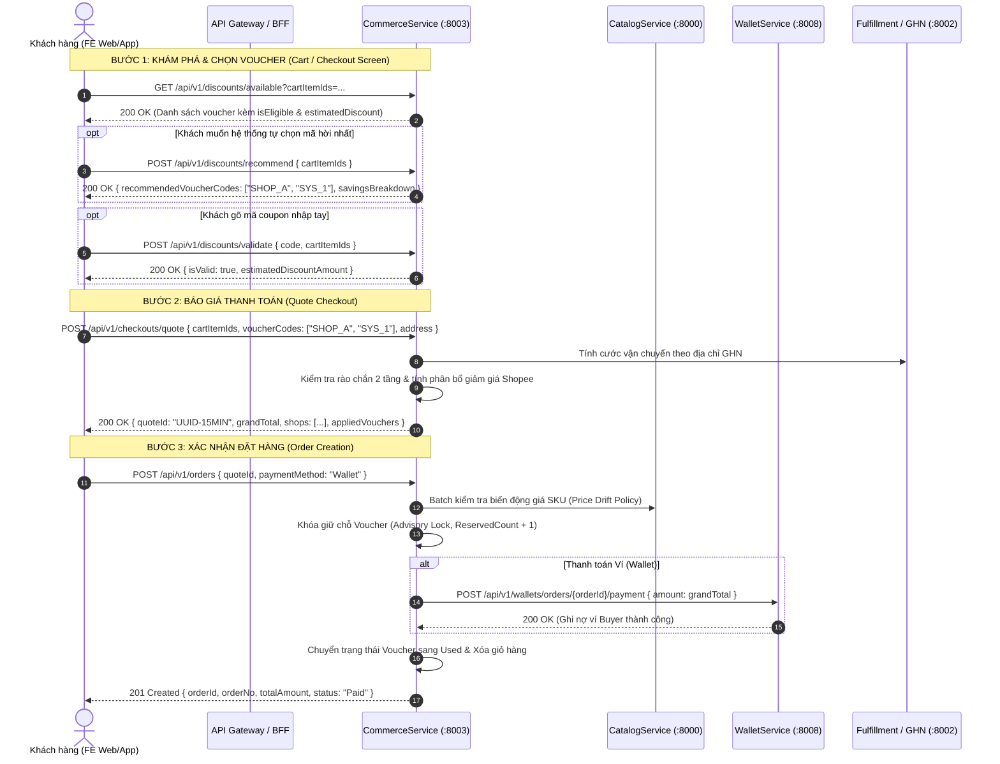

# COMMERCE SERVICE — TÀI LIỆU HỢP ĐỒNG API PHÂN HỆ VOUCHER & CHECKOUT (API CONTRACT)
## DÀNH CHO FRONTEND (WEB/APP), API GATEWAY / BFF & CÁC THÀNH VIÊN DỰ ÁN

> **Dịch vụ cung cấp**: `CommerceService` (Cổng: `8003`)  
> **Phiên bản chuẩn**: v2.0 (Shopee 2-Tier Alignment Standard)  
> **Giao thức**: RESTful Web API (JSON, UTF-8, PascalCase Enums, camelCase Properties)  
> **Xác thực**: Bearer JWT (`Authorization: Bearer <token>`) & Header ngữ cảnh Gateway (`x-user-id`, `x-user-roles`)  
> **Trạng thái**: ✅ RATIFIED & IMPLEMENTED (100% Build Verified)  
> **Ngày cập nhật**: 2026-11-18  

---

## 1. TỔNG QUAN LUỒNG NGHIỆP VỤ (BUSINESS MENTAL MODEL)

Hệ thống Voucher & Khuyến mãi của sàn vận hành theo **Mô hình 2 Tầng Tinh gọn chuẩn Shopee / TikTok Shop** nhằm bảo vệ quyền lợi Người mua và chống lỗ kép cho Người bán:

```text
                               ┌──────────────────────────────────────────────────────────┐
                               │                    ĐƠN HÀNG MASTER                        │
                               └────────────────────────────┬─────────────────────────────┘
                                                            │
                            ┌───────────────────────────────┴───────────────────────────────┐
                            ▼                                                               ▼
        ┌───────────────────────────────────────┐                       ┌───────────────────────────────────────┐
        │        SHOP A (SubOrder A)            │                       │        SHOP B (SubOrder B)            │
        ├───────────────────────────────────────┤                       ├───────────────────────────────────────┤
        │  TẦNG 1: VOUCHER CẤP SHOP (Max 1)     │                       │  TẦNG 1: VOUCHER CẤP SHOP (Max 1)     │
        │  - Chọn Mã SP: Hoặc                   │                       │  - Chọn Mã SP: Hoặc                   │
        │  - Chọn Mã Shop: Hoặc                 │                       │  - Chọn Mã Shop: Hoặc                 │
        │  => DO SHOP A CHI TRẢ (Max 1 mã)      │                       │  => DO SHOP B CHI TRẢ (Max 1 mã)      │
        └───────────────────┬───────────────────┘                       └───────────────────┬───────────────────┘
                            │                                                               │
                            └───────────────────────────────┬───────────────────────────────┘
                                                            │
                                                            ▼
                                        ┌───────────────────────────────────────┐
                                        │   TẦNG 2: VOUCHER CỦA SÀN (Max 1)     │
                                        │   - Mã Freeship hoặc Mã Giảm Toàn Sàn │
                                        │   => DO SÀN TÀI TRỢ / BÙ TIỀN 100%    │
                                        └───────────────────────────────────────┘
```

### 3 Nguyên tắc Bất biến Frontend & Gateway CẦN NHỚ:
1. **Quy tắc Độc quyền cấp Shop (Single Shop-Voucher Invariant)**:
   - Trong cùng một đơn hàng, mỗi Shop **CHỈ ĐƯỢC ÁP DỤNG DUY NHẤT 1 VOUCHER** (Hoặc mã Sản phẩm của shop đó, HOẶC mã toàn Shop).
   - Nếu Frontend gửi từ 2 voucher trở lên của cùng 1 Shop $\rightarrow$ Hệ thống chặn ngay với lỗi **HTTP 400 `SHOP_MULTIPLE_VOUCHERS_NOT_ALLOWED`**.
2. **Quy tắc Voucher Toàn sàn (Platform Voucher Invariant)**:
   - Mỗi đơn hàng chỉ được chọn **TỐI ĐA 1 VOUCHER SÀN** (`ScopeType == "System"`). Nếu gửi $\ge 2$ voucher sàn $\rightarrow$ Lỗi **HTTP 400 `VOUCHER_STACKING_CONFLICT`**.
3. **Mô hình Báo giá 2 Bước (Quote-First Checkout Flow)**:
   - Bắt buộc phải qua bước Báo giá (`POST /api/v1/checkouts/quote`) để nhận `quoteId` (hiệu lực 5 phút), sau đó mới gọi tạo đơn (`POST /api/v1/orders`).

---

## 2. SƠ ĐỒ TUẦN TỰ TỔNG THỂ (END-TO-END SEQUENCE DIAGRAM)



---

## 3. CHI TIẾT DANH MỤC REST API ENDPOINTS

### Bảng tra cứu nhanh URL & Phân quyền:

| Phân nhóm | HTTP Method | URL Endpoint | Phân quyền (`x-user-roles`) | Chức năng |
| :--- | :---: | :--- | :---: | :--- |
| **Buyer** | `GET` | `/api/v1/discounts/available` | `buyer` | Lấy danh sách voucher khả dụng để mở Popup |
| **Buyer** | `POST` | `/api/v1/discounts/validate` | `buyer` | Kiểm tra mã voucher khi gõ tay |
| **Buyer** | `POST` | `/api/v1/discounts/recommend` | `buyer` | Tự động chọn combo voucher hời nhất (2 Tầng) |
| **Checkout**| `POST` | `/api/v1/checkouts/quote` | `buyer`, `seller`, `admin` | Tạo phiên báo giá đơn hàng (TTL 5 phút) |
| **Checkout**| `POST` | `/api/v1/orders` | `buyer`, `seller`, `admin` | Tạo đơn hàng chính thức từ `quoteId` |
| **Admin/Shop**| `POST` | `/api/v1/discounts` | `admin`, `seller` | Tạo mới voucher |
| **Admin/Shop**| `GET` | `/api/v1/discounts` | `admin`, `seller`, `staff` | Lấy danh sách voucher quản trị phân trang |
| **Admin/Shop**| `GET` | `/api/v1/discounts/{discountId}` | `admin`, `seller`, `staff` | Chi tiết voucher |
| **Admin/Shop**| `PUT` | `/api/v1/discounts/{discountId}` | `admin`, `seller` | Sửa voucher (Khóa trường tiền nếu đã có người dùng) |
| **Admin/Shop**| `PATCH` | `/api/v1/discounts/{discountId}/status`| `admin`, `seller` | Bật / Tắt trạng thái voucher |
| **Admin/Shop**| `DELETE`| `/api/v1/discounts/{discountId}` | `admin`, `seller` | Xóa mềm voucher |

---

## 4. ĐẶC TẢ CHI TIẾT CÁC ENDPOINT DÀNH CHO FRONTEND CHECKOUT

### 4.1. Lấy danh sách Voucher khả dụng (`GET /api/v1/discounts/available`)
- **Mục đích**: Hiển thị Modal/Popup "Chọn Voucher" tại màn hình Giỏ hàng hoặc Thanh toán.
- **Query Parameters**:
  - `sellerId` (optional, UUID): Lọc voucher của riêng shop đó + voucher toàn sàn.
  - `cartItemIds` (optional, string): Danh sách ID món giỏ hàng cách nhau bởi dấu phẩy (`uuid1,uuid2`). Backend sẽ đánh giá giỏ hàng để tính ra cờ `isEligible` và số tiền ước tính `estimatedDiscountAmount`.
  - `page` (optional, int, default: `1`).
  - `pageSize` (optional, int, default: `20`).
- **Response `200 OK`**:
  ```json
  {
    "items": [
      {
        "id": "7fa85f64-5717-4562-b3fc-2c963f66afa1",
        "code": "FREESHIP30K",
        "name": "Giảm 30K Phí Vận Chuyển Toàn Sàn",
        "scopeType": "System",
        "ownerSellerId": null,
        "discountType": "FixedAmount",
        "discountValue": 30000.0,
        "minOrderAmount": 200000.0,
        "maxDiscountAmount": null,
        "startsAt": "2026-11-01T00:00:00Z",
        "endsAt": "2026-11-30T23:59:59Z",
        "isEligible": true,
        "ineligibleReason": null,
        "estimatedDiscountAmount": 30000.0
      },
      {
        "id": "8fa85f64-5717-4562-b3fc-2c963f66afa2",
        "code": "SHOP50K",
        "name": "Voucher Shop Giảm 50K đơn từ 500K",
        "scopeType": "Shop",
        "ownerSellerId": "9fa85f64-5717-4562-b3fc-2c963f66afa9",
        "discountType": "FixedAmount",
        "discountValue": 50000.0,
        "minOrderAmount": 500000.0,
        "maxDiscountAmount": null,
        "startsAt": "2026-11-01T00:00:00Z",
        "endsAt": "2026-11-30T23:59:59Z",
        "isEligible": false,
        "ineligibleReason": "Minimum order amount 500,000 VND not met for shop.",
        "estimatedDiscountAmount": 0.0
      }
    ],
    "pagination": {
      "pageIndex": 1,
      "pageSize": 20,
      "totalCount": 2,
      "totalPages": 1,
      "hasPreviousPage": false,
      "hasNextPage": false
    }
  }
  ```
- **Hướng dẫn cho Frontend UI**:
  - Phân tách làm 2 tabs hoặc 2 nhóm: **Voucher của Shop** (`scopeType == "Shop" || "Product"`) và **Voucher của Sàn** (`scopeType == "System"`).
  - Nếu `isEligible == false`: Làm mờ nút checkbox (disabled) và hiển thị dòng chữ màu xám/đỏ từ `ineligibleReason`.

---

### 4.2. Kiểm tra mã nhập tay (`POST /api/v1/discounts/validate`)
- **Mục đích**: Khi người dùng gõ mã coupon vào ô text và nhấn nút "Áp dụng".
- **Request Body**:
  ```json
  {
    "code": "SHOP20K",
    "cartItemIds": [
      "1fa85f64-5717-4562-b3fc-2c963f66afa1",
      "2fa85f64-5717-4562-b3fc-2c963f66afa2"
    ]
  }
  ```
- **Response `200 OK`**:
  ```json
  {
    "isValid": true,
    "discountId": "7fa85f64-5717-4562-b3fc-2c963f66afa1",
    "code": "SHOP20K",
    "scopeType": "Shop",
    "estimatedDiscountAmount": 20000.0
  }
  ```
- **Lỗi thường gặp (HTTP 400 / 404)**:
  - `VOUCHER_NOT_FOUND`: Mã không tồn tại hoặc đã bị tắt/hết hạn.
  - `VOUCHER_NOT_APPLICABLE`: Không đủ giá trị đơn hàng tối thiểu hoặc không khớp sản phẩm.

---

### 4.3. Tự động gợi ý Combo tối ưu 2 Tầng (`POST /api/v1/discounts/recommend`)
- **Mục đích**: Nút "Áp dụng mã giảm giá tốt nhất" (Best Voucher Auto-Apply).
- **Cơ chế Backend**: Với mỗi Shop có mặt trong giỏ, tự động so sánh mã SP và mã Shop của shop đó để chọn ra mã có mức giảm cao nhất $\max(\text{ProductDiscount}, \text{ShopDiscount})$; sau đó chọn tiếp 1 mã Sàn tốt nhất.
- **Request Body**:
  ```json
  {
    "cartItemIds": [
      "1fa85f64-5717-4562-b3fc-2c963f66afa1",
      "2fa85f64-5717-4562-b3fc-2c963f66afa2"
    ]
  }
  ```
- **Response `200 OK` (Chuẩn 2 Tầng Shopee)**:
  ```json
  {
    "recommendedVoucherCodes": [
      "SHOP_A_20K",
      "SYS_30K"
    ],
    "savingsBreakdown": {
      "shopDiscount": 20000.0,
      "systemDiscount": 30000.0,
      "totalSavings": 50000.0
    }
  }
  ```
- **Hướng dẫn cho Frontend UI**:
  - Lấy mảng `recommendedVoucherCodes` tự động gán vào form chọn mã của Buyer.
  - Hiển thị badge: *"Bạn tiết kiệm được 50.000đ (Shop giảm 20.000đ, Sàn giảm 30.000đ)"*.

---

### 4.4. Báo giá Đơn hàng Đa Shop (`POST /api/v1/checkouts/quote`)
- **Mục đích**: Tính toán chi tiết toàn bộ tiền hàng, cước ship GHN, số tiền giảm từng shop, và sinh mã `quoteId` có hiệu lực 5 phút.
- **Request Body**:
  ```json
  {
    "cartItemIds": [
      "1fa85f64-5717-4562-b3fc-2c963f66afa1",
      "2fa85f64-5717-4562-b3fc-2c963f66afa2"
    ],
    "shippingAddress": {
      "receiverName": "Nguyen Van A",
      "contactPhone": "0901234567",
      "street": "123 Le Loi",
      "ward": "Ben Nghe",
      "district": "Quan 1",
      "province": "Ho Chi Minh",
      "ghnDistrictId": 1442,
      "ghnWardCode": "20101"
    },
    "contactPhone": "0901234567",
    "paymentMethod": "Wallet",
    "voucherCodes": [
      "SHOP_A_20K",
      "SYS_30K"
    ]
  }
  ```
- **Response `200 OK`**:
  ```json
  {
    "quoteId": "a1b2c3d4-e5f6-4562-b3fc-2c963f66afa1",
    "grandTotal": 670000.0,
    "walletBalance": 1500000.0,
    "shops": [
      {
        "sellerId": "9fa85f64-5717-4562-b3fc-2c963f66afa9",
        "shopName": "Shop Thời Trang A",
        "items": [
          {
            "cartItemId": "1fa85f64-5717-4562-b3fc-2c963f66afa1",
            "productId": "8fa85f64-5717-4562-b3fc-2c963f66afa8",
            "skuId": "5fa85f64-5717-4562-b3fc-2c963f66afa5",
            "productName": "Áo Polo Nam Classic",
            "quantity": 2,
            "unitPrice": 200000.0,
            "lineTotal": 400000.0
          }
        ],
        "itemsAmount": 400000.0,
        "productDiscountAmount": 0.0,
        "shopDiscountAmount": 20000.0,
        "systemDiscountAmount": 17015.0,
        "discountAmount": 37015.0,
        "shippingFeeAmount": 25000.0,
        "totalAmount": 387985.0
      },
      {
        "sellerId": "8fa85f64-5717-4562-b3fc-2c963f66afa8",
        "shopName": "Shop Giày Dép B",
        "items": [...],
        "itemsAmount": 300000.0,
        "productDiscountAmount": 0.0,
        "shopDiscountAmount": 0.0,
        "systemDiscountAmount": 12985.0,
        "discountAmount": 12985.0,
        "shippingFeeAmount": 30000.0,
        "totalAmount": 317015.0
      }
    ],
    "appliedVouchers": [
      "SHOP_A_20K",
      "SYS_30K"
    ],
    "warnings": null,
    "expiredAt": "2026-11-18T00:38:37Z"
  }
  ```
- **Lưu ý quan trọng cho Frontend**:
  - `grandTotal` là số tiền cuối cùng khách phải trả: $\text{grandTotal} = \sum \text{shops.totalAmount}$.
  - Nếu khách gửi mã không thỏa mãn, mã đó sẽ bị bỏ qua và backend trả về danh sách cảnh báo trong mảng `warnings` (ví dụ: `["Minimum order amount not met for voucher 'SALE50K'."]`). Frontend kiểm tra `warnings` để hiển thị Toast thông báo màu vàng cho người dùng biết.
  - Nếu vi phạm rào chắn chọn $\ge 2$ voucher cùng 1 shop $\rightarrow$ Lập tức ném HTTP 400 `SHOP_MULTIPLE_VOUCHERS_NOT_ALLOWED`.

---

### 4.5. Tạo đơn hàng chính thức (`POST /api/v1/orders`)
- **Mục đích**: Xác nhận thanh toán và tạo đơn hàng từ `quoteId`.
- **Request Body**:
  ```json
  {
    "quoteId": "a1b2c3d4-e5f6-4562-b3fc-2c963f66afa1",
    "paymentMethod": "Wallet",
    "shippingAddress": "123 Le Loi, Ben Nghe, Quan 1, TP.HCM",
    "contactPhone": "0901234567"
  }
  ```
- **Response `201 Created`**:
  ```json
  {
    "orderId": "6fa85f64-5717-4562-b3fc-2c963f66afa6",
    "orderNo": "ORD-20261118-A1B2C3",
    "totalAmount": 670000.0,
    "status": "Paid",
    "subOrderIds": [
      "4fa85f64-5717-4562-b3fc-2c963f66afa4",
      "5fa85f64-5717-4562-b3fc-2c963f66afa5"
    ],
    "createdAt": "2026-11-18T00:25:00Z"
  }
  ```

---

## 5. ĐẶC TẢ API DÀNH CHO SELLER & ADMIN (QUẢN TRỊ VOUCHER)

### 5.1. Tạo mới Voucher (`POST /api/v1/discounts`)
- **Role yêu cầu**: `admin`, `seller`.
- **Header**: Bắt buộc có token chứa `x-user-id` và role.
- **Request Body (Ví dụ tạo mã toàn Shop)**:
  ```json
  {
    "code": "BLACKFRIDAY",
    "name": "Giảm 10% Toàn Shop dịp Black Friday",
    "scopeType": "Shop",
    "ownerSellerId": "9fa85f64-5717-4562-b3fc-2c963f66afa9",
    "discountType": "Percentage",
    "discountValue": 10.0,
    "minOrderAmount": 300000.0,
    "maxDiscountAmount": 50000.0,
    "maxUsesTotal": 500,
    "maxUsesPerUser": 1,
    "isVisible": true,
    "startsAt": "2026-11-20T00:00:00Z",
    "endsAt": "2026-11-30T23:59:59Z",
    "scopes": []
  }
  ```
- **Request Body (Ví dụ tạo mã Sản phẩm cụ thể — `ScopeType = Product`)**:
  Bắt buộc truyền mảng `scopes` chứa các SKU ID:
  ```json
  {
    "code": "POLO20K",
    "name": "Giảm 20K Cho Áo Polo",
    "scopeType": "Product",
    "ownerSellerId": "9fa85f64-5717-4562-b3fc-2c963f66afa9",
    "discountType": "FixedAmount",
    "discountValue": 20000.0,
    "minOrderAmount": 100000.0,
    "maxDiscountAmount": null,
    "maxUsesTotal": 100,
    "maxUsesPerUser": 1,
    "isVisible": true,
    "scopes": [
      {
        "scopeRefType": "Sku",
        "scopeRefId": "5fa85f64-5717-4562-b3fc-2c963f66afa5"
      }
    ]
  }
  ```
- **Rào chắn kiểm tra từ Backend**:
  - Không được tạo mã cho SKU hàng Đấu giá $\rightarrow$ HTTP 400 `VOUCHER_SKU_AUCTION_NOT_ALLOWED`.
  - Không được tạo mã cho SKU đã bị ẩn/ngừng bán $\rightarrow$ HTTP 400 `CATALOG_SKU_INACTIVE`.
  - Seller không được tạo mã cho SKU của Shop khác $\rightarrow$ HTTP 403 `VOUCHER_SELLER_SKU_FORBIDDEN`.

---

## 6. MA TRẬN MÃ LỖI CHUẨN RFC 9110 (ERROR CODE MATRIX CHO FE)

Tất cả các lỗi đều trả về dưới cấu trúc RFC 9110 Problem Details:
```json
{
  "type": "https://tools.ietf.org/html/rfc9110#section-15.5.1",
  "title": "Bad Request",
  "status": 400,
  "errorCode": "SHOP_MULTIPLE_VOUCHERS_NOT_ALLOWED",
  "message": "Only one voucher per shop can be applied.",
  "traceId": "00-4bf92f3577b34da6a3ce929d0e0e4736-00f067aa0ba902b7-01"
}
```

| `errorCode` | HTTP Status | Thông báo Tiếng Anh gốc (`message`) | Hướng dẫn hiển thị Toast trên Frontend |
| :--- | :---: | :--- | :--- |
| `SHOP_MULTIPLE_VOUCHERS_NOT_ALLOWED` | **400** | *"Only one voucher per shop can be applied."* | "Mỗi Shop chỉ được áp dụng tối đa 1 mã giảm giá. Vui lòng bỏ bớt mã thừa." |
| `VOUCHER_STACKING_CONFLICT` | **400** | *"Multiple system vouchers cannot be applied to the same order."* | "Chỉ được áp dụng tối đa 1 mã giảm giá toàn sàn cho một đơn hàng." |
| `VOUCHER_NOT_FOUND` | **404** | *"Voucher code was not found or is not active."* | "Mã giảm giá không tồn tại hoặc đã bị tắt." |
| `VOUCHER_NOT_APPLICABLE` | **400** | *"Voucher is not applicable to current cart items."* | "Đơn hàng chưa đạt giá trị tối thiểu hoặc không chứa sản phẩm áp dụng." |
| `VOUCHER_USAGE_LIMIT_EXCEEDED` | **400** | *"Voucher has reached its total usage limit."* | "Rất tiếc, mã giảm giá này đã hết lượt sử dụng trên hệ thống." |
| `VOUCHER_USER_LIMIT_EXCEEDED` | **400** | *"You have reached the maximum redemption limit for this voucher."* | "Bạn đã sử dụng hết số lần cho phép của mã giảm giá này." |
| `VOUCHER_SKU_AUCTION_NOT_ALLOWED`| **400** | *"Voucher cannot be applied to auction products."* | "Không thể áp dụng mã giảm giá cho sản phẩm thuộc phiên đấu giá." |
| `CATALOG_SKU_INACTIVE` | **400** | *"Product is no longer available for purchase."* | "Sản phẩm trong mã giảm giá hiện đã ngừng kinh doanh." |
| `VOUCHER_SELLER_SKU_FORBIDDEN` | **403** | *"Seller can only apply vouchers to their own products."* | "Bạn không thể tạo mã giảm giá cho sản phẩm của Shop khác." |
| `VOUCHER_FINANCIAL_MODIFICATION_LOCKED`| **400** | *"Financial terms cannot be modified after voucher has been reserved or used."*| "Không thể thay đổi giá trị giảm giá của mã đã phát sinh lượt dùng." |
| `PRICE_CHANGED` | **409** | *"Price of product has increased. Cart prices have been refreshed."* | "Giá sản phẩm trong giỏ đã thay đổi. Vui lòng kiểm tra lại đơn trước khi đặt." |
| `QUOTE_EXPIRED` | **400** | *"Checkout quote has expired, is invalid, or is currently being processed."*| "Phiên báo giá đã hết hạn (5 phút). Vui lòng tải lại trang thanh toán." |
| `BUYER_ACTION_RESTRICTED` | **403** | *"User has an active restriction prohibiting purchase actions."* | "Tài khoản của bạn đang bị tạm khóa tính năng mua hàng." |
| `SELLER_ACTION_RESTRICTED` | **403** | *"User has an active restriction prohibiting voucher management."* | "Tài khoản người bán đang bị giới hạn quyền quản lý khuyến mãi." |
