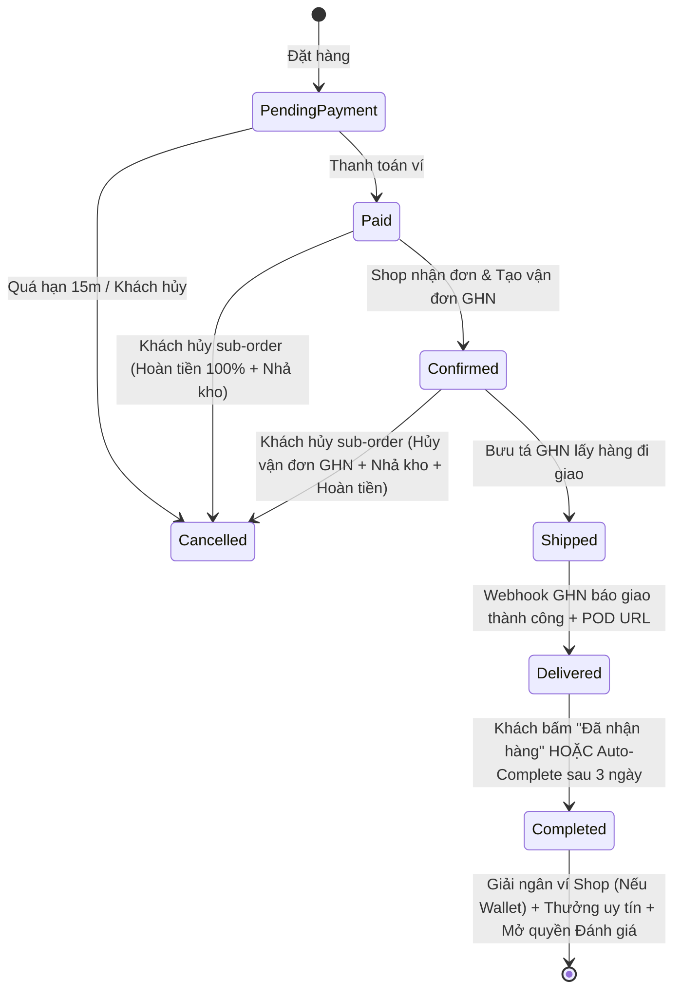

# BÁO CÁO KỸ THUẬT & HƯỚNG DẪN TÍCH HỢP TÍNH NĂNG VÒNG ĐỜI GIAO VẬN VÀ HỦY ĐƠN HÀNG CON
> **Dành cho:** Frontend (Web/Mobile), Phân hệ Giao vận (Fulfillment), Ví (Wallet), và QA/Testers  
> **Dịch vụ phụ trách:** `CommerceService` (Port `8003`, Database `commerce_db:5435`)  
> **Mã tính năng:** `025-fulfillment-delivery-and-suborder-lifecycle`  
> **Ngày cập nhật:** 2026-11-17  
> **Trạng thái:** ✅ Đã hoàn thiện mã nguồn, kiểm thử 100% pass (243/243 Unit Tests)  

---

## 1. Tóm tắt nghiệp vụ & Đổi mới cốt lõi

Nhằm chuẩn hóa quy trình thương mại điện tử thực tế (tương tự mô hình Shopee/Lazada) và tối ưu độ phức tạp cho đồ án tốt nghiệp, hệ thống đã chuẩn hóa 4 nghiệp vụ trọng yếu:

1. **Phân tách rạch ròi giữa `Delivered` (Đã giao hàng) và `Completed` (Hoàn tất đơn)**:
   - Khi shipper GHN giao kiện hàng thành công, đơn hàng con chuyển sang **`Delivered`**. Quỹ Escrow (tiền thanh toán) **vẫn được giữ an toàn tại ví sàn**, chưa giải ngân cho Người bán.
   - Chỉ khi Người mua bấm **"Đã nhận được hàng"** (hoặc hệ thống tự động hoàn tất sau thời gian chờ kiểm tra hàng), đơn mới sang **`Completed`** và kích hoạt giải ngân tiền cho Người bán.
2. **Quy tắc bất biến với đơn COD (Thanh toán khi nhận hàng)**:
   - Với đơn COD, shipper thu tiền mặt trực tiếp từ người mua. Do đó, hệ thống **bỏ qua hoàn toàn bước giải ngân ví Escrow** khi hoàn tất đơn, tránh việc sàn bị âm quỹ vô lý.
3. **Quyền Hủy đơn hàng con độc lập (Sub-Order Cancellation)**:
   - Khi Người mua đặt giỏ hàng đa người bán (gồm Shop A và Shop B): Nếu Shop A chuẩn bị hàng lâu, Người mua có thể **hủy riêng đơn con của Shop A** mà không làm ảnh hưởng đến tiến độ giao hàng của Shop B.
   - Hệ thống tự động: Nhả tồn kho riêng cho Shop A, hủy điều phối bưu tá GHN nếu đã tạo vận đơn, và hoàn trả 100% tiền ví cho phần đơn của Shop A.
4. **Cơ chế Tự động hoàn tất (Auto-Complete)**:
   - Nếu Người mua nhận hàng nhưng quên bấm xác nhận, sau **3 ngày** (mặc định 4320 phút, có thể cấu hình) kể từ thời điểm `DeliveredAt`, hệ thống chạy Background Worker tự động chuyển `Completed`, giải ngân cho Shop và cộng điểm uy tín.



---

## 2. Hướng dẫn chi tiết dành cho Frontend (FE / Mobile Dev)

### 📌 2.1. Nút "Đã nhận được hàng" (Confirm Receipt)

- **Điều kiện hiển thị trên UI**:
  - Chỉ kích hoạt (Enable) khi `subOrder.status === "Delivered"`.
  - Nếu `status` đang là `Shipped` (đang trên đường giao), `Confirmed`, `Paid`: **Bắt buộc Disable nút** (hoặc hiển thị tooltip: *"Bạn chỉ có thể xác nhận khi bưu tá đã giao hàng thành công"*).
- **Endpoint**:
  ```http
  POST /api/v1/sub-orders/{subOrderId}/confirm-receipt
  Authorization: Bearer <buyer_token>
  ```
- **Response thành công (HTTP 200 OK)**:
  ```json
  {
    "subOrderId": "3fa85f64-5717-4562-b3fc-2c963f66afa6",
    "status": "Completed",
    "completedAt": "2026-11-17T10:30:00Z",
    "escrowSettled": true,
    "amountSettled": 230000.0
  }
  ```
- **Xử lý lỗi (HTTP 400)**:
  - Nếu cố tình gửi API khi chưa `Delivered`: Nhận mã lỗi `"INVALID_STATUS"` kèm thông báo: `"Sub-order cannot be confirmed until it is delivered."` $\rightarrow$ FE hiển thị toast cảnh báo.

---

### 📌 2.2. Nút "Hủy đơn hàng con" (Cancel Sub-Order)

- **Điều kiện hiển thị trên UI**:
  - Khách chỉ được hủy đơn con khi trạng thái là một trong ba: `PendingPayment`, `Paid`, `Confirmed`.
  - Khi đơn đã chuyển sang `Shipped` (Bưu tá đã lấy hàng), `Delivered`, `Completed`, hoặc `Cancelled`: **Ẩn hoặc Disable nút "Hủy đơn"** (hiển thị thông báo: *"Hàng đã được gửi cho bưu tá, không thể hủy. Vui lòng nhận hàng hoặc yêu cầu trả hàng sau khi nhận"*).
- **Endpoint**:
  ```http
  POST /api/v1/sub-orders/{subOrderId}/cancel
  Authorization: Bearer <buyer_token>
  Content-Type: application/json
  ```
- **Request Payload**:
  ```json
  {
    "reasonCode": "BuyerChangedMind",
    "reasonNote": "Tôi muốn đổi địa chỉ giao hàng hoặc không còn nhu cầu."
  }
  ```
  *(Các mã `reasonCode` hợp lệ: `BuyerChangedMind`, `FoundCheaperPrice`, `DontWantToWait`, `Other`)*.
- **Response thành công (HTTP 200 OK)**:
  ```json
  {
    "subOrderId": "3fa85f64-5717-4562-b3fc-2c963f66afa6",
    "status": "Cancelled",
    "cancelledAt": "2026-11-17T10:45:00Z",
    "refundAmount": 250000.0,
    "inventoryReleased": true,
    "carrierShipmentCancelled": true
  }
  ```
- **Hành vi UI sau khi hủy thành công**:
  - Đơn con đó chuyển sang màu xám với badge `Đã hủy`.
  - Nếu đơn đã thanh toán Ví: Hiển thị popup *"Đã hoàn trả 250.000đ vào ví số của bạn"*.
  - Các đơn con khác trong cùng đơn hàng vẫn giữ nguyên trạng thái đang giao bình thường.

---

### 📌 2.3. Hiển thị Thông tin Shipper & Ảnh bằng chứng giao hàng (POD)

Khi theo dõi Timeline đơn hàng (`GET /api/v1/sub-orders/{subOrderId}/shipments/timeline`), các mốc lịch sử giao vận giờ đây có thêm thông tin chi tiết:

- **Ảnh POD (Proof of Delivery)**: Trường `podUrl` chứa link ảnh chụp chữ ký / gói hàng do shipper GHN tải lên. FE render ảnh này trong popup/modal *"Xem bằng chứng giao hàng"*.
- **Thông tin bưu tá**: Hiển thị `shipperName` và `shipperPhone` (kèm icon gọi điện nhanh) để người mua liên hệ bưu tá khi cần.
- **Ví dụ chuỗi ghi chú Timeline thực tế**:
  ```text
  [Delivered] Giao hàng thành công | Location: Bưu cục Tân Bình | Courier: Nguyễn Văn Bưu Tá (0987654321) | POD: https://cdn.fulfillment.com/pod/proof-1234.jpg
  ```

---

### 📌 2.4. Đếm ngược tự động hoàn tất (Countdown Widget)

- Đối với các đơn con có `status === "Delivered"`:
  - FE lấy mốc thời gian `deliveredAt`.
  - Hiển thị thanh thông báo: *"Đơn hàng sẽ tự động xác nhận sau 3 ngày kể từ khi giao thành công. Vui lòng kiểm tra hàng và khiếu nại nếu có vấn đề."*

---

## 3. Quy chuẩn phối hợp Liên dịch vụ (Inter-Service Alignment)

| Phân hệ gọi / nhận | Endpoint | Vai trò & Trách nhiệm phối hợp |
| :--- | :--- | :--- |
| **Fulfillment $\rightarrow$ Commerce** | `POST /api/v1/sub-orders/{subOrderId}/delivery-status` | Webhook tiếp nhận 9 trường: `status`, `carrierCode`, `trackingCode`, `note`, `location`, `deliveredAt`, `podUrl`, `shipperName`, `shipperPhone`. Cần header `X-Internal-Service-Key: eaT0Ombups70WJzd85CBBpp8rAno55SxKn1qvYBGH9e`. |
| **Commerce $\rightarrow$ Fulfillment** | `POST /api/v1/shipments/{subOrderId}/cancel` | Hủy vận đơn bên GHN khi người mua hủy đơn con đã `Confirmed`. |
| **Commerce $\rightarrow$ Fulfillment** | `POST /api/v1/internal/inventories/reservations/{orderId}/release-items` | Trả lại số lượng tồn kho của các mặt hàng trong đơn con bị hủy. |
| **Commerce $\rightarrow$ Wallet** | `POST /api/v1/wallets/sub-orders/{subOrderId}/settle` | Giải ngân tiền hàng `SellerReceiveAmount` sang ví Seller khi `Completed` (Chỉ gọi với đơn Ví, **bỏ qua với đơn COD**). |
| **Commerce $\rightarrow$ Wallet** | `POST /api/v1/wallets/sub-orders/{subOrderId}/refund` | Hoàn 100% tiền ví tức thời cho Buyer khi đơn con đã thanh toán bị hủy. |
| **Commerce $\rightarrow$ User & Catalog** | `POST /api/v1/users/reputation/adjust` & `SyncPurchasesBatchAsync` | Tự động cộng +1 điểm uy tín cho Shop và mở quyền đánh giá sản phẩm cho Khách hàng ngay khi đơn chuyển `Completed`. |

---

## 4. Ma trận Mã lỗi chuẩn hóa (Error Codes Governance)

Tất cả các lỗi trả về từ API tuân thủ 100% chuẩn: **Mã lỗi `SCREAMING_SNAKE_CASE`** và **Thông điệp tiếng Anh `Sentence case`**.

| HTTP Code | Error Code | Thông báo lỗi tiếng Anh chuẩn | Ý nghĩa nghiệp vụ & Xử lý phía Client |
| :---: | :--- | :--- | :--- |
| **400** | `INVALID_STATUS` | `Sub-order cannot be confirmed until it is delivered.` | Khách cố tình gửi API xác nhận nhận hàng khi kiện hàng chưa ở trạng thái `Delivered`. |
| **400** | `SUB_ORDER_CANNOT_BE_CANCELLED` | `Sub-order cannot be cancelled once shipped or completed.` | Khách gửi API hủy đơn khi bưu tá đã lấy hàng (`Shipped`) hoặc đơn đã kết thúc. |
| **403** | `FORBIDDEN` | `You do not have permission to cancel this sub-order.` | Token người dùng hiện tại không khớp với `BuyerId` sở hữu đơn hàng con này. |
| **404** | `SUB_ORDER_NOT_FOUND` | `SubOrder with ID '{id}' was not found.` | Mã định danh `subOrderId` trên URL không tồn tại trong cơ sở dữ liệu. |

---

## 5. Checklist nghiệm thu dành cho QA / Testers

- [x] **Test Case 1 (Chặn gian lận nhận hàng)**: Tạo đơn $\rightarrow$ Thanh toán $\rightarrow$ Shop duyệt $\rightarrow$ GHN nhận hàng (`Shipped`). Thử gọi API `confirm-receipt`. **Kỳ vọng:** Báo lỗi 400 `INVALID_STATUS`, quỹ Escrow không bị xả.
- [x] **Test Case 2 (Nhận hàng hợp lệ & Giải ngân ví)**: Webhook GHN bắn `status: "Delivered"` kèm `podUrl`. Gọi `confirm-receipt`. **Kỳ vọng:** Thành công 200 OK, ví Seller nhận được tiền, Shop được +1 uy tín.
- [x] **Test Case 3 (Đơn COD không âm tiền sàn)**: Tạo đơn với `PaymentMethod: Cod`. GHN giao `Delivered`, khách bấm `confirm-receipt`. **Kỳ vọng:** Đơn chuyển `Completed` nhưng **không** gọi lệnh giải ngân ví.
- [x] **Test Case 4 (Hủy đơn con độc lập)**: Tạo đơn gộp 2 Shop (Shop 1 và Shop 2). Gọi hủy đơn con Shop 1 khi đang `Confirmed`. **Kỳ vọng:** Đơn Shop 1 chuyển `Cancelled`, được hoàn tiền ví, kho Shop 1 được nhả; đơn Shop 2 vẫn giữ nguyên trạng thái; đơn Master Order vẫn là `Paid`.
- [x] **Test Case 5 (Chặn hủy khi đã gửi hàng)**: Đơn con đã sang `Shipped`. Gọi API hủy đơn con. **Kỳ vọng:** Báo lỗi 400 `SUB_ORDER_CANNOT_BE_CANCELLED`.
- [x] **Test Case 6 (Tự động hoàn tất sau 3 ngày)**: Đơn con ở trạng thái `Delivered` với `DeliveredAt` quá 4320 phút. Worker quét chạy. **Kỳ vọng:** Tự động nhảy sang `Completed`, kích hoạt giải ngân và thưởng điểm uy tín cho Seller.
