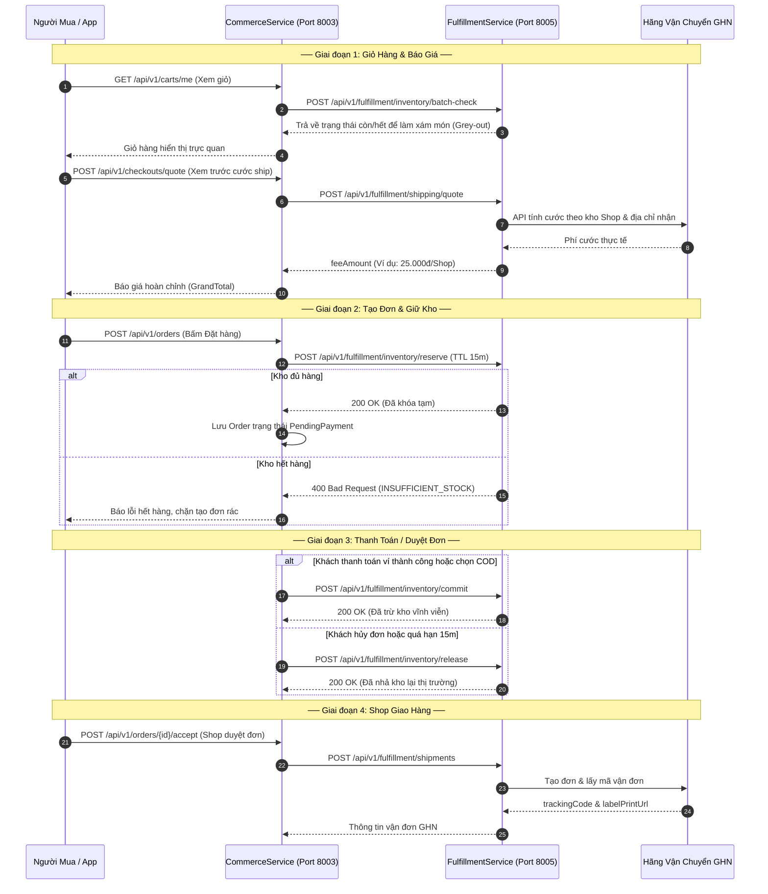

# HỢP ĐỒNG TÍCH HỢP REST API & TÀI LIỆU ĐỐI CHIẾU KỸ THUẬT
## COMMERCE SERVICE ↔ FULFILLMENT SERVICE

> **Dự án:** Nexus Microservices Ecosystem  
> **Service gửi yêu cầu:** `CommerceService` (Port `8003`, DB `commerce_db`)  
> **Service đối chiếu:** `FulfillmentService` (Port `8005`, DB `fulfillment_db`)  
> **Mục tiêu:** Thống nhất hợp đồng RESTful API, cơ chế giữ/trừ/nhả tồn kho, tính cước giao vận GHN động, tạo vận đơn và xử lý Webhook đồng bộ trạng thái giao hàng.  
> **Phiên bản tài liệu:** `v1.0.0` (Draft - Chờ nghiệm thu)  
> **Ngày lập:** 2026-11-02  

---

## MỤC LỤC
1. [Kiến trúc Tương tác & Bản đồ Điểm chạm](#1-kiến-trúc-tương-tác--bản-đồ-điểm-chạm)
2. [Chi tiết Hợp đồng REST API (API Specifications)](#2-chi-tiết-hợp-đồng-rest-api-api-specifications)
   - [2.1. Check nhanh tồn kho 1 SKU](#21-check-nhanh-tồn-kho-1-sku)
   - [2.2. Batch check tồn kho nhiều SKU (Làm xám giỏ hàng)](#22-batch-check-tồn-kho-nhiều-sku-làm-xám-giỏ-hàng)
   - [2.3. Khóa giữ hàng tạm thời (Reserve Stock - TTL 15m)](#23-khóa-giữ-hàng-tạm-thời-reserve-stock---ttl-15m)
   - [2.4. Xác nhận trừ kho vĩnh viễn (Commit Stock)](#24-xác-nhận-trừ-kho-vĩnh-viễn-commit-stock)
   - [2.5. Nhả tồn kho toàn đơn hàng (Release Full Order)](#25-nhả-tồn-kho-toàn-đơn-hàng-release-full-order)
   - [2.6. Nhả tồn kho theo đơn con của từng Shop (Release SubOrder)](#26-nhả-tồn-kho-theo-đơn-con-của-từng-shop-release-suborder)
   - [2.7. Tính cước phí giao vận GHN động (Shipping Quote)](#27-tính-cước-phí-giao-vận-ghn-động-shipping-quote)
   - [2.8. Tạo vận đơn giao hàng GHN (Create Shipment)](#28-tạo-vận-đơn-giao-hàng-ghn-create-shipment)
3. [Bộ Câu Hỏi Kỹ Thuật Trọng Tâm Cần Thống Nhất](#3-bộ-câu-hỏi-kỹ-thuật-trọng-tâm-cần-thống-nhất)
   - [Nhóm 1: Cơ chế Giữ kho, TTL & Worker tự động](#nhóm-1-cơ-chế-giữ-kho-ttl--worker-tự-động)
   - [Nhóm 2: Chống trừ kho lặp (Idempotency)](#nhóm-2-chống-trừ-kho-lặp-idempotency)
   - [Nhóm 3: Tính cước GHN & Quy chuẩn Trọng lượng](#nhóm-3-tính-cước-ghn--quy-chuẩn-trọng-lượng)
   - [Nhóm 4: Tạo vận đơn & In phiếu giao hàng (Label Print)](#nhóm-4-tạo-vận-đơn--in-phiếu-giao-hàng-label-print)
   - [Nhóm 5: Cơ chế Webhook đồng bộ hành trình đơn hàng](#nhóm-5-cơ-chế-webhook-đồng-bộ-hành-trình-đơn-hàng)
4. [Ma Trận Mã Lỗi Chuẩn (RFC 9110 Error Matrix)](#4-ma-trận-mã-lỗi-chuẩn-rfc-9110-error-matrix)

---

## 1. KIẾN TRÚC TƯƠNG TÁC & BẢN ĐỒ ĐIỂM CHẠM



---

## 2. CHI TIẾT HỢP ĐỒNG REST API (API SPECIFICATIONS)

Mọi endpoint dưới đây đều chạy trên giao thức `HTTP/1.1` hoặc `HTTP/2`, sử dụng `Content-Type: application/json`.

### 2.1. Check nhanh tồn kho 1 SKU
* **Mục đích:** Kiểm tra tức thời khi khách bấm "Thêm vào giỏ hàng" (`POST /api/v1/carts/me/items`).
* **Route:** `POST /api/v1/fulfillment/inventory/check`
* **Request Body:**
  ```json
  {
    "skuId": "9b1deb4d-3b7d-4bad-9bdd-2b0d7b3dcb6d",
    "quantity": 2
  }
  ```
* **Response `200 OK`:**
  ```json
  {
    "skuId": "9b1deb4d-3b7d-4bad-9bdd-2b0d7b3dcb6d",
    "isAvailable": true,
    "availableStock": 15
  }
  ```

---

### 2.2. Batch check tồn kho nhiều SKU (Làm xám giỏ hàng)
* **Mục đích:** Quét danh sách SKU trong giỏ khi tải trang (`GET /api/v1/carts/me/grouped`) để làm xám (vô hiệu hóa nút chọn) các món đã hết hàng giống cơ chế Shopee.
* **Route:** `POST /api/v1/fulfillment/inventory/batch-check`
* **Request Body:**
  ```json
  {
    "skuIds": [
      "9b1deb4d-3b7d-4bad-9bdd-2b0d7b3dcb6d",
      "e3a1f802-5c8e-4b69-8d62-7f91c98a5e12"
    ]
  }
  ```
* **Response `200 OK`:**
  ```json
  [
    {
      "skuId": "9b1deb4d-3b7d-4bad-9bdd-2b0d7b3dcb6d",
      "isAvailable": true,
      "availableStock": 5,
      "disabledReason": null
    },
    {
      "skuId": "e3a1f802-5c8e-4b69-8d62-7f91c98a5e12",
      "isAvailable": false,
      "availableStock": 0,
      "disabledReason": "OUT_OF_STOCK"
    }
  ]
  ```

---

### 2.3. Khóa giữ hàng tạm thời (Reserve Stock - TTL 15m)
* **Mục đích:** Khóa số lượng hàng trong kho khi khách bấm "Đặt hàng" (`POST /api/v1/orders`). Đảm bảo trong 15 phút khách thanh toán, hàng không bị người khác mua mất.
* **Route:** `POST /api/v1/fulfillment/inventory/reserve`
* **Request Headers:**
  ```http
  Idempotency-Key: quote-reserve-{quoteId}
  ```
* **Request Body:**
  ```json
  {
    "orderId": "b1a9e7bc-6b84-46d5-9e17-092347640841",
    "ttlMinutes": 15,
    "items": [
      {
        "skuId": "9b1deb4d-3b7d-4bad-9bdd-2b0d7b3dcb6d",
        "quantity": 2,
        "sellerId": "c4d5e6f7-a8b9-4c0d-1e2f-3a4b5c6d7e8f"
      }
    ]
  }
  ```
* **Response `200 OK`:**
  ```json
  {
    "success": true,
    "orderId": "b1a9e7bc-6b84-46d5-9e17-092347640841",
    "expiresAt": "2026-11-02T09:35:00Z"
  }
  ```
* **Response `400 Bad Request` (Hết hàng):**
  ```json
  {
    "type": "https://tools.ietf.org/html/rfc9110#section-15.5.1",
    "title": "Insufficient stock",
    "status": 400,
    "errorCode": "INSUFFICIENT_STOCK",
    "detail": "One or more items in the order have insufficient stock.",
    "outOfStockItems": [
      {
        "skuId": "9b1deb4d-3b7d-4bad-9bdd-2b0d7b3dcb6d",
        "requestedQuantity": 2,
        "availableStock": 1
      }
    ]
  }
  ```

---

### 2.4. Xác nhận trừ kho vĩnh viễn (Commit Stock)
* **Mục đích:** Chuyển trạng thái hàng từ `Reserved` sang `Deducted` khi khách thanh toán ví thành công hoặc chọn hình thức COD.
* **Route:** `POST /api/v1/fulfillment/inventory/commit`
* **Request Body:**
  ```json
  {
    "orderId": "b1a9e7bc-6b84-46d5-9e17-092347640841"
  }
  ```
* **Response `200 OK`:**
  ```json
  {
    "success": true,
    "orderId": "b1a9e7bc-6b84-46d5-9e17-092347640841",
    "committedAt": "2026-11-02T09:25:30Z"
  }
  ```

---

### 2.5. Nhả tồn kho toàn đơn hàng (Release Full Order)
* **Mục đích:** Giải phóng hàng bị khóa tạm thời trả lại kho khi đơn hàng bị Buyer hủy hoặc quá hạn 15 phút không thanh toán (`PaymentTimeoutWorker`).
* **Route:** `POST /api/v1/fulfillment/inventory/release`
* **Request Body:**
  ```json
  {
    "orderId": "b1a9e7bc-6b84-46d5-9e17-092347640841"
  }
  ```
* **Response `200 OK`:**
  ```json
  {
    "success": true,
    "orderId": "b1a9e7bc-6b84-46d5-9e17-092347640841",
    "releasedAt": "2026-11-02T09:36:00Z"
  }
  ```

---

### 2.6. Nhả tồn kho theo đơn con của từng Shop (Release SubOrder)
* **Mục đích:** Khi đơn hàng cha gồm nhiều Shop, nhưng chỉ có **1 Shop từ chối nhận đơn** (`POST /api/v1/orders/{id}/reject`). Hệ thống chỉ nhả các món của riêng Shop này, **không ảnh hưởng** đến các món của các Shop khác trong cùng đơn cha.
* **Route:** `POST /api/v1/fulfillment/inventory/suborder/release`
* **Request Body:**
  ```json
  {
    "subOrderId": "f47ac10b-58cc-4372-a567-0e02b2c3d479",
    "items": [
      {
        "skuId": "9b1deb4d-3b7d-4bad-9bdd-2b0d7b3dcb6d",
        "quantity": 2,
        "sellerId": "c4d5e6f7-a8b9-4c0d-1e2f-3a4b5c6d7e8f"
      }
    ]
  }
  ```
* **Response `200 OK`:**
  ```json
  {
    "success": true,
    "subOrderId": "f47ac10b-58cc-4372-a567-0e02b2c3d479",
    "releasedItemCount": 1
  }
  ```

---

### 2.7. Tính cước phí giao vận GHN động (Shipping Quote)
* **Mục đích:** Tính toán chính xác cước GHN theo từng Shop khi người mua xem trước đơn hàng (`POST /api/v1/checkouts/quote`).
* **Route:** `POST /api/v1/fulfillment/shipping/quote`
* **Request Body:**
  ```json
  {
    "sellerId": "c4d5e6f7-a8b9-4c0d-1e2f-3a4b5c6d7e8f",
    "ghnDistrictId": 1442,
    "ghnWardCode": "20101",
    "items": [
      {
        "skuId": "9b1deb4d-3b7d-4bad-9bdd-2b0d7b3dcb6d",
        "quantity": 2,
        "weightGrams": 200
      }
    ]
  }
  ```
* **Response `200 OK`:**
  ```json
  {
    "sellerId": "c4d5e6f7-a8b9-4c0d-1e2f-3a4b5c6d7e8f",
    "carrierCode": "GHN",
    "feeAmount": 28000.0,
    "estimatedDays": 2
  }
  ```

---

### 2.8. Tạo vận đơn giao hàng GHN (Create Shipment)
* **Mục đích:** Gọi sang GHN sinh mã vận đơn và link in phiếu khi Shop bấm tiếp nhận đơn (`POST /api/v1/orders/{id}/accept`).
* **Route:** `POST /api/v1/fulfillment/shipments`
* **Request Body:**
  ```json
  {
    "subOrderId": "f47ac10b-58cc-4372-a567-0e02b2c3d479"
  }
  ```
* **Response `200 OK`:**
  ```json
  {
    "subOrderId": "f47ac10b-58cc-4372-a567-0e02b2c3d479",
    "trackingCode": "GHN-20261102-A1B2C3",
    "carrierCode": "GHN",
    "labelPrintUrl": "https://fulfillment.nexus.internal/labels/f47ac10b.pdf",
    "createdAt": "2026-11-02T09:30:00Z"
  }
  ```

---

## 3. BỘ CÂU HỎI KỸ THUẬT TRỌNG TÂM CẦN THỐNG NHẤT

Dưới đây là 6 nhóm câu hỏi kỹ thuật sống còn cần phía Team Fulfillment giải đáp:

### Nhóm 1: Cơ chế Giữ kho, TTL & Worker tự động
1. **TTL Quản lý ở đâu?** Phía Fulfillment đã có Background Worker quét các đơn giữ kho (`Reserved`) có `expiresAt < UtcNow` để tự động nhả kho hay chưa? Hay Fulfillment hoàn toàn phụ thuộc vào lệnh gọi `POST /release` từ phía Commerce?
2. **Cơ chế All-or-Nothing:** Khi gửi danh sách 5 SKU để giữ kho, nếu 4 món còn hàng nhưng 1 món hết hàng, Fulfillment có cam kết rollback không giữ 4 món kia (Atomic) không?

### Nhóm 2: Chống trừ kho lặp (Idempotency)
1. **Idempotency Header:** Khi mạng chập chờn hoặc gateway retry, Commerce có thể gửi lại lệnh `POST /reserve` hoặc `POST /commit` 2 lần. Fulfillment kiểm tra chống trừ lặp qua Header `Idempotency-Key` hay kiểm tra theo trường `orderId` trong body?
2. Nếu gọi `commit` lần 2 cho một `orderId` đã trừ kho thành công, Fulfillment sẽ trả về `200 OK` (bỏ qua an toàn) hay ném lỗi `400 ORDER_ALREADY_COMMITTED`?

### Nhóm 3: Tính cước GHN & Quy chuẩn Trọng lượng
1. **Địa chỉ lấy hàng của Shop:** API tính cước `/shipping/quote` chỉ nhận `sellerId`. Fulfillment đã có bảng lưu thông tin kho xuất hàng của từng Seller (gồm `ghnShopId`, `districtId`, `wardCode`) để truyền cho GHN chưa?
2. **Kích thước & Trọng lượng:** Hiện tại Commerce gửi `weightGrams = 200g / sản phẩm`. Phía GHN có yêu cầu thêm kích thước 3 chiều (`length`, `width`, `height`) để tính cân nặng quy đổi không? Nếu có, Fulfillment tự tra cứu thông số này từ Catalog Service hay Commerce cần gửi kèm?
3. **SLA Thời gian phản hồi:** Thời gian tính cước qua GHN mất khoảng bao nhiêu ms? Nếu API GHN bị nghẽn (timeout > 2s), Fulfillment có cơ chế fallback về bảng giá cố định vùng miền không?

### Nhóm 4: Tạo vận đơn & In phiếu giao hàng (Label Print)
1. Khi gọi `POST /api/v1/fulfillment/shipments`, Commerce hiện chỉ gửi `{ subOrderId }`. Phía Fulfillment sẽ tự query ngược lại thông tin người nhận, địa chỉ nhận và danh sách hàng từ Commerce, hay Commerce bắt buộc phải gửi toàn bộ object người nhận trong Payload?
2. URL in phiếu giao hàng (`labelPrintUrl`) là link file PDF trả về trực tiếp từ GHN hay link do Fulfillment tự render?

### Nhóm 5: Cơ chế Webhook đồng bộ hành trình đơn hàng
1. **Webhook GHN cấu hình về đâu?** Webhook cập nhật trạng thái đơn (Shipper đã lấy hàng, Đang giao, Đã giao thành công, Giao thất bại) từ GHN đang cấu hình bắn về đâu?
2. **Đồng bộ về Commerce:** Khi GHN báo đơn hàng đã `Delivered` (Giao thành công), Fulfillment sẽ gọi sang Commerce Service bằng endpoint nào để cập nhật trạng thái đơn hàng (`SubOrder` sang `Delivered` / `Completed`)?
   - *Đề xuất:* Commerce cung cấp endpoint nội bộ: `POST /api/v1/sub-orders/{subOrderId}/delivery-status`.

### Nhóm 6: Xử lý sự cố & Đối soát tồn kho (Reconciliation)
1. Trong trường hợp Commerce đã trừ tiền ví khách thành công nhưng gọi `CommitStock` sang Fulfillment bị rớt mạng:
   - Fulfillment có cung cấp API đối soát: `GET /api/v1/fulfillment/inventory/status/{orderId}` để Commerce Background Worker tự động kiểm tra lại trạng thái kho sau mỗi 5 phút không?

---

## 4. MA TRẬN MÃ LỖI CHUẨN (RFC 9110 ERROR MATRIX)

Đề nghị Fulfillment Service xác nhận chuẩn định dạng mã lỗi trả về theo chuẩn `application/problem+json`:

| Mã lỗi (`errorCode`) | HTTP Status | Điều kiện kích hoạt tại Fulfillment Service | Hành vi tương ứng phía Commerce Service |
|:---|:---:|:---|:---|
| `SKU_NOT_FOUND` | `404` | SKU không tồn tại trong hệ thống quản lý kho | Chặn thêm giỏ hàng, thông báo sản phẩm không hợp lệ |
| `INSUFFICIENT_STOCK` | `400` | Số lượng yêu cầu vượt quá tồn kho khả dụng | Từ chối tạo đơn, yêu cầu user giảm số lượng |
| `RESERVATION_EXPIRED` | `400` | Đơn hàng quá 15 phút giữ kho, đã bị giải phóng | Báo phiên đặt hàng hết hạn, yêu cầu checkout lại |
| `SELLER_WAREHOUSE_UNCONFIGURED` | `400` | Shop chưa thiết lập địa chỉ kho lấy hàng | Báo lỗi Shop chưa sẵn sàng vận chuyển |
| `SHIPPING_ADDRESS_INVALID` | `400` | Tuyến đường hoặc địa chỉ không được GHN hỗ trợ | Yêu cầu người mua kiểm tra lại địa chỉ |
| `CARRIER_GATEWAY_TIMEOUT` | `503` | Không thể kết nối tới máy chủ GHN | Fallback về cước chuẩn 30.000 VNĐ |
| `INTERNAL_WAREHOUSE_ERROR` | `500` | Lỗi cơ sở dữ liệu nội bộ của Fulfillment | Rollback đơn hàng, không trừ tiền người mua |

---

## 5. KÝ TÊN & PHÊ DUYỆT HỢP ĐỒNG

| Đại diện Commerce Service | Đại diện Fulfillment Service |
|:---:|:---:|
| *(Chữ ký & Họ tên)* | *(Chữ ký & Họ tên)* |
| **Trạng thái:** `Đã phê duyệt bản dự thảo` | **Trạng thái:** `Chờ phản hồi & thống nhất` |
