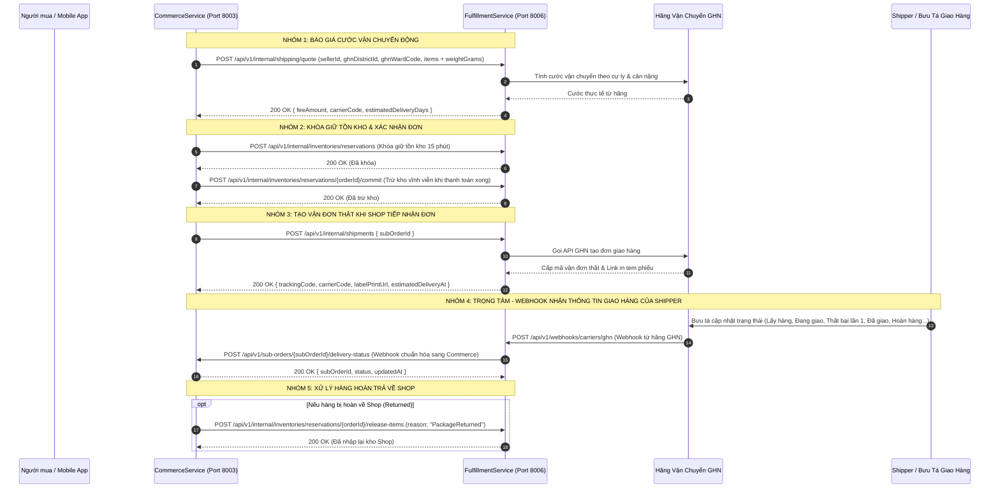
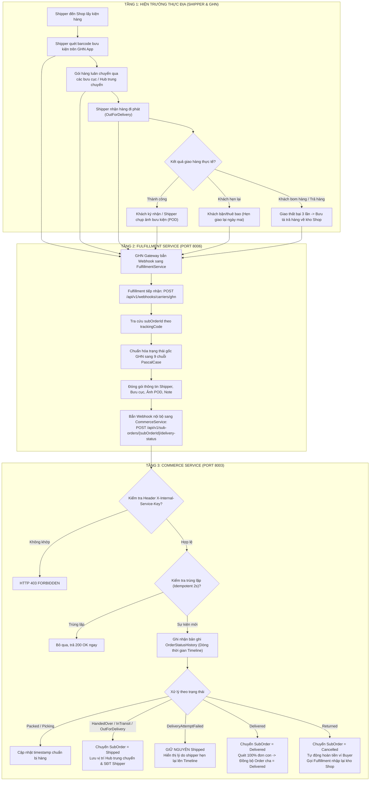

# HỢP ĐỒNG KỸ THUẬT & ĐẶC TẢ TÍCH HỢP REST API LIÊN DỊCH VỤ
## DÀNH RIÊNG CHO PHÂN HỆ FULFILLMENT SERVICE (PORT 8006)
### TIÊU CHUẨN ĐỒNG NHẤT COMMERCE SERVICE ↔ FULFILLMENT SERVICE (v3.0.0 GOLDEN STANDARD)

> **Dự án:** Nexus Microservices Ecosystem  
> **Service yêu cầu (Caller/Receiver):** `CommerceService` (Port `8003`, DB `commerce_db:5435`)  
> **Service đối tác (Receiver/Caller):** `FulfillmentService` (Port `8006`, DB `fulfillment_db`)  
> **Người tiếp nhận & ký duyệt:** **Anh Ngô Nhựt Minh — Lead Phân hệ Fulfillment Service**  
> **Phiên bản tài liệu:** `v3.0.0-FULFILLMENT-DEDICATED`  
> **Ngày cập nhật:** 2026-11-17  
> **Trạng thái:** 📋 **TÀI LIỆU ĐỒNG THUẬN KỸ THUẬT BẮT BUỘC (MANDATORY CONTRACT)**  

---

## 1. MỤC TIÊU & TÔN CHỈ THỐNG NHẤT

Hợp đồng kỹ thuật này là **nguồn sự thật duy nhất (Single Source of Truth)** quy định toàn bộ giao tiếp REST API giữa phân hệ **CommerceService** và **FulfillmentService**, loại bỏ 100% tình trạng lệch schema, sai enum hay thiếu trường dữ liệu giữa hai bên.

### Các nguyên tắc bất biến:
1. **100% RESTful Web API qua JSON**: Bãi bỏ hoàn toàn gRPC, Saga state machine, RabbitMQ, MassTransit và Outbox tables. Mọi giao tiếp là trực tiếp HTTP/1.1 hoặc HTTP/2.
2. **Quy chuẩn Tuần tự hóa Enum (PascalCase Serialization)**: 100% các giá trị Enum vận chuyển (`status`, `carrierCode`, `reasonCode`) truyền trong JSON body bắt buộc là chuỗi ký tự dạng `PascalCase` (ví dụ: `"InTransit"`, `"Delivered"`, `"DeliveryAttemptFailed"`, `"Returned"`). Tuyệt đối **CẤM** truyền số nguyên (`1, 2, 3`) hoặc chuỗi viết thường gạch dưới (`in_transit`, `delivered`).
3. **Bảo mật liên dịch vụ (Service-to-Service Security)**: Mọi endpoint nội bộ đều bắt buộc kiểm tra Header:
   ```http
   X-Internal-Service-Key: eaT0Ombups70WJzd85CBBpp8rAno55SxKn1qvYBGH9e
   ```
   Nếu thiếu hoặc sai, hệ thống lập tức từ chối với HTTP 403 `FORBIDDEN`.
4. **Nguyên tắc Lũy đẳng an toàn (Safe Idempotency) & Chống nghẽn**: Khi mạng chập chờn, mọi thao tác tạo vận đơn, hủy vận đơn hay bắn webhook đều phải cho phép thử lại (retry) mà không gây sinh trùng mã vận đơn GHN hay lặp bản ghi lịch sử.
5. **Thông báo lỗi chuẩn quốc tế RFC 9110**: Mã lỗi dạng `SCREAMING_SNAKE_CASE` và câu thông báo tiếng Anh `Sentence case`.

---

## 2. TỔNG QUAN KIẾN TRÚC & MA TRẬN TÍCH HỢP 2 CHIỀU



---

## 3. TRỌNG TÂM: ĐẶC TẢ FLOW WEBHOOK NHẬN THÔNG TIN GIAO HÀNG CỦA SHIPPER

Đây là luồng nghiệp vụ quan trọng nhất nhằm phản ánh **100% dữ liệu thực địa từ bưu tá (Shipper)** lên ứng dụng di động và website cho khách hàng và chủ Shop theo dõi.

### 3.1. Sơ đồ Luồng Dữ liệu Bưu tá 3 Tầng (3-Tier Shipper Webhook Flow)



---

### 3.2. Bảng Ma Trận Chuẩn Hóa Trạng Thái Gốc Của GHN Sang PascalCase

Fulfillment Service có trách nhiệm tiếp nhận mã trạng thái gốc từ GHN và **chuẩn hóa (map)** thành đúng 1 trong 9 giá trị chuỗi PascalCase sau trước khi gửi sang CommerceService:

| Mã trạng thái gốc từ GHN (`ghn_status`) | Chuỗi chuẩn hóa gửi sang Commerce (`status`) | Ý nghĩa nghiệp vụ bưu tá | Hành vi xử lý tại CommerceService |
|:---|:---|:---|:---|
| `ready_to_pick` | `"ReadyToPick"` | Shop đã đóng gói xong, tạo yêu cầu lấy hàng | Lưu sự kiện Timeline (giữ nguyên trạng thái `Confirmed`). |
| `picking`, `money_collect_picking` | `"Picking"` | Bưu tá GHN đang đến địa chỉ Shop để gom hàng | Lưu sự kiện Timeline thông báo bưu tá đang đến lấy hàng. |
| `storing`, `packed` | `"Packed"` | Kiện hàng đã nhập kho phát hoặc đóng gói niêm phong | Lưu sự kiện Timeline. |
| `picked`, `handed_over` | `"HandedOver"` | Bưu tá GHN đã nhận hàng từ Shop thành công | Chuyển `SubOrder.Status = Shipped`, ghi nhận `ShippedAt = UtcNow`. |
| `transporting`, `sorting` | `"InTransit"` | Kiện hàng đang luân chuyển qua các kho bãi/Hub | Lưu sự kiện Timeline kèm tên Hub trung chuyển (`location`). |
| `delivering`, `money_collect_delivering` | `"OutForDelivery"` | **Shipper đang trên đường đi giao đến người mua** | Lưu sự kiện Timeline kèm thông tin `shipperName` và `shipperPhone`. |
| `delivery_fail`, `rescheduled` | `"DeliveryAttemptFailed"` | **Giao không thành công lần 1 hoặc lần 2** (Khách bận, không nghe máy, hẹn lại) | **TUYỆT ĐỐI KHÔNG HỦY ĐƠN**. Giữ nguyên `SubOrderStatus.Shipped`. Lưu lý do hẹn lại vào Timeline. |
| `delivered` | `"Delivered"` | **Giao hàng thành công đến tay người mua** | Chuyển `SubOrder.Status = Delivered`, lưu `DeliveredAt`. Tự động chuyển đơn cha sang `Delivered` nếu các đơn con khác đã xong. |
| `waiting_to_return`, `return` | `"DeliveryFailed"` | Thất bại sau 3 lần phát, chuẩn bị hoàn hàng | Ghi nhận sự kiện chuẩn bị xuất trả hàng. |
| `returned` | `"Returned"` | **Kiện hàng đã hoàn trả về lại kho của Shop** | Chuyển `SubOrder.Status = Cancelled`. Tự động hoàn tiền ví 100% cho Buyer (nếu đơn đã trả trước) và tự động gọi API nhập lại kho Shop. |
| `cancel`, `canceled` | `"Cancelled"` | Đơn giao vận bị hủy | Chuyển `SubOrder.Status = Cancelled`. |

---

### 3.3. Đặc Tả Chi Tiết Webhook: `POST /api/v1/sub-orders/{subOrderId}/delivery-status`

* **HTTP Method:** `POST`
* **URL:** `/api/v1/sub-orders/{subOrderId}/delivery-status`
* **Caller:** `FulfillmentService` $\rightarrow$ **Receiver:** `CommerceService`
* **Cơ chế xác thực (Authentication):** Header `X-Internal-Service-Key`
* **Path Parameter:**
  - `subOrderId`: Mã định danh đơn hàng con của Shop (UUIDv4).

#### Request Headers:
```http
X-Internal-Service-Key: eaT0Ombups70WJzd85CBBpp8rAno55SxKn1qvYBGH9e
Content-Type: application/json
```

#### Request Payload Schema (Fulfillment gửi sang):
```json
{
  "status": "InTransit",
  "deliveredAt": "2026-11-17T09:30:00Z",
  "carrierCode": "GHN",
  "trackingCode": "GHN-SGN-1029384",
  "note": "Kiện hàng đã xuất kho trung chuyển Tân Bình, đang chuyển sang bưu cục Quận 1.",
  "location": "Kho trung chuyển Tân Bình, TP. Hồ Chí Minh",
  "podUrl": "https://cdn.fulfillment.nexus.internal/pod/GHN-SGN-1029384.jpg",
  "shipperName": "Nguyễn Văn Bưu Tá",
  "shipperPhone": "0987654321"
}
```

#### Giải thích các trường dữ liệu:
| Tên trường | Kiểu dữ liệu | Bắt buộc | Mô tả & Ví dụ |
|:---|:---|:---:|:---|
| `status` | `string` | **BẮT BUỘC** | 1 trong 9 chuỗi PascalCase quy định tại Mục 3.2 (Ví dụ: `"InTransit"`). |
| `deliveredAt` | `string (ISO 8601)` | Tùy chọn | Mốc thời gian xảy ra sự kiện theo giờ UTC (Ví dụ: `"2026-11-17T09:30:00Z"`). Nếu bỏ trống, Commerce sẽ tự lấy `DateTimeOffset.UtcNow`. |
| `carrierCode` | `string` | Tùy chọn | Mã đơn vị vận chuyển (Mặc định: `"GHN"`). |
| `trackingCode` | `string` | Tùy chọn | Mã vận đơn chính thức do GHN cấp (Ví dụ: `"GHN-SGN-1029384"`). |
| `note` | `string` | Tùy chọn | Ghi chú từ bưu tá hoặc lý do bưu cục ghi nhận (Ví dụ: `"Khách hẹn giao lại sau 17h"`). |
| `location` | `string` | Tùy chọn | Tên kho hàng, bưu cục hoặc địa danh trung chuyển (Ví dụ: `"Bưu cục Bến Nghé, Quận 1"`). |
| `podUrl` | `string (URI)` | Tùy chọn | Link ảnh chứng từ giao hàng thành công (Proof of Delivery - ảnh chụp gói hàng hoặc chữ ký người nhận). |
| `shipperName` | `string` | Tùy chọn | Họ tên bưu tá phụ trách phát kiện hàng (Ví dụ: `"Trần Văn Giao"`). |
| `shipperPhone` | `string` | Tùy chọn | Số điện thoại liên lạc trực tiếp của bưu tá (Ví dụ: `"0912345678"`). |

#### Response Payload (CommerceService phản hồi lại):

* **Thành công (HTTP 200 OK):**
```json
{
  "subOrderId": "3fa85f64-5717-4562-b3fc-2c963f66afa6",
  "status": "InTransit",
  "updatedAt": "2026-11-17T09:30:02Z"
}
```

* **Lỗi xác thực (HTTP 403 Forbidden):**
```json
{
  "errorCode": "FORBIDDEN",
  "message": "Access denied: Missing or invalid X-Internal-Service-Key header."
}
```

* **Lỗi dữ liệu (HTTP 400 Bad Request):**
```json
{
  "errorCode": "INVALID_DELIVERY_STATUS",
  "message": "The provided delivery status is not supported."
}
```

* **Lỗi không tìm thấy đơn (HTTP 404 Not Found):**
```json
{
  "errorCode": "SUB_ORDER_NOT_FOUND",
  "message": "SubOrder with ID '3fa85f64-5717-4562-b3fc-2c963f66afa6' was not found."
}
```

---

### 3.4. Các Kịch Bản Bưu Tá Cụ Thể (Real-World Shipper Scenarios)

#### Kịch bản 1: Shipper đi giao hàng (OutForDelivery)
* **Ý nghĩa:** Shipper nhận gói hàng từ bưu cục và bắt đầu đi phát đến địa chỉ người mua.
* **Payload Fulfillment gửi:**
  ```json
  {
    "status": "OutForDelivery",
    "carrierCode": "GHN",
    "trackingCode": "GHN-SGN-1029384",
    "note": "Bưu tá đang trên đường giao kiện hàng đến bạn. Vui lòng để ý điện thoại.",
    "location": "Bưu cục Phường Bến Nghé, Quận 1",
    "shipperName": "Lê Hoàng Nam",
    "shipperPhone": "0934567890",
    "deliveredAt": "2026-11-17T08:15:00Z"
  }
  ```
* **Hành vi CommerceService:**
  - Cập nhật dòng thời gian: Ghi nhận sự kiện `OutForDelivery` kèm họ tên và số điện thoại của shipper.
  - Trên ứng dụng khách hàng: Hiển thị nút "Gọi cho shipper: 0934567890" để người mua chủ động liên hệ nhận hàng.

#### Kịch bản 2: Giao không thành công lần 1 (DeliveryAttemptFailed)
* **Ý nghĩa:** Shipper đến nơi nhưng gọi khách không nghe máy hoặc khách hẹn giao lại vào hôm sau.
* **Payload Fulfillment gửi:**
  ```json
  {
    "status": "DeliveryAttemptFailed",
    "carrierCode": "GHN",
    "trackingCode": "GHN-SGN-1029384",
    "note": "Gọi khách 3 cuộc không nghe máy. Shipper sẽ liên hệ giao lại vào ngày mai.",
    "location": "Tuyến phát Quận 1, TP. HCM",
    "shipperName": "Lê Hoàng Nam",
    "shipperPhone": "0934567890",
    "deliveredAt": "2026-11-17T11:45:00Z"
  }
  ```
* **Hành vi CommerceService:**
  - **Giữ nguyên trạng thái `SubOrderStatus.Shipped`**.
  - **TUYỆT ĐỐI KHÔNG hủy đơn, KHÔNG hoàn tiền ví**.
  - Ghi nhận vào dòng thời gian: `[DeliveryAttemptFailed] Gọi khách 3 cuộc không nghe máy. Shipper sẽ liên hệ giao lại vào ngày mai. | Location: Tuyến phát Quận 1, TP. HCM`.
  - Khách hàng xem trên app sẽ thấy thông báo lý do shipper giao chưa được để kịp thời liên lạc lại.

#### Kịch bản 3: Giao hàng thành công (Delivered) kèm ảnh chứng từ bưu tá chụp
* **Ý nghĩa:** Khách đã nhận hàng và shipper đã chụp ảnh gói hàng/chữ ký làm bằng chứng giao nhận (Proof of Delivery - POD).
* **Payload Fulfillment gửi:**
  ```json
  {
    "status": "Delivered",
    "carrierCode": "GHN",
    "trackingCode": "GHN-SGN-1029384",
    "note": "Giao hàng thành công. Người nhận: Chị Lan (ký nhận thay).",
    "location": "123 Lê Lợi, Bến Nghé, Quận 1, TP. HCM",
    "podUrl": "https://cdn.ghn.vn/pod/20261117/GHN-SGN-1029384-proof.jpg",
    "deliveredAt": "2026-11-17T15:20:00Z"
  }
  ```
* **Hành vi CommerceService:**
  - Chuyển `SubOrder.Status = Delivered`, lưu `DeliveredAt`.
  - Ghi nhận sự kiện giao thành công lên dòng thời gian kèm link ảnh chứng từ `podUrl`.
  - **Đồng bộ đơn cha tự động:** Kiểm tra tất cả các đơn con khác trong cùng đơn cha `OrderId`:
    - Nếu 100% các đơn con đều đã `Delivered` hoặc `Completed` $\rightarrow$ Tự động chuyển `Order.Status = OrderStatus.Delivered`!
    - Kích hoạt thông báo "Đơn hàng của bạn đã được giao thành công" trên toàn hệ thống.

#### Kịch bản 4: Hàng hoàn về kho người bán (Returned)
* **Ý nghĩa:** Sau 3 lần giao thất bại hoặc khách bom hàng, kiện hàng được bưu tá chuyển quay về kho xuất phát của Shop.
* **Payload Fulfillment gửi:**
  ```json
  {
    "status": "Returned",
    "carrierCode": "GHN",
    "trackingCode": "GHN-SGN-1029384",
    "note": "Kiện hàng đã hoàn trả thành công về kho Shop sau 3 lần giao không thành công.",
    "location": "Kho Shop Áo Thun Nexus, TP. Thủ Đức",
    "deliveredAt": "2026-11-19T10:00:00Z"
  }
  ```
* **Hành vi CommerceService:**
  - Chuyển `SubOrder.Status = Cancelled`, `CancelledAt = UtcNow`.
  - Tạo bản ghi `OrderCancellation` với lý do `CancellationReasonCode.PackageReturned`.
  - **Tự động hoàn tiền ví (Prepaid):** Nếu đơn con đã thanh toán trước qua Ví Nexus/VNPay, CommerceService lập tức gọi `IWalletClient.RefundSubOrderPaymentAsync` để hoàn trả 100% tiền vào ví của người mua với khóa lũy đẳng an toàn `refund-delivery-returned-{subOrderId}`.
  - **Tự động kích hoạt nhả tồn kho:** Gọi ngược lại sang Fulfillment qua `POST /api/v1/internal/inventories/reservations/{orderId}/release-items` với lý do `"PackageReturned"` để nhập lại số lượng vào kho khả dụng của Shop.

---

### 3.5. Chính Sách Thử Lại & Chống Nghẽn Từ Phía Fulfillment (Retry Policy)
Khi Fulfillment Service bắn webhook sang CommerceService:
1. **Timeout**: Đặt HTTP Client Timeout là **5 giây**.
2. **Cơ chế Retry (Exponential Backoff)**:
   - Nếu CommerceService phản hồi HTTP `5xx` hoặc bị Timeout do nghẽn mạng:
     - Thử lại lần 1: Sau **2 giây**.
     - Thử lại lần 2: Sau **10 giây**.
     - Thử lại lần 3: Sau **30 giây**.
   - Nếu sau 3 lần vẫn lỗi: Đưa vào Dead Letter Queue (DLQ) của Fulfillment để đối soát thủ công, **tuyệt đối không gửi lặp lại vô tận**.
3. **Nếu Commerce phản hồi HTTP 4xx (`400`, `403`, `404`)**:
   - Dừng retry ngay lập tức vì đây là lỗi dữ liệu hoặc sai khóa bảo mật, cần báo động hệ thống để kỹ sư kiểm tra cấu hình.

---

## 4. CHI TIẾT CÁC ENDPOINT OUTBOUND COMMERCE GỌI SANG FULFILLMENT

Dưới đây là đặc tả các API mà `FulfillmentService` phải cung cấp để `CommerceService` kết nối:

---

### 4.1. Báo Giá Cước Vận Chuyển Động Theo Trọng Lượng & Địa Chỉ
* **Mục đích:** Tính cước phí giao hàng chính xác khi người mua xem trước giỏ hàng (Checkout Preview).
* **HTTP Method:** `POST`
* **URL:** `/api/v1/internal/shipping/quote`
* **Caller:** `CommerceService` $\rightarrow$ **Receiver:** `FulfillmentService`
* **Header bắt buộc:**
  ```http
  X-Internal-Service-Key: eaT0Ombups70WJzd85CBBpp8rAno55SxKn1qvYBGH9e
  Content-Type: application/json
  ```
* **Request Payload (Commerce gửi sang):**
  ```json
  {
    "sellerId": "9b1deb4d-3b7d-4bad-9bdd-2b0d7b3dcb6d",
    "ghnDistrictId": 1442,
    "ghnWardCode": "20101",
    "items": [
      {
        "skuId": "e3a1f802-5c8e-4b69-8d62-7f91c98a5e12",
        "quantity": 2,
        "weightGrams": 400
      },
      {
        "skuId": "a1b2c3d4-5c8e-4b69-8d62-7f91c98a5e99",
        "quantity": 1,
        "weightGrams": 600
      }
    ]
  }
  ```
* **Xử lý tại Fulfillment:**
  - Lấy địa chỉ kho của `sellerId` làm điểm gửi (`from_district_id`).
  - Lấy `ghnDistrictId` và `ghnWardCode` làm điểm nhận (`to_district_id`, `to_ward_code`).
  - Tổng trọng lượng bưu kiện: `totalWeight = sum(weightGrams) = 1000g`.
  - Gọi GHN API tính cước thực tế.
* **Response Payload (Fulfillment trả về - 200 OK):**
  ```json
  {
    "sellerId": "9b1deb4d-3b7d-4bad-9bdd-2b0d7b3dcb6d",
    "feeAmount": 32000.00,
    "carrierCode": "GHN",
    "estimatedDeliveryDays": 2
  }
  ```
* **Quy chuẩn lỗi:**
  - Nếu `ghnDistrictId` hoặc `ghnWardCode` không tồn tại: Trả về HTTP `400 Bad Request` (`errorCode: "SHIPPING_QUOTE_FAILED"`).
  - Nếu GHN ngắt kết nối: Trả về HTTP `503 Service Unavailable` (`errorCode: "FULFILLMENT_SERVICE_UNAVAILABLE"`).

---

### 4.2. Tạo Vận Đơn Thật Trên GHN Khi Shop Tiếp Nhận Đơn Con
* **Mục đích:** Khi chủ Shop bấm "Tiếp nhận đơn hàng" (`POST /orders/{id}/accept`), hệ thống tự động đẩy đơn sang GHN để bưu tá đến lấy.
* **HTTP Method:** `POST`
* **URL:** `/api/v1/internal/shipments`
* **Caller:** `CommerceService` $\rightarrow$ **Receiver:** `FulfillmentService`
* **Header bắt buộc:** `X-Internal-Service-Key`
* **Request Payload (Commerce gửi sang):**
  ```json
  {
    "subOrderId": "3fa85f64-5717-4562-b3fc-2c963f66afa6"
  }
  ```
* **Xử lý tại Fulfillment:**
  - Tạo đơn giao hàng sang hệ thống GHN.
  - Lấy mã vận đơn thật do GHN cấp (`trackingCode`), mã hãng (`GHN`), và link in tem phiếu gửi hàng (`labelPrintUrl`).
* **Response Payload (Fulfillment trả về - 200 OK):**
  ```json
  {
    "subOrderId": "3fa85f64-5717-4562-b3fc-2c963f66afa6",
    "trackingCode": "GHN-SGN-1029384",
    "carrierCode": "GHN",
    "labelPrintUrl": "https://api.ghn.vn/print/label-1029384.pdf",
    "estimatedDeliveryAt": "2026-11-20T17:00:00Z"
  }
  ```
* **Cam kết Lũy đẳng (Safe Idempotency):**
  - Nếu `subOrderId` này đã được tạo vận đơn trước đó, Fulfillment **bắt buộc trả về đúng dữ liệu vận đơn cũ**, tuyệt đối **không được tạo trùng thêm 1 mã vận đơn mới trên GHN**.
* **Xử lý lỗi mạng:**
  - Nếu GHN bị timeout / sập mạng: Fulfillment trả về HTTP `503 Service Unavailable`. Commerce sẽ chuyển `Confirmed` và bật cờ `ShipmentPendingCreation = true` để Shop thử lại sau.

---

### 4.3. Hủy Vận Đơn GHN Khi Khách Hàng Hủy Đơn Sớm
* **Mục đích:** Khi người mua hoặc Shop hủy đơn trước khi shipper đến lấy hàng.
* **HTTP Method:** `POST`
* **URL:** `/api/v1/shipments/{subOrderId}/cancel`
* **Caller:** `CommerceService` $\rightarrow$ **Receiver:** `FulfillmentService`
* **Header bắt buộc:** `X-Internal-Service-Key`
* **Request Payload (Commerce gửi sang):**
  ```json
  {
    "reason": "Buyer cancelled order before courier pickup."
  }
  ```
* **Response Payload (Fulfillment trả về - 200 OK):**
  ```json
  {
    "subOrderId": "3fa85f64-5717-4562-b3fc-2c963f66afa6",
    "status": "ShipmentCancelled",
    "cancelledAt": "2026-11-17T10:00:00Z"
  }
  ```

---

### 4.4. Quản Lý Tồn Kho Vật Lý (Inventory Reservations)

CommerceService quản lý vòng đời giữ và trừ hàng thông qua 4 endpoint kho của FulfillmentService:

#### 1. Khóa giữ tồn kho tạm thời (15 phút TTL):
* **Endpoint:** `POST /api/v1/internal/inventories/reservations`
* **Payload:**
  ```json
  {
    "orderId": "a1b2c3d4-e5f6-7890-abcd-ef1234567890",
    "items": [
      { "skuId": "e3a1f802-5c8e-4b69-8d62-7f91c98a5e12", "quantity": 2, "sellerId": "shop-guid" }
    ],
    "ttlMinutes": 15
  }
  ```
* **Response (200 OK):** `{ "success": true }`

#### 2. Xác nhận trừ kho vĩnh viễn (Commit Stock):
* **Endpoint:** `POST /api/v1/internal/inventories/reservations/{orderId}/commit`
* **Thời điểm gọi:** Ngay khi thanh toán thành công (Ví Nexus / VNPay / COD).
* **Response (200 OK):** `{ "success": true }`

#### 3. Nhả hàng toàn bộ khi đơn bị hủy (Release Stock):
* **Endpoint:** `POST /api/v1/internal/inventories/reservations/{orderId}/release?reason=OrderCancelled`
* **Response (200 OK):** `{ "success": true }`

#### 4. Nhập lại kho cho SubOrder riêng lẻ hoặc khi Hàng Hoàn (Release Items):
* **Endpoint:** `POST /api/v1/internal/inventories/reservations/{orderId}/release-items`
* **Thời điểm gọi:** Khi Shop từ chối 1 đơn con (`SellerRejected`) HOẶC khi Shipper hoàn hàng về kho (`PackageReturned`).
* **Payload:**
  ```json
  {
    "items": [
      { "skuId": "e3a1f802-5c8e-4b69-8d62-7f91c98a5e12", "quantity": 2 }
    ],
    "reason": "PackageReturned"
  }
  ```
* **Response (200 OK):** `{ "success": true }`

---

## 5. BẢNG TỔNG HỢP CÁC ENDPOINT ĐỐI CHIẾU

| Chiều gọi | Endpoint URL | Mục đích nghiệp vụ | Headers | Mã phản hồi |
|:---:|:---|:---|:---:|:---:|
| **Commerce $\rightarrow$ Ful** | `POST /api/v1/internal/shipping/quote` | Báo giá cước GHN theo trọng lượng động | `X-Internal-Service-Key` | `200`, `400`, `503` |
| **Commerce $\rightarrow$ Ful** | `POST /api/v1/internal/shipments` | Tạo vận đơn GHN thật (kèm Safe Idempotency) | `X-Internal-Service-Key` | `200`, `503` |
| **Commerce $\rightarrow$ Ful** | `POST /api/v1/shipments/{subOrderId}/cancel` | Hủy vận đơn GHN khi khách hủy đơn | `X-Internal-Service-Key` | `200`, `404` |
| **Commerce $\rightarrow$ Ful** | `POST /api/v1/internal/inventories/reservations` | Khóa giữ hàng 15 phút khi Checkout | `X-Internal-Service-Key` | `200`, `400` |
| **Commerce $\rightarrow$ Ful** | `POST /api/v1/internal/inventories/reservations/{orderId}/commit` | Trừ kho vĩnh viễn sau thanh toán | `X-Internal-Service-Key` | `200` |
| **Commerce $\rightarrow$ Ful** | `POST /api/v1/internal/inventories/reservations/{orderId}/release` | Nhả toàn bộ kho khi đơn bị hủy | `X-Internal-Service-Key` | `200` |
| **Commerce $\rightarrow$ Ful** | `POST /api/v1/internal/inventories/reservations/{orderId}/release-items` | Nhả kho món riêng lẻ / Hoàn hàng Shop | `X-Internal-Service-Key` | `200` |
| **Ful $\rightarrow$ Commerce** | `POST /api/v1/sub-orders/{subOrderId}/delivery-status` | **Webhook nhận thông tin giao hàng của bưu tá** | `X-Internal-Service-Key` | `200`, `400`, `403`, `404` |

---

## 6. PHIẾU NGHIỆM THU ĐỒNG THUẬN KỸ THUẬT (SIGN-OFF & VERIFICATION)

Kính gửi: **Anh Ngô Nhựt Minh — Lead Phân hệ Fulfillment Service**  
Vui lòng kiểm tra và tích chọn xác nhận các tiêu chí kỹ thuật dưới đây để đội ngũ kỹ sư hai bên tiến hành tích hợp:

- [ ] **Tiêu chí 1 (Webhook Shipper):** Fulfillment cam kết bắn Webhook sang `POST /api/v1/sub-orders/{subOrderId}/delivery-status` kèm đầy đủ thông tin bưu tá (`shipperName`, `shipperPhone`), vị trí trạm (`location`) và ảnh chữ ký/gói hàng (`podUrl`).
- [ ] **Tiêu chí 2 (Map Trạng thái):** Chuẩn hóa toàn bộ trạng thái gốc của GHN sang đúng 9 chuỗi **PascalCase** theo Bảng Mục 3.2. Đặc biệt, khi khách hẹn lại lần 1-2, bắt buộc gửi `"DeliveryAttemptFailed"`.
- [ ] **Tiêu chí 3 (Safe Idempotency):** Endpoint `POST /api/v1/internal/shipments` bắt buộc trả lại đúng `trackingCode` cũ nếu đơn đã được tạo trước đó, không sinh trùng đơn trên GHN.
- [ ] **Tiêu chí 4 (Trọng lượng kiện hàng):** Endpoint `POST /api/v1/internal/shipping/quote` tính cước dựa trên tổng `weightGrams` của các món và tọa độ quận/phường.
- [ ] **Tiêu chí 5 (Nhập lại kho khi hoàn hàng):** Khi đơn bị `Returned`, tiếp nhận endpoint `release-items` với `reason: "PackageReturned"` để hồi kho khả dụng cho Shop.
- [ ] **Tiêu chí 6 (Bảo mật):** Đồng nhất 100% sử dụng header `X-Internal-Service-Key: eaT0Ombups70WJzd85CBBpp8rAno55SxKn1qvYBGH9e`.

---

| ĐẠI DIỆN COMMERCE SERVICE | ĐẠI DIỆN FULFILLMENT SERVICE |
|:---:|:---:|
| *(Ký & ghi rõ họ tên)* | *(Ký & ghi rõ họ tên)* |
| **Trạng thái:** `Đã sẵn sàng 100% trên môi trường Production/Staging` | **Trạng thái:** `Tiếp nhận & Đồng thuận kỹ thuật` |
| **Đại diện:** Kỹ sư Trưởng Phân hệ Commerce | **Đại diện:** Ngô Nhựt Minh — Lead Fulfillment Service |
| **Ngày lập:** 2026-11-17 | **Ngày ký duyệt:** 2026-11-17 |
