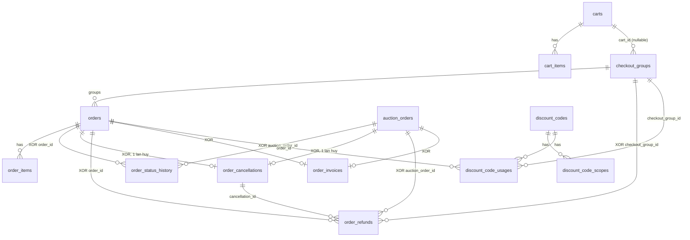

# SRS – Commerce Service (Project Nexus)

| Mục | Giá trị |
|---|---|
| Tài liệu | Software Requirement Specification riêng cho **Commerce Service** |
| Phiên bản | 1.0 (draft để review) |
| Hệ thống cha | Project Nexus – E-Commerce & Auction (SRS hệ thống v1.0, 04/06/2026) |
| Database | PostgreSQL, schema **DB_Commerce_v2** |
| Thay đổi so với SRS hệ thống | **Payment đã được tách thành service riêng**; Commerce chỉ giữ phần *order-side* của thanh toán (xem mục 4.3) |
| Ngôn ngữ | Tiếng Việt, giữ nguyên thuật ngữ và định danh tiếng Anh (English terms) |

---

## 0. Cách đọc tài liệu này (dành cho AI agent và developer)

### 0.1 Mục tiêu
File này là **nguồn tham chiếu duy nhất** để hiểu Commerce Service: trách nhiệm, ranh giới với service khác, nghiệp vụ, state machine, event, và thiết kế database. Một AI agent chỉ đọc file này phải đủ thông tin để thiết kế/sinh code đúng, và phải biết **chỗ nào đã chốt, chỗ nào chưa**.

### 0.2 Nguồn dữ liệu và thẻ độ tin cậy
Mỗi quy tắc quan trọng được gắn thẻ để agent biết có được tự quyết hay không:

| Thẻ | Ý nghĩa | Agent được phép làm gì |
|---|---|---|
| `[SRS]` | Có trong SRS hệ thống v1.0 | Coi là yêu cầu |
| `[DB]` | Có trong `DB_Commerce_v2.sql` (constraint, comment, seed) | Coi là **ràng buộc cứng**, không được vi phạm |
| `[DERIVED]` | Suy ra hợp lý từ `[SRS]` + `[DB]` | Dùng được, nên ghi chú giả định trong code |
| `[PROPOSED]` | Đề xuất của BA, **chưa được chốt** | Dùng làm mặc định, nhưng đặt sau feature flag hoặc interface dễ đổi |
| `[OPEN]` | Câu hỏi mở, chưa có quyết định | **Không tự quyết**; dừng lại hỏi hoặc để TODO có đánh dấu |

Các file nguồn: (1) SRS hệ thống Project Nexus v1.0; (2) `DB_Commerce_v2.sql`; (3) báo cáo thay đổi DB v1 → v2; (4) trao đổi với team Auction về event (chưa được Auction xác nhận, nên mọi nội dung từ nguồn này là `[PROPOSED]`).

> Lưu ý: **API spec v2 không nằm trong bộ tài liệu này.** Các mã API như `CART-02`, `CHK-03`, `ORD-13` chỉ xuất hiện trong comment của DB; tài liệu này chỉ dùng những mã đó ở cột "Tham chiếu API spec" khi biết chắc. Đường dẫn endpoint (REST path) thuộc API spec, không định nghĩa ở đây.

### 0.3 Mười điều cần nhớ về Commerce Service
1. Commerce sở hữu: **giỏ hàng, checkout, đơn hàng thường, đơn đấu giá, hủy đơn, hoàn tiền (phía order), hóa đơn, mã giảm giá**.
2. Commerce **không** sở hữu: tiền/ví/cổng thanh toán (Payment Service), tồn kho (Fulfillment-Inventory), vận chuyển (Fulfillment-Shipping), sản phẩm (Catalog), user/reputation (User), phiên đấu giá (Auction), thông báo (Notification).
3. Hai loại đơn tách bảng: `orders` (đi qua cart + checkout) và `auction_orders` (tạo từ event `AuctionWon`, **không** qua cart).
4. Một lần thanh toán có thể trả cho **nhiều đơn** của nhiều seller: `checkout_groups` 1 - n `orders`.
5. Tiền luôn là `numeric(18,2)`. Công thức bất biến: `orders.total_amount = seller_receive_amount + platform_fee_amount + shipping_fee_amount` `[DB]`.
6. Mọi thao tác ghi quan trọng phát event qua **Outbox**, nhận event qua **Inbox**, API quan trọng **idempotent** bằng `idempotency_keys`.
7. Tranh chấp đồng thời xử lý bằng **optimistic lock** `row_version`; mọi chuyển trạng thái đơn ghi `order_status_history`.
8. Các cột `buyer_id`, `seller_id`, `product_id`, `sku_id`, `wallet_transaction_id`... là **cross-service reference**: chỉ lưu UUID, **không có FK** và **không được query DB service khác** `[SRS 4.1]`.
9. Dữ liệu đơn hàng giữ **≥ 5 năm** `[SRS 5.8]`, vì vậy chỉ **soft delete** (`deleted_at`), không xóa vật lý.
10. Quá hạn thanh toán / seller không phản hồi / tự hoàn tất đơn là **job nền** của Commerce, mỗi job có index riêng (mục 4.10).

---

## 1. Giới thiệu

### 1.1 Mục đích
Đặc tả yêu cầu chức năng, phi chức năng, tích hợp và dữ liệu cho Commerce Service sau khi Payment được tách riêng.

### 1.2 Phạm vi

**In-scope (Commerce Service):**
- Shopping Cart (vòng đời, thêm/sửa/xóa item, tính giá, validate, hết hạn).
- Checkout (tính giá, tạo checkout group và order, giữ chỗ voucher/tồn kho, chặn checkout song song, hết hạn).
- **Phía order của thanh toán**: khởi tạo yêu cầu thanh toán, nhận kết quả, xử lý thanh toán trễ/lệch tiền, giới hạn số lần thử.
- Order Management (tạo, tra cứu, trạng thái, seller phản hồi, đồng bộ vận chuyển, tự hoàn tất, admin).
- Auction Order (tạo đơn từ kết quả đấu giá, báo giá ship, hạn thanh toán).
- Hủy đơn và hoàn tiền (khởi tạo yêu cầu refund, nhận kết quả refund).
- Invoice/Receipt.
- Discount Code (SYSTEM / SHOP / PRODUCT; scope; reserve - use - release).
- Hạ tầng: idempotency, saga, outbox/inbox, sequence số đơn, system settings.

**Out-of-scope (thuộc service khác):**
- Ví, giao dịch, cổng thanh toán (STRIPE/VNPAY...), đối soát giao dịch, callback gateway: **Payment Service**.
- Tồn kho, reservation, ledger kho: **Fulfillment – Inventory**.
- Tạo shipment, tích hợp GHN/GHTK, tracking: **Fulfillment – Shipping**.
- Quản lý sản phẩm/danh mục: **Catalog**.
- Tài khoản, RBAC, reputation, trừ điểm: **User Service**.
- Phiên đấu giá, bid, xác định người thắng: **Auction Service**.
- Gửi email/push, event log: **Notification Service**.

### 1.3 Thuật ngữ

| Thuật ngữ | Định nghĩa |
|---|---|
| Buyer / Seller / Admin / Support Staff | Actor theo SRS hệ thống mục 2.3 |
| Cart | Giỏ hàng, mỗi buyer tối đa 1 giỏ `ACTIVE` |
| Checkout Group | Một lần "đặt hàng": gom các order (mỗi seller một order) để thanh toán một lần |
| Order | Đơn hàng thường của **một seller**, thuộc một checkout group |
| Auction Order | Đơn tạo từ kết quả đấu giá (1 auction = 1 đơn) |
| Snapshot | Bản sao giá trị (tên, giá, địa chỉ...) tại thời điểm tạo, không đổi theo nguồn |
| Cross-service reference | UUID tham chiếu sang service khác, không có FK |
| Outbox / Inbox | Pattern ghi event cùng transaction và xử lý message nhận được một lần |
| Saga | Chuỗi bước phân tán có bù trừ (`CheckoutSaga`, `OrderCancellationSaga`) |
| Idempotency | Gọi lặp cho kết quả như nhau, không xử lý trùng |
| Platform markup | Phần trăm nền tảng cộng thêm sau khi trừ giảm giá của seller |

---

## 2. Bối cảnh service

### 2.1 Trách nhiệm và ranh giới (bounded context)

```
 Buyer/Seller/Admin ──► API Gateway ──► [ Commerce Service ] ──► DB Commerce (PostgreSQL, riêng)
                                              │  ▲
              ┌───────────────┬──────────────┼──┼───────────────┬────────────────┐
              ▼               ▼              ▼  │               ▼                ▼
          Catalog        Fulfillment      Payment (tách)     Auction         Notification / User
        (sản phẩm,      Inventory +      (ví, giao dịch,    (AuctionWon,    (thông báo, reputation)
         giá, ảnh)      Shipping          refund)            phiên đấu giá)
```

### 2.2 Quan hệ với các service khác

Cột "Kiểu" chỉ ra cách giao tiếp **đã biết** hay **chưa chốt**.

| Service | Commerce nhận / gọi | Commerce phát / cung cấp | Kiểu giao tiếp |
|---|---|---|---|
| **Catalog** | Kiểm tra product/SKU còn tồn tại, trạng thái ACTIVE, giá hiện tại; lấy `image_url`, `sku_attributes` để snapshot (comment DB: "lấy từ Catalog"); nhận `ProductDeleted`, `ProductStatusChanged` | – | API đồng bộ + event `[DERIVED]` |
| **Payment (tách)** | Nhận kết quả thanh toán, kết quả refund | Yêu cầu thanh toán; `OrderRefundRequested` | Event/API `[OPEN]` (mục 5.5) |
| **Fulfillment – Inventory** | Nhận `InventoryReserved/Released/ReservationExpired` | Yêu cầu reserve/commit/release | `[OPEN]` sync hay event |
| **Fulfillment – Shipping** | Báo giá ship (GHN), nhận `ShipmentPickedUp/InTransit/Delivered/Failed/Returned` | Thông tin order đã thanh toán để tạo shipment | `[DERIVED]` |
| **Auction** | Nhận `AuctionWon` (settlement data) | `OrderPaid`, `OrderPaymentFailed`, `OrderCancelled`, event trả `orderId` | Event `[SRS 3.5.3.4]` + `[PROPOSED]` |
| **User** | Xác thực/JWT, RBAC; (reputation) | `OrderCompleted` (cho phép rating), `OrderCancelled` (reason PAYMENT_TIMEOUT) | `[OPEN]` ai trừ điểm (mục 10, OQ-03) |
| **Notification** | – | Mọi event order/cart/refund để tạo thông báo; hóa đơn | Event `[SRS 3.2.3.2]` |

### 2.3 Nguyên tắc triển khai bắt buộc `[SRS 4.1, 4.2, 5.x]`
- Database-per-service: **không** truy cập DB service khác, **không** chia sẻ bảng.
- API có version (`/api/v1`), tương thích ngược, có OpenAPI; thay đổi contract (API/event schema) phải được review trước.
- Secrets không hardcode; cấu hình theo môi trường (`SYSTEM_ENV`: DEV/STAGING/PROD).
- Stateless, scale ngang; job nền phải an toàn khi chạy nhiều instance (khóa dòng hoặc `row_version`).
- Lỗi service không quan trọng (Notification) **không được làm hỏng** xử lý đơn hàng `[SRS 5.2]`.

### 2.4 Actor và quyền (Privileges) `[SRS 2.7]`

| Privilege | Mô tả | Admin | Seller | Buyer | Support |
|---|---|:-:|:-:|:-:|:-:|
| CART.CREATE / UPDATE / REMOVE_ITEM / VIEW | Thao tác giỏ hàng | | | X | |
| CHECKOUT.START | Bắt đầu checkout | | | X | |
| ORDER.CREATE | Tạo đơn | | | X | |
| ORDER.CANCEL | Hủy đơn | X | | X | X |
| ORDER.VIEW / ORDER.LIST | Xem chi tiết / danh sách | X | X | X | X |
| ORDER.REFUND | Yêu cầu hoặc xử lý refund | X | | | X |

**Khoảng trống quyền `[OPEN]` (xem OQ-12):** SRS không có privilege cho *seller xác nhận/từ chối đơn*, cho *discount code*, và `ORDER.CANCEL` không gồm Seller. `[PROPOSED]` bổ sung: `ORDER.CONFIRM`, `ORDER.REJECT` (Seller), `DISCOUNT.CREATE/UPDATE/DELETE/VIEW/LIST` (Admin: SYSTEM; Seller: SHOP/PRODUCT của mình).

Quy tắc dữ liệu theo vai trò `[DB]`/`[DERIVED]`:
- Buyer chỉ thấy đơn của mình; Seller **chỉ thấy đơn đã thanh toán** (`paid_at IS NOT NULL`); Admin/Support thấy tất cả.

---

## 3. Mô hình miền (Domain model)

### 3.1 Thực thể chính

| Aggregate | Bảng | Ghi chú |
|---|---|---|
| Cart | `carts`, `cart_items` | Giỏ ACTIVE duy nhất mỗi buyer |
| CheckoutGroup | `checkout_groups` | Gom order để thanh toán một lần; liên kết `cart_id` (nullable) |
| Order | `orders`, `order_items` | Một seller, snapshot sản phẩm/giá/địa chỉ |
| AuctionOrder | `auction_orders` | Từ `AuctionWon`; không có item riêng (1 sản phẩm) |
| Lifecycle | `order_status_history`, `order_cancellations`, `order_refunds`, `order_invoices` | Dùng chung cho `orders` và `auction_orders` bằng 2 cột FK nullable + CHECK XOR |
| Discount | `discount_codes`, `discount_code_scopes`, `discount_code_usages` | Voucher và vòng đời lượt dùng |
| Platform | `system_settings`, `daily_order_sequences`, `saga_state`, `outbox_messages`, `inbox_messages`, `idempotency_keys` | Hạ tầng |

### 3.2 Công thức tiền

**Định nghĩa cột `[DB]`:**
- `total_amount` = số tiền buyer trả. `seller_receive_amount` = số tiền seller nhận. `platform_fee_amount` = *markup trừ system voucher*, **có thể âm**.
- `platform_markup_amount` = phần trăm nền tảng cộng thêm **sau** giảm giá seller.
- **Invariant `[DB]`:** `total_amount = seller_receive_amount + platform_fee_amount + shipping_fee_amount`.

**Công thức đề xuất `[DERIVED]` (khớp invariant, cần BA xác nhận, xem OQ-06):**

```
items_amount            = Σ quantity × unit_price                        (giá gốc)
product_discount_amount = Σ quantity × (unit_price − unit_price_after_discount)
shop_discount_amount    = giảm giá mã SHOP áp lên đơn của seller
net_after_seller_disc   = items_amount − product_discount_amount − shop_discount_amount
seller_receive_amount   = net_after_seller_disc
platform_markup_amount  = PLATFORM_MARKUP_PERCENT × net_after_seller_disc      (chưa seed, chờ BA)
system_discount_amount  = giảm giá mã SYSTEM (nền tảng chịu)
platform_fee_amount     = platform_markup_amount − system_discount_amount     (có thể âm)
total_amount            = seller_receive_amount + platform_fee_amount + shipping_fee_amount
line_total (order_items)= quantity × unit_price_after_discount
```

Ví dụ minh họa (tỷ lệ markup 5% là **giả định**): items 1.000.000; giảm sản phẩm 100.000; giảm shop 50.000 → net 850.000; markup 42.500; voucher hệ thống 20.000 → platform_fee 22.500; ship 30.000 → `total = 850.000 + 22.500 + 30.000 = 902.500`.

**Đơn đấu giá `[DB]`:** `total_amount = winning_amount + shipping_fee_amount`; `shipping_fee_amount` và `total_amount` **cùng NULL** (chưa có báo giá ship) hoặc cùng có giá trị. Quan hệ `seller_receive_amount + platform_fee_amount` với `winning_amount` **chưa được DB enforce** (`[OPEN]` OQ-06, cần `AUCTION_PLATFORM_FEE_PERCENT`).

Làm tròn: `numeric(18,2)`; quy tắc làm tròn `[PROPOSED]` HALF_UP, tính trên từng order rồi cộng, không làm tròn lại tổng.

### 3.3 Catalog ENUM
DB **không dùng PostgreSQL ENUM**; mọi enum là `text` + `CHECK (... IN (...))`. Trong code phải map **dạng string** (JPA `EnumType.STRING`, EF Core `HasConversion<string>()`).

| Enum | Giá trị | Cột |
|---|---|---|
| CartStatus | `ACTIVE`, `CHECKED_OUT`, `ABANDONED` | `carts.status` |
| CheckoutGroupStatus | `PENDING_PAYMENT`, `PAYMENT_PROCESSING`, `PAID`, `CANCELLED`, `EXPIRED` | `checkout_groups.status` |
| OrderStatus | `PENDING_PAYMENT`, `PAID`, `CONFIRMED`, `SHIPPING`, `DELIVERED`, `COMPLETED`, `CANCELLED`, `REFUNDED` | `orders.status`, `auction_orders.status` |
| PaymentMethod | `WALLET`, `VNPAY`, `COD` (COD chưa hỗ trợ ở MVP) | `*.payment_method` |
| ActorRole | `BUYER`, `SELLER`, `ADMIN`, `SUPPORT_STAFF`, `SYSTEM` | `order_status_history`, `order_cancellations`, `order_refunds` |
| RefundStatus | `REQUESTED`, `COMPLETED`, `FAILED` | `order_refunds.status` |
| RefundType | `FULL`, `PARTIAL` | `order_refunds.refund_type` |
| InvoiceStatus | `GENERATED`, `FAILED` | `order_invoices.status` |
| DiscountScopeType | `SYSTEM`, `SHOP`, `PRODUCT` | `discount_codes.scope_type` |
| DiscountType | `PERCENT`, `FIXED` | `discount_codes.discount_type` |
| DiscountStatus | `DRAFT`, `ACTIVE`, `INACTIVE`, `EXPIRED` | `discount_codes.status` |
| DiscountScopeRefType | `SHOP`, `PRODUCT`, `SKU`, `CATEGORY`, `ALL` | `discount_code_scopes.scope_ref_type` |
| DiscountUsageStatus | `RESERVED`, `USED`, `RELEASED` | `discount_code_usages.status` |
| SettingValueType | `STRING`, `INTEGER`, `DECIMAL`, `BOOLEAN`, `JSON` | `system_settings.value_type` |
| SettingCategory | `REPUTATION`, `MONEY`, `AUCTION`, `TIMING`, `SYSTEM` | `system_settings.category` |
| SequenceType | `ORDER_NO`, `AUCTION_ORDER_NO`, `INVOICE_NO` | `daily_order_sequences.seq_type` |
| SagaType | `CheckoutSaga`, `OrderCancellationSaga` | `saga_state.saga_type` |
| OutboxStatus | `PENDING`, `PUBLISHED`, `FAILED`, `DEAD` | `outbox_messages.status` |
| InboxStatus | `RECEIVED`, `PROCESSED`, `FAILED`, `SKIPPED` | `inbox_messages.status` |

**Giá trị chỉ nằm trong COMMENT (DB không có CHECK):**
- `saga_state.current_state`. CheckoutSaga: `INVENTORY_RESERVING`, `AWAITING_PAYMENT`, `PAYMENT_PENDING`, `COMPLETED`, `COMPENSATED`. OrderCancellationSaga: `CANCELLING`, `REFUND_PENDING`, `COMPLETED`, `FAILED`. Terminal: `COMPLETED`, `COMPENSATED`, `FAILED` (index `idx_saga_state_stuck` phụ thuộc 3 giá trị này).
- `order_status_history.from_status/to_status`: cùng tập OrderStatus, **không có CHECK**, code phải validate.

**Free-text cần chuẩn hóa trong code (xem mục 5.6):** `order_cancellations.reason_code`, `order_refunds.reason_code`, `order_refunds.failure_code`, `outbox_messages.event_type/aggregate_type`, `inbox_messages.consumer`, `idempotency_keys.scope`.

### 3.4 State machine

**3.4.1 Cart**
```
ACTIVE ──(job: không hoạt động ≥ CART_EXPIRATION_DAYS)──► ABANDONED
ACTIVE ──(checkout thành công)──► CHECKED_OUT          [OPEN: thời điểm chuyển, xem OQ-10]
```

**3.4.2 CheckoutGroup**
```
PENDING_PAYMENT ──(khởi tạo thanh toán, attempt+1)──► PAYMENT_PROCESSING
PAYMENT_PROCESSING ──(thanh toán thành công, đúng số tiền)──► PAID
PAYMENT_PROCESSING ──(thất bại, attempt < PAYMENT_RETRY_LIMIT)──► PENDING_PAYMENT
PENDING_PAYMENT ──(quá payment_deadline_at, job CHK-06)──► EXPIRED
PENDING_PAYMENT ──(buyer hủy trước khi trả)──► CANCELLED       [PROPOSED]
```
Hết lượt thử (`attempt = PAYMENT_RETRY_LIMIT`) `[PROPOSED]`: từ chối lần thử tiếp theo bằng lỗi nghiệp vụ; group giữ `PENDING_PAYMENT` cho đến khi hết hạn (không tự hủy sớm).

**3.4.3 Order và AuctionOrder (`OrderStatus`)** — DB chỉ enforce *tập giá trị*, **không** enforce thứ tự. Bảng sau là transition được phép `[PROPOSED]`, code phải enforce:

| Từ | Đến | Actor | Điều kiện / cột set | Ghi chú |
|---|---|---|---|---|
| `PENDING_PAYMENT` | `PAID` | SYSTEM | Payment thành công đúng tiền; set `paid_at`, `seller_respond_deadline_at = paid_at + SELLER_RESPOND_HOURS` | Cả group chuyển cùng lúc |
| `PENDING_PAYMENT` | `CANCELLED` | SYSTEM / BUYER / ADMIN / SUPPORT | Quá hạn, hoặc hủy tay; `was_paid = false` | Không refund |
| `PAID` | `CONFIRMED` | SELLER | Set `seller_accepted_at` | Trong hạn phản hồi |
| `PAID` | `CANCELLED` | SELLER (từ chối) / SYSTEM (quá hạn phản hồi) / BUYER / ADMIN / SUPPORT | `was_paid = true` | Bắt buộc refund |
| `CONFIRMED` | `SHIPPING` | SYSTEM | Event `ShipmentPickedUp`; set `shipped_at` | |
| `CONFIRMED` | `CANCELLED` | ADMIN / SUPPORT | `was_paid = true` | Buyer tự hủy sau CONFIRMED `[OPEN]` OQ-11 |
| `SHIPPING` | `DELIVERED` | SYSTEM | Event `ShipmentDelivered`; set `delivered_at` | |
| `DELIVERED` | `COMPLETED` | SYSTEM | `delivered_at + ORDER_AUTO_COMPLETE_DAYS`; set `completed_at` | Buyer xác nhận sớm `[OPEN]` |
| `CANCELLED` | `REFUNDED` | SYSTEM | Refund `COMPLETED` cho đơn đã trả | |
| `DELIVERED`/`COMPLETED` | `REFUNDED` | ADMIN / SUPPORT | Refund thủ công (ORD-13) | `[OPEN]` OQ-11 |
| `SHIPPING` | ? | – | `ShipmentFailed` / `ShipmentReturned` | **`[OPEN]`** chưa có quy tắc, mặc định xử lý thủ công |

Mỗi transition: (1) cập nhật bằng **optimistic lock** `row_version`; (2) ghi `order_status_history` (`from_status`, `to_status`, `actor_role`, `changed_by`, `reason`); (3) ghi outbox event tương ứng **cùng transaction**.

**3.4.4 Refund:** `REQUESTED → COMPLETED` hoặc `REQUESTED → FAILED`. `FAILED` được tạo refund mới (unique chỉ tính `REQUESTED/COMPLETED`).

**3.4.5 Discount usage:** `RESERVED → USED` (thanh toán thành công) hoặc `RESERVED → RELEASED` (hủy/hết hạn trước khi trả). Khi đơn đã trả rồi bị hủy: voucher dùng lại hay mất `[OPEN]` OQ-09.

**3.4.6 Saga**
- `CheckoutSaga` (correlation = `checkout_group_id`): `INVENTORY_RESERVING → AWAITING_PAYMENT → PAYMENT_PENDING → COMPLETED`; lỗi → `COMPENSATED` (release tồn kho, voucher, hủy đơn).
- `OrderCancellationSaga` (correlation = `order_id` hoặc `auction_order_id`): `CANCELLING → REFUND_PENDING → COMPLETED`; refund lỗi → `FAILED` (Support đối soát).

---

## 4. Yêu cầu chức năng

Quy ước: ID dạng `COM-<MODULE>-<số>`. Cột "Tham chiếu API spec" chỉ điền khi mã có trong comment DB.

### 4.1 Shopping Cart (`COM-CART`)

| ID | Yêu cầu | Tham chiếu |
|---|---|---|
| COM-CART-001 | **Vòng đời giỏ.** Mỗi buyer tối đa **1 giỏ ACTIVE** (`MAX_ACTIVE_CART_PER_USER = 1`). Tự tạo giỏ khi cần: INSERT, nếu `DuplicateKey` (unique `uq_carts_active_buyer`) thì SELECT lại giỏ hiện có. Phát `CartCreated` khi tạo mới. `[SRS][DB]` | CART-01/02 |
| COM-CART-002 | **Thêm item.** Validate: product/SKU tồn tại và ACTIVE (Catalog), `1 ≤ quantity ≤ MAX_QTY_PER_ITEM (99)`, số dòng ≤ `MAX_CART_ITEMS (50)`. Cùng `sku_id` đã có trong giỏ → **cộng dồn quantity** (không tạo dòng mới, do UNIQUE `(cart_id, sku_id)`). Lưu snapshot `unit_price_snapshot`, `product_name_snapshot`, `seller_id`. Cập nhật `item_count` (số **dòng**), `subtotal_amount`, `last_activity_at`. Dùng `row_version` chống ghi đè đồng thời. Phát `CartItemAdded`. Giỏ cho phép nhiều seller. | CART-02 |
| COM-CART-003 | **Sửa số lượng.** Validate như trên; `quantity > 0` (muốn bỏ thì dùng xóa). Cập nhật tổng, `row_version`. Phát `CartItemUpdated`. | CART-03 |
| COM-CART-004 | **Xóa item.** Cập nhật `item_count`, `subtotal_amount`. Phát `CartItemRemoved`. | |
| COM-CART-005 | **Xem giỏ và tính giá.** Trả subtotal, giảm giá ước tính, phí ship ước tính. SRS còn nêu "taxes" nhưng DB v2 **không có cột thuế** `[OPEN]` OQ-08. Giá chốt cuối **luôn tính lại khi checkout** `[SRS 3.4.1.5]`. | |
| COM-CART-006 | **Validate giỏ trước checkout.** Kiểm tra sản phẩm còn ACTIVE, SKU còn, còn tồn kho (`InventoryChecked`), giá còn hợp lệ. Nếu `CHECKOUT_PRICE_REVALIDATION = true` mà giá đổi so với `unit_price_snapshot`: không tự chạy tiếp; trả lỗi `PRICE_CHANGED` kèm giá mới để buyer xác nhận `[PROPOSED]`. | |
| COM-CART-007 | **Hết hạn giỏ (job).** Giỏ `ACTIVE`, `deleted_at IS NULL`, `last_activity_at < now − CART_EXPIRATION_DAYS (7)` → `ABANDONED`, phát `CartExpired`. Index `idx_carts_abandon`. | CART-09 |
| COM-CART-008 | **Dọn item theo Catalog.** Nhận `ProductDeleted`: xóa các `cart_items` theo `product_id` (index `idx_cart_items_product`), tính lại tổng. Nhận `ProductStatusChanged` sang không ACTIVE: không sửa giỏ, chỉ chặn ở validate (COM-CART-006) `[PROPOSED]`. | CART-11 |
| COM-CART-009 | **Guest cart.** SRS có `ALLOW_GUEST_CART = true` và `CART_MERGE_ON_LOGIN = true`, nhưng `carts.buyer_id` là `NOT NULL`, nên **DB v2 không hỗ trợ guest cart**. `[OPEN]` OQ-04. Mặc định: yêu cầu đăng nhập; không hiện thực merge. | |

### 4.2 Checkout (`COM-CHK`)

| ID | Yêu cầu | Tham chiếu |
|---|---|---|
| COM-CHK-001 | **Bắt đầu checkout.** Đầu vào: giỏ ACTIVE của buyer, địa chỉ giao hàng, số điện thoại, phương thức thanh toán, mã giảm giá (tùy chọn). Thực hiện COM-CART-006 trước. Phát `CheckoutStarted`. Cần privilege `CHECKOUT.START`. API idempotent (COM-PLT-001) `[SRS 3.4.3.7]`. | CHK-02 |
| COM-CHK-002 | **Tách order theo seller.** Mỗi seller trong giỏ → một `orders`; cùng thuộc một `checkout_groups`. | |
| COM-CHK-003 | **Tính giá từng order** theo mục 3.2: giá hiện tại từ Catalog, giảm sản phẩm/shop/hệ thống, markup, phí ship, kiểm tra invariant tổng tiền trước khi lưu. | |
| COM-CHK-004 | **Phí ship.** Mỗi order lấy báo giá từ Fulfillment-Shipping `[DERIVED]`. Miễn phí khi vượt `FREE_SHIPPING_THRESHOLD` (đơn vị tiền chưa rõ `[OPEN]` OQ-14). | |
| COM-CHK-005 | **Lưu dữ liệu (một transaction).** Tạo `checkout_groups` (`PENDING_PAYMENT`, `total_amount` = Σ order, `payment_deadline_at = now + CHECKOUT_TIMEOUT_MINUTES (15)`), các `orders` (`PENDING_PAYMENT`, `order_no` từ sequence, `shipping_address` jsonb snapshot, `contact_phone`, `payment_deadline_at`), `order_items` (snapshot tên, SKU code, attributes, ảnh, giá), `order_status_history`, `saga_state` (`CheckoutSaga`). | |
| COM-CHK-006 | **Giữ chỗ tài nguyên.** (a) Voucher: tạo `discount_code_usages` `RESERVED`, tăng `reserved_count`; (b) Tồn kho: yêu cầu Inventory reserve với hạn. Cơ chế gọi Inventory (đồng bộ hay command event) **chưa chốt** `[OPEN]` OQ-07; saga phải chịu được cả hai. Nếu reserve thất bại: bù trừ toàn bộ, không để lại đơn. | |
| COM-CHK-007 | **Chặn checkout song song.** Mỗi cart tối đa 1 checkout đang mở (`PENDING_PAYMENT`/`PAYMENT_PROCESSING`) nhờ unique `uq_checkout_groups_open_cart`; vi phạm → lỗi `CHECKOUT_ALREADY_OPEN` kèm id checkout đang mở. | |
| COM-CHK-008 | **Hết hạn checkout (job).** `checkout_groups.status = PENDING_PAYMENT` và `payment_deadline_at < now` → `EXPIRED`; các order → `CANCELLED` (`reason_code = PAYMENT_TIMEOUT`, actor `SYSTEM`, `was_paid = false`); release voucher (`RELEASED`) và tồn kho (`inventory_released = true`); saga → `COMPENSATED`; phát `OrderCancelled`. Index `idx_checkout_groups_expire`. | CHK-06 |
| COM-CHK-009 | **Lịch sử checkout** của buyer, sắp theo `created_at DESC` (`idx_checkout_groups_buyer`). | CHK-04 |
| COM-CHK-010 | **Hủy checkout trước khi trả** `[PROPOSED]`: buyer hủy cả group (không hủy lẻ order chưa trả); xử lý như COM-CHK-008 nhưng actor `BUYER`, reason `BUYER_CANCELLED`, group → `CANCELLED`. | |

### 4.3 Thanh toán phía Commerce (`COM-PAY`)

Payment Service **đã tách riêng**. Commerce **không** gọi cổng thanh toán, **không** giữ ví/số dư, **không** xử lý callback gateway. Commerce chỉ: (1) yêu cầu thanh toán, (2) nhận kết quả, (3) cập nhật order. Chi tiết hợp đồng giao tiếp `[OPEN]` ở mục 5.5.

| ID | Yêu cầu | Tham chiếu |
|---|---|---|
| COM-PAY-001 | **Khởi tạo thanh toán** cho checkout group (đơn thường) hoặc cho một auction order. Điều kiện: group `PENDING_PAYMENT`, chưa quá hạn, `payment_attempt_count < PAYMENT_RETRY_LIMIT (3)`. Hành động: tăng `payment_attempt_count`, chuyển `PAYMENT_PROCESSING`, saga → `PAYMENT_PENDING`, gửi yêu cầu sang Payment với `reference = checkout_group_id` (hoặc id auction order), số tiền = `total_amount`, idempotency key. Phát hành thanh toán một lần cho **cả group** (một giao dịch, ghi vào `wallet_transaction_id`). `payment_method` hiện hỗ trợ `WALLET`, `VNPAY`; `COD` chưa hỗ trợ. | CHK-03 |
| COM-PAY-002 | **Thanh toán thành công** (một transaction): kiểm tra group còn `PAYMENT_PROCESSING`/`PENDING_PAYMENT` và `amount == total_amount`; group → `PAID`, ghi `wallet_transaction_id`; mọi order → `PAID` (ghi `wallet_transaction_id`, `paid_at`, `seller_respond_deadline_at`); voucher `RESERVED → USED`, `used_count + 1`, `reserved_count − 1`; saga → `COMPLETED`; commit tồn kho; cart → `CHECKED_OUT` `[OPEN]` OQ-10; ghi history; phát **`OrderPaid`** cho từng order. Xử lý **idempotent** (kết quả trùng không đổi gì thêm). `[SRS 3.4.3.8]`: thanh toán thành công thì order phải `PAID`. | PAY-01 (suy luận) |
| COM-PAY-003 | **Thanh toán thất bại:** đơn **không** được đánh dấu `PAID` `[SRS 3.4.3.8]`. Nếu `payment_attempt_count < PAYMENT_RETRY_LIMIT`: group về `PENDING_PAYMENT` để buyer thử lại (vẫn bị chặn bởi `payment_deadline_at`). Phát **`OrderPaymentFailed`** (mang số lần thử). Hết lượt: xem 3.4.2. | |
| COM-PAY-004 | **Thanh toán trễ hoặc lệch tiền.** Nếu kết quả thành công đến khi group đã `EXPIRED`/`CANCELLED`, hoặc số tiền ≠ `total_amount`: **không** đánh dấu `PAID`; tạo `order_refunds` loại `FULL` với `checkout_group_id` (reason `LATE_PAYMENT` hoặc `AMOUNT_MISMATCH` `[PROPOSED]`), `wallet_transaction_id` = giao dịch gốc; phát `OrderRefundRequested`. Chống trùng nhờ unique `uq_order_refunds_group_active` và Inbox. `[DB comment]` | PAY-01 |
| COM-PAY-005 | **Đối với đơn đấu giá:** thanh toán theo từng `auction_orders` (không có checkout group); cần `shipping_fee_amount` và `total_amount` đã được báo giá trước khi cho thanh toán (COM-AUC-004). | |

### 4.4 Order Management (`COM-ORD`)

| ID | Yêu cầu | Tham chiếu |
|---|---|---|
| COM-ORD-001 | **Tạo đơn** chỉ từ checkout hoàn tất hoặc kết quả đấu giá hợp lệ `[SRS 3.4.3.1, 3.4.3.8]`. Mỗi đơn có mã duy nhất (`ORD-YYYYMMDD-NNNNNN`, `AOR-YYYYMMDD-NNNNNN`) sinh từ `daily_order_sequences` (tăng nguyên tử theo `(seq_date, seq_type)`; ngày theo `SYSTEM_TIMEZONE`, mặc định UTC). Phát `OrderCreated`. | |
| COM-ORD-002 | **Buyer xem danh sách đơn**, lọc theo status/thời gian, gồm cả `orders` và `auction_orders`; "No Data" khi rỗng. Sắp `created_at DESC`. Chỉ đơn `deleted_at IS NULL`. | ORD-01 |
| COM-ORD-003 | **Chi tiết đơn:** items, giá, trạng thái hiện tại, **statusHistory** (`order_status_history` theo `created_at`). | ORD-02 |
| COM-ORD-004 | **Seller xem danh sách đơn:** chỉ đơn `paid_at IS NOT NULL`. | ORD-03 |
| COM-ORD-005 | **Seller xác nhận đơn** (`PAID → CONFIRMED`) trong `seller_respond_deadline_at`; set `seller_accepted_at`. Cần privilege `ORDER.CONFIRM` `[OPEN]` OQ-12. | |
| COM-ORD-006 | **Seller từ chối đơn** (`PAID → CANCELLED`): `reason_code = SELLER_REJECTED`, actor `SELLER`, `was_paid = true`, kích hoạt hủy + refund (COM-CNL). `[PROPOSED]` | |
| COM-ORD-007 | **Seller quá hạn phản hồi (job):** `status = PAID` và `seller_respond_deadline_at < now` (cả `orders` và `auction_orders`) → hủy + refund, reason `SELLER_NO_RESPONSE`, actor `SYSTEM`. Index `idx_orders_seller_respond`, `idx_auction_orders_seller_respond`. | ORD-09 |
| COM-ORD-008 | **Đồng bộ vận chuyển:** nhận `ShipmentPickedUp` → `SHIPPING` (`shipped_at`); `ShipmentDelivered` → `DELIVERED` (`delivered_at`). `ShipmentFailed`/`ShipmentReturned`: `[OPEN]` OQ-11. Xử lý idempotent qua Inbox. | |
| COM-ORD-009 | **Tự hoàn tất (job):** `status = DELIVERED` và `delivered_at < now − ORDER_AUTO_COMPLETE_DAYS (7, đề xuất)` → `COMPLETED`, set `completed_at`, phát `OrderCompleted` (User dùng để mở quyền rating `[SRS 3.1.2.1]`). Index `idx_orders_auto_complete`, `idx_auction_orders_auto_complete`. | ORD-08 |
| COM-ORD-010 | **Admin/Support quản lý đơn:** tìm theo buyer/seller/ngày, xem tất cả, cập nhật trạng thái **trong giới hạn state machine** `[SRS 3.4.3.5]`. Index `idx_orders_seller_created`. | ORD-11 |
| COM-ORD-011 | **Enforce state machine** (mục 3.4.3) ở tầng service: transition ngoài bảng → lỗi `INVALID_TRANSITION`. Luôn dùng `row_version`; xung đột → thử lại hoặc lỗi `CONCURRENT_UPDATE`. | |
| COM-ORD-012 | **Retention:** đơn giữ ≥ 5 năm; chỉ soft delete bằng `deleted_at`; không xóa vật lý `order_*`. `[SRS 5.8]` | |

### 4.5 Đơn đấu giá (`COM-AUC`)

| ID | Yêu cầu |
|---|---|
| COM-AUC-001 | **Tạo đơn từ `AuctionWon`.** Auction **không** tự tạo đơn `[SRS 3.5.3.4]`; Commerce nhận settlement data (sản phẩm, giá cuối, buyer, seller) rồi tạo `auction_orders`: `auction_id` (unique), `winning_bid_id`, `buyer_id`, `seller_id`, `product_id`, `sku_id` (nullable), `winning_amount`, snapshot tên/ảnh/thuộc tính (ảnh và thuộc tính lấy từ Catalog lúc tạo), `status = PENDING_PAYMENT`, `payment_method = WALLET` mặc định, `seller_receive_amount`/`platform_fee_amount` tính theo `AUCTION_PLATFORM_FEE_PERCENT` (`[OPEN]` OQ-06). `shipping_address`, `contact_phone`, `shipping_fee_amount`, `total_amount` = NULL cho đến khi winner nhập địa chỉ. |
| COM-AUC-002 | **Idempotent:** `AuctionWon` gửi trùng **không** tạo đơn thứ hai (unique `auction_id`); trả lại cùng `orderId`. Dùng Inbox `(message_id, consumer)`. |
| COM-AUC-003 | **Báo lại cho Auction `orderId`** ngay sau khi tạo (Auction lưu `orderId` ở AUC-09): phát event kèm `auctionId`, `orderId`, `orderNo`, `paymentDeadlineAt`. Tên event `[PROPOSED]`: `AuctionOrderCreated` (hoặc `OrderCreated` với `orderType = AUCTION`); chưa có trong SRS `[OPEN]` OQ-02. |
| COM-AUC-004 | **Địa chỉ và phí ship:** winner nhập địa chỉ/SĐT → Commerce lấy báo giá GHN từ Fulfillment-Shipping → set `shipping_fee_amount`, `total_amount = winning_amount + shipping_fee_amount`. Chỉ cho thanh toán khi đã có `total_amount`. |
| COM-AUC-005 | **Hạn thanh toán:** `payment_deadline_at` (comment DB: `settled_at + 24h`; SRS `AUCTION_PAYMENT_DEADLINE_HOURS = 24`). Lấy `paymentDeadlineAt` từ `AuctionWon` làm chuẩn, nếu thiếu thì tính `settledAt + 24h` `[PROPOSED]` (OQ-01). |
| COM-AUC-006 | **Quá hạn thanh toán (job):** `auction_orders.status = PENDING_PAYMENT` và `payment_deadline_at < now` → `CANCELLED`, `reason_code = PAYMENT_TIMEOUT`, actor `SYSTEM`, `was_paid = false`, ghi `order_cancellations` + history, phát `OrderCancelled`. Index `idx_auction_orders_payment_deadline`. Chu kỳ quét **chưa chốt** (đề xuất 1 phút) `[OPEN]` OQ-01. |
| COM-AUC-007 | **Sau khi trả tiền**, đơn đấu giá đi cùng luồng seller phản hồi → vận chuyển → hoàn tất → hủy/refund như đơn thường (mục 4.4, 4.6). |
| COM-AUC-008 | **Event** `OrderPaid`/`OrderPaymentFailed`/`OrderCancelled` của đơn đấu giá phải có `orderType = AUCTION`, `auctionId`, `winningBidId` (mục 5.4). Cờ `FEATURE_AUCTION_ENABLED` tắt thì ngừng nhận `AuctionWon` `[DERIVED]`. |

### 4.6 Hủy đơn và hoàn tiền (`COM-CNL`, `COM-RFD`)

| ID | Yêu cầu |
|---|---|
| COM-CNL-001 | **Điều kiện hủy.** Theo state machine (3.4.3). Buyer: khi `PENDING_PAYMENT`, hoặc `PAID` chưa `CONFIRMED` `[PROPOSED]`. Seller: từ chối khi `PAID`. Admin/Support: mọi trạng thái trước `COMPLETED` (cần privilege `ORDER.CANCEL`). Mỗi đơn **chỉ hủy một lần** (unique `uq_order_cancellations_*`). |
| COM-CNL-002 | **Xử lý hủy.** Một transaction: cập nhật status `CANCELLED` + `cancelled_at`, ghi `order_cancellations` (`cancelled_by`, `actor_role`, `reason_code`, `reason_note`, `was_paid`), history, saga `OrderCancellationSaga` (`CANCELLING`), phát `OrderCancelled`. |
| COM-CNL-003 | **Giải phóng tài nguyên:** yêu cầu Inventory release (`inventory_released = true` khi xong); voucher: đơn chưa trả thì `RELEASED`, đơn đã trả `[OPEN]` OQ-09. |
| COM-CNL-004 | **Nếu `was_paid = true`:** tạo refund (COM-RFD-001), saga → `REFUND_PENDING`. Đơn chưa trả: saga → `COMPLETED`, không refund `[SRS 3.4.2.4]`. |
| COM-RFD-001 | **Tạo yêu cầu refund** (`order_refunds`): đúng 1 trong `order_id`/`auction_order_id`/`checkout_group_id`; `refund_type` `FULL`/`PARTIAL`; `amount > 0`; `status = REQUESTED`; `wallet_transaction_id` = giao dịch thanh toán gốc; `cancellation_id` nếu do hủy, NULL nếu refund thủ công (ORD-13); `request_event_id` = id của outbox event `OrderRefundRequested`. Cùng transaction với outbox. |
| COM-RFD-002 | **Quy tắc:** mỗi order/auction/group chỉ có **một** refund `REQUESTED` hoặc `COMPLETED` (unique partial); `FAILED` thì được tạo lại. Refund một order trong group = **hoàn một phần** giao dịch của group. Service phải kiểm tra thêm (DB không ép): tổng refund ≤ số tiền đã trả; không vừa refund cả group vừa refund từng order. `[OPEN]` OQ-05: hoàn nhiều đợt cho cùng một order bị unique chặn. |
| COM-RFD-003 | **Nhận kết quả refund** (ORD-14, idempotent theo `refund_transaction_id` unique): thành công → `COMPLETED`, ghi `refund_transaction_id`, `completed_at` (CHECK bắt buộc cả hai); order → `REFUNDED`; saga `COMPLETED`; phát `OrderRefundCompleted`. |
| COM-RFD-004 | **Refund thất bại:** `FAILED`, ghi `failure_code`, `failed_at`; saga `FAILED`; **Support đối soát thủ công** qua `idx_order_refunds_pending`; có thể tạo refund mới. |
| COM-RFD-005 | **Refund thủ công (Admin/Support, ORD-13)** cần privilege `ORDER.REFUND`; `cancellation_id` NULL; chống trùng nhờ unique active. |

### 4.7 Mã giảm giá (`COM-DSC`)

| ID | Yêu cầu |
|---|---|
| COM-DSC-001 | **Quản lý mã:** Admin tạo mã `SYSTEM` (`owner_seller_id` NULL); Seller tạo mã `SHOP`/`PRODUCT` (`owner_seller_id` bắt buộc, CHECK). Trạng thái `DRAFT → ACTIVE → INACTIVE/EXPIRED`. `code` unique không phân biệt hoa thường trong mã chưa xóa. `[DB]`; quyền xem OQ-12. |
| COM-DSC-002 | **Liệt kê mã khả dụng** (hiển thị): `status = ACTIVE`, `is_visible = true`, chưa xóa, trong thời hạn; mã `is_visible = false` vẫn dùng được nếu biết code. |
| COM-DSC-003 | **Phạm vi áp dụng:** `discount_code_scopes` (`SHOP`/`PRODUCT`/`SKU`/`CATEGORY`/`ALL`; `ALL` ⇔ `scope_ref_id IS NULL`). Mã PRODUCT áp vào dòng `order_items` đủ điều kiện (ghi `order_items.discount_code_id`, mỗi dòng một mã); mã SHOP áp vào đơn của seller; mã SYSTEM do nền tảng chịu (giảm `platform_fee`). `orders` **không** lưu id mã SHOP/SYSTEM, truy vết qua `discount_code_usages`. |
| COM-DSC-004 | **Điều kiện hợp lệ (DSC-03):** trong `starts_at..ends_at`, `status = ACTIVE`, `order amount ≥ min_order_amount`, `used_count + reserved_count < max_uses_total`, lượt của user (`RESERVED + USED`) `< max_uses_per_user`. |
| COM-DSC-005 | **Tính tiền giảm:** `PERCENT`: `value% × cơ sở`, chặn trên bởi `max_discount_amount` (nếu có); `FIXED`: `min(value, cơ sở)`. Cơ sở tính theo scope. `[PROPOSED]`; quy tắc cộng dồn nhiều mã (stacking) `[OPEN]` OQ-13. |
| COM-DSC-006 | **Vòng đời lượt dùng:** reserve lúc checkout (`reserved_count + 1`) → used khi `PAID` → release khi hủy/hết hạn. CHECK DB ngăn `used + reserved > max_uses_total` kể cả khi race. Usage có `order_id` và/hoặc `checkout_group_id`. |
| COM-DSC-007 | **Hết hạn mã (job)** `[PROPOSED]`: `ends_at < now` → `EXPIRED`. |

### 4.8 Hóa đơn (`COM-INV`)

| ID | Yêu cầu |
|---|---|
| COM-INV-001 | **Sinh hóa đơn** cho đơn đã hoàn tất `[SRS 3.4.3.6]`: `invoice_no` = `INV-YYYYMMDD-NNNNNN` (sequence), `total_amount`, `file_url`, `status = GENERATED`. Mỗi đơn **một** hóa đơn (unique partial). Thời điểm phát hành (PAID hay COMPLETED) `[OPEN]` OQ-15. |
| COM-INV-002 | **Gửi qua Notification:** hóa đơn/biên lai được đẩy sang Notification để gửi người dùng. Lỗi Notification **không** làm lỗi đơn. |
| COM-INV-003 | **Lỗi sinh hóa đơn** → `status = FAILED`, cho phép thử lại. |

### 4.9 Nền tảng (`COM-PLT`)

| ID | Yêu cầu |
|---|---|
| COM-PLT-001 | **Idempotency (API).** Các API tạo đơn/checkout, khởi tạo thanh toán, yêu cầu refund bắt buộc có idempotency key (`ORDER_IDEMPOTENCY_ENABLED = true`). Lưu `idempotency_keys(key, scope, request_hash, response_status, response_body, expires_at)`. Cùng key + cùng hash → trả lại response cũ; cùng key nhưng hash khác → lỗi xung đột `[PROPOSED]`. Job dọn key hết hạn (ORD-19). Thời hạn key `[OPEN]` OQ-16. |
| COM-PLT-002 | **Outbox (ORD-20).** Ghi event vào `outbox_messages` **cùng transaction** với thay đổi dữ liệu (`status = PENDING`). Publisher quét theo `occurred_at`, publish, set `PUBLISHED` + `published_at`; lỗi → tăng `retry_count`, ghi `last_error`, vượt ngưỡng → `FAILED`/`DEAD` (ngưỡng `[OPEN]`). `outbox_messages.id` chính là `eventId`. Job dọn bản ghi `PUBLISHED` cũ. Giao **at-least-once**, consumer phải dedupe. Khi broker ngừng hoạt động, các thao tác phụ thuộc broker tạm dừng, còn lại hoạt động bình thường `[SRS 3.2.2.1]`. |
| COM-PLT-003 | **Inbox.** Mỗi event nhận: `(message_id, consumer)` là PK; đã `PROCESSED` thì bỏ qua (`SKIPPED`); lỗi → `FAILED` + retry (`idx_inbox_retry`). |
| COM-PLT-004 | **Saga (ORD-21).** Ghi `saga_state(correlation_id, saga_type, current_state, state_data, row_version)`; job quét saga chưa vào trạng thái kết thúc và `updated_at` quá cũ để thử lại hoặc cảnh báo. Ngưỡng "treo" `[OPEN]`. |
| COM-PLT-005 | **Sequence số chứng từ.** `daily_order_sequences` tăng nguyên tử (UPDATE ... RETURNING hoặc khóa dòng) để mã không trùng khi nhiều instance. |
| COM-PLT-006 | **System settings.** Đọc từ `system_settings`; chỉ sửa khi `is_editable = true`; phát `SystemConfigUpdated` khi đổi `[SRS]`. Cache được, nhưng phải có cơ chế làm mới. |
| COM-PLT-007 | **Audit.** Ghi nhận hành động quan trọng (tạo/huỷ/hoàn tiền/đổi trạng thái) với người thực hiện và thời gian; audit log bất biến `[SRS 5.8]`. `order_status_history` là một phần của audit. |
| COM-PLT-008 | **Concurrency.** Cập nhật bằng `row_version` (cart, checkout group, order, auction order, refund, saga). Job quét dùng khóa dòng bỏ qua dòng đang bị khóa (`FOR UPDATE SKIP LOCKED`) để chạy nhiều instance `[PROPOSED]`. |
| COM-PLT-009 | **Observability.** Log chuẩn có trace id, mask user id; metric request rate/error rate/latency p95/p99; **tracing bắt buộc** cho checkout `[SRS 5.5]`. |

### 4.10 Job nền (tổng hợp)

| Job | Điều kiện quét | Hành động | Index | Chu kỳ |
|---|---|---|---|---|
| Hết hạn giỏ (CART-09) | `carts.status = ACTIVE`, `last_activity_at` quá `CART_EXPIRATION_DAYS` | `ABANDONED`, `CartExpired` | `idx_carts_abandon` | `[OPEN]` |
| Hết hạn checkout (CHK-06) | `checkout_groups.status = PENDING_PAYMENT`, `payment_deadline_at < now` | `EXPIRED`, hủy order, release | `idx_checkout_groups_expire` | `[OPEN]` |
| Quá hạn thanh toán đấu giá | `auction_orders.status = PENDING_PAYMENT`, `payment_deadline_at < now` | `CANCELLED`, `PAYMENT_TIMEOUT` | `idx_auction_orders_payment_deadline` | `[OPEN]`, đề xuất 1 phút |
| Seller quá hạn phản hồi (ORD-09) | `status = PAID`, `seller_respond_deadline_at < now` | Hủy + refund | `idx_orders_seller_respond`, `idx_auction_orders_seller_respond` | `[OPEN]` |
| Tự hoàn tất (ORD-08) | `status = DELIVERED`, `delivered_at` quá hạn | `COMPLETED` | `idx_orders_auto_complete`, `idx_auction_orders_auto_complete` | `[OPEN]` |
| Outbox publisher (ORD-20) | `outbox_messages.status = PENDING` | Publish | `idx_outbox_pending` | liên tục/ngắn |
| Dọn outbox | `status = PUBLISHED` cũ | Xóa/archive | `idx_outbox_cleanup` | `[OPEN]` |
| Retry inbox | `status IN (RECEIVED, FAILED)` | Xử lý lại | `idx_inbox_retry` | `[OPEN]` |
| Saga treo (ORD-21) | `current_state` chưa terminal | Retry/cảnh báo | `idx_saga_state_stuck` | `[OPEN]` |
| Dọn idempotency (ORD-19) | `expires_at < now` | Xóa | `idx_idempotency_expires` | `[OPEN]` |
| Đối soát refund | `order_refunds.status IN (REQUESTED, FAILED)` quá lâu | Báo Support | `idx_order_refunds_pending` | `[OPEN]` |
| Hết hạn voucher | `ends_at < now` | `EXPIRED` | `idx_discount_codes_available` | `[PROPOSED]` |

---

## 5. Tích hợp và Event

### 5.1 Nguyên tắc event
- Phát qua **Outbox**, nhận qua **Inbox**; at-least-once; **consumer phải dedupe theo `eventId`**.
- Event không đảm bảo thứ tự giữa các loại: consumer so sánh `occurredAt` và trạng thái hiện tại, không tin thứ tự nhận.
- Mọi thay đổi schema event phải qua review contract `[SRS 4.2]`.

### 5.2 Event Commerce phát `[SRS 2.8]`

| Event | Khi nào | Consumer dự kiến |
|---|---|---|
| `CartCreated`, `CartItemAdded`, `CartItemUpdated`, `CartItemRemoved`, `CartExpired` | Thao tác giỏ / job hết hạn | Notification, Event Log |
| `CheckoutStarted` | COM-CHK-001 | Event Log |
| `OrderCreated` | Tạo order/auction order | Notification, Event Log, (Auction nếu `orderType = AUCTION`, `[PROPOSED]`) |
| `OrderPaid` | COM-PAY-002 | Notification, Fulfillment (tạo shipment, commit kho), **Auction** |
| `OrderPaymentFailed` | COM-PAY-003 | Notification, **Auction** |
| `OrderCancelled` | COM-CNL-002, COM-CHK-008, COM-AUC-006 | Notification, Fulfillment (release kho), **Auction**, User (reputation) |
| `OrderCompleted` | COM-ORD-009 | Notification, User (cho phép rating) |
| `OrderRefundRequested` | COM-RFD-001 | **Payment** |
| `OrderRefundCompleted` | COM-RFD-003 | Notification |

### 5.3 Event Commerce nhận

| Event | Nguồn | Xử lý |
|---|---|---|
| `ProductDeleted` | Catalog `[SRS]` | COM-CART-008 |
| `ProductStatusChanged` | Catalog `[SRS]` | Validate giỏ |
| `AuctionWon` | Auction `[SRS 3.5.3.3-4]` | COM-AUC-001 |
| `AuctionCancelled` | Auction `[SRS]` | Không tạo đơn; không ảnh hưởng (chưa có settlement) `[DERIVED]` |
| `InventoryReserved` / `InventoryReleased` / `InventoryReservationExpired` | Inventory `[SRS]` | Bước saga, COM-CHK-006 |
| `ShipmentPickedUp` / `ShipmentInTransit` / `ShipmentDelivered` / `ShipmentFailed` / `ShipmentReturned` | Shipping `[SRS]` | COM-ORD-008 |
| Kết quả thanh toán (thành công / thất bại) | Payment (tách) | COM-PAY-002/003/004. **Tên event chưa chốt** `[OPEN]` OQ-17 |
| Kết quả refund (thành công / `RefundFailed`) | Payment (tách) | COM-RFD-003/004. `RefundFailed` theo comment DB, tên còn lại `[OPEN]` |

### 5.4 Payload event `[PROPOSED]`

**Envelope** (map vào `outbox_messages`): `eventId` (= `outbox_messages.id`), `eventType`, `occurredAt` (ISO-8601 UTC), `aggregateType` (`Cart`/`CheckoutGroup`/`Order`/`AuctionOrder`/`Refund`), `aggregateId`, headers (traceId, correlationId, schemaVersion), `payload`.

**Payload chung cho `OrderPaid` / `OrderPaymentFailed` / `OrderCancelled`:**

| Trường | Ghi chú |
|---|---|
| `orderType` | `REGULAR` hoặc `AUCTION`. **Bắt buộc**, vì event dùng chung cho cả hai loại đơn; Auction chỉ xử lý `AUCTION` |
| `orderId`, `orderNo` | `orders.id` hoặc `auction_orders.id` |
| `auctionId`, `winningBidId` | Chỉ khi `orderType = AUCTION` |
| `checkoutGroupId` | Chỉ khi `REGULAR` |
| `buyerId`, `sellerId`, `totalAmount` | |
| `paymentDeadlineAt` | |
| `paidAt` | `OrderPaid` |
| `attemptCount` | `OrderPaymentFailed` |
| `cancelledAt`, `reasonCode`, `actorRole`, `wasPaid` | `OrderCancelled` |

**`OrderRefundRequested`:** `refundId` (`order_refunds.id`), `refundType`, `amount`, một trong `orderId`/`auctionOrderId`/`checkoutGroupId`, `originalWalletTransactionId` (= `order_refunds.wallet_transaction_id`), `reasonCode`, `actorRole`, `requestedBy`; `eventId` được lưu vào `order_refunds.request_event_id`.

### 5.5 Hợp đồng với Payment Service `[OPEN]` (giả định để làm việc)
- Commerce → Payment: yêu cầu thanh toán với `reference` (group hoặc auction order), `amount`, `paymentMethod`, idempotency key.
- Payment → Commerce: kết quả thành công (kèm `walletTransactionId`, số tiền, thời điểm) hoặc thất bại (kèm mã lỗi); kết quả refund (kèm `refundTransactionId` hoặc `failureCode`).
- Cần chốt: sync/async, tên và schema event, ai là nguồn sự thật cho `paidAt`, thời gian chờ kết quả (cấu hình `PAYMENT_CALLBACK_TIMEOUT_MINUTES = 10`, `PAYMENT_IDEMPOTENCY_WINDOW_MINUTES = 60` giờ thuộc Payment), xung đột cấu hình `PAYMENT_PROVIDER = STRIPE` trong SRS với `WALLET/VNPAY` trong DB (OQ-17).

### 5.6 Mã lý do hủy/refund `[PROPOSED]` (cần đóng băng trong contract)

| `reasonCode` | `actorRole` điển hình | Ý nghĩa | Lỗi của buyer? |
|---|---|---|---|
| `PAYMENT_TIMEOUT` | `SYSTEM` | Quá hạn thanh toán (checkout hoặc đơn đấu giá) | **Có** |
| `BUYER_CANCELLED` | `BUYER` | Buyer tự hủy | Tùy chính sách |
| `SELLER_REJECTED` | `SELLER` | Seller từ chối đơn đã trả tiền | Không |
| `SELLER_NO_RESPONSE` | `SYSTEM` | Seller không phản hồi trong `SELLER_RESPOND_HOURS` | Không |
| `ADMIN_CANCELLED` | `ADMIN` / `SUPPORT_STAFF` | Admin hoặc Support hủy | Không (cần xem xét thủ công) |

Reason cho refund: thêm `LATE_PAYMENT`, `AMOUNT_MISMATCH`. Consumer phải xử lý `reasonCode` **không biết** theo hướng an toàn (không phạt, ghi log).

### 5.7 Hợp đồng với Auction `[PROPOSED]` (chưa được Auction xác nhận)
1. Auction nghe `OrderPaid` (chốt thành công), `OrderPaymentFailed` (một lần thất bại, **chưa phải trạng thái cuối**), `OrderCancelled` (trạng thái cuối).
2. Quá hạn 24h: **Commerce phát hiện** (COM-AUC-006) và phát `OrderCancelled` với `reasonCode = PAYMENT_TIMEOUT`; **không** có event riêng cho quá hạn trong SRS và không khuyến nghị thêm.
3. Event mang cả `orderType`, `orderId`, `auctionId`.
4. Auction biết `orderId` nhờ event trả lại sau khi Commerce tạo đơn (COM-AUC-003).
5. Commerce **không** gọi đồng bộ `Auction.CheckPaymentDeadline` khi người thắng thanh toán, chỉ phát `OrderPaid`. Auction không tự hủy theo timer riêng mà chờ `OrderCancelled`.
6. Mâu thuẫn với SRS: xem OQ-01 và OQ-03.

---

## 6. Thiết kế dữ liệu

### 6.1 Quan hệ (ERD nội bộ Commerce)


Các bảng độc lập: `system_settings`, `daily_order_sequences`, `saga_state`, `outbox_messages`, `inbox_messages`, `idempotency_keys`. Mọi FK `DEFERRABLE INITIALLY IMMEDIATE`. `order_items.discount_code_id` là **soft reference** (không FK).

### 6.2 Quy ước chung của schema
- PK `uuid DEFAULT gen_random_uuid()` (PostgreSQL 13+ hoặc extension `pgcrypto`).
- Tiền `numeric(18,2)`; thời gian `timestamptz DEFAULT now()`; mọi bảng có `created_at`, `updated_at` (trừ nơi nêu khác). Schema **không có trigger** `updated_at`: ORM/code phải tự cập nhật.
- `row_version bigint NOT NULL DEFAULT 0` trên: `carts`, `checkout_groups`, `orders`, `auction_orders`, `order_refunds`, `saga_state`.
- `deleted_at` (soft delete) trên: `carts`, `orders`, `auction_orders`, `discount_codes`.
- Cột "Cross-service ref" = UUID tham chiếu service khác, **không FK**.

### 6.3 Từ điển dữ liệu (data dictionary)

Ký hiệu: NN = NOT NULL; `d:` = default.

**`carts`**
| Cột | Kiểu | Ghi chú |
|---|---|---|
| id | uuid PK | |
| buyer_id | uuid NN | Cross-service: `user.users.id` |
| status | text NN d:`ACTIVE` | CHECK `ACTIVE|CHECKED_OUT|ABANDONED` |
| item_count | int NN d:0 | Số **dòng** `cart_items` (không phải tổng quantity); CHECK ≥ 0 |
| subtotal_amount | numeric(18,2) NN d:0 | Tạm tính theo `unit_price_snapshot`; CHECK ≥ 0 |
| last_activity_at | timestamptz NN | Dùng cho job hết hạn |
| created_at, updated_at, deleted_at, row_version | | Optimistic lock |

Index: unique partial `uq_carts_active_buyer (buyer_id) WHERE status='ACTIVE' AND deleted_at IS NULL`; `idx_carts_abandon (last_activity_at) WHERE status='ACTIVE' AND deleted_at IS NULL`.

**`cart_items`**
| Cột | Kiểu | Ghi chú |
|---|---|---|
| id | uuid PK | |
| cart_id | uuid NN FK→carts | |
| product_id, sku_id, seller_id | uuid NN | Cross-service (Catalog / Catalog / User) |
| quantity | int NN | CHECK > 0 |
| unit_price_snapshot | numeric(18,2) NN | CHECK ≥ 0 |
| product_name_snapshot | text NN | |
| added_at, created_at, updated_at | timestamptz NN | |

Ràng buộc: UNIQUE `(cart_id, sku_id)`; index `idx_cart_items_product (product_id)`.

**`checkout_groups`**
| Cột | Kiểu | Ghi chú |
|---|---|---|
| id | uuid PK | |
| cart_id | uuid FK→carts, nullable | |
| buyer_id | uuid NN | Cross-service |
| status | text NN d:`PENDING_PAYMENT` | CHECK 5 giá trị (mục 3.3) |
| total_amount | numeric(18,2) NN | CHECK ≥ 0 |
| wallet_transaction_id | uuid | Cross-service: giao dịch thanh toán của Payment |
| payment_attempt_count | int NN d:0 | Tối đa `PAYMENT_RETRY_LIMIT = 3`; CHECK ≥ 0 |
| payment_deadline_at | timestamptz NN | `now + CHECKOUT_TIMEOUT_MINUTES` |
| created_at, updated_at, row_version | | |

Index: unique partial `uq_checkout_groups_open_cart (cart_id) WHERE cart_id IS NOT NULL AND status IN ('PENDING_PAYMENT','PAYMENT_PROCESSING')`; `idx_checkout_groups_buyer (buyer_id, created_at DESC)`; `idx_checkout_groups_expire (payment_deadline_at) WHERE status='PENDING_PAYMENT'`.

**`orders`**
| Nhóm | Cột (kiểu) | Ghi chú |
|---|---|---|
| Định danh | id uuid PK; order_no text UNIQUE NN (`ORD-YYYYMMDD-NNNNNN`); buyer_id, seller_id uuid NN (cross-service); checkout_group_id uuid NN FK→checkout_groups | |
| Trạng thái | status text NN d:`PENDING_PAYMENT`; payment_method text NN d:`WALLET`; wallet_transaction_id uuid (cross-service) | CHECK status 8 giá trị; payment_method `WALLET|VNPAY|COD` |
| Giao hàng | shipping_address jsonb NN (snapshot `{receiverName, phone, street...}`); contact_phone text NN | |
| Tiền (numeric(18,2) NN d:0) | items_amount, product_discount_amount, shop_discount_amount, platform_markup_amount, system_discount_amount, shipping_fee_amount, total_amount, seller_receive_amount, platform_fee_amount | CHECK mọi cột ≥ 0 **trừ** `platform_fee_amount` (được âm); CHECK `total = seller_receive + platform_fee + shipping_fee` |
| Hạn | payment_deadline_at timestamptz NN; seller_respond_deadline_at timestamptz (`paid_at + 24h`) | |
| Mốc thời gian | paid_at, seller_accepted_at, shipped_at, delivered_at, completed_at, cancelled_at | Nullable, set theo transition |
| Hệ thống | created_at, updated_at, deleted_at, row_version | |

Index: `idx_orders_checkout_group (checkout_group_id)`; `idx_orders_buyer_created (buyer_id, created_at DESC) WHERE deleted_at IS NULL`; `idx_orders_buyer_status (buyer_id, status) WHERE deleted_at IS NULL`; `idx_orders_seller_status_created (seller_id, status, created_at DESC) WHERE paid_at IS NOT NULL AND deleted_at IS NULL`; `idx_orders_seller_respond (seller_respond_deadline_at) WHERE status='PAID'`; `idx_orders_auto_complete (delivered_at) WHERE status='DELIVERED'`; `idx_orders_seller_created (seller_id, created_at DESC) WHERE deleted_at IS NULL`.

**`order_items`**
| Cột | Kiểu | Ghi chú |
|---|---|---|
| id | uuid PK | |
| order_id | uuid NN FK→orders | index `idx_order_items_order` |
| product_id, sku_id, seller_id | uuid NN | Cross-service |
| product_name_snapshot | text NN | |
| sku_code_snapshot, image_url_snapshot | text | |
| sku_attributes_snapshot | jsonb NN d:`{}` | |
| quantity | int NN | CHECK > 0 |
| unit_price, unit_price_after_discount, line_total | numeric(18,2) NN | CHECK ≥ 0 |
| discount_code_id | uuid | Soft ref tới mã giảm giá sản phẩm (không FK) |
| created_at, updated_at | | |

**`auction_orders`**
| Nhóm | Cột | Ghi chú |
|---|---|---|
| Định danh | id PK; order_no UNIQUE NN (`AOR-YYYYMMDD-NNNNNN`); **auction_id UNIQUE NN** (cross-service: `auction.auctions.id`); buyer_id (winner), seller_id, winning_bid_id (`auction.bids.id`), product_id uuid NN; sku_id uuid nullable | 1 auction = 1 đơn |
| Snapshot | product_name_snapshot text NN; image_url_snapshot text; sku_attributes_snapshot jsonb NN d:`{}` | 2 cột cuối **mới ở v2** |
| Tiền | winning_amount numeric NN (CHECK > 0); shipping_fee_amount numeric nullable (≥ 0); total_amount numeric nullable; seller_receive_amount NN (≥ 0); platform_fee_amount NN | CHECK: `shipping_fee` và `total` cùng NULL hoặc `total = winning + shipping_fee` |
| Giao hàng | shipping_address jsonb nullable; contact_phone text nullable | NULL đến khi winner nhập |
| Trạng thái | status text NN d:`PENDING_PAYMENT` (8 giá trị); payment_method text NN d:`WALLET`; wallet_transaction_id uuid | |
| Hạn và mốc | payment_deadline_at NN (`settled_at + 24h`); seller_respond_deadline_at; paid_at, seller_accepted_at, shipped_at, delivered_at, completed_at, cancelled_at | |
| Hệ thống | created_at, updated_at, deleted_at, row_version | |

Index: `idx_auction_orders_buyer_created`, `idx_auction_orders_buyer_status`, `idx_auction_orders_seller_status_created` (partial `paid_at IS NOT NULL`), `idx_auction_orders_payment_deadline` (partial `status='PENDING_PAYMENT'`), `idx_auction_orders_seller_respond` (partial `PAID`), `idx_auction_orders_auto_complete` (partial `DELIVERED`).

**`order_status_history`** — id PK; order_id, auction_order_id (FK, XOR); from_status text; to_status text NN; changed_by uuid (cross-service); actor_role text NN d:`SYSTEM` (CHECK 5 giá trị); reason text; created_at, updated_at. CHECK `num_nonnulls(order_id, auction_order_id) = 1`. Index `(order_id, created_at)` và `(auction_order_id, created_at)` (partial theo cột NOT NULL).

**`order_cancellations`** — id PK; order_id/auction_order_id (XOR); cancelled_by uuid; actor_role text NN (CHECK); reason_code text NN; reason_note text; was_paid boolean NN d:false; refund_transaction_id uuid (**DEPRECATED**, dùng `order_refunds`); inventory_released boolean NN d:false; created_at, updated_at. Unique partial theo `order_id` và theo `auction_order_id` (mỗi đơn hủy 1 lần).

**`order_refunds`** *(bảng mới ở v2)*
| Cột | Kiểu | Ghi chú |
|---|---|---|
| id | uuid PK | |
| order_id, auction_order_id, checkout_group_id | uuid FK | CHECK `num_nonnulls = 1`: đúng một đối tượng |
| cancellation_id | uuid FK→order_cancellations | NULL nếu refund thủ công (ORD-13) |
| refund_type | text NN d:`FULL` | `FULL|PARTIAL` |
| amount | numeric NN | CHECK > 0 |
| status | text NN d:`REQUESTED` | `REQUESTED|COMPLETED|FAILED` |
| reason_code | text NN; reason_note text | |
| actor_role | text NN d:`SYSTEM` | CHECK 5 giá trị |
| requested_by | uuid | NULL nếu SYSTEM |
| wallet_transaction_id | uuid | Giao dịch thanh toán gốc cần hoàn |
| refund_transaction_id | uuid | Điền ở ORD-14 |
| request_event_id | uuid | `outbox_messages.id` của `OrderRefundRequested` |
| failure_code | text | Khi Payment báo thất bại |
| requested_at NN d:now(), completed_at, failed_at, created_at, updated_at, row_version | | CHECK: `COMPLETED` ⇒ có `completed_at` và `refund_transaction_id` |

Index: unique partial `uq_order_refunds_order_active`, `uq_order_refunds_auction_active`, `uq_order_refunds_group_active` (mỗi cái WHERE cột tương ứng NOT NULL AND status IN (`REQUESTED`,`COMPLETED`)); unique partial `uq_order_refunds_txn (refund_transaction_id) WHERE NOT NULL`; `idx_order_refunds_pending (status, requested_at) WHERE status IN ('REQUESTED','FAILED')`; `idx_order_refunds_cancellation (cancellation_id) WHERE NOT NULL`.

**`order_invoices`** — id PK; invoice_no text UNIQUE NN (`INV-YYYYMMDD-NNNNNN`); order_id/auction_order_id (XOR); total_amount numeric NN; file_url text; status text NN d:`GENERATED` (`GENERATED|FAILED`); issued_at NN d:now(); created_at, updated_at. Unique partial theo `order_id` / `auction_order_id` (mỗi đơn một hóa đơn).

**`discount_codes`**
| Cột | Kiểu | Ghi chú |
|---|---|---|
| id | uuid PK | |
| code | text NN | Unique `lower(code)` partial `deleted_at IS NULL` |
| name | text NN | |
| scope_type | text NN | `SYSTEM|SHOP|PRODUCT`; CHECK `(scope_type='SYSTEM') = (owner_seller_id IS NULL)` |
| owner_seller_id | uuid | Cross-service; NULL nếu SYSTEM |
| discount_type | text NN | `PERCENT|FIXED` |
| discount_value | numeric NN | CHECK > 0 và ≤ 100 nếu PERCENT |
| max_discount_amount | numeric | NULL = không giới hạn; CHECK > 0 nếu có |
| min_order_amount | numeric NN d:0 | CHECK ≥ 0 |
| max_uses_total, max_uses_per_user | int | CHECK `used+reserved ≤ max_uses_total`; `max_uses_per_user > 0` |
| used_count, reserved_count | int NN d:0 | CHECK ≥ 0 |
| is_visible | boolean NN d:true | Mã ẩn vẫn dùng được |
| status | text NN d:`DRAFT` | `DRAFT|ACTIVE|INACTIVE|EXPIRED` |
| starts_at, ends_at | timestamptz | CHECK `ends_at > starts_at` |
| created_by uuid; created_at, updated_at, deleted_at | | |

Index: unique `uq_discount_codes_code`; `idx_discount_codes_available (scope_type, owner_seller_id, ends_at) WHERE status='ACTIVE' AND is_visible AND deleted_at IS NULL`.

**`discount_code_scopes`** — id PK; discount_code_id FK NN; scope_ref_type text NN (`SHOP|PRODUCT|SKU|CATEGORY|ALL`); scope_ref_id uuid; created_at, updated_at. CHECK `(scope_ref_type='ALL') = (scope_ref_id IS NULL)`. Unique `(discount_code_id, scope_ref_type, COALESCE(scope_ref_id, 0-uuid))`; index `(scope_ref_type, scope_ref_id)`.

**`discount_code_usages`** — id PK; discount_code_id FK NN; user_id uuid NN (cross-service); order_id FK, checkout_group_id FK (CHECK ít nhất một); status text NN d:`RESERVED` (`RESERVED|USED|RELEASED`); discount_amount numeric NN d:0 (≥ 0); reserved_at NN d:now(), used_at, released_at, created_at, updated_at. Index `(discount_code_id, user_id, status)`, `(order_id)` và `(checkout_group_id)` (partial NOT NULL).

**`system_settings`** — id PK; setting_key text UNIQUE NN; setting_value text NN; value_type text NN d:`STRING`; category text NN; description; is_editable boolean NN d:true; updated_by uuid; created_at, updated_at. CHECK `value_type`, `category`.

**`daily_order_sequences`** — PK `(seq_date date, seq_type text)`; last_value bigint NN d:0 (≥ 0); created_at, updated_at.

**`saga_state`** — correlation_id uuid PK (order_id / checkout_group_id); current_state text NN (không CHECK); saga_type text NN (CHECK); state_data jsonb NN d:`{}`; created_at, updated_at, row_version. Index `idx_saga_state_stuck (updated_at) WHERE current_state NOT IN ('COMPLETED','COMPENSATED','FAILED')`.

**`outbox_messages`** — id uuid PK (= eventId); aggregate_type text NN; aggregate_id uuid NN; event_type text NN; payload jsonb NN; headers jsonb NN d:`{}`; occurred_at NN; created_at; published_at; retry_count int NN d:0; last_error text; status text NN d:`PENDING`. Index `idx_outbox_pending (occurred_at) WHERE status='PENDING'`; `idx_outbox_cleanup (published_at) WHERE status='PUBLISHED'`.

**`inbox_messages`** — PK `(message_id uuid, consumer text)`; event_type text NN; payload jsonb NN; received_at NN d:now(); processed_at; status text NN d:`RECEIVED`; retry_count int NN d:0; last_error. Index `idx_inbox_retry (received_at) WHERE status IN ('RECEIVED','FAILED')`.

**`idempotency_keys`** — PK `(key text, scope text)`; request_hash text NN; response_status int; response_body jsonb; created_at NN; expires_at NN. Index `idx_idempotency_expires (expires_at)`.

### 6.4 Bất biến do DB bảo vệ (agent không được code ngược lại)
1. Mỗi buyer tối đa 1 cart `ACTIVE`; mỗi SKU một dòng trong cart; `quantity > 0`.
2. Mỗi cart tối đa 1 checkout đang mở.
3. `orders.total = seller_receive + platform_fee + shipping_fee`; số tiền ≥ 0 (trừ `platform_fee`).
4. Đơn đấu giá: `shipping_fee`/`total` cùng NULL hoặc `total = winning + shipping`.
5. `order_status_history`, `order_cancellations`, `order_invoices`, `order_refunds` gắn đúng đối tượng (XOR / `num_nonnulls = 1`).
6. Mỗi đơn hủy tối đa 1 lần; mỗi đơn tối đa 1 hóa đơn; mỗi order/auction/group tối đa 1 refund `REQUESTED/COMPLETED`.
7. Refund `COMPLETED` phải có `completed_at` và `refund_transaction_id`; `refund_transaction_id` unique.
8. Mã voucher unique không phân biệt hoa thường; SYSTEM ⇔ không owner; `used + reserved ≤ max_uses_total`.
9. `auction_id` unique: một auction chỉ có một đơn.
10. Mọi cột status chỉ nhận giá trị trong CHECK (trừ `saga_state.current_state` và `order_status_history.from/to_status`).

---

## 7. Cấu hình

| Key | Giá trị | Nguồn | Trạng thái trong DB v2 `system_settings` | Ghi chú |
|---|---|---|---|---|
| CART_EXPIRATION_DAYS | 7 | SRS + DB | **Đã seed** (TIMING) | Job CART-09 |
| CHECKOUT_TIMEOUT_MINUTES | 15 | SRS + DB | **Đã seed** (TIMING) | Hạn thanh toán checkout |
| SELLER_RESPOND_HOURS | 24 | DB | **Đã seed** (TIMING) | Không có trong danh sách config SRS |
| ORDER_AUTO_COMPLETE_DAYS | 7 | DB | **Đã seed**, *đề xuất, cần BA chốt* | |
| PAYMENT_RETRY_LIMIT | 3 | SRS + DB | **Đã seed** (SYSTEM) | |
| MAX_QTY_PER_ITEM | 99 | DB | **Đã seed** (SYSTEM) | Không có trong SRS |
| MAX_CART_ITEMS | 50 | DB | **Đã seed** (SYSTEM) | Không có trong SRS |
| MAX_ACTIVE_CART_PER_USER | 1 | SRS | Chưa seed; **ép bằng unique index** | |
| CHECKOUT_PRICE_REVALIDATION | true | SRS | Chưa seed | |
| ORDER_IDEMPOTENCY_ENABLED | true | SRS | Chưa seed | |
| AUCTION_PAYMENT_DEADLINE_HOURS | 24 | SRS | Chưa seed | DB chỉ ghi comment `settled_at + 24h` |
| FREE_SHIPPING_THRESHOLD | 100 | SRS | Chưa seed | Đơn vị tiền chưa rõ |
| PLATFORM_MARKUP_PERCENT | – | – | **Chưa seed, chờ BA** | Cần cho tính giá |
| AUCTION_PLATFORM_FEE_PERCENT | – | – | **Chưa seed, chờ BA** | Cần cho đơn đấu giá |
| ALLOW_GUEST_CART, CART_MERGE_ON_LOGIN | true, true | SRS | – | **Mâu thuẫn DB** (OQ-04) |
| FEATURE_AUCTION_ENABLED | true | SRS | – | Cờ tính năng |
| SYSTEM_TIMEZONE | UTC | SRS | – | Dùng cho ngày trong mã chứng từ |
| PAYMENT_PROVIDER, PAYMENT_CALLBACK_TIMEOUT_MINUTES, PAYMENT_IDEMPOTENCY_WINDOW_MINUTES | STRIPE, 10, 60 | SRS | – | **Thuộc Payment Service** sau khi tách |
| INVENTORY_RESERVATION_TIMEOUT_MINUTES | 30 | SRS | – | Thuộc Inventory; **lệch** với checkout 15 phút (OQ-07) |
| DEFAULT_CARRIER, SUPPORTED_CARRIERS (GHN, GHTK) | GHN | SRS | – | Thuộc Shipping |
| PAYMENT_TIMEOUT_PENALTY_SCORE | 10 | SRS | – | Thuộc User/Reputation |

---

## 8. Yêu cầu phi chức năng riêng cho Commerce

| Nhóm | Yêu cầu | Nguồn |
|---|---|---|
| Hiệu năng | Add to cart ≤ 500 ms; **tạo đơn ≤ 1,5 giây**; thông lượng Commerce ≥ **500 req/s** | SRS 5.1 |
| Khả dụng | Core platform 99,9%. Thanh toán qua gateway timeout được thử lại tối đa 3 lần và hỗ trợ đối soát thủ công | SRS 5.2 |
| Cô lập lỗi | Lỗi Notification không làm hỏng xử lý đơn | SRS 5.2 |
| Nhất quán | **Strong consistency** cho order/payment; eventual cho notification, search, report | SRS 5.3 |
| Idempotency | Tạo đơn, callback/kết quả thanh toán, refund request đều idempotent | SRS 5.3, 3.4.3.7 |
| Bảo mật | HTTPS/TLS; OAuth2 + JWT; RBAC; không lưu số thẻ/CVV; log chỉ lưu dữ liệu đã mask | SRS 5.4 |
| Quan sát | Log chuẩn + trace id; metric p95/p99; cảnh báo khi lỗi > 1%; **tracing bắt buộc cho checkout** | SRS 5.5 |
| Bảo trì | Clean architecture/DDD; unit test ≥ 70%; API REST có version | SRS 5.6 |
| Vận hành | CI/CD, zero-downtime deploy, Docker/K8s; backup DB hằng ngày; RTO ≤ 4 giờ, RPO ≤ 15 phút | SRS 5.7 |
| Lưu trữ | Đơn ≥ 5 năm; lịch sử đấu giá ≥ 3 năm; log hệ thống ≥ 90 ngày; audit log bất biến | SRS 5.8 |
| Scale | Stateless, scale ngang; job nền an toàn khi chạy nhiều instance | SRS 5.1 + `[PROPOSED]` |

---

## 9. Truy vết (traceability) yêu cầu SRS hệ thống → Commerce

| Mục SRS hệ thống | Nội dung | Đã gom vào |
|---|---|---|
| 3.4.1.1 Cart Lifecycle | 1 giỏ ACTIVE, tự hết hạn | COM-CART-001, 007 |
| 3.4.1.2-4 Add/Update/Remove | Thao tác item | COM-CART-002, 003, 004 |
| 3.4.1.5 Cart Price Calculation | subtotal, **taxes**, discounts, ship ước tính | COM-CART-005 (taxes: OQ-08) |
| 3.4.1.6 Cart Validation | Kiểm tra trước checkout | COM-CART-006 |
| 3.4.2.1 Checkout Process | Địa chỉ, phương thức TT, xác nhận giá | COM-CHK-001..005 |
| 3.4.2.2 Payment Initiation | **Đã tách Payment** | COM-PAY-001 (chỉ phía Commerce) |
| 3.4.2.3 Payment Confirmation | Kết quả thành công/thất bại/pending, idempotent | COM-PAY-002..004 |
| 3.4.2.4 Order Cancellation & Refund | Hủy, refund sau thanh toán | COM-CNL, COM-RFD |
| 3.4.3.1 Order Creation | Mã duy nhất, snapshot | COM-ORD-001, COM-CHK-005 |
| 3.4.3.2 Order Status Management | Chuyển trạng thái nhất quán | Mục 3.4.3, COM-ORD-011 |
| 3.4.3.3 Order Tracking | Chi tiết + status history | COM-ORD-003 |
| 3.4.3.4 Order History | Danh sách, lọc | COM-ORD-002 |
| 3.4.3.5 Admin Order Management | Admin xem/cập nhật | COM-ORD-010 |
| 3.4.3.6 Invoice & Receipt | Sinh hóa đơn, gửi Notification | COM-INV |
| 3.4.3.7 Idempotency Handling | Tạo đơn, thanh toán, refund | COM-PLT-001 |
| 3.4.3.8 Consistence Enforcement | Paid ⇒ order PAID; auction order chỉ từ kết quả hợp lệ | COM-PAY-002/003, COM-AUC-001 |
| 3.5.3.4 Order Creation Trigger (Auction) | Auction gửi settlement, **không tự tạo đơn** | COM-AUC-001 |
| 3.5.3.5 Payment Deadline Enforcement | Auction báo timeout và phạt | **Mâu thuẫn**, OQ-01, OQ-03 |
| 2.8 Event Message Table | Event order/cart/refund | Mục 5.2 |
| 5.x NFR | Hiệu năng, nhất quán, lưu trữ | Mục 8 |

---

## 10. Khoảng trống, mâu thuẫn và câu hỏi mở (Gaps, Conflicts, Open Questions)

Đây là mục quan trọng nhất cho agent: **không tự quyết** các mục `[OPEN]`. Cột "Khuyến nghị" là hướng BA đề xuất.

| ID | Vấn đề | Bằng chứng | Khuyến nghị | Ảnh hưởng nếu chọn sai |
|---|---|---|---|---|
| **OQ-01** | **Ai thực thi hạn thanh toán 24h của đơn đấu giá?** SRS 3.5.3.5 nói **Auction** thực thi hạn, phát timeout và phạt. DB lại có `payment_deadline_at` + index `idx_auction_orders_payment_deadline` cho job của **Commerce**. Cần chốt cả chu kỳ quét và việc `AuctionWon` có mang `paymentDeadlineAt` không | SRS 3.5.3.5; DB v2 | **Commerce phát hiện** (nguồn sự thật về trạng thái thanh toán) → phát `OrderCancelled(PAYMENT_TIMEOUT)`; Auction nghe và phát `AuctionPaymentTimeout` của nó để giữ nguyên contract SRS. Chu kỳ quét đề xuất 1 phút | Hai bên cùng hủy/phạt, hoặc không ai hủy |
| **OQ-02** | Event trả `orderId` cho Auction (AUC-09) không có trong SRS | SRS 2.8 | Thêm `AuctionOrderCreated` (hoặc `OrderCreated` có `orderType`) | Auction không có `orderId` |
| **OQ-03** | **Ai trừ điểm uy tín buyer khi quá hạn?** `PAYMENT_TIMEOUT_PENALTY_SCORE = 10` thuộc User/Reputation; SRS nói Auction áp phạt | SRS 3.5.3.5, 2.6 | Một chủ duy nhất, tránh trừ hai lần. Phương án: Auction nhận `OrderCancelled(PAYMENT_TIMEOUT)` rồi báo User; hoặc User nghe trực tiếp. Cần ba bên thống nhất | Trừ điểm trùng/sót |
| **OQ-04** | Guest cart: SRS `ALLOW_GUEST_CART=true`, `CART_MERGE_ON_LOGIN=true` nhưng `carts.buyer_id NOT NULL` | SRS 2.6; DB | Bỏ guest cart ở MVP (sửa config SRS thành `false`), hoặc thêm `session_id` ở v3 | Lệch tính năng |
| **OQ-05** | Hoàn một phần nhiều đợt cho cùng một order bị unique `uq_order_refunds_order_active` chặn | DB | Chốt nghiệp vụ; nếu cần nhiều đợt thì bỏ unique và kiểm tra `Σ amount ≤ số đã trả` | Không refund được lần hai |
| **OQ-06** | Công thức tiền: `PLATFORM_MARKUP_PERCENT`, `AUCTION_PLATFORM_FEE_PERCENT` chưa seed; quan hệ `seller_receive + platform_fee` với `winning_amount` của đấu giá chưa ép | DB | BA chốt tỷ lệ và công thức; thêm CHECK cho auction | Lệch tiền seller/nền tảng |
| **OQ-07** | Cách gọi Inventory (sync hay event); `INVENTORY_RESERVATION_TIMEOUT_MINUTES = 30` lệch `CHECKOUT_TIMEOUT_MINUTES = 15` | SRS | Hạn giữ kho **≥** hạn thanh toán; làm rõ ai release khi checkout hết hạn | Tồn kho nhả sớm/muộn |
| **OQ-08** | SRS có "taxes" trong tính giá giỏ nhưng DB không có cột thuế | SRS 3.4.1.5 | Loại thuế khỏi MVP hoặc thêm `tax_amount` ở v3 | Sai giá hiển thị |
| **OQ-09** | Voucher của đơn **đã trả rồi bị hủy**: hoàn lượt dùng hay mất | – | Đề xuất: đơn hủy do seller/hệ thống thì `RELEASED`; do buyer thì giữ `USED` | Khiếu nại người dùng |
| **OQ-10** | Thời điểm cart → `CHECKED_OUT` (khi tạo checkout hay khi `PAID`); cart sau khi checkout hết hạn | – | Chuyển khi `PAID`; checkout hết hạn thì cart vẫn `ACTIVE` | Buyer không đặt lại được |
| **OQ-11** | Transition chưa có quy tắc: `SHIPPING → ?` khi `ShipmentFailed/Returned`; buyer tự hủy sau `CONFIRMED`; refund sau `DELIVERED/COMPLETED`; buyer xác nhận nhận hàng sớm | – | Xử lý thủ công qua Support trong MVP | Đơn kẹt trạng thái |
| **OQ-12** | Thiếu privilege: seller confirm/reject, discount code; `ORDER.CANCEL` không gồm Seller | SRS 2.7 | Thêm `ORDER.CONFIRM`, `ORDER.REJECT`, `DISCOUNT.*` | Không phân quyền được |
| **OQ-13** | Quy tắc cộng dồn (stacking) nhiều mã; mỗi `order_item` chỉ có 1 `discount_code_id` | DB | Tối đa: 1 mã PRODUCT/dòng, 1 mã SHOP/đơn, 1 mã SYSTEM/checkout | Giảm giá sai |
| **OQ-14** | `FREE_SHIPPING_THRESHOLD = 100` không rõ đơn vị tiền (DB dùng `numeric`, ví dụ VND) | SRS | Chốt đơn vị | Miễn ship sai ngưỡng |
| **OQ-15** | Thời điểm phát hành hóa đơn: SRS nói đơn "completed" | SRS 3.4.3.6 | Phát hành khi `COMPLETED` (hoặc `PAID` nếu cần chứng từ sớm) | Thiếu hóa đơn |
| **OQ-16** | Thời hạn `idempotency_keys.expires_at` của Commerce (khác `PAYMENT_IDEMPOTENCY_WINDOW_MINUTES` của Payment) | – | Đề xuất 24 giờ | Xử lý trùng/rác dữ liệu |
| **OQ-17** | **Hợp đồng Payment sau khi tách:** tên/schema event kết quả thanh toán và refund; sync/async; `PAYMENT_PROVIDER = STRIPE` (SRS) lệch `WALLET/VNPAY` (DB); `wallet.wallet_transactions` thuộc Payment hay Wallet riêng | SRS; DB | Soạn tài liệu contract Commerce ↔ Payment riêng, đồng bộ SRS Payment | Không tích hợp được |
| **OQ-18** | `reasonCode` là free text, chưa đóng băng danh sách | DB | Đóng băng danh sách ở mục 5.6 trong contract chung | Consumer xử lý sai |
| **OQ-19** | Ngưỡng retry/`DEAD` của outbox, ngưỡng "saga treo", chu kỳ các job | – | BA/DevOps chốt | Backlog event hoặc retry vô hạn |
| **OQ-20** | Cơ chế tạo shipment: Shipping tạo khi `OrderPaid` hay `OrderConfirmed`? SRS: "sau khi đơn đã thanh toán" | SRS 3.6.2.7 | Tạo sau khi seller `CONFIRMED` nếu seller được quyền từ chối | Tạo shipment cho đơn bị từ chối |

### 10.1 Quyết định đã chốt (agent coi như hằng số)
- Payment là service riêng; Commerce không gọi gateway.
- 1 checkout group → nhiều order (mỗi seller một đơn); thanh toán một giao dịch cho cả group; refund theo order là hoàn một phần giao dịch đó.
- `auction_orders` tách riêng, 1 auction = 1 đơn, tạo từ `AuctionWon`, không qua cart.
- Status là `text` + CHECK; mã chứng từ `ORD-/AOR-/INV-YYYYMMDD-NNNNNN` sinh từ `daily_order_sequences`.
- Outbox/Inbox, idempotency key, optimistic lock `row_version` là bắt buộc.
- Không truy cập DB service khác; cross-service chỉ bằng UUID, API hoặc event.

### 10.2 Điểm kỹ thuật cần biết khi hiện thực
- Schema không có trigger `updated_at`; không có state machine ở DB; `order_status_history.from/to_status` không có CHECK.
- Refund theo group và theo order là hai unique độc lập: DB **không** ngăn double refund giữa hai cấp.
- Không có kiểm tra tổng refund ≤ số tiền đã trả ở DB.
- `order_cancellations.refund_transaction_id` đã **deprecated**; chỉ dùng `order_refunds`.
- Khi dữ liệu v1 đã tồn tại: kiểm tra vi phạm trước khi thêm CHECK/UNIQUE; tạo index lớn bằng `CREATE INDEX CONCURRENTLY`, thêm CHECK bằng `NOT VALID` rồi `VALIDATE CONSTRAINT`.

---

## Phụ lục A. Bảng từ khóa Anh - Việt (English support)

| English | Tiếng Việt / giải thích |
|---|---|
| Bounded context | Ranh giới nghiệp vụ của một service |
| Cross-service reference | Tham chiếu ID sang service khác, không có FK |
| Snapshot | Bản sao dữ liệu tại thời điểm tạo |
| Optimistic locking (`row_version`) | Khóa lạc quan chống ghi đè đồng thời |
| Soft delete | Xóa logic bằng `deleted_at` |
| Outbox / Inbox | Ghi event cùng transaction / lưu message nhận để xử lý một lần |
| At-least-once delivery | Giao ít nhất một lần, có thể trùng nên phải dedupe |
| Idempotency key | Khóa để gọi lặp không xử lý trùng |
| Saga / Compensation | Chuỗi giao dịch phân tán / bước bù trừ |
| Partial index | Index chỉ áp dụng cho dòng thỏa `WHERE` |
| Invariant | Quy tắc luôn đúng (vd. công thức tổng tiền) |
| XOR reference | Đúng một trong các cột tham chiếu có giá trị |
| Settlement | Chốt kết quả phiên đấu giá |
| Late payment | Tiền về sau khi đơn/checkout đã hết hạn |

## Phụ lục B. Hướng dẫn nhanh cho AI agent khi sinh code

1. Đọc mục 3.4 (state machine) và 6.4 (bất biến) trước khi viết bất kỳ logic ghi dữ liệu.
2. Mọi thay đổi trạng thái = một transaction gồm: update có `row_version`, insert `order_status_history`, insert `outbox_messages`.
3. Mọi consumer event = kiểm tra `inbox_messages` trước, xử lý, rồi đánh dấu `PROCESSED` cùng transaction.
4. Mọi API tạo/thanh toán/refund = kiểm tra `idempotency_keys` trước.
5. Gặp thẻ `[OPEN]`: **không tự quyết**; để TODO có tham chiếu mã `OQ-xx` và đặt sau interface hoặc feature flag.
6. Không join, không query bảng của service khác; dữ liệu ngoài lấy qua API/event và lưu snapshot.
