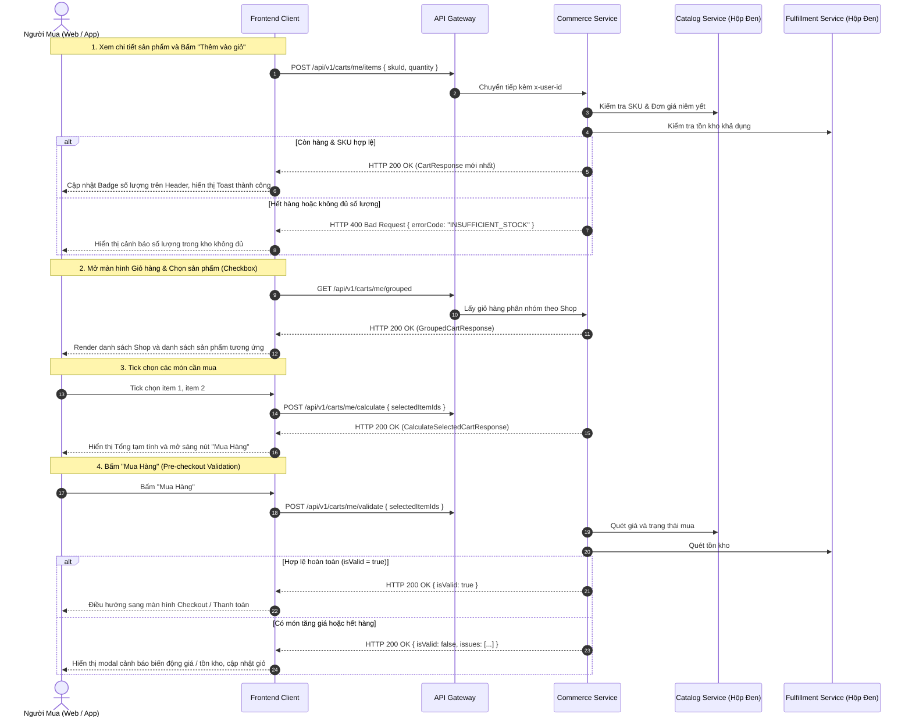

# LUỒNG 1: QUẢN LÝ GIỎ HÀNG (SHOPPING CART INTEGRATION GUIDE)

> **Dành cho:** Web Client & Mobile App (Kênh Người Mua - Buyer)  
> **Base Route:** `/api/v1/carts`  
> **Xác thực:** Yêu cầu đăng nhập (`x-user-id`, role `buyer`)  

---

## 1. TỔNG QUAN & ĐIỀU KIỆN TIÊN QUYẾT

- **Mục tiêu:** Cho phép người mua quản lý danh sách sản phẩm dự định mua, thay đổi phân loại (SKU variant), tick chọn từng món để tính tiền tạm thời (Shopee checkbox mechanism), thẩm định tồn kho & giá mới nhất trước khi bấm Checkout.
- **Người thực hiện:** Người mua (`buyer`), Khách vãng lai (lưu local storage, sau đó gộp giỏ khi đăng nhập).
- **Quy tắc bất biến:**
  - Mỗi người mua chỉ sở hữu duy nhất **1 giỏ hàng hoạt động (`Active`)**.
  - Giới hạn tối đa **50 dòng sản phẩm** trong giỏ.
  - Số lượng mỗi dòng sản phẩm từ **1 đến 99**.

---

## 2. SEQUENCE DIAGRAM LUỒNG GIỎ HÀNG



---

## 3. DANH SÁCH CHI TIẾT CÁC API TRONG LUỒNG GIỎ HÀNG

### 3.1. Lấy thông tin Giỏ hàng của tôi
- **Method / Path:** `GET /api/v1/carts/me`
- **Quyền:** `buyer`
- **Mô tả:** Lấy giỏ hàng đang hoạt động của người mua. Nếu người mua chưa từng có giỏ hàng, hệ thống tự động khởi tạo mới.
- **Response (200 OK):**
```json
{
  "id": "e8d6934c-6880-4fc7-b893-68d76587c631",
  "buyerId": "a1b2c3d4-e5f6-7a8b-9c0d-1e2f3a4b5c6d",
  "status": "Active",
  "itemCount": 2,
  "subtotalAmount": 450000.0,
  "items": [
    {
      "id": "7b7a1234-abcd-4def-9012-1234567890ab",
      "productId": "99991111-2222-3333-4444-555566667777",
      "skuId": "11112222-3333-4444-5555-666677778888",
      "sellerId": "88889999-aaaa-bbbb-cccc-ddddeeeeffff",
      "productName": "Áo Thun Cotton Nam Dáng Rộng",
      "quantity": 2,
      "unitPriceSnapshot": 150000.0,
      "lineTotal": 300000.0,
      "addedAt": "2026-11-27T08:30:00Z",
      "isAvailable": true,
      "disabledReason": null
    },
    {
      "id": "8c8b2345-bcde-4efa-9012-2345678901bc",
      "productId": "99991111-2222-3333-4444-555566667777",
      "skuId": "22223333-4444-5555-6666-777788889999",
      "sellerId": "88889999-aaaa-bbbb-cccc-ddddeeeeffff",
      "productName": "Quần Short Kaki",
      "quantity": 1,
      "unitPriceSnapshot": 150000.0,
      "lineTotal": 150000.0,
      "addedAt": "2026-11-27T08:35:00Z",
      "isAvailable": true,
      "disabledReason": null
    }
  ],
  "lastActivityAt": "2026-11-27T08:35:00Z"
}
```

---

### 3.2. Lấy số lượng Badge Giỏ hàng (Header Badge)
- **Method / Path:** `GET /api/v1/carts/me/summary`
- **Quyền:** `buyer`
- **Mô tả:** API gọn nhẹ chuyên dùng cho Header/Navigation bar để hiển thị số lượng badge icon giỏ hàng và tổng tạm tính mà không cần tải chi tiết toàn bộ các dòng hàng.
- **Response (200 OK):**
```json
{
  "cartId": "e8d6934c-6880-4fc7-b893-68d76587c631",
  "totalDistinctItems": 2,
  "totalQuantity": 3,
  "estimatedSubtotal": 450000.0
}
```

---

### 3.3. Lấy Giỏ hàng phân nhóm theo từng Người Bán (Shop Grouped Cart)
- **Method / Path:** `GET /api/v1/carts/me/grouped`
- **Quyền:** `buyer`
- **Mô tả:** Gom nhóm các sản phẩm theo từng Shop (`SellerId`), hiển thị tên gian hàng, tổng tiền theo từng shop, phục vụ giao diện giỏ hàng đa người bán chuẩn Shopee.
- **Response (200 OK):**
```json
{
  "cartId": "e8d6934c-6880-4fc7-b893-68d76587c631",
  "buyerId": "a1b2c3d4-e5f6-7a8b-9c0d-1e2f3a4b5c6d",
  "totalDistinctItems": 2,
  "totalQuantity": 3,
  "subtotalAmount": 450000.0,
  "shops": [
    {
      "sellerId": "88889999-aaaa-bbbb-cccc-ddddeeeeffff",
      "shopName": "Thời Trang Nam Coolmate",
      "distinctItemCount": 2,
      "totalQuantity": 3,
      "shopSubtotal": 450000.0,
      "items": [
        {
          "id": "7b7a1234-abcd-4def-9012-1234567890ab",
          "productId": "99991111-2222-3333-4444-555566667777",
          "skuId": "11112222-3333-4444-5555-666677778888",
          "sellerId": "88889999-aaaa-bbbb-cccc-ddddeeeeffff",
          "productName": "Áo Thun Cotton Nam Dáng Rộng",
          "quantity": 2,
          "unitPriceSnapshot": 150000.0,
          "lineTotal": 300000.0,
          "isAvailable": true,
          "disabledReason": null
        }
      ]
    }
  ]
}
```

---

### 3.4. Thêm sản phẩm vào giỏ hàng
- **Method / Path:** `POST /api/v1/carts/me/items`
- **Quyền:** `buyer`
- **Request Body:**
| Field | Kiểu | Bắt buộc | Mô tả & Validation |
|---|---|---|---|
| `skuId` | UUID | Có | Định danh phiên bản sản phẩm (SKU) cần thêm |
| `quantity` | Integer | Có | Số lượng mua thêm (tối thiểu 1, dồn tối đa 99) |
| `productId` | UUID | Không | Định danh sản phẩm cha (tùy chọn) |

- **Ví dụ Request:**
```json
{
  "skuId": "11112222-3333-4444-5555-666677778888",
  "quantity": 2
}
```
- **Response (200 OK):** Trả về toàn bộ `CartResponse` mới nhất.

---

### 3.5. Cập nhật số lượng của một dòng sản phẩm
- **Method / Path:** `PATCH /api/v1/carts/me/items/{cartItemId}`
- **Quyền:** `buyer`
- **Request Body:**
```json
{
  "cartItemId": "7b7a1234-abcd-4def-9012-1234567890ab",
  "quantity": 5
}
```
- **Response (200 OK):** Trả về `CartResponse` mới nhất.

---

### 3.6. Đổi phân loại biến thể trực tiếp trong giỏ (Change Variant)
- **Method / Path:** `PATCH /api/v1/carts/me/items/{cartItemId}/variant`
- **Quyền:** `buyer`
- **Mô tả:** Cho phép người mua đổi size/màu (chuyển sang `newSkuId`) trực tiếp trên màn hình giỏ hàng mà không cần xóa đi thêm lại. Biến thể mới bắt buộc phải cùng sản phẩm cha.
- **Request Body:**
```json
{
  "newSkuId": "33334444-5555-6666-7777-888899990000"
}
```
- **Response (200 OK):** Trả về `CartResponse` mới nhất với đơn giá snapshot được làm mới theo SKU mới.

---

### 3.7. Xóa sản phẩm khỏi giỏ hàng
- **Xóa 1 món:** `DELETE /api/v1/carts/me/items/{cartItemId}`
- **Xóa nhiều món chọn lọc:** `POST /api/v1/carts/me/items:bulk-remove`
  ```json
  {
    "cartItemIds": ["7b7a1234-abcd-4def-9012-1234567890ab"],
    "clearAll": false
  }
  ```
- **Dọn sạch toàn bộ giỏ:** `DELETE /api/v1/carts/me/clear`
- **Response (200 OK):** Trả về `CartResponse` mới nhất.

---

### 3.8. Tính tiền tạm tính theo Checkbox (Shopee Selection Calculator)
- **Method / Path:** `POST /api/v1/carts/me/calculate`
- **Quyền:** `buyer`
- **Mô tả:** Khi người mua tick chọn hoặc bỏ tick các checkbox sản phẩm trong giỏ, FE gọi API này để hệ thống tính toán chính xác tổng tiền hàng, số lượng mặt hàng và kiểm tra tình trạng tồn kho của từng món đã chọn.
- **Request Body:**
```json
{
  "selectedItemIds": [
    "7b7a1234-abcd-4def-9012-1234567890ab",
    "8c8b2345-bcde-4efa-9012-2345678901bc"
  ]
}
```
- **Response (200 OK):**
```json
{
  "selectedItemCount": 2,
  "totalQuantity": 3,
  "subtotalAmount": 450000.0,
  "items": [
    {
      "cartItemId": "7b7a1234-abcd-4def-9012-1234567890ab",
      "skuId": "11112222-3333-4444-5555-666677778888",
      "productName": "Áo Thun Cotton Nam Dáng Rộng",
      "quantity": 2,
      "unitPrice": 150000.0,
      "lineTotal": 300000.0,
      "isAvailable": true,
      "availableStock": 50,
      "stockWarning": null
    }
  ]
}
```

---

### 3.9. Thẩm định Giỏ hàng trước Checkout (Pre-checkout Validate)
- **Method / Path:** `POST /api/v1/carts/me/validate`
- **Quyền:** `buyer`
- **Mô tả:** Gọi ngay trước khi chuyển sang màn hình Checkout để phát hiện sớm các trường hợp tăng giá, giảm giá hoặc tồn kho không đủ.
- **Request Body:**
```json
{
  "selectedItemIds": [
    "7b7a1234-abcd-4def-9012-1234567890ab"
  ]
}
```
- **Response (200 OK - Không có lỗi):**
```json
{
  "isValid": true,
  "hasPriceChanges": false,
  "hasStockIssues": false,
  "issues": []
}
```
- **Response (200 OK - Phát hiện cảnh báo biến động):**
```json
{
  "isValid": false,
  "hasPriceChanges": true,
  "hasStockIssues": true,
  "issues": [
    {
      "cartItemId": "7b7a1234-abcd-4def-9012-1234567890ab",
      "skuId": "11112222-3333-4444-5555-666677778888",
      "issueType": "PRICE_INCREASED",
      "message": "Product price has increased from 150,000 to 180,000.",
      "oldPrice": 150000.0,
      "newPrice": 180000.0,
      "availableStock": 5,
      "requestedQuantity": 2,
      "suggestedQuantity": 2
    }
  ]
}
```

---

### 3.10. Gộp giỏ hàng khách vãng lai khi đăng nhập (Merge Guest Cart)
- **Method / Path:** `POST /api/v1/carts/me/merge`
- **Quyền:** `buyer`
- **Mô tả:** Khi khách hàng duyệt web ẩn danh thêm đồ vào local storage, sau đó bấm Đăng nhập, FE gọi API này để gộp toàn bộ danh sách local vào giỏ hàng lưu trên server.
- **Request Body:**
```json
{
  "guestItems": [
    {
      "skuId": "11112222-3333-4444-5555-666677778888",
      "quantity": 1
    }
  ]
}
```
- **Response (200 OK):** Trả về `CartResponse` hợp nhất mới nhất.

---

## 4. MA TRẬN MÃ LỖI CHO MODULE GIỎ HÀNG

| HTTP Status | ErrorCode | Nguyên nhân | Hành động khuyến nghị cho Frontend |
|---|---|---|---|
| `400` | `VAL_INVALID_INPUT` | Số lượng `<= 0` hoặc dữ liệu rỗng | Báo lỗi trường nhập số lượng |
| `400` | `INSUFFICIENT_STOCK` | Kho không đủ số lượng tồn | Hiển thị cảnh báo số lượng tồn tối đa |
| `400` | `CATALOG_SKU_INACTIVE` | SKU đã ngừng bán hoặc ẩn | Disable nút mua, đánh dấu sản phẩm màu xám |
| `400` | `CATALOG_VARIANT_MISMATCH` | Biến thể mới không cùng cha | Chặn người dùng chọn sai danh mục variant |
| `404` | `CART_NOT_FOUND` | Giỏ hàng không tồn tại | Tự động gọi `GET /api/v1/carts/me` để tạo lại |
| `404` | `CART_ITEM_NOT_FOUND` | Món hàng đã bị xóa trước đó | Reload lại giỏ hàng |
| `404` | `CATALOG_SKU_NOT_FOUND` | SKU không tồn tại trong Catalog | Xóa món hàng khỏi giao diện |
| `409` | `CONCURRENCY_CONFLICT` | Tranh chấp dữ liệu giỏ hàng | Tự động gọi lại `GET /api/v1/carts/me` cập nhật lại UI |
