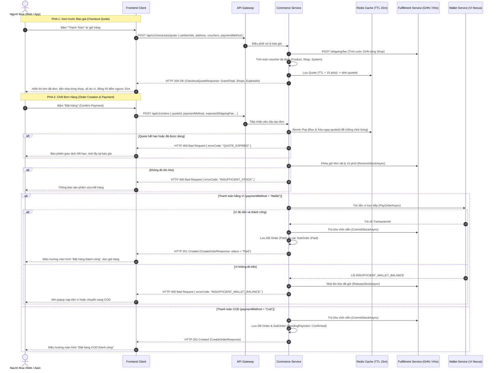
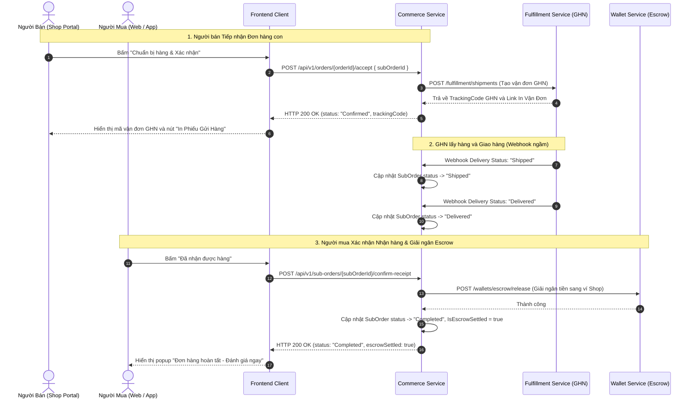

# LUỒNG 2: BÁO GIÁ, ĐẶT HÀNG & VÒNG ĐỜI ĐƠN HÀNG ĐA NGƯỜI BÁN (CHECKOUT & ORDER LIFECYCLE)

> **Dành cho:** Web Client & Mobile App (Kênh Người Mua & Cổng Người Bán)  
> **Base Routes:** `/api/v1/checkouts`, `/api/v1/orders`, `/api/v1/sub-orders`, `/api/v1/shipments`  
> **Xác thực:** Yêu cầu đăng nhập (`x-user-id`, role `buyer` hoặc `seller`)  

---

## 1. TỔNG QUAN & NGUYÊN TẮC CỐT LÕI

- **Kiến trúc Đơn hàng 2 Cấp (Hierarchical Two-Tier Order Model):**
  - **Đơn hàng cha (`Order` - Master Order):** Đại diện cho toàn bộ giao dịch thanh toán tổng thể của người mua trong một lần thanh toán.
  - **Đơn hàng con (`SubOrder`):** Tự động phân rã độc lập theo từng Người bán (Shop/Seller). Mỗi SubOrder có trạng thái giao vận, mã vận đơn GHN, chiết khấu voucher và giải ngân ví hoàn toàn riêng biệt.
- **Quy trình Thanh toán 2 Pha (Two-Phase Order Placement):**
  - **Pha 1 (Báo giá - Quote):** Gọi `POST /api/v1/checkouts/quote` để server tính cước vận chuyển GHN theo từng Shop, thẩm định và xếp chồng voucher, khóa báo giá trong **15 phút (`TTL = 15m`)**.
  - **Pha 2 (Tạo đơn chính thức - Create Order):** Người mua xác nhận bấm "Đặt hàng", gửi `quoteId` lên `POST /api/v1/orders`. Hệ thống áp dụng **Atomic Pop** trên Redis (chống click đúp), khóa giữ kho 15 phút tại FulfillmentService, thanh toán ví Nexus trực tiếp, và commit đơn hàng.
- **Phương thức Thanh toán Hỗ trợ:**
  - `Wallet`: Thanh toán qua Ví điện tử Nexus.
  - `Cod`: Thanh toán khi nhận hàng (Cash on Delivery).
  - ⚠️ *Lưu ý:* `VnPay` đã chính thức ngừng hỗ trợ (`[Obsolete]`), FE không hiển thị tùy chọn này.

---

## 2. SEQUENCE DIAGRAM: BÁO GIÁ & CHỐT ĐƠN HÀNG (PHA 1 & PHA 2)



---

## 3. SEQUENCE DIAGRAM: VÒNG ĐỜI GIAO HÀNG & GIẢI NGÂN ESCROW



---

## 4. CHI TIẾT CÁC API TRONG LUỒNG CHECKOUT & ĐƠN HÀNG

### 4.1. Tạo Phiên Báo Giá Thanh Toán (Checkout Quote)
- **Method / Path:** `POST /api/v1/checkouts/quote`
- **Quyền:** `buyer`
- **Mô tả:** Nhận danh sách các món hàng muốn thanh toán từ giỏ hàng, thông tin địa chỉ, voucher và phương thức thanh toán. Server tính phí vận chuyển GHN cho từng Shop, áp dụng voucher và trả về mã `quoteId` có hiệu lực trong 15 phút.
- **Request Body:**
```json
{
  "cartItemIds": [
    "7b7a1234-abcd-4def-9012-1234567890ab",
    "8c8b2345-bcde-4efa-9012-2345678901bc"
  ],
  "addressId": "00001111-2222-3333-4444-555566667777",
  "shippingAddress": {
    "receiverName": "Nguyễn Văn A",
    "contactPhone": "0987654321",
    "street": "Số 123 Đường Nguyễn Huệ",
    "ward": "Phường Bến Nghé",
    "district": "Quận 1",
    "province": "Hồ Chí Minh",
    "ghnDistrictId": 1442,
    "ghnWardCode": "20101"
  },
  "paymentMethod": "Wallet",
  "voucherCodes": ["FREESHIP50K", "SHOPDISCOUNT10"]
}
```
- **Response (200 OK):**
```json
{
  "quoteId": "a1b2c3d4-e5f6-7a8b-9c0d-1e2f3a4b5c6d",
  "grandTotal": 472000.0,
  "walletBalance": 1500000.0,
  "expiredAt": "2026-11-27T08:45:00Z",
  "shops": [
    {
      "sellerId": "88889999-aaaa-bbbb-cccc-ddddeeeeffff",
      "shopName": "Thời Trang Nam Coolmate",
      "itemsAmount": 450000.0,
      "productDiscountAmount": 0.0,
      "shopDiscountAmount": 10000.0,
      "systemDiscountAmount": 0.0,
      "discountAmount": 10000.0,
      "shippingFeeAmount": 32000.0,
      "totalAmount": 472000.0,
      "items": [
        {
          "cartItemId": "7b7a1234-abcd-4def-9012-1234567890ab",
          "productId": "99991111-2222-3333-4444-555566667777",
          "skuId": "11112222-3333-4444-5555-666677778888",
          "productName": "Áo Thun Cotton Nam Dáng Rộng",
          "quantity": 2,
          "unitPrice": 150000.0,
          "lineTotal": 300000.0
        }
      ]
    }
  ],
  "appliedVouchers": ["SHOPDISCOUNT10"],
  "appliedVoucherDetails": [
    {
      "code": "SHOPDISCOUNT10",
      "scopeType": "Shop",
      "ownerSellerId": "88889999-aaaa-bbbb-cccc-ddddeeeeffff",
      "discountAmount": 10000.0
    }
  ],
  "rejectedVouchers": [
    {
      "code": "FREESHIP50K",
      "reasonCode": "MIN_ORDER_NOT_MET"
    }
  ],
  "warnings": null
}
```

---

### 4.2. Tính lại Báo Giá khi Đổi Địa Chỉ ở màn Checkout
- **Method / Path:** `POST /api/v1/checkouts/quote/{quoteId}/recalculate`
- **Quyền:** `buyer`
- **Mô tả:** Khi người mua thay đổi địa chỉ giao hàng ở màn hình thanh toán, FE gọi API này để tính lại tiền ship GHN và tổng tiền thanh toán mới mà không cần tạo quote mới từ đầu.
- **Request Body:**
```json
{
  "addressId": "11112222-3333-4444-5555-666677778888",
  "shippingAddress": {
    "receiverName": "Nguyễn Văn A",
    "contactPhone": "0987654321",
    "street": "Số 456 Đường Lê Lợi",
    "ward": "Phường Bến Thành",
    "district": "Quận 1",
    "province": "Hồ Chí Minh",
    "ghnDistrictId": 1442,
    "ghnWardCode": "20102"
  }
}
```
- **Response (200 OK):** Trả về `CheckoutQuoteResponse` đã được cập nhật giá vận chuyển.

---

### 4.3. Chốt Tạo Đơn Hàng Chính Thức (Create Order)
- **Method / Path:** `POST /api/v1/orders`
- **Header Khuyến nghị:** `Idempotency-Key: <unique-uuid>` (Chống click lặp)
- **Quyền:** `buyer`
- **Request Body:**
| Field | Kiểu | Bắt buộc | Mô tả |
|---|---|---|---|
| `quoteId` | UUID | Có | Mã phiên báo giá vừa tạo từ Pha 1 |
| `paymentMethod` | String | Có | `"Wallet"` hoặc `"Cod"` (Cấm dùng `"VnPay"`) |
| `shippingAddress` | String | Có | Chuỗi địa chỉ giao hàng đầy đủ hiển thị |
| `contactPhone` | String | Có | Số điện thoại nhận hàng |
| `expectedShippingFee` | Decimal | Không | Tổng tiền ship dự kiến ở client để đối soát parity |
| `note` | String | Không | Ghi chú đơn hàng từ người mua |

- **Ví dụ Request:**
```json
{
  "quoteId": "a1b2c3d4-e5f6-7a8b-9c0d-1e2f3a4b5c6d",
  "paymentMethod": "Wallet",
  "shippingAddress": "Số 123 Đường Nguyễn Huệ, Phường Bến Nghé, Quận 1, Hồ Chí Minh",
  "contactPhone": "0987654321",
  "expectedShippingFee": 32000.0,
  "note": "Giao vào giờ hành chính"
}
```
- **Response (201 Created):**
```json
{
  "orderId": "55556666-7777-8888-9999-000011112222",
  "orderNo": "ORD-20261127-555566",
  "totalAmount": 472000.0,
  "status": "Paid",
  "paymentDeadlineAt": "2026-11-27T08:50:00Z",
  "paymentUrl": null,
  "subOrderIds": [
    "99998888-7777-6666-5555-444433332222"
  ],
  "createdAt": "2026-11-27T08:35:00Z",
  "appliedPriceDrops": []
}
```

---

### 4.4. Tra cứu Danh sách Đơn Hàng của Người Mua
- **Method / Path:** `GET /api/v1/orders`
- **Quyền:** `buyer`
- **Query Params:**
  - `page`: Trang hiện tại (Mặc định `1`).
  - `pageSize`: Kích thước trang (Mặc định `20`, tối đa `100`).
  - `status`: Lọc theo trạng thái (`PendingPayment`, `Paid`, `Cancelled`, `Completed`, `Delivered`).
- **Response (200 OK):**
```json
{
  "items": [
    {
      "orderId": "55556666-7777-8888-9999-000011112222",
      "orderNo": "ORD-20261127-555566",
      "totalAmount": 472000.0,
      "status": "Paid",
      "paymentDeadlineAt": "2026-11-27T08:50:00Z",
      "subOrderCount": 1,
      "createdAt": "2026-11-27T08:35:00Z"
    }
  ],
  "pagination": {
    "pageIndex": 1,
    "pageSize": 20,
    "totalCount": 1,
    "totalPages": 1,
    "hasPreviousPage": false,
    "hasNextPage": false
  }
}
```

---

### 4.5. Tra cứu Chi tiết Đơn hàng cha
- **Method / Path:** `GET /api/v1/orders/{orderId}`
- **Quyền:** `buyer`, `admin`, `staff`
- **Response (200 OK):** Trả về `OrderResponse` chứa danh sách chi tiết các `SubOrders` thuộc đơn hàng này.

---

### 4.6. Người bán Tra cứu Danh sách Đơn Hàng Con (Seller Sub-Orders)
- **Method / Path:** `GET /api/v1/sub-orders`
- **Quyền:** `seller`
- **Query Params:** `page`, `pageSize`, `status` (`PendingPayment`, `Paid`, `Confirmed`, `Shipped`, `Delivered`, `Completed`, `Cancelled`, `Refunded`).
- **Response (200 OK):** Trả về danh sách đơn con của Shop với phân trang database `PagedData<SubOrderSummaryResponse>`.

---

### 4.7. Tra cứu Chi tiết Đơn hàng con của Shop
- **Method / Path:** `GET /api/v1/sub-orders/{subOrderId}`
- **Quyền:** `seller`, `buyer`, `admin`, `staff`
- **Response (200 OK):**
```json
{
  "subOrderId": "99998888-7777-6666-5555-444433332222",
  "subOrderNo": "SUB-20261127-999988",
  "orderId": "55556666-7777-8888-9999-000011112222",
  "buyerId": "a1b2c3d4-e5f6-7a8b-9c0d-1e2f3a4b5c6d",
  "sellerId": "88889999-aaaa-bbbb-cccc-ddddeeeeffff",
  "shopName": "Thời Trang Nam Coolmate",
  "status": "Paid",
  "paymentMethod": "Wallet",
  "shippingAddress": {
    "receiverName": "Nguyễn Văn A",
    "contactPhone": "0987654321",
    "fullAddress": "Số 123 Đường Nguyễn Huệ, Phường Bến Nghé, Quận 1, Hồ Chí Minh"
  },
  "contactPhone": "0987654321",
  "itemsAmount": 450000.0,
  "productDiscountAmount": 0.0,
  "shopDiscountAmount": 10000.0,
  "systemDiscountAmount": 0.0,
  "discountAmount": 10000.0,
  "shippingFeeAmount": 32000.0,
  "totalAmount": 472000.0,
  "createdAt": "2026-11-27T08:35:00Z",
  "carrierCode": null,
  "trackingCode": null,
  "shipmentPendingCreation": false,
  "items": [
    {
      "orderItemId": "1111aaaa-2222-bbbb-3333-cccc4444dddd",
      "productId": "99991111-2222-3333-4444-555566667777",
      "skuId": "11112222-3333-4444-5555-666677778888",
      "productName": "Áo Thun Cotton Nam Dáng Rộng",
      "skuCode": "AT-NAM-TRANG-L",
      "quantity": 2,
      "unitPrice": 150000.0,
      "lineTotal": 300000.0
    }
  ]
}
```

---

### 4.8. Người bán Tiếp nhận Đơn hàng con (Seller Accept)
- **Method / Path:** `POST /api/v1/orders/{orderId}/accept`
- **Quyền:** `seller`
- **Mô tả:** Người bán xác nhận đơn hàng, hệ thống tự động sinh vận đơn GHN.
- **Request Body:**
```json
{
  "subOrderId": "99998888-7777-6666-5555-444433332222",
  "note": "Đã đóng gói cẩn thận",
  "pickShiftId": 2
}
```
- **Response (200 OK):**
```json
{
  "subOrderId": "99998888-7777-6666-5555-444433332222",
  "status": "Confirmed",
  "acceptedAt": "2026-11-27T09:00:00Z"
}
```

---

### 4.9. Người bán Từ chối Đơn hàng con (Seller Reject)
- **Method / Path:** `POST /api/v1/orders/{orderId}/reject`
- **Quyền:** `seller`
- **Mô tả:** Từ chối đơn hàng vì hết hàng hoặc không giao được. Hệ thống tự động kích hoạt hoàn tiền ví 100% cho người mua và mở lại kho.
- **Request Body:**
```json
{
  "subOrderId": "99998888-7777-6666-5555-444433332222",
  "reasonCode": "OutOfStock",
  "reasonText": "Sản phẩm tạm thời hết hàng tại kho"
}
```
- **Response (200 OK):**
```json
{
  "subOrderId": "99998888-7777-6666-5555-444433332222",
  "status": "Cancelled",
  "cancellationReason": "OutOfStock",
  "rejectedAt": "2026-11-27T09:05:00Z"
}
```

---

### 4.10. Thử lại tạo Vận đơn GHN (Retry Shipment Creation)
- **Method / Path:** `POST /api/v1/sub-orders/{subOrderId}/shipments/retry`
- **Quyền:** `seller`
- **Mô tả:** Dùng khi đơn con đã ở trạng thái `Confirmed` nhưng việc đẩy sang GHN bị lỗi mạng (`shipmentPendingCreation = true`).
- **Response (200 OK):**
```json
{
  "subOrderId": "99998888-7777-6666-5555-444433332222",
  "subOrderNo": "SUB-20261127-999988",
  "trackingCode": "GHN123456789VN",
  "carrierCode": "GHN",
  "labelPrintUrl": "https://carrier.ghn.vn/print/GHN123456789VN",
  "createdAt": "2026-11-27T09:10:00Z"
}
```

---

### 4.11. Theo dõi Tiến độ & Timeline Vận Chuyển GHN
- **Timeline Đơn con:** `GET /api/v1/sub-orders/{subOrderId}/shipments/timeline`
- **Tổng quan Vận chuyển Đơn cha:** `GET /api/v1/shipments/order/{orderId}`
- **Quyền:** `buyer`, `seller`, `admin`, `staff`
- **Response Timeline (200 OK):**
```json
{
  "subOrderId": "99998888-7777-6666-5555-444433332222",
  "subOrderNo": "SUB-20261127-999988",
  "orderId": "55556666-7777-8888-9999-000011112222",
  "carrierCode": "GHN",
  "carrierName": "Giao Hàng Nhanh",
  "trackingCode": "GHN123456789VN",
  "labelPrintUrl": "https://carrier.ghn.vn/print/GHN123456789VN",
  "currentStatus": "Shipped",
  "estimatedDeliveryAt": "2026-11-29T17:00:00Z",
  "shippingAddress": {
    "receiverName": "Nguyễn Văn A",
    "contactPhone": "0987654321",
    "fullAddress": "Số 123 Đường Nguyễn Huệ, Phường Bến Nghé, Quận 1, Hồ Chí Minh"
  },
  "timeline": [
    {
      "status": "Confirmed",
      "title": "Người bán đã xác nhận đơn hàng",
      "description": "Đang chuẩn bị hàng để giao cho đơn vị vận chuyển",
      "occurredAt": "2026-11-27T09:00:00Z",
      "location": "Kho Hồ Chí Minh"
    },
    {
      "status": "Shipped",
      "title": "Bưu tá đã lấy hàng thành công",
      "description": "Đơn hàng đang trên đường trung chuyển đến bưu cục phát",
      "occurredAt": "2026-11-27T14:30:00Z",
      "location": "Bưu cục Quận 1"
    }
  ]
}
```

---

### 4.12. Người mua Xác nhận Đã Nhận Hàng (Confirm Receipt)
- **Method / Path:** `POST /api/v1/sub-orders/{subOrderId}/confirm-receipt`
- **Quyền:** `buyer`
- **Mô tả:** Chuyển đơn sang `Completed`, kích hoạt giải ngân quỹ Escrow sang ví Người bán.
- **Response (200 OK):**
```json
{
  "subOrderId": "99998888-7777-6666-5555-444433332222",
  "status": "Completed",
  "completedAt": "2026-11-29T16:00:00Z",
  "escrowSettled": true,
  "amountSettled": 440000.0
}
```

---

### 4.13. Hủy Đơn Hàng (Cancel Order / SubOrder)
- **Hủy toàn bộ đơn cha:** `POST /api/v1/orders/{orderId}/cancel`
- **Hủy riêng 1 đơn con:** `POST /api/v1/sub-orders/{subOrderId}/cancel`
- **Quyền:** `buyer`
- **Điều kiện:** Đơn hàng chưa chuyển sang trạng thái `Shipped`.
- **Request Body:**
```json
{
  "reasonCode": "BuyerChangedMind",
  "reasonNote": "Tôi muốn đổi địa chỉ giao hàng khác"
}
```
- **Response (200 OK):**
```json
{
  "subOrderId": "99998888-7777-6666-5555-444433332222",
  "status": "Cancelled",
  "cancelledAt": "2026-11-27T09:30:00Z",
  "refundAmount": 472000.0,
  "inventoryReleased": true,
  "carrierShipmentCancelled": true
}
```

---

### 4.14. Thanh toán lại Đơn hàng (Repay Order)
- **Method / Path:** `POST /api/v1/orders/{orderId}/pay`
- **Quyền:** `buyer`
- **Mô tả:** Áp dụng khi đơn hàng đang ở `PendingPayment` và vẫn còn trong thời hạn 15 phút.
- **Response (200 OK):**
```json
{
  "orderId": "55556666-7777-8888-9999-000011112222",
  "status": "Paid",
  "totalAmount": 472000.0,
  "paidAt": "2026-11-27T08:40:00Z",
  "walletTransactionId": "11223344-5566-7788-9900-aabbccddeeff"
}
```

---

### 4.15. Đổi Địa Chỉ Giao Hàng Sau Khi Đặt Đơn
- **Đổi cho toàn bộ đơn cha:** `PATCH /api/v1/orders/{orderId}/shipping-address`
- **Đổi cho riêng đơn con:** `PATCH /api/v1/sub-orders/{subOrderId}/shipping-address`
- **Quyền:** `buyer`, `admin`, `staff`
- **Điều kiện:** Đơn hàng chưa bàn giao cho bên vận chuyển (`Status` trước `Shipped`). Nếu tiền ship mới lệch với tiền ship cũ, hệ thống tự động điều chỉnh tổng tiền.
- **Request Body:**
```json
{
  "shippingAddress": {
    "receiverName": "Nguyễn Văn B",
    "contactPhone": "0912345678",
    "street": "Số 789 Đường Hai Bà Trưng",
    "ward": "Phường Đa Kao",
    "district": "Quận 1",
    "province": "Hồ Chí Minh",
    "ghnDistrictId": 1442,
    "ghnWardCode": "20103"
  }
}
```
- **Response (200 OK):** Trả về `ChangeShippingAddressResponse` gồm địa chỉ mới, tiền ship cũ, tiền ship mới và tổng tiền đã cập nhật.

---

### 4.16. Bảng Kê Phân Rã Tài Chính Đơn Con cho Người Bán (Financial Breakdown)
- **Method / Path:** `GET /api/v1/sub-orders/{subOrderId}/financial-breakdown`
- **Quyền:** `seller`
- **Mô tả:** Cho phép người bán xem minh bạch từng khoản mục tài chính: Doanh thu hàng, Giảm giá shop, Trợ cấp sàn, Phí sàn thu, Phí ship, và Tiền thực nhận vào ví sau giải ngân.
- **Response (200 OK):**
```json
{
  "subOrderId": "99998888-7777-6666-5555-444433332222",
  "subOrderNo": "SUB-20261127-999988",
  "sellerId": "88889999-aaaa-bbbb-cccc-ddddeeeeffff",
  "buyerId": "a1b2c3d4-e5f6-7a8b-9c0d-1e2f3a4b5c6d",
  "totalAmount": 472000.0,
  "itemsAmount": 450000.0,
  "productDiscountAmount": 0.0,
  "shopDiscountAmount": 10000.0,
  "systemDiscountAmount": 0.0,
  "shippingFeeAmount": 32000.0,
  "platformFeeAmount": 15000.0,
  "sellerReceiveAmount": 425000.0,
  "isEscrowSettled": true,
  "status": "Completed",
  "paymentMethod": "Wallet",
  "completedAt": "2026-11-29T16:00:00Z"
}
```

---

## 5. MA TRẬN MÃ LỖI CHO MODULE ĐƠN HÀNG & CHECKOUT

| HTTP Status | ErrorCode | Nguyên nhân | Hành động khuyến nghị cho Frontend |
|---|---|---|---|
| `400` | `QUOTE_EXPIRED` | Báo giá quá hạn 15m hoặc đã dùng tạo đơn khác | Báo hết hạn báo giá, gọi lại `/quote` |
| `400` | `UNSUPPORTED_PAYMENT_METHOD` | Chọn phương thức thanh toán VNPay | Báo VNPay đã ngưng hoạt động, chọn Ví hoặc COD |
| `400` | `INSUFFICIENT_STOCK` | Kho hết hàng trong lúc tạo đơn | Thông báo hết hàng, cập nhật lại số lượng giỏ |
| `400` | `INSUFFICIENT_WALLET_BALANCE` | Số dư ví không đủ thanh toán | Hiển thị modal "Nạp tiền ví" hoặc chuyển COD |
| `403` | `BUYER_ACTION_RESTRICTED` | Người mua bị UserService hạn chế quyền mua | Hiển thị thông báo tài khoản đang bị khóa mua |
| `404` | `ORDER_NOT_FOUND` / `SUB_ORDER_NOT_FOUND` | Đơn hàng không tồn tại | Thông báo không tìm thấy đơn hàng |
| `409` | `PRICE_CHANGED` | Có sản phẩm tăng giá so với lúc lấy báo giá | Hiển thị modal biến động giá, cập nhật lại giỏ |
| `409` | `SHIPPING_FEE_MISMATCH` | Tiền ship tại FE không khớp với tiền ship server tính | Gọi lại `/recalculate` để đồng bộ tiền ship |
| `409` | `VOUCHER_NO_LONGER_VALID` | Voucher hết lượt hoặc không còn thỏa điều kiện | Báo voucher không hợp lệ, tạo báo giá mới |
| `409` | `CONCURRENCY_CONFLICT` | Tranh chấp dữ liệu đơn hàng giữa 2 thao tác | Tải lại trang chi tiết đơn hàng |
| `500` | `ORDER_CREATION_FAILED` | Lỗi DB khi lưu đơn, toàn bộ tiền ví và kho đã bồi hoàn | Báo lỗi hệ thống, xác nhận tiền ví đã an toàn |
