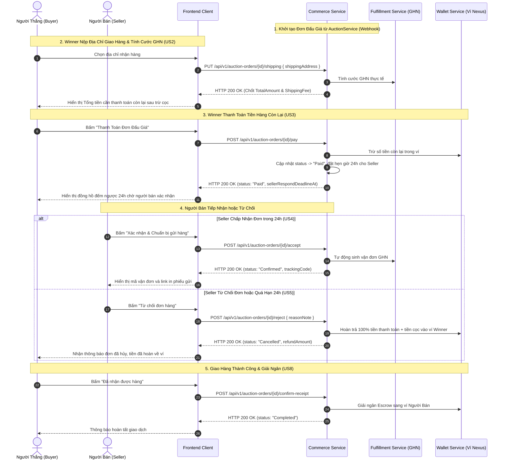

# LUỒNG 3: ĐƠN HÀNG ĐẤU GIÁ (AUCTION ORDER INTEGRATION GUIDE)

> **Dành cho:** Web Client & Mobile App (Kênh Người Mua & Cổng Người Bán)  
> **Base Route:** `/api/v1/auction-orders`  
> **Xác thực:** Yêu cầu đăng nhập (`x-user-id`, role `buyer`, `seller`, `admin`)  

---

## 1. TỔNG QUAN & NGUYÊN TẮC VẬN HÀNH ĐƠN ĐẤU GIÁ

- **Nguồn gốc Đơn Hàng:**
  - Không đi qua giỏ hàng. Đơn hàng được tự động khởi tạo sau khi phiên đấu giá kết thúc thành công thông qua webhook settlement từ `AuctionService` (`US1`).
  - Hỗ trợ 3 nguồn gốc đơn (`OrderSource`): `WINNER` (Người thắng cuộc), `SECOND_CHANCE` (Cơ hội thứ hai cho người về nhì), `BUY_NOW` (Mua ngay theo giá ấn định).
- **Quy tắc Thanh toán Trừ Cọc:**
  - Người mua đã đặt cọc trước đó trong phiên đấu giá (`DepositAmount`).
  - Số tiền cần thanh toán thực tế:
    $$\text{RemainingAmount} = \text{WinningAmount} - \text{DepositAmount} + \text{ShippingFeeAmount}$$
- **Quy tắc Hạn Định Thời Gian (Timeouts):**
  - **Hạn chốt địa chỉ & thanh toán:** `PaymentDeadlineAt` do phiên đấu giá thiết lập (thường là 24 giờ). Quá hạn không thanh toán -> Bị hủy và mất tiền cọc.
  - **Hạn Người bán tiếp nhận (`SellerRespondDeadlineAt`):** Người bán có đúng **24 giờ** kể từ thời điểm người mua thanh toán để bấm "Xác nhận nhận đơn" (`Accept`) hoặc "Từ chối" (`Reject`). Nếu quá 24 giờ người bán không phản hồi, hệ thống tự động hủy đơn và hoàn trả 100% (cả tiền hàng lẫn tiền cọc) cho người mua.

---

## 2. SEQUENCE DIAGRAM VÒNG ĐỜI ĐƠN ĐẤU GIÁ



---

## 3. DANH SÁCH CHI TIẾT CÁC API TRONG LUỒNG ĐẤU GIÁ

### 3.1. Winner Nộp Địa Chỉ Nhận Hàng & Tính Phí Ship GHN (US2)
- **Method / Path:** `PUT /api/v1/auction-orders/{auctionOrderId}/shipping`
- **Quyền:** `buyer` (phải là Winner)
- **Mô tả:** Winner gửi địa chỉ giao hàng. Server tính phí ship GHN thực tế từ kho của Seller đến Winner, sau đó chốt `TotalAmount` và `RemainingAmount`.
- **Request Body:**
```json
{
  "addressId": "11112222-3333-4444-5555-666677778888",
  "shippingAddress": {
    "fullName": "Trần Văn B",
    "phoneNumber": "0912345678",
    "addressLine": "Số 12 Đường Lê Duẩn",
    "provinceName": "Hồ Chí Minh",
    "districtName": "Quận 1",
    "wardName": "Phường Bến Nghé",
    "ghnDistrictId": 1442,
    "ghnWardCode": "20101"
  },
  "contactPhone": "0912345678"
}
```
- **Response (200 OK):**
```json
{
  "id": "33334444-5555-6666-7777-888899990000",
  "orderNo": "AUC-20261127-333344",
  "winningAmount": 2000000.0,
  "depositAmount": 200000.0,
  "shippingFeeAmount": 35000.0,
  "remainingAmount": 1835000.0,
  "totalAmount": 2035000.0,
  "status": "PendingPayment",
  "paymentDeadlineAt": "2026-11-28T08:30:00Z"
}
```

---

### 3.2. Winner Thanh Toán Đơn Đấu Giá qua Ví (US3)
- **Method / Path:** `POST /api/v1/auction-orders/{auctionOrderId}/pay`
- **Quyền:** `buyer` (Winner)
- **Mô tả:** Trừ số tiền còn lại (`RemainingAmount`) trong ví Nexus của Winner. Đổi trạng thái sang `Paid`, kích hoạt thời hạn 24 giờ để Seller tiếp nhận đơn.
- **Response (200 OK):**
```json
{
  "orderId": "33334444-5555-6666-7777-888899990000",
  "orderNo": "AUC-20261127-333344",
  "status": "Paid",
  "paidAt": "2026-11-27T10:00:00Z",
  "sellerRespondDeadlineAt": "2026-11-28T10:00:00Z",
  "walletTransactionId": "55667788-9900-aabb-ccdd-eeff00112233"
}
```

---

### 3.3. Seller Tiếp Nhận Đơn Hàng Đấu Giá (US4)
- **Method / Path:** `POST /api/v1/auction-orders/{auctionOrderId}/accept`
- **Quyền:** `seller`
- **Mô tả:** Người bán xác nhận chuẩn bị đơn đấu giá trong hạn 24 giờ. Hệ thống tự động tạo mã vận đơn GHN.
- **Request Body:**
```json
{
  "note": "Hàng đấu giá quý hiếm, đóng gói 3 lớp xốp khí"
}
```
- **Response (200 OK):**
```json
{
  "orderId": "33334444-5555-6666-7777-888899990000",
  "orderNo": "AUC-20261127-333344",
  "status": "Confirmed",
  "action": "Accepted",
  "respondedAt": "2026-11-27T11:00:00Z",
  "trackingCode": "GHNAUC987654321",
  "refundAmount": null
}
```

---

### 3.4. Seller Từ Chối Đơn Hàng Đấu Giá (US5)
- **Method / Path:** `POST /api/v1/auction-orders/{auctionOrderId}/reject`
- **Quyền:** `seller`
- **Mô tả:** Người bán từ chối giao hàng. Toàn bộ tiền hàng và tiền cọc sẽ được hoàn trả 100% về ví của người mua.
- **Request Body:**
```json
{
  "reasonNote": "Sản phẩm bị nứt vỡ trong quá trình kiểm tra trước khi đóng gói",
  "reasonCode": "SellerRejected"
}
```
- **Response (200 OK):**
```json
{
  "orderId": "33334444-5555-6666-7777-888899990000",
  "orderNo": "AUC-20261127-333344",
  "status": "Cancelled",
  "action": "Rejected",
  "respondedAt": "2026-11-27T11:15:00Z",
  "trackingCode": null,
  "refundAmount": 2035000.0
}
```

---

### 3.5. Buyer Xác Nhận Nhận Hàng & Giải Ngân Escrow (US8)
- **Method / Path:** `POST /api/v1/auction-orders/{auctionOrderId}/confirm-receipt`
- **Quyền:** `buyer`
- **Mô tả:** Xác nhận đã nhận được hàng đấu giá thành công, giải ngân tiền hàng sang ví của người bán.
- **Response (200 OK):**
```json
{
  "orderId": "33334444-5555-6666-7777-888899990000",
  "orderNo": "AUC-20261127-333344",
  "status": "Completed",
  "completedAt": "2026-11-29T15:30:00Z"
}
```

---

### 3.6. Tra Cứu Danh Sách Đơn Đấu Giá của Tôi (Buyer Orders)
- **Method / Path:** `GET /api/v1/auction-orders/me`
- **Quyền:** `buyer`
- **Query Params:** `page`, `pageSize`, `status` (`PendingPayment`, `Paid`, `Confirmed`, `Shipped`, `Delivered`, `Completed`, `Cancelled`)
- **Response (200 OK):** Trả về danh sách `PagedAuctionOrderSummary`.

---

### 3.7. Người Bán Tra Cứu Danh Sách Đơn Đấu Giá (Seller Orders)
- **Method / Path:** `GET /api/v1/auction-orders/seller`
- **Quyền:** `seller`
- **Query Params:** `page`, `pageSize`
- **Response (200 OK):** Trả về danh sách đơn đấu giá của Shop.

---

### 3.8. Tra Cứu Chi Tiết Đơn Hàng Đấu Giá (US9)
- **Method / Path:** `GET /api/v1/auction-orders/{auctionOrderId}`
- **Quyền:** `buyer`, `seller`, `admin`, `staff`
- **Response (200 OK):**
```json
{
  "id": "33334444-5555-6666-7777-888899990000",
  "orderNo": "AUC-20261127-333344",
  "auctionId": "77778888-9999-0000-aaaa-bbbbccccdddd",
  "buyerId": "a1b2c3d4-e5f6-7a8b-9c0d-1e2f3a4b5c6d",
  "sellerId": "88889999-aaaa-bbbb-cccc-ddddeeeeffff",
  "productId": "99991111-2222-3333-4444-555566667777",
  "productName": "Đồng Hồ Cơ Cổ Thụy Sĩ 1968",
  "imageUrl": "https://cdn.nexus.com/products/watch.jpg",
  "winningAmount": 2000000.0,
  "depositAmount": 200000.0,
  "remainingAmount": 1835000.0,
  "shippingFeeAmount": 35000.0,
  "totalAmount": 2035000.0,
  "orderSource": "WINNER",
  "status": "Paid",
  "paymentDeadlineAt": "2026-11-28T08:30:00Z",
  "sellerRespondDeadlineAt": "2026-11-28T10:00:00Z",
  "createdAt": "2026-11-27T08:30:00Z"
}
```

---

### 3.9. Theo Dõi Timeline Giao Hàng Đơn Đấu Giá
- **Method / Path:** `GET /api/v1/auction-orders/{id}/shipments/timeline`
- **Quyền:** `buyer`, `seller`, `admin`, `staff`
- **Response (200 OK):** Trả về `ShipmentTimelineResponse` tương tự đơn hàng thường.

---

### 3.10. Hủy Đơn Đấu Giá Trước Khi Người Bán Tiếp Nhận
- **Method / Path:** `POST /api/v1/auction-orders/{id}/cancel`
- **Quyền:** `buyer`
- **Điều kiện:** Đơn hàng chưa được người bán chấp nhận (`Status` trước `Confirmed`). Nếu đã thanh toán, hệ thống tự động hoàn tiền ví.
- **Request Body:**
```json
{
  "reason": "Người mua đổi ý không muốn nhận hàng"
}
```
- **Response (200 OK):** Trả về `AuctionOrderDetailResponse` với trạng thái `Cancelled`.

---

## 4. MA TRẬN MÃ LỖI CHO MODULE ĐẤU GIÁ

| HTTP Status | ErrorCode | Nguyên nhân | Hướng xử lý cho Frontend |
|---|---|---|---|
| `400` | `INVALID_STATUS` | Hành động không phù hợp trạng thái hiện tại | Tải lại trang chi tiết đơn hàng |
| `400` | `PAYMENT_DEADLINE_EXPIRED` | Quá hạn thanh toán của phiên đấu giá | Thông báo đơn đấu giá đã bị hủy do quá hạn |
| `400` | `SELLER_RESPOND_TIMEOUT` | Người bán quá hạn 24h phản hồi | Thông báo đơn đang được tự động hủy & hoàn tiền |
| `400` | `SHIPPING_ADDRESS_REQUIRED` | Chưa gửi địa chỉ giao hàng mà đã bấm thanh toán | Yêu cầu người dùng nhập địa chỉ giao hàng trước |
| `403` | `FORBIDDEN` | Không phải Winner hoặc Seller của đơn | Thông báo từ chối truy cập |
| `404` | `AUCTION_ORDER_NOT_FOUND` | Không tìm thấy đơn hàng đấu giá | Thông báo đơn hàng không tồn tại |
| `422` | `SKU_WEIGHT_UNAVAILABLE` | Sản phẩm thiếu cân nặng để tính cước GHN | Báo lỗi phía người bán, liên hệ hỗ trợ |
