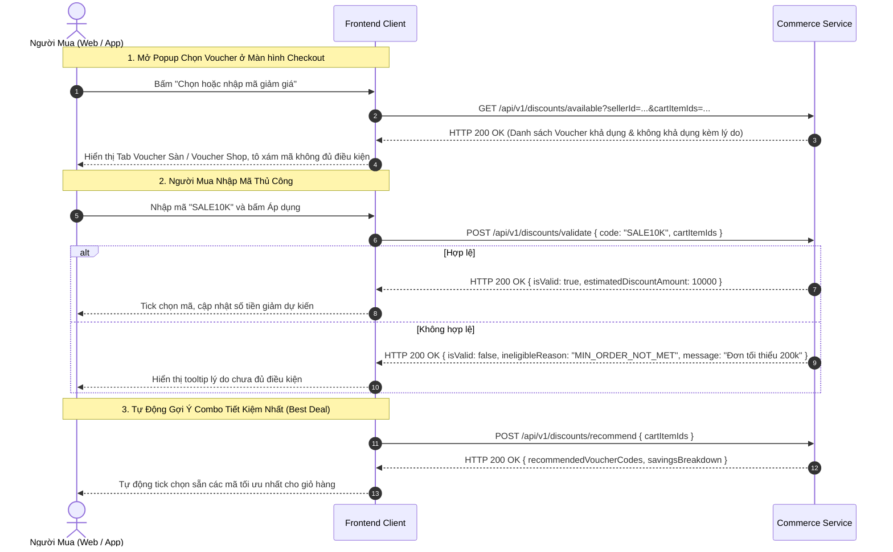

# LUỒNG 4: KHUYẾN MÃI & VOUCHER ĐA TẦNG (DISCOUNT & PROMOTION ENGINE)

> **Dành cho:** Web Client & Mobile App (Kênh Người Mua & Cổng Người Bán / Admin)  
> **Base Route:** `/api/v1/discounts`  
> **Xác thực:** Yêu cầu đăng nhập (`x-user-id`, role `buyer`, `seller`, `admin`, `staff`)  

---

## 1. TỔNG QUAN & QUY TẮC XẾP CHỒNG VOUCHER (VOUCHER STACKING)

Hệ thống hỗ trợ cơ chế áp dụng đồng thời nhiều loại voucher (Voucher Stacking) chuẩn sàn thương mại điện tử:
1. **Phạm vi Voucher (`DiscountScopeType`):**
   - **`Product` (Voucher Sản phẩm):** Giảm giá trên từng dòng sản phẩm cụ thể.
   - **`Shop` (Voucher Gian hàng):** Do Người bán tạo, áp dụng cho các sản phẩm thuộc Shop đó.
   - **`System` (Voucher Sàn):** Do Admin tạo, áp dụng toàn sàn hoặc trợ cấp phí vận chuyển / đơn hàng.
2. **Quy tắc Xếp Chồng (Stacking Hierarchy):**
   - Thứ tự tính chiết khấu: **Product Discount -> Shop Discount -> System Discount**.
   - Trên một đơn hàng, người mua có thể áp dụng đồng thời: 1 Voucher Shop cho mỗi Shop + 1 Voucher Toàn Sàn (hoặc Freeship toàn sàn).
3. **Cơ chế Gợi Ý Tối Ưu (Voucher Recommender):**
   - FE chỉ cần gửi danh sách `cartItemIds`, server tự động tính toán và trả về combo mã giảm giá giúp người mua tiết kiệm được nhiều tiền nhất.

---

## 2. SEQUENCE DIAGRAM TƯƠNG TÁC VOUCHER



---

## 3. DANH SÁCH CHI TIẾT CÁC API DÀNH CHO NGƯỜI MUA (BUYER)

### 3.1. Lấy Danh Sách Voucher Khả Dụng (UC-01)
- **Method / Path:** `GET /api/v1/discounts/available`
- **Quyền:** `buyer`
- **Query Params:**
  - `sellerId`: Lọc voucher của một Shop cụ thể (tùy chọn).
  - `cartItemIds`: Chuỗi các UUID phân cách bằng dấu phẩy (ví dụ: `id1,id2`) để server thẩm định điều kiện giỏ hàng.
  - `page`: Số trang (mặc định 1).
  - `pageSize`: Kích thước trang (mặc định 20).
- **Response (200 OK):**
```json
{
  "items": [
    {
      "id": "aaaa1111-bbbb-2222-cccc-3333dddd4444",
      "code": "SHOP10K",
      "name": "Giảm 10k cho đơn từ 150k",
      "scopeType": "Shop",
      "ownerSellerId": "88889999-aaaa-bbbb-cccc-ddddeeeeffff",
      "discountType": "FixedAmount",
      "discountValue": 10000.0,
      "minOrderAmount": 150000.0,
      "maxDiscountAmount": 10000.0,
      "isEligible": true,
      "ineligibleReason": null,
      "startsAt": "2026-11-01T00:00:00Z",
      "endsAt": "2026-12-31T23:59:59Z"
    },
    {
      "id": "bbbb2222-cccc-3333-dddd-4444eeee5555",
      "code": "FREESHIP50K",
      "name": "Miễn phí vận chuyển toàn sàn",
      "scopeType": "System",
      "ownerSellerId": null,
      "discountType": "FixedAmount",
      "discountValue": 50000.0,
      "minOrderAmount": 500000.0,
      "maxDiscountAmount": 50000.0,
      "isEligible": false,
      "ineligibleReason": "MIN_ORDER_NOT_MET",
      "startsAt": "2026-11-01T00:00:00Z",
      "endsAt": "2026-12-31T23:59:59Z"
    }
  ],
  "pagination": {
    "pageIndex": 1,
    "pageSize": 20,
    "totalCount": 2,
    "totalPages": 1
  }
}
```

---

### 3.2. Thẩm Định Một Mã Voucher (UC-02)
- **Method / Path:** `POST /api/v1/discounts/validate`
- **Quyền:** `buyer`
- **Request Body:**
```json
{
  "code": "SHOP10K",
  "cartItemIds": [
    "7b7a1234-abcd-4def-9012-1234567890ab"
  ]
}
```
- **Response Hợp Lệ (200 OK):**
```json
{
  "isValid": true,
  "discountId": "aaaa1111-bbbb-2222-cccc-3333dddd4444",
  "code": "SHOP10K",
  "scopeType": "Shop",
  "estimatedDiscountAmount": 10000.0,
  "ineligibleReason": null,
  "message": "Voucher áp dụng thành công."
}
```
- **Response Không Hợp Lệ (200 OK):**
```json
{
  "isValid": false,
  "discountId": null,
  "code": null,
  "scopeType": null,
  "estimatedDiscountAmount": 0.0,
  "ineligibleReason": "MIN_ORDER_NOT_MET",
  "message": "Đơn hàng chưa đạt giá trị tối thiểu 150.000đ để áp dụng mã này."
}
```

---

### 3.3. Gợi Ý Combo Voucher Tối Ưu Nhất (UC-03)
- **Method / Path:** `POST /api/v1/discounts/recommend`
- **Quyền:** `buyer`
- **Mô tả:** FE gọi API này khi mở màn hình Checkout để hệ thống tự động tính toán combo voucher tiết kiệm nhất.
- **Request Body:**
```json
{
  "cartItemIds": [
    "7b7a1234-abcd-4def-9012-1234567890ab",
    "8c8b2345-bcde-4efa-9012-2345678901bc"
  ]
}
```
- **Response (200 OK):**
```json
{
  "recommendedVoucherCodes": [
    "SHOP10K",
    "NEXUSVIP20"
  ],
  "savingsBreakdown": {
    "productDiscount": 0.0,
    "shopDiscount": 10000.0,
    "systemDiscount": 20000.0,
    "totalSavings": 30000.0
  }
}
```

---

## 4. DANH SÁCH CHI TIẾT CÁC API DÀNH CHO SELLER & ADMIN (QUẢN LÝ VOUCHER)

### 4.1. Tạo Voucher Khuyến Mãi Mới (UC-04)
- **Method / Path:** `POST /api/v1/discounts`
- **Quyền:** `seller` (chỉ tạo được `Shop` / `Product` voucher), `admin` (tạo được toàn bộ gồm `System`)
- **Request Body:**
```json
{
  "code": "SUMMER2026",
  "name": "Khuyến mãi chào hè",
  "scopeType": "Shop",
  "ownerSellerId": "88889999-aaaa-bbbb-cccc-ddddeeeeffff",
  "discountType": "Percentage",
  "discountValue": 10.0,
  "minOrderAmount": 200000.0,
  "maxDiscountAmount": 50000.0,
  "maxUsesTotal": 1000,
  "maxUsesPerUser": 1,
  "isVisible": true,
  "startsAt": "2026-06-01T00:00:00Z",
  "endsAt": "2026-06-30T23:59:59Z",
  "scopes": []
}
```
- **Response (201 Created):** Trả về `DiscountDetailResponse`.

---

### 4.2. Danh Sách & Lọc Voucher Khuyến Mãi (UC-05)
- **Method / Path:** `GET /api/v1/discounts`
- **Quyền:** `seller`, `admin`, `staff`
- **Query Params:** `page`, `pageSize`, `scopeType`, `status` (`Draft`, `Active`, `Inactive`, `Expired`), `search`, `ownerSellerId`
- **Response (200 OK):** Trả về danh sách voucher có phân trang.

---

### 4.3. Cập Nhật Metadata & Bật/Tắt Trạng Thái Voucher (UC-07 & UC-08)
- **Cập nhật thông tin:** `PUT /api/v1/discounts/{discountId}`
  ```json
  {
    "name": "Khuyến mãi chào hè - Cập nhật",
    "isVisible": true,
    "maxUsesPerUser": 2,
    "maxUsesTotal": 2000,
    "endsAt": "2026-07-15T23:59:59Z"
  }
  ```
- **Bật/Tắt trạng thái nhanh:** `PATCH /api/v1/discounts/{discountId}/status`
  ```json
  {
    "status": "Inactive"
  }
  ```
- **Xóa mềm Voucher:** `DELETE /api/v1/discounts/{discountId}` (HTTP 204 No Content).

---

## 5. BẢNG MÃ LÝ DO KHÔNG THỎA MÃN VOUCHER (`ReasonCode`)

| ReasonCode | Ý nghĩa hiển thị cho người mua |
|---|---|
| `NOT_FOUND` | Mã giảm giá không tồn tại trong hệ thống |
| `NOT_ACTIVE` | Mã giảm giá đang tạm thời bị khóa |
| `NOT_STARTED` | Chương trình khuyến mãi chưa tới ngày bắt đầu |
| `EXPIRED` | Mã giảm giá đã hết hạn sử dụng |
| `MIN_ORDER_NOT_MET` | Đơn hàng chưa đạt giá trị tối thiểu quy định |
| `USAGE_LIMIT_REACHED` | Mã giảm giá đã hết lượt sử dụng trên toàn hệ thống |
| `USER_LIMIT_REACHED` | Bạn đã sử dụng hết lượt cho phép của mã giảm giá này |
| `SCOPE_MISMATCH` | Mã giảm giá không áp dụng cho các sản phẩm trong giỏ hàng hiện tại |
