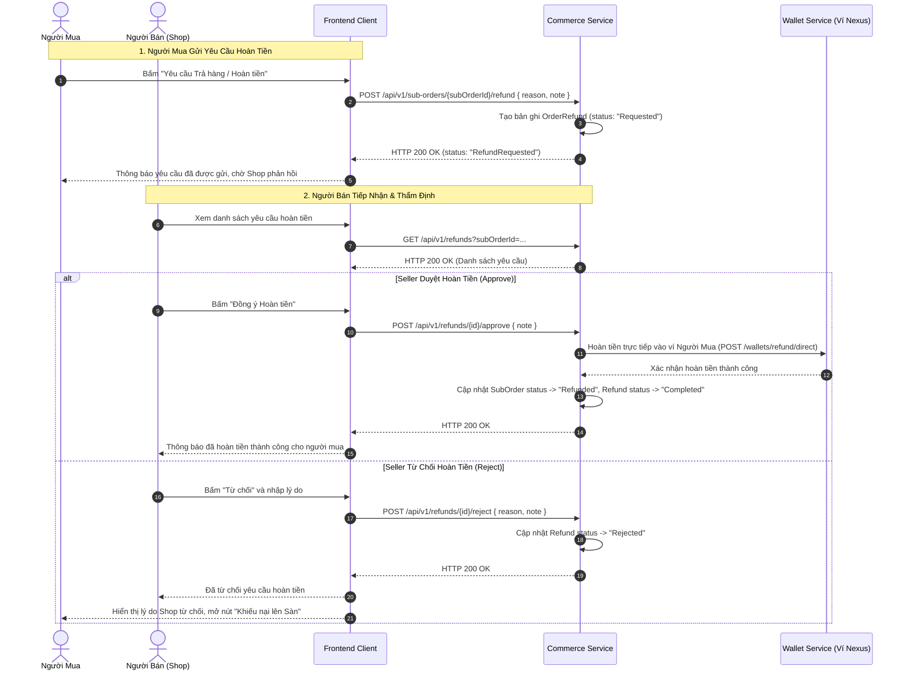

# LUỒNG 5: YÊU CẦU HOÀN TIỀN & XỬ LÝ TRANH CHẤP (REFUND & DISPUTE FLOW)

> **Dành cho:** Web Client & Mobile App (Kênh Người Mua & Cổng Người Bán / Admin)  
> **Base Routes:** `/api/v1/refunds`, `/api/v1/sub-orders/{id}/refund`  
> **Xác thực:** Yêu cầu đăng nhập (`x-user-id`, role `buyer`, `seller`, `admin`, `staff`)  

---

## 1. TỔNG QUAN & NGUYÊN TẮC HOÀN TIỀN

- **Phạm vi Hoàn tiền:**
  - Hoàn tiền được xử lý **theo từng Đơn hàng con (`SubOrder`)**, không hoàn gộp toàn bộ đơn cha.
  - Sau khi nhận hàng (`Delivered`), nếu hàng bị lỗi, thiếu hoặc không đúng mô tả, người mua có quyền gửi yêu cầu hoàn tiền.
- **Trách nhiệm Thẩm định:**
  - **Người bán (Seller):** Xem xét lý do, hình ảnh/video của người mua để bấm "Duyệt hoàn tiền" (`Approve`) hoặc "Từ chối" (`Reject`).
  - **Admin / Staff:** Có quyền can thiệp duyệt hoặc từ chối thay cho người bán trong trường hợp tranh chấp hoặc khiếu nại kéo dài.
- **Dòng Tiền Hoàn Trả (Refund Money Flow):**
  - Khi yêu cầu hoàn tiền được duyệt, CommerceService trực tiếp gọi `WalletService` để chuyển tiền từ quỹ Escrow hoặc ví hệ thống về lại Ví Nexus của người mua.
  - Số tiền hoàn trả được tính toán theo giá trị thực trả của đơn con (`SubOrder.TotalAmount`).

---

## 2. SEQUENCE DIAGRAM LUỒNG HOÀN TIỀN



---

## 3. DANH SÁCH CHI TIẾT CÁC API TRONG LUỒNG HOÀN TIỀN

### 3.1. Người Mua Gửi Yêu Cầu Hoàn Tiền Cho Đơn Con
- **Method / Path:** `POST /api/v1/sub-orders/{subOrderId}/refund`
- **Quyền:** `buyer`
- **Request Body:**
```json
{
  "reason": "Hàng bị rách và sai kích thước mô tả",
  "note": "Đã liên hệ shop nhưng không phản hồi, gửi kèm ảnh bằng chứng"
}
```
- **Response (200 OK):**
```json
{
  "subOrderId": "99998888-7777-6666-5555-444433332222",
  "status": "RefundRequested",
  "requestedAt": "2026-11-27T10:00:00Z"
}
```

---

### 3.2. Tra Cứu Danh Sách Yêu Cầu Hoàn Tiền
- **Method / Path:** `GET /api/v1/refunds`
- **Quyền:** `buyer`, `seller`, `admin`, `staff`
- **Query Params:**
  - `page`: Số trang (mặc định 1).
  - `pageSize`: Kích thước trang (mặc định 20).
  - `status`: Lọc theo trạng thái (`Requested`, `Completed`, `Rejected`, `WalletPending`, `Failed`).
  - `subOrderId`: Lọc theo đơn hàng con cụ thể (tùy chọn).
- **Response (200 OK):**
```json
{
  "items": [
    {
      "id": "ffff0000-1111-2222-3333-444455556666",
      "subOrderId": "99998888-7777-6666-5555-444433332222",
      "subOrderNo": "SUB-20261127-999988",
      "buyerId": "a1b2c3d4-e5f6-7a8b-9c0d-1e2f3a4b5c6d",
      "sellerId": "88889999-aaaa-bbbb-cccc-ddddeeeeffff",
      "amount": 472000.0,
      "reason": "Hàng bị rách và sai kích thước mô tả",
      "status": "Requested",
      "sellerNote": null,
      "rejectReason": null,
      "requestedAt": "2026-11-27T10:00:00Z",
      "completedAt": null
    }
  ],
  "pagination": {
    "pageIndex": 1,
    "pageSize": 20,
    "totalCount": 1,
    "totalPages": 1
  }
}
```

---

### 3.3. Tra Cứu Chi Tiết Một Yêu Cầu Hoàn Tiền
- **Method / Path:** `GET /api/v1/refunds/{id}`
- **Quyền:** `buyer`, `seller`, `admin`, `staff`
- **Response (200 OK):** Trả về `RefundDetailResponse` chi tiết.

---

### 3.4. Người Bán hoặc Admin Duyệt Hoàn Tiền (Approve Refund)
- **Method / Path:** `POST /api/v1/refunds/{id}/approve`
- **Quyền:** `seller`, `admin`, `staff`
- **Mô tả:** Duyệt hoàn tiền, hệ thống chuyển tiền ví cho người mua ngay lập tức.
- **Request Body:**
```json
{
  "note": "Đồng ý nhận lại hàng và hoàn tiền cho khách"
}
```
- **Response (200 OK):**
```json
{
  "id": "ffff0000-1111-2222-3333-444455556666",
  "subOrderId": "99998888-7777-6666-5555-444433332222",
  "status": "Completed",
  "amount": 472000.0,
  "completedAt": "2026-11-27T11:00:00Z"
}
```

---

### 3.5. Người Bán hoặc Admin Từ Chối Hoàn Tiền (Reject Refund)
- **Method / Path:** `POST /api/v1/refunds/{id}/reject`
- **Quyền:** `seller`, `admin`, `staff`
- **Request Body:**
```json
{
  "reason": "Sản phẩm gửi trả đã bị bóc seal và qua sử dụng",
  "note": "Đã kiểm tra video mở hộp"
}
```
- **Response (200 OK):**
```json
{
  "id": "ffff0000-1111-2222-3333-444455556666",
  "subOrderId": "99998888-7777-6666-5555-444433332222",
  "status": "Rejected",
  "rejectReason": "Sản phẩm gửi trả đã bị bóc seal và qua sử dụng"
}
```

---

### 3.6. Tra Cứu Toàn Bộ Lịch Sử Hoàn Tiền của Đơn Hàng Cha
- **Method / Path:** `GET /api/v1/orders/{orderId}/refunds`
- **Quyền:** `buyer`, `admin`, `staff`
- **Mô tả:** Liệt kê toàn bộ các biên bản hoàn tiền (của tất cả các đơn con) thuộc đơn hàng cha.
- **Response (200 OK):** Trả về mảng danh sách `OrderRefundResponse`.

---

## 4. MA TRẬN MÃ LỖI CHO MODULE HOÀN TIỀN

| HTTP Status | ErrorCode | Nguyên nhân | Hướng xử lý cho Frontend |
|---|---|---|---|
| `400` | `INVALID_STATUS` | Đơn hàng chưa giao (`Delivered`) nên chưa thể yêu cầu hoàn tiền | Chờ đơn giao thành công mới mở nút hoàn tiền |
| `400` | `ALREADY_REFUNDED` | Đơn hàng con này đã được hoàn tiền trước đó | Chặn gửi thêm yêu cầu, thông báo đã hoàn tiền |
| `403` | `FORBIDDEN` | Người dùng không phải là chủ sở hữu đơn hàng con này | Thông báo từ chối truy cập |
| `404` | `REFUND_NOT_FOUND` | Không tìm thấy biên bản hoàn tiền theo ID | Báo không tìm thấy bản ghi, tải lại trang |
