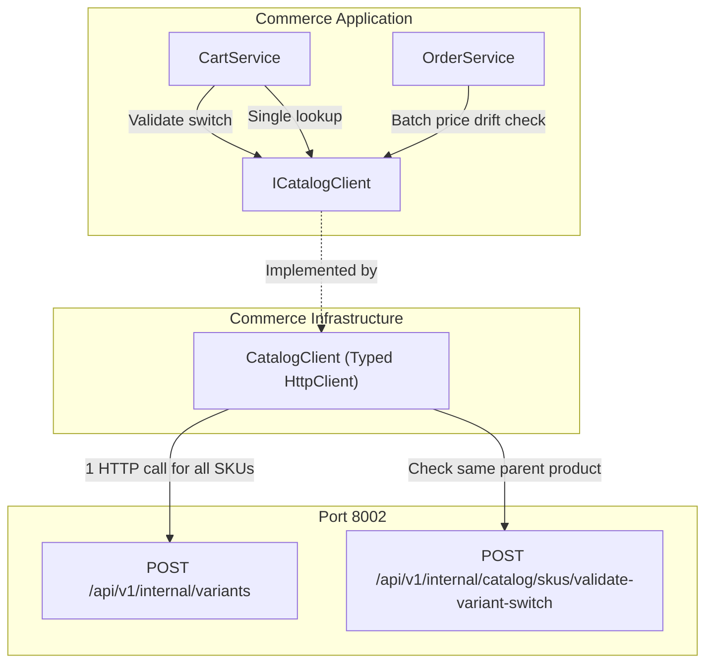

# Implementation Plan: Catalog Service Alignment & Batch Variant Optimization

**Feature Directory**: `specs/008-catalog-integration-alignment`  
**Prerequisites**: `spec.md`  

---

## 1. Architecture & Layer Mapping

---

## 2. File Modification & Creation Breakdown

### Phase 1: Application Contracts & Interfaces
- [`Commerce.Application/Interfaces/ICatalogClient.cs`](file:///d:/CommerceService/Commerce.Application/Interfaces/ICatalogClient.cs):
  - Add `CatalogSkuBatchRequest` and `CatalogSkuBatchResponse` DTO records.
  - Add `CatalogVariantSwitchResult` record (`bool IsValid, Guid ProductId, Guid SellerId, Guid NewSkuId, string NewSkuName, decimal NewUnitPrice, bool IsPurchasable, int WeightGrams`).
  - Add `Task<IReadOnlyDictionary<Guid, CatalogProductCheckResult>> GetSkuBatchDetailsAsync(IEnumerable<Guid> skuIds, CancellationToken cancellationToken = default);`
  - Add `Task<CatalogVariantSwitchResult> ValidateVariantSwitchAsync(Guid currentSkuId, Guid newSkuId, CancellationToken cancellationToken = default);`
  - Remove deprecated `ReserveStockAsync`.

### Phase 2: Infrastructure Implementation
- [`Commerce.Infrastructure/Services/Catalog/CatalogClient.cs`](file:///d:/CommerceService/Commerce.Infrastructure/Services/Catalog/CatalogClient.cs):
  - Implement `GetSkuBatchDetailsAsync`:
    - Chunk input `skuIds` by 100 items.
    - Call `POST api/v1/internal/variants` with `{ "variantIds": [...] }`.
    - Map response items into `CatalogProductCheckResult`:
      - `SkuId = item.VariantId`
      - `ProductId = item.ProductId`
      - `SellerId = item.SellerId`
      - `ProductName = item.ProductName`
      - `UnitPrice = item.Price`
      - `IsPurchasable = item.Status == "Active" && item.ProductStatus == "Active" && item.Price > 0`
    - Include graceful fallback in offline development mode.
  - Implement `GetSkuDetailsAsync(Guid skuId, ...)`:
    - Delegates to `GetSkuBatchDetailsAsync(new[] { skuId })`.
  - Implement `ValidateVariantSwitchAsync(Guid currentSkuId, Guid newSkuId, ...)`:
    - Call `POST api/v1/internal/catalog/skus/validate-variant-switch` with `{ currentSkuId, newSkuId }`.
    - Handle HTTP 400 `CATALOG_VARIANT_MISMATCH` and 404 `CATALOG_SKU_NOT_FOUND`.
  - Remove `ReserveStockAsync`.

### Phase 3: Application Services Optimization
- [`Commerce.Application/Services/Cart/CartService.cs`](file:///d:/CommerceService/Commerce.Application/Services/Cart/CartService.cs):
  - In `ChangeItemVariantAsync`:
    - First call `_catalogClient.ValidateVariantSwitchAsync(currentItem.SkuId, request.NewSkuId, cancellationToken)`.
    - If valid, check Fulfillment warehouse stock.
    - Update cart item with new SKU, new product name, and new unit price.
- [`Commerce.Application/Services/Order/OrderService.cs`](file:///d:/CommerceService/Commerce.Application/Services/Order/OrderService.cs):
  - In `CreateOrderAsync`:
    - Extract all unique `skuIds` from `cachedQuote.Response.Shops.SelectMany(s => s.Items.Select(i => i.SkuId))`.
    - Fetch all prices and status in 1 call: `await _catalogClient.GetSkuBatchDetailsAsync(allSkuIds, ct)`.
    - Eliminate the previous N+1 `foreach` calling `GetSkuDetailsAsync`.

### Phase 4: Verification & Test Updates
- Update Unit Tests:
  - `CartServiceTests.cs`: Update mock setups for `ValidateVariantSwitchAsync` and verify variant switch validations.
  - `OrderCheckoutTests.cs`, `OrderServiceTests.cs`, `EndToEndFlowTests.cs`, `ExternalClientFaultTests.cs`:
    - Update mocks to setup `GetSkuBatchDetailsAsync` and/or `GetSkuDetailsAsync`.
- Build & Run tests:
  - `dotnet build Commerce.sln -c Release`
  - `dotnet test tests/Commerce.UnitTests/Commerce.UnitTests.csproj -c Release`
