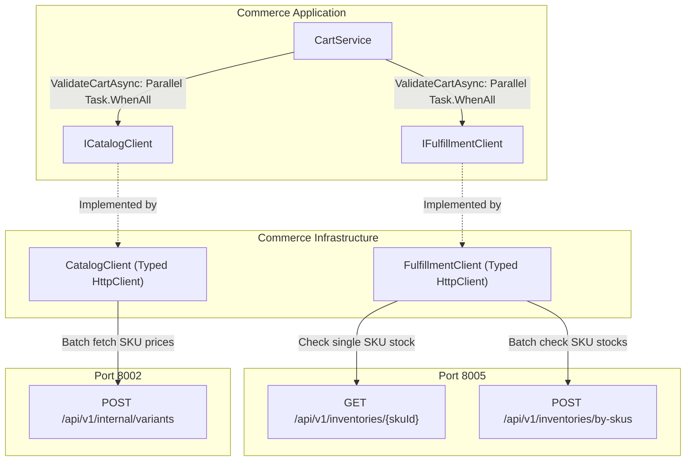

# Implementation Plan: Fulfillment Route Alignment and Cart Batch Optimization

**Feature Directory**: `specs/009-fulfillment-and-cart-optimization`  
**Prerequisites**: `spec.md`  

---

## 1. Architecture & Layer Mapping

---

## 2. File Modification & Creation Breakdown

### Phase 1: Infrastructure Fulfillment Client Alignment
- [`Commerce.Infrastructure/Services/Fulfillment/FulfillmentClient.cs`](file:///d:/CommerceService/Commerce.Infrastructure/Services/Fulfillment/FulfillmentClient.cs):
  - Refactor `CheckStockAvailabilityAsync`:
    - Update endpoint to `GET api/v1/inventories/{skuId}`.
    - Parse flexible inventory response: extract `availableStock`, `availableQuantity`, or `quantity - reservedQuantity`.
    - Compare `availableStock >= quantity`.
    - If `_failOpen == false` and connection fails/service unavailable, throw `CommerceDomainException("STOCK_CHECK_UNAVAILABLE", "Warehouse inventory service is temporarily unreachable.", 503)`.
  - Refactor `BatchCheckStockAsync`:
    - Update endpoint to `POST api/v1/inventories/by-skus` with body `{ "skuIds": skuIds }`.
    - Parse array of inventory items and map to `Dictionary<Guid, SkuStockCheckResult>`.
    - When `_failOpen == false` and request fails, throw `CommerceDomainException("STOCK_CHECK_UNAVAILABLE", ...)` with HTTP 503.

### Phase 2: Application CartService Concurrent Batch Optimization
- [`Commerce.Application/Services/Cart/CartService.cs`](file:///d:/CommerceService/Commerce.Application/Services/Cart/CartService.cs):
  - In `ValidateCartAsync`:
    - Extract distinct `skuIds` from `targetItems`.
    - Launch `stockTask = _fulfillmentClient.BatchCheckStockAsync(skuIds, cancellationToken)` and `catalogTask = _catalogClient.GetSkuBatchDetailsAsync(skuIds, cancellationToken)`.
    - Await both in parallel via `await Task.WhenAll(stockTask, catalogTask)`.
    - Eliminate the sequential `foreach` loop that previously called `GetSkuDetailsAsync` sequentially.
    - For each item in `targetItems`, retrieve SKU metadata from `catalogTask.Result` and stock from `stockTask.Result`.
    - Accurately append validation issues (`OUT_OF_STOCK`, `INSUFFICIENT_STOCK`, `PRICE_CHANGED`).

### Phase 3: Test Verification & Synchronization
- [`tests/Commerce.UnitTests/Application/CartServiceTests.cs`](file:///d:/CommerceService/tests/Commerce.UnitTests/Application/CartServiceTests.cs):
  - Ensure mock for `ICatalogClient.GetSkuBatchDetailsAsync` and `IFulfillmentClient.BatchCheckStockAsync` in `ValidateCartAsync` tests.
  - Verify concurrent execution and correct aggregation of issues.
- Solution build check:
  - `dotnet build Commerce.sln -c Release`
