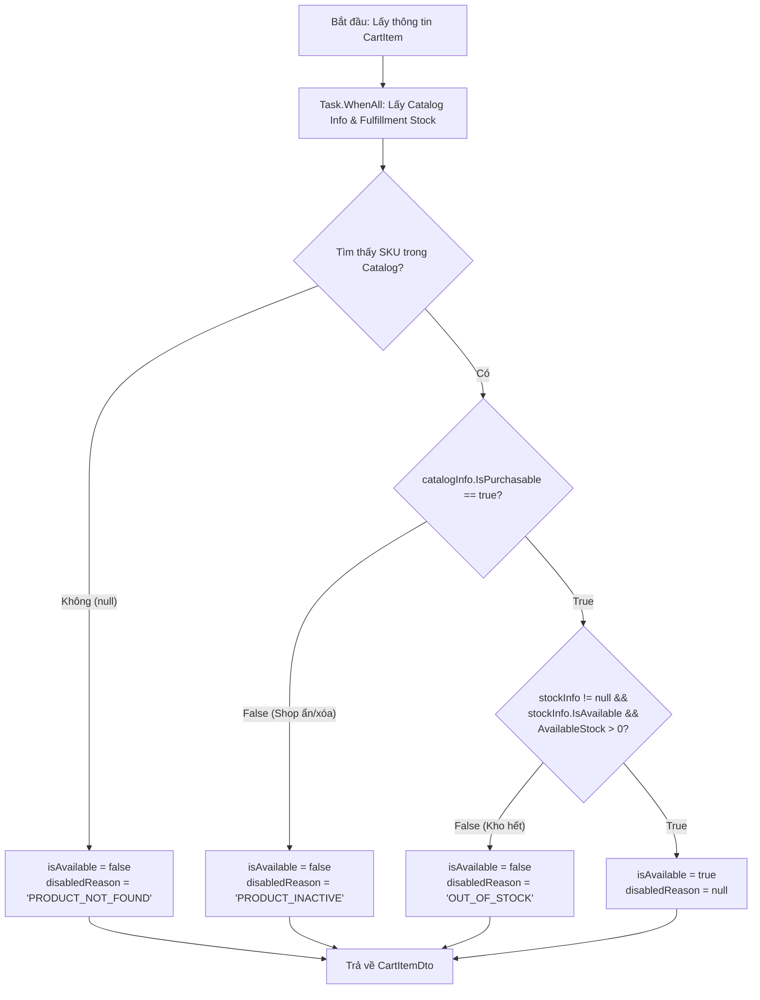

# Data Model & Contracts: Catalog and Commerce Contract Alignment

**Feature**: `specs/011-catalog-commerce-alignment`  
**Date**: 2026-11-03  
**Status**: APPROVED  

---

## 1. Outbound DTOs (Commerce $\rightarrow$ CatalogService Port 8002)

### 1.1. Batch Tra cứu Biến thể Sản phẩm (`POST /api/v1/internal/variants`)
- **Headers**:
  - `Content-Type: application/json`
  - `X-Internal-Service-Key: eaT0Ombups70WJzd85CBBpp8rAno55SxKn1qvYBGH9e`
- **Request Body (`BatchGetVariantsRequest`)**:
  ```json
  {
    "variantIds": [
      "3fa85f64-5717-4562-b3fc-2c963f66afa6",
      "7ca85f64-5717-4562-b3fc-2c963f66afa7"
    ]
  }
  ```
  *Quy tắc*: Danh sách tối đa 100 items mỗi request (tự động chunking nếu $>100$).

- **Response Body (`BatchVariantResponse` - HTTP 200 OK)**:
  ```json
  {
    "items": [
      {
        "variantId": "3fa85f64-5717-4562-b3fc-2c963f66afa6",
        "productId": "8fa85f64-5717-4562-b3fc-2c963f66afa1",
        "skuCode": "SKU-AO-NAM-01",
        "variantName": "Áo Sơ Mi Trắng - L",
        "productName": "Áo Sơ Mi Nam Oxford",
        "price": 250000.00,
        "currency": "VND",
        "status": "Active",
        "productStatus": "Active",
        "sellerId": "9fa85f64-5717-4562-b3fc-2c963f66afa9",
        "saleType": "Regular",
        "primaryImageUrl": "https://cdn.nexus.internal/img/shirt.jpg",
        "attributes": [
          { "attrName": "Color", "attrValue": "White" },
          { "attrName": "Size", "attrValue": "L" }
        ],
        "isPurchasable": true
      }
    ],
    "notFoundIds": []
  }
  ```

---

### 1.2. Xác thực Đổi Biến thể (`POST /api/v1/internal/catalog/skus/validate-variant-switch`)
- **Headers**:
  - `Content-Type: application/json`
  - `X-Internal-Service-Key: eaT0Ombups70WJzd85CBBpp8rAno55SxKn1qvYBGH9e`
- **Request Body (`ValidateVariantSwitchRequest`)**:
  ```json
  {
    "currentSkuId": "3fa85f64-5717-4562-b3fc-2c963f66afa6",
    "newSkuId": "4fa85f64-5717-4562-b3fc-2c963f66afa7"
  }
  ```

- **Response Body (`ValidateVariantSwitchResponse` - HTTP 200 OK)**:
  ```json
  {
    "isValid": true,
    "productId": "8fa85f64-5717-4562-b3fc-2c963f66afa1",
    "sellerId": "9fa85f64-5717-4562-b3fc-2c963f66afa9",
    "newSkuId": "4fa85f64-5717-4562-b3fc-2c963f66afa7",
    "newSkuName": "Áo Sơ Mi Trắng - XL",
    "newUnitPrice": 260000.00,
    "isPurchasable": true,
    "weightGrams": 200
  }
  ```

---

## 2. Internal Data Structures (CommerceService)

### 2.1. Cập nhật `CatalogClient.cs` (`Commerce.Infrastructure`)
```csharp
private sealed class CatalogVariantRawItem
{
    public Guid VariantId { get; set; }
    public Guid ProductId { get; set; }
    public string? VariantName { get; set; }
    public string? ProductName { get; set; }
    public decimal? Price { get; set; }        // Nullable decimal: Hỗ trợ đấu giá / bản nháp
    public string? Status { get; set; }
    public string? ProductStatus { get; set; }
    public Guid SellerId { get; set; }
    public bool IsPurchasable { get; set; }     // Nhận trực tiếp từ Catalog
}
```

### 2.2. Ánh xạ sang `CatalogProductCheckResult` (`Commerce.Application`)
```csharp
public sealed record CatalogProductCheckResult(
    Guid SkuId,
    Guid ProductId,
    Guid SellerId,
    string ProductName,
    decimal UnitPrice,           // Gán an toàn: item.Price ?? 0m
    bool IsPurchasable,          // Gán trực tiếp: item.IsPurchasable
    int StockQuantity = 100
);
```

### 2.3. Cấu trúc Trả về DTO Dòng Giỏ Hàng (`CartItemDto`)
```csharp
public sealed record CartItemDto(
    Guid Id,
    Guid ProductId,
    Guid SkuId,
    Guid SellerId,
    string ProductName,
    int Quantity,
    decimal UnitPriceSnapshot,
    decimal TotalAmount,
    DateTimeOffset AddedAt,
    bool IsAvailable = true,
    string? DisabledReason = null
);
```

---

## 3. Flowchart: Đánh Giá Tính Khả Dụng Dòng Giỏ Hàng (`Cart Gray-out`)


