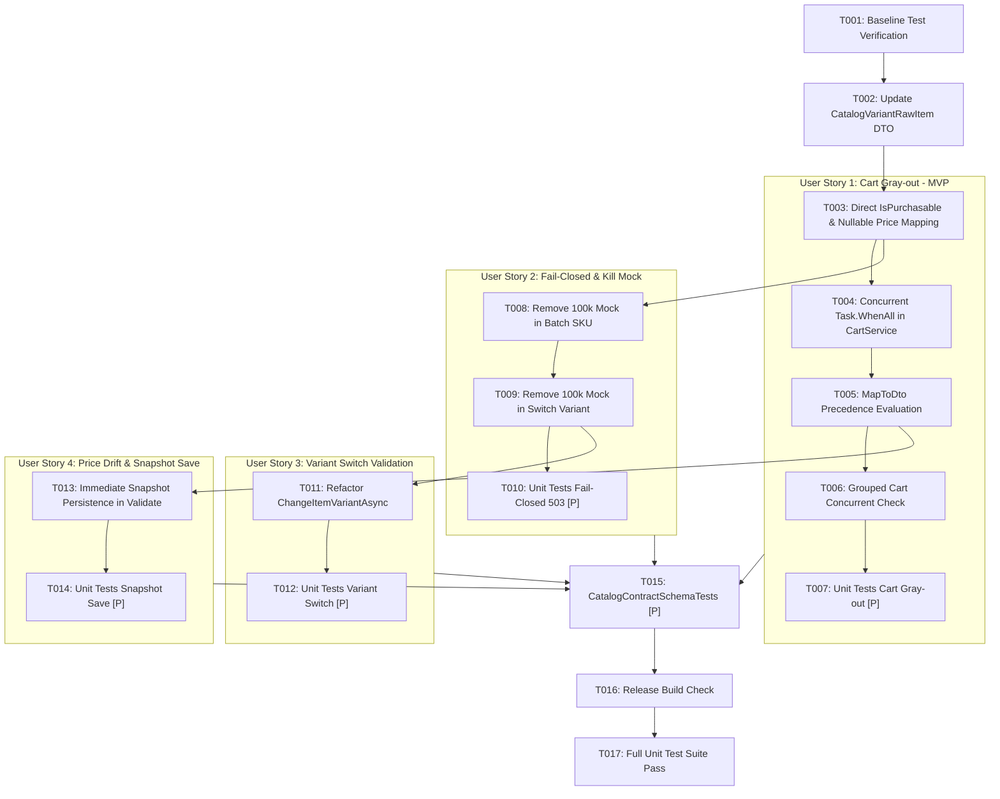

# Tasks: Catalog and Commerce Contract Alignment

**Feature Directory**: `specs/011-catalog-commerce-alignment`  
**Input**: Design documents from `specs/011-catalog-commerce-alignment/` (`spec.md`, `plan.md`, `research.md`, `data-model.md`, `contracts/`, `quickstart.md`)  
**Prerequisites**: `spec.md`, `plan.md`, `research.md`, `data-model.md`  

---

## Phase 1: Setup & Baseline

**Purpose**: Xác minh trạng thái ban đầu của hệ sinh thái kiểm thử trước khi thực hiện thay đổi mã nguồn.

- [x] T001 Baseline verification: run `dotnet test tests/Commerce.UnitTests/Commerce.UnitTests.csproj -c Release` to verify existing test suite passes before modifications

---

## Phase 2: Foundational (Core Client Contract & Model Alignment)

**Purpose**: Cập nhật DTO và phương thức ánh xạ dữ liệu nền tảng trong `CatalogClient.cs` làm cơ sở cho toàn bộ các User Stories.

- [x] T002 [US2] Update `CatalogVariantRawItem` in `Commerce.Infrastructure/Services/Catalog/CatalogClient.cs` to add `public bool IsPurchasable { get; set; }` and change `public decimal Price` to `public decimal? Price`
- [x] T003 [US2] Update `GetSkuBatchDetailsAsync` in `Commerce.Infrastructure/Services/Catalog/CatalogClient.cs` to map `bool isPurchasable = item.IsPurchasable` directly and `decimal unitPrice = item.Price ?? 0m`, removing local `item.Price > 0` condition

---

## Phase 3: User Story 1 - Tự động Làm Xám Món Hàng trong Giỏ Hàng (Priority: P1) 🎯 MVP

**Goal**: Khi người mua tải giỏ hàng (`GET /api/v1/carts/me`), hệ thống kiểm tra song song Catalog và Fulfillment để làm xám (`isAvailable: false`) các sản phẩm ngưng bán hoặc hết hàng.  
**Independent Test**: Thêm sản phẩm vào giỏ, đổi trạng thái bên Catalog sang `IsPurchasable = false`, gọi `GET /api/v1/carts/me` và xác nhận món hàng có `isAvailable: false` và `disabledReason: "PRODUCT_INACTIVE"`.

- [x] T004 [US1] Update `GetActiveCartByBuyerIdAsync` and `GetOrCreateActiveCartAsync` in `Commerce.Application/Services/Cart/CartService.cs` to execute concurrent check via `Task.WhenAll(_fulfillmentClient.BatchCheckStockAsync(skuIds, cancellationToken), _catalogClient.GetSkuBatchDetailsAsync(skuIds, cancellationToken))`
- [x] T005 [US1] Update `MapToDto` in `Commerce.Application/Services/Cart/CartService.cs` to accept `IReadOnlyDictionary<Guid, CatalogProductCheckResult>? catalogResults` and enforce precedence: `PRODUCT_NOT_FOUND` > `PRODUCT_INACTIVE` > `OUT_OF_STOCK`
- [x] T006 [US1] Update `GetGroupedCartAsync` in `Commerce.Application/Services/Cart/CartService.cs` to evaluate both stock and catalog status concurrently for grouped shop items
- [x] T007 [P] [US1] Add unit tests in `tests/Commerce.UnitTests/Application/CartServiceTests.cs` verifying `GetActiveCartByBuyerIdAsync` sets `isAvailable: false` and `disabledReason: "PRODUCT_INACTIVE"` when Catalog returns `IsPurchasable: false`

---

## Phase 4: User Story 2 - Tiêu Diệt Mock Fallback & Chịu Lỗi Fail-Closed (Priority: P1)

**Goal**: Loại bỏ hoàn toàn việc sinh giá ảo 100.000 VNĐ và `SellerId` giả lập khi CatalogService gặp lỗi; ném ngoại lệ RFC 9110 HTTP 503 `CATALOG_SERVICE_UNAVAILABLE`.  
**Independent Test**: Gọi `GetSkuBatchDetailsAsync` khi CatalogService trả về mã lỗi 500 hoặc rớt mạng; xác nhận ném `CommerceDomainException` với mã `CATALOG_SERVICE_UNAVAILABLE` (HTTP 503) mà không trả về dữ liệu mock.

- [x] T008 [US2] Remove mock fallback `100000m` and dummy seller ID from `GetSkuBatchDetailsAsync` in `Commerce.Infrastructure/Services/Catalog/CatalogClient.cs`, throwing `CommerceDomainException("CATALOG_SERVICE_UNAVAILABLE", "Product catalog service is temporarily unreachable.", 503)` on `!response.IsSuccessStatusCode` and network exceptions
- [x] T009 [US2] Remove mock fallback `100000m` from `ValidateVariantSwitchAsync` in `Commerce.Infrastructure/Services/Catalog/CatalogClient.cs`, throwing `CommerceDomainException("CATALOG_SERVICE_UNAVAILABLE", "Connection error communicating with product catalog service.", 503)` on network exceptions
- [x] T010 [P] [US2] Add unit tests in `tests/Commerce.UnitTests/Infrastructure/CatalogClientTests.cs` verifying `GetSkuBatchDetailsAsync` handles `price: null` safely, maps `IsPurchasable` directly, and throws 503 on HTTP 500 error

---

## Phase 5: User Story 3 - Xác Thực Chuyển Đổi Biến Thể Trong Giỏ Hàng (Priority: P2)

**Goal**: Xác thực tính hợp lệ của việc đổi biến thể (cùng sản phẩm cha, cùng shop) trực tiếp qua CatalogService, loại bỏ fallback mock trong `CartService`.  
**Independent Test**: Gọi đổi biến thể giữa 2 SKU khác sản phẩm cha; hệ thống từ chối với HTTP 400 `CATALOG_VARIANT_MISMATCH`.

- [x] T011 [US3] Refactor `ChangeItemVariantAsync` in `Commerce.Application/Services/Cart/CartService.cs` to remove fallback `GetSkuDetailsAsync` mock construction, directly enforcing `switchValidation.IsValid` and `switchValidation.IsPurchasable`
- [x] T012 [P] [US3] Add unit tests in `tests/Commerce.UnitTests/Infrastructure/CatalogClientTests.cs` verifying `ValidateVariantSwitchAsync` throws `CATALOG_VARIANT_MISMATCH` (400) when Catalog rejects switch

---

## Phase 6: User Story 4 - Biến Động Giá & Cập Nhật Tức Thì Snapshot (Priority: P2)

**Goal**: Khi người dùng validate giỏ hàng (`POST /api/v1/carts/me/validate`), tự động phát hiện biến động giá, lưu snapshot giá mới ngay vào database PostgreSQL và cảnh báo `PRODUCT_INACTIVE`.  
**Independent Test**: Cập nhật giá SKU trên Catalog, gọi `POST /api/v1/carts/me/validate`; xác nhận `UnitPriceSnapshot` trong bảng `CartItems` được cập nhật và response trả về issue tương ứng.

- [x] T013 [US4] Update `ValidateCartItemsAsync` in `Commerce.Application/Services/Cart/CartService.cs` to immediately persist `item.UnitPriceSnapshot = catalogSku.UnitPrice` and `item.UpdatedAt = DateTimeOffset.UtcNow` with `await _dbContext.SaveChangesAsync(cancellationToken)` when price difference is detected, and add `PRODUCT_INACTIVE` issue
- [x] T014 [P] [US4] Add unit tests in `tests/Commerce.UnitTests/Application/CartServiceTests.cs` verifying `ValidateCartAsync` commits updated snapshot prices to database and flags `PRODUCT_INACTIVE` items

---

## Phase 7: Polish & Verification

**Purpose**: Kiểm chứng toàn diện biên dịch, hợp đồng OpenAPI và bộ kiểm thử tự động.

- [x] T015 [P] Verify `CatalogContractSchemaTests` in `tests/Commerce.UnitTests/Contracts/CatalogContractSchemaTests.cs` passes 100% against `catalog_swagger.json`
- [x] T016 Execute full solution build with `dotnet build Commerce.sln -c Release` (0 warnings, 0 errors)
- [x] T017 Run full test suite with `dotnet test Commerce.sln -c Release` (100% pass rate)

---

## Dependencies & Execution Order

---

## Parallel Execution Opportunities

- **Unit Tests**: T007, T010, T012, T014, T015 can run in parallel or be authored in parallel with their respective service implementations.
- **US1 & US2 Implementation**: Once T002-T003 (Foundational) are complete, work on `CartService.cs` (US1) and `CatalogClient.cs` error handling (US2) can proceed independently.

---

## Implementation Strategy (MVP First)

1. **MVP Scope**: Complete Phase 1, Phase 2, and Phase 3 (T001 – T007).
   - Đạt được tính năng làm xám giỏ hàng (`Cart Gray-out`) chính xác theo trạng thái Catalog.
2. **Hardening**: Complete Phase 4 (T008 – T010) to completely eliminate 100k mock data and enforce fail-closed 503.
3. **Full Parity**: Complete Phase 5 (US3: Variant Switch) and Phase 6 (US4: Price Drift & Snapshot).
4. **Verification**: Complete Phase 7 (Build 0 errors, 100% tests pass).
