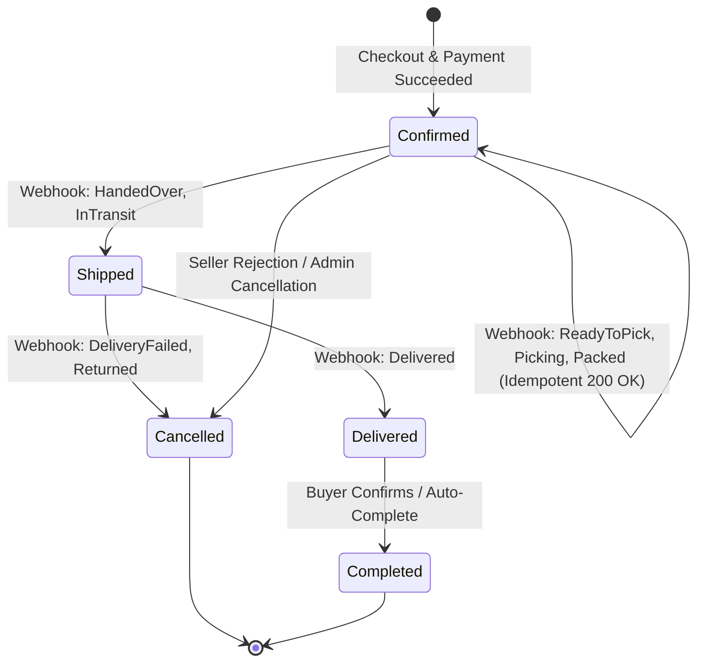
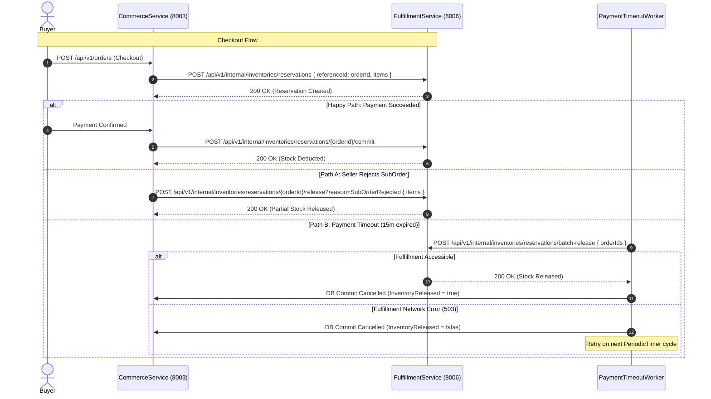

# Data Model & State Transitions: Fulfillment Integration Remediation

**Feature Directory**: `specs/012-commerce-fulfillment-remediation`  
**Phase**: Phase 1 (Data Design & Contracts)  
**Date**: 2026-11-04  

---

## 1. Domain Entities & Audit Records

### 1.1. SubOrder (`sub_orders`)
Represents the seller-specific order group created during checkout.

| Attribute | Type | Nullable | Description |
| :--- | :--- | :---: | :--- |
| `Id` | `Guid` | No | Primary Key |
| `OrderId` | `Guid` | No | Foreign Key to master `orders` |
| `SellerId` | `Guid` | No | ID of the shop/seller |
| `Status` | `SubOrderStatus` | No | Order lifecycle state (stored as string / enum) |
| `TotalAmount` | `decimal` | No | Total amount including shipping and items |
| `ShippedAt` | `DateTimeOffset?` | Yes | Recorded when carrier takes custody (`HandedOver`/`InTransit`) |
| `DeliveredAt` | `DateTimeOffset?` | Yes | Recorded on successful delivery (`Delivered`) |
| `CancelledAt` | `DateTimeOffset?` | Yes | Recorded on cancellation, rejection, or delivery failure |
| `UpdatedAt` | `DateTimeOffset` | No | Timestamp of the most recent state change |

### 1.2. OrderCancellation (`order_cancellations`)
Audit record tracking cancellations and inventory release status.

| Attribute | Type | Nullable | Description |
| :--- | :--- | :---: | :--- |
| `Id` | `Guid` | No | Primary Key |
| `SubOrderId` | `Guid` | No | Reference to `SubOrder` |
| `CancelledBy` | `Guid?` | Yes | User ID or null if initiated by system |
| `ActorRole` | `OrderActorRole` | No | `System`, `Seller`, or `Buyer` |
| `ReasonCode` | `string` | No | `PaymentTimeout`, `SELLER_REJECTED`, `DELIVERY_FAILED`, `PACKAGE_RETURNED` |
| `ReasonNote` | `string?` | Yes | Human-readable explanation |
| `WasPaid` | `bool` | No | Indicates whether payment was completed prior to cancellation |
| `InventoryReleased` | `bool` | No | **Resilience Flag**: `true` if inventory release succeeded; `false` if release failed and needs retry |
| `CreatedAt` | `DateTimeOffset` | No | Creation timestamp |

### 1.3. OrderRefund (`order_refunds`)
Financial record capturing refund obligations when paid orders are cancelled.

| Attribute | Type | Nullable | Description |
| :--- | :--- | :---: | :--- |
| `Id` | `Guid` | No | Primary Key |
| `SubOrderId` | `Guid` | No | Reference to `SubOrder` |
| `OrderId` | `Guid` | No | Reference to Master `Order` |
| `CancellationId` | `Guid` | No | Reference to `OrderCancellation` |
| `RefundType` | `RefundType` | No | `Full` or `Partial` |
| `Amount` | `decimal` | No | Amount to be reimbursed |
| `Status` | `RefundStatus` | No | `Requested` (reconciled through wallet workflows) |
| `ReasonCode` | `string` | No | Rejection or return reason code |
| `ReasonNote` | `string?` | Yes | Context note |
| `ActorRole` | `OrderActorRole` | No | Originating actor |
| `RequestedBy` | `Guid?` | Yes | ID of requesting actor |
| `RequestedAt` | `DateTimeOffset` | No | Timestamp of request |

---

## 2. State Transition Diagrams

### 2.1. SubOrder Delivery & Webhook Lifecycle



### 2.2. Master Order & Reservation Lifecycle



---

## 3. Inter-Service DTO Models

### 3.1. Outbound to FulfillmentService
```csharp
// POST /api/v1/internal/inventories/reservations/{orderId}/release?reason=SubOrderRejected
public sealed record PartialReservationReleaseRequest(
    List<StockReservationItem> Items);

public sealed record StockReservationItem(
    Guid SkuId,
    int Quantity,
    Guid? SellerId = null);

// POST /api/v1/internal/inventories/reservations/batch-release
public sealed record BatchReleaseStockRequest(
    List<Guid> OrderIds);

// POST /api/v1/shipments
public sealed record CreateShipmentRequest(
    Guid SubOrderId);

public sealed record ShipmentCreationResult(
    string TrackingCode,
    string CarrierCode,
    string LabelPrintUrl);
```

### 3.2. Inbound Webhook from FulfillmentService
```csharp
// POST /api/v1/sub-orders/{subOrderId}/delivery-status
public sealed record UpdateDeliveryStatusRequest(
    string Status,
    DateTimeOffset? DeliveredAt);
```
