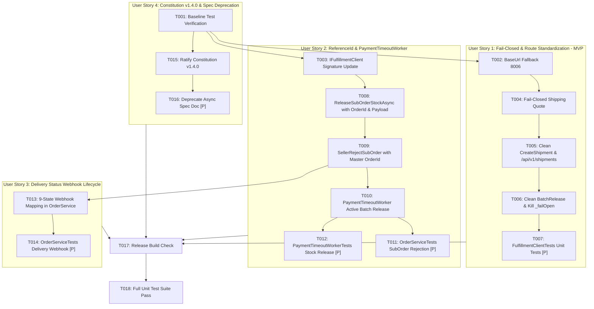

# Tasks: Fulfillment Integration Remediation and Architectural Alignment

**Feature Directory**: `specs/012-commerce-fulfillment-remediation`  
**Input**: Design documents from `specs/012-commerce-fulfillment-remediation/` (`spec.md`, `plan.md`, `research.md`, `data-model.md`, `contracts/`, `quickstart.md`)  
**Prerequisites**: `spec.md`, `plan.md`, `research.md`, `data-model.md`  

---

## Phase 1: Setup & Baseline

**Purpose**: Xác minh trạng thái ban đầu của hệ sinh thái kiểm thử trước khi thực hiện thay đổi mã nguồn.

- [x] T001 Baseline verification: run `dotnet test tests/Commerce.UnitTests/Commerce.UnitTests.csproj -c Release` to verify existing 96 tests pass before modifications

---

## Phase 2: Foundational (Core Configuration & Client Signature Alignment)

**Purpose**: Cập nhật cấu hình cổng kết nối và chữ ký interface nền tảng làm tiền đề cho các User Stories.

- [x] T002 [US1] Update BaseUrl fallback in `Commerce.Infrastructure/DependencyInjection.cs` from `http://localhost:8005/` to `http://localhost:8006/`
- [x] T003 [US2] Update `IFulfillmentClient` interface in `Commerce.Application/Interfaces/IFulfillmentClient.cs` to signature `ReleaseSubOrderStockAsync(Guid orderId, List<StockReservationItem> items, CancellationToken ct = default)`

---

## Phase 3: User Story 1 - Chuẩn hóa URI, Cổng Kết Nối & Áp Dụng Fail-Closed cho FulfillmentClient (Priority: P1) 🎯 MVP

**Goal**: Cập nhật `FulfillmentClient.cs` để gọi đúng các route REST (`/api/v1/fulfillment/shipping/quote`, `/api/v1/shipments`, `/api/v1/internal/inventories/reservations/batch-release`), loại bỏ hoàn toàn các fallback cước 30.000 VNĐ, mã tracking giả `GHN-...` và cờ `_failOpen`, ném lỗi chuẩn RFC 9110 HTTP 503 `FULFILLMENT_SERVICE_UNAVAILABLE`.  
**Independent Test**: Chạy unit tests trong `FulfillmentClientTests.cs` xác nhận khi Fulfillment trả về 500 hoặc mất mạng thì ném `CommerceDomainException` (HTTP 503), không trả về 30.000 VNĐ hoặc mã tracking giả.

- [x] T004 [US1] Update `CalculateShopShippingFeeAsync` in `Commerce.Infrastructure/Services/Fulfillment/FulfillmentClient.cs` to eliminate hardcoded `30000m` fallback, throwing `CommerceDomainException("FULFILLMENT_SERVICE_UNAVAILABLE", "Fulfillment service is temporarily unreachable for shipping fee calculation.", 503)` on network/5xx errors
- [x] T005 [US1] Update `CreateShipmentAsync` in `Commerce.Infrastructure/Services/Fulfillment/FulfillmentClient.cs` to standardize URI to `/api/v1/shipments` and eliminate fake `GHN-...` tracking code and PDF URL fallback, throwing `CommerceDomainException("FULFILLMENT_SERVICE_UNAVAILABLE", "Unable to create shipment with fulfillment service.", 503)` on failure
- [x] T006 [US1] Update `BatchReleaseStockAsync` in `Commerce.Infrastructure/Services/Fulfillment/FulfillmentClient.cs` to standardize URI to `/api/v1/internal/inventories/reservations/batch-release` and eliminate `_failOpen = true`, throwing `CommerceDomainException("STOCK_RELEASE_UNAVAILABLE", ..., 503)` on failure
- [x] T007 [P] [US1] Add unit tests in `tests/Commerce.UnitTests/Infrastructure/FulfillmentClientTests.cs` verifying port 8006 fallback, fail-closed 503 on shipping quote and shipment creation without dummy values, and batch release URI

---

## Phase 4: User Story 2 - Đồng Bộ Định Danh Giữ & Nhả Kho Theo Đơn Hàng (Priority: P1)

**Goal**: Khắc phục lệch định danh reservation giữa Checkout (`orderId`) và SubOrder rejection, và xóa bỏ giả định "Zero-HTTP call" trong `PaymentTimeoutWorker.cs` để chủ động giải phóng kho kèm cờ chịu lỗi `InventoryReleased = false`.  
**Independent Test**: Gọi `SellerRejectSubOrderAsync` xác nhận gửi `orderId` cùng items payload; chạy `PaymentTimeoutWorker` xác nhận gọi `BatchReleaseStockAsync` và lưu `InventoryReleased` tương ứng.

- [x] T008 [US2] Update `ReleaseSubOrderStockAsync` in `Commerce.Infrastructure/Services/Fulfillment/FulfillmentClient.cs` to call `POST /api/v1/internal/inventories/reservations/{orderId}/release?reason=SubOrderRejected` with `{ items: items }` JSON payload
- [x] T009 [US2] Refactor `SellerRejectSubOrderAsync` in `Commerce.Application/Services/Order/OrderService.cs` to call `_fulfillmentClient.ReleaseSubOrderStockAsync(so.OrderId, itemsToRelease, ct)` using Master `OrderId`
- [x] T010 [US2] Update `PaymentTimeoutWorker` in `Commerce.Api/Workers/PaymentTimeoutWorker.cs` to eliminate "Zero-HTTP" assumption, actively invoking `await fulfillmentClient.BatchReleaseStockAsync(orderIds, ct)` for expired orders, and setting `InventoryReleased = false` on `OrderCancellation` records when the call fails
- [x] T011 [P] [US2] Add unit tests in `tests/Commerce.UnitTests/Application/OrderServiceTests.cs` verifying `SellerRejectSubOrderAsync` releases stock using Master `OrderId`
- [x] T012 [P] [US2] Add unit tests in `tests/Commerce.UnitTests/Application/PaymentTimeoutWorkerTests.cs` verifying active `BatchReleaseStockAsync` invocation and `InventoryReleased = false` resilience flag on failure

---

## Phase 5: User Story 3 - Tiếp Nhận Đầy Đủ Toàn Bộ Vòng Đời Vận Chuyển Từ Webhook (Priority: P2)

**Goal**: Mở rộng `OrderService.UpdateSubOrderDeliveryStatusAsync` để tiếp nhận và xử lý đầy đủ 9 trạng thái giao hàng từ Fulfillment Webhook, ánh xạ `DeliveryFailed` và `Returned` sang `SubOrderStatus.Cancelled` kèm `OrderCancellation` và `OrderRefund` (Requested), và ném 400 `INVALID_DELIVERY_STATUS` nếu trạng thái không hợp lệ.  
**Independent Test**: Gửi webhook cho từng trạng thái (`Picking`, `HandedOver`, `InTransit`, `Delivered`, `DeliveryFailed`, `Returned`, `Cancelled`, `Invalid`) và xác nhận kết quả cập nhật entity và ném ngoại lệ tương ứng.

- [x] T013 [US3] Refactor `UpdateSubOrderDeliveryStatusAsync` in `Commerce.Application/Services/Order/OrderService.cs` to map 9 delivery states: idempotent 200 OK for `ReadyToPick`/`Picking`/`Packed`; `Shipped` and `ShippedAt` for `HandedOver`/`InTransit`/`Shipped`; `Delivered` and `DeliveredAt` for `Delivered`; `Cancelled` with `OrderCancellation` and `OrderRefund` (Requested) for `DeliveryFailed`/`Returned`; throw `INVALID_DELIVERY_STATUS` (400) on invalid values
- [x] T014 [P] [US3] Add unit tests in `tests/Commerce.UnitTests/Application/OrderServiceTests.cs` verifying `UpdateSubOrderDeliveryStatusAsync` transitions for all 9 states and rejection of unknown status codes

---

## Phase 6: User Story 4 - Vệ Sinh Kiến Trúc & Cập Nhật Hiến Pháp Spec-Kit v1.4.0 (Priority: P3)

**Goal**: Cập nhật `.specify/memory/constitution.md` lên v1.4.0 (bãi bỏ MassTransit/RabbitMQ Saga, ratify Synchronous Typed HTTP REST Orchestration) và deprecate `docs/COMMERCE_EVENTS_AND_ASYNC_SPEC.md`.  
**Independent Test**: Rà soát `constitution.md` có version 1.4.0 và spec async có banner Deprecated.

- [x] T015 [US4] Update `.specify/memory/constitution.md` to Version 1.4.0, replacing Principle II with "Synchronous Typed HTTP REST Orchestration & Transactional Compensation" and removing MassTransit Transactional Outbox requirements
- [x] T016 [P] [US4] Add deprecation notice banner to `docs/COMMERCE_EVENTS_AND_ASYNC_SPEC.md` linking to synchronous REST contracts in `docs/api_catalog.md`

---

## Phase 7: Polish & Verification

**Purpose**: Kiểm chứng toàn diện biên dịch, hợp đồng OpenAPI và bộ kiểm thử tự động.

- [x] T017 Execute full solution build with `dotnet build Commerce.sln -c Release` (0 warnings, 0 errors)
- [x] T018 Run full test suite with `dotnet test Commerce.sln -c Release` (100% pass rate across all unit & E2E tests)

---

## Dependencies & Execution Order

---

## Parallel Execution Opportunities

- **Unit Tests**: T007, T011, T012, T014 can be written and run in parallel alongside their respective service implementations.
- **US1 & US4**: Constitution update (US4) can proceed in parallel with client remediation (US1).
- **US2 & US3**: OrderService improvements (US2 and US3) can proceed sequentially or be batched logically.

---

## Implementation Strategy (MVP First)

1. **MVP Scope**: Complete Phase 1, Phase 2, and Phase 3 (T001 – T007).
   - Loại bỏ hoàn toàn cước ship giả 30k và tracking giả `GHN-...`, chuẩn hóa port `8006` và route `/api/v1/shipments`.
2. **Hardening**: Complete Phase 4 (T008 – T012).
   - Đồng bộ `orderId` cho SubOrder rejection và kích hoạt active batch release trong `PaymentTimeoutWorker`.
3. **Webhook Lifecycle & Governance**: Complete Phase 5 (US3: 9 delivery states) and Phase 6 (US4: Constitution v1.4.0).
4. **Verification**: Complete Phase 7 (0 errors, 0 warnings, 100% tests pass).
