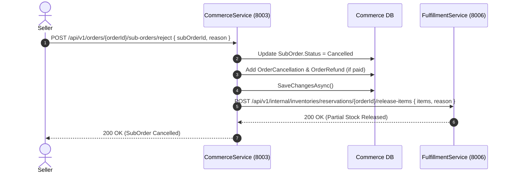
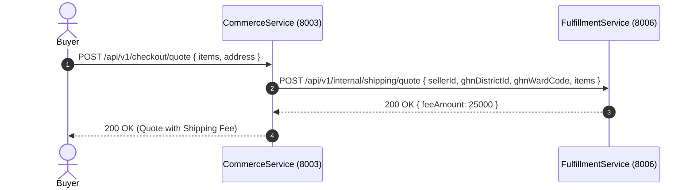
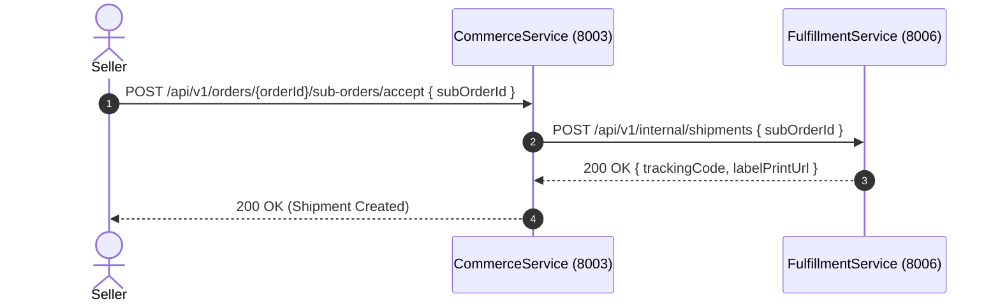

# Data Model & Interaction Contracts: Fulfillment Endpoint Alignment

**Feature Directory**: `specs/013-fulfillment-endpoint-alignment`  
**Phase**: Phase 1 (Data Model & Sequences)  
**Date**: 2026-11-04  

---

## 1. Outbound Request & Response DTOs

### 1.1. Partial Stock Release (`POST /api/v1/internal/inventories/reservations/{referenceId}/release-items`)

#### Request: `ReleaseReservationItemsRequest`
| Field | Type | Required | Description |
| :--- | :--- | :---: | :--- |
| `items` | `List<ReleaseReservationItem>` | Yes | Array of items to decrement from the reservation hold |
| `reason` | `string` | No | Rejection context (defaults to `"SubOrderRejected"`) |

#### Item: `ReleaseReservationItem`
| Field | Type | Required | Description |
| :--- | :--- | :---: | :--- |
| `skuId` | `Guid` | Yes | Unique identifier of the product variant |
| `quantity` | `int` | Yes | Quantity to release back to available stock |

#### Response: `ReleaseReservationResponse`
| Field | Type | Required | Description |
| :--- | :--- | :---: | :--- |
| `success` | `bool` | Yes | Indicates successful partial stock restoration |

---

### 1.2. Dynamic Shipping Quote (`POST /api/v1/internal/shipping/quote`)

#### Request: `ShopShippingQuoteRequest`
| Field | Type | Required | Description |
| :--- | :--- | :---: | :--- |
| `sellerId` | `Guid` | Yes | Identifier of the originating shop |
| `ghnDistrictId` | `int` | Yes | Carrier destination district code |
| `ghnWardCode` | `string` | Yes | Carrier destination ward code |
| `items` | `List<ShippingQuoteItem>` | Yes | Package items with physical weights |

#### Response: `ShippingQuoteResponse`
| Field | Type | Required | Description |
| :--- | :--- | :---: | :--- |
| `feeAmount` | `decimal` | Yes | Calculated shipping fee in VND |

---

### 1.3. Carrier Shipment Dispatch (`POST /api/v1/internal/shipments`)

#### Request: `CreateShipmentRequest`
| Field | Type | Required | Description |
| :--- | :--- | :---: | :--- |
| `subOrderId` | `Guid` | Yes | Target sub-order identifier |

#### Response: `ShipmentCreationResult`
| Field | Type | Required | Description |
| :--- | :--- | :---: | :--- |
| `trackingCode` | `string` | Yes | Active carrier tracking code (e.g., `GHN...`) |
| `carrierCode` | `string` | Yes | Carrier code (e.g., `GHN`) |
| `labelPrintUrl` | `string` | Yes | Printable package waybill URL |

---

## 2. Interaction Sequence Diagrams

### 2.1. Partial Stock Release Flow

### 2.2. Dynamic Shipping Quote Flow

### 2.3. Shipment Creation Flow

