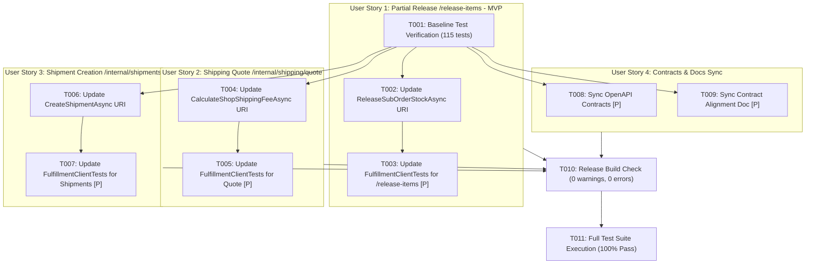

# Tasks: Fulfillment Service Internal REST Endpoint Alignment

**Feature Directory**: `specs/013-fulfillment-endpoint-alignment`  
**Input**: Design documents from `specs/013-fulfillment-endpoint-alignment/` (`spec.md`, `plan.md`, `research.md`, `data-model.md`, `contracts/`, `quickstart.md`)  
**Prerequisites**: `spec.md`, `plan.md`, `research.md`, `data-model.md`  

---

## Phase 1: Setup & Baseline

**Purpose**: Xác minh trạng thái ban đầu của hệ thống kiểm thử trước khi tiến hành cập nhật các đường dẫn REST.

- [x] T001 Baseline verification: run `dotnet test Commerce.sln -c Release` to confirm existing 115 tests pass before route modifications

---

## Phase 2: User Story 1 - Targeted Sub-Order Inventory Release via Dedicated Endpoint (Priority: P1) 🎯 MVP

**Goal**: Chuẩn hóa endpoint nhả kho từng phần khi người bán từ chối đơn hàng con sang `POST /api/v1/internal/inventories/reservations/{orderId}/release-items` với payload `{ items, reason: "SubOrderRejected" }`, bảo toàn phiếu giữ tồn kho của các shop khác.  
**Independent Test**: Chạy unit test `ReleaseSubOrderStockAsync_ShouldSendCorrectPayload_WithMasterOrderId` xác nhận HTTP POST gửi đến `/release-items` với danh sách items và reason.

- [x] T002 [US1] Update `ReleaseSubOrderStockAsync` in `Commerce.Infrastructure/Services/Fulfillment/FulfillmentClient.cs` to target `POST api/v1/internal/inventories/reservations/{orderId}/release-items` with payload `{ items = items.Select(x => new { skuId = x.SkuId, quantity = x.Quantity }).ToList(), reason = "SubOrderRejected" }`
- [x] T003 [P] [US1] Update unit test `ReleaseSubOrderStockAsync_ShouldSendCorrectPayload_WithMasterOrderId` in `tests/Commerce.UnitTests/Infrastructure/FulfillmentClientTests.cs` to verify `/release-items` endpoint and `{ items, reason }` JSON payload structure

---

## Phase 3: User Story 2 - Accurate Carrier Shipping Quotation via Internal Service Route (Priority: P1)

**Goal**: Chuẩn hóa endpoint tính cước vận chuyển động sang `POST /api/v1/internal/shipping/quote`, triệt tiêu hoàn toàn lỗi HTTP 404 Not Found và bảo đảm chính sách Fail-Closed RFC 9110 HTTP 503 khi gặp sự cố.  
**Independent Test**: Chạy unit test `CalculateShopShippingFeeAsync_ShouldReturnFee_WhenFulfillmentReturns200` xác nhận HTTP POST gửi đến `api/v1/internal/shipping/quote`.

- [x] T004 [US2] Update `CalculateShopShippingFeeAsync` in `Commerce.Infrastructure/Services/Fulfillment/FulfillmentClient.cs` to target `POST api/v1/internal/shipping/quote` (replacing legacy `api/v1/fulfillment/shipping/quote`)
- [x] T005 [P] [US2] Update unit test `CalculateShopShippingFeeAsync_ShouldReturnFee_WhenFulfillmentReturns200` in `tests/Commerce.UnitTests/Infrastructure/FulfillmentClientTests.cs` to verify `api/v1/internal/shipping/quote` route

---

## Phase 4: User Story 3 - Carrier Shipment Dispatch via Protected Internal Route (Priority: P1)

**Goal**: Chuẩn hóa endpoint tạo vận đơn giao hàng sang `POST /api/v1/internal/shipments`, hỗ trợ cơ chế chống trùng lũy đẳng của Fulfillment và loại bỏ dữ liệu giả lập.  
**Independent Test**: Chạy unit test `CreateShipmentAsync_ShouldCallShipmentsEndpointAndReturnResult_WhenSuccessful` xác nhận HTTP POST gửi đến `api/v1/internal/shipments`.

- [x] T006 [US3] Update `CreateShipmentAsync` in `Commerce.Infrastructure/Services/Fulfillment/FulfillmentClient.cs` to target `POST api/v1/internal/shipments` (replacing `api/v1/shipments`)
- [x] T007 [P] [US3] Update unit test `CreateShipmentAsync_ShouldCallShipmentsEndpointAndReturnResult_WhenSuccessful` in `tests/Commerce.UnitTests/Infrastructure/FulfillmentClientTests.cs` to verify `api/v1/internal/shipments` route

---

## Phase 5: User Story 4 - End-to-End Contract Consistency & Documentation Sync (Priority: P2)

**Goal**: Đồng bộ hóa OpenAPI 3.0 specification và tài liệu hợp đồng nội bộ khớp với 3 route chuẩn của Fulfillment Task F01–F08.  
**Independent Test**: Kiểm tra file hợp đồng `fulfillment-contracts.json` và bảng đối chiếu `FULFILLMENT_SERVICE_ALIGNMENT_CONTRACT.md` chứa đúng các route `/internal/`.

- [x] T008 [P] [US4] Synchronize OpenAPI route definitions in `specs/013-fulfillment-endpoint-alignment/contracts/fulfillment-contracts.json` for `/release-items`, `/internal/shipping/quote`, and `/internal/shipments`
- [x] T009 [P] [US4] Update integration contract reference in `docs/FULFILLMENT_SERVICE_ALIGNMENT_CONTRACT.md` noting the 3 standardized internal routes matching Fulfillment Tasks F01–F08

---

## Phase 6: Polish & Verification

**Purpose**: Kiểm chứng toàn diện biên dịch không lỗi và toàn bộ test suite đạt 100% pass rate.

- [x] T010 Execute full solution release build with `dotnet build Commerce.sln -c Release` (0 warnings, 0 errors)
- [x] T011 Run full automated test suite with `dotnet test Commerce.sln -c Release` (100% pass rate across all 115+ unit & integration tests)

---

## Dependencies & Execution Order

---

## Parallel Execution Opportunities

- **Unit Tests**: T003, T005, T007 can be executed alongside client code changes.
- **US4**: T008 and T009 (contract and documentation sync) can proceed in parallel with service client implementations.
- **US1, US2, US3**: Since each endpoint modifies distinct methods in `FulfillmentClient.cs`, changes can be batched cleanly or developed incrementally.

---

## Implementation Strategy (MVP First)

1. **Phase 1 & 2 (MVP Scope)**: Complete T001 – T003 (`ReleaseSubOrderStockAsync` -> `/release-items`).
   - Ngăn chặn nguy cơ nghiêm trọng nhất: nhả nhầm toàn bộ đơn hàng của các shop khác khi 1 shop từ chối đơn.
2. **Phase 3 & 4 (Routing Completeness)**: Complete T004 – T007 (`CalculateShopShippingFeeAsync` -> `/internal/shipping/quote`, `CreateShipmentAsync` -> `/internal/shipments`).
   - Xóa bỏ hoàn toàn lỗi 404 Not Found trên luồng checkout preview và seller order acceptance.
3. **Phase 5 & 6 (Hardening & Verification)**: Complete T008 – T011 (OpenAPI sync, build Release, full test suite pass).
