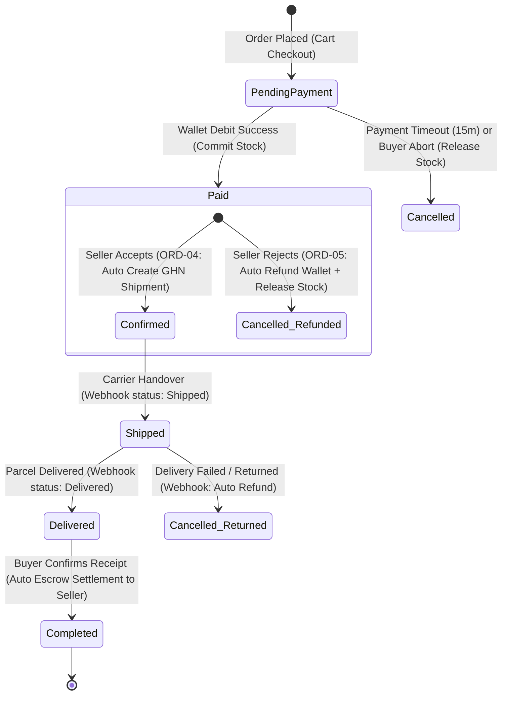

# Data Model & State Machine: Order Settlement, Automated Refund, and Seed Data Alignment

**Feature Directory**: `specs/014-order-settlement-and-refund-alignment`  
**Phase**: Phase 1 (Data Model & State Transitions)  
**Status**: Completed  

---

## 1. Domain Entities & Field Specifications

### 1.1 `SubOrder` (Entity Aggregate)
Represents a shop/vendor-specific order partitioned from the master `Order`.

| Field | Type | Constraints / Mapping | Description |
| :--- | :--- | :--- | :--- |
| `Id` | `Guid` | Primary Key | Unique sub-order identifier |
| `SubOrderNo` | `string` | Max(100), Unique Index | Human-readable order code (e.g. `SUB-20261106-001`) |
| `OrderId` | `Guid` | FK to `Orders.Id` | Master order parent identifier |
| `BuyerId` | `Guid` | Required | Customer user identifier |
| `SellerId` | `Guid` | Required, Index | Shop / Vendor merchant identifier |
| `Status` | `SubOrderStatus` | Enum (Integer in DB, PascalCase in JSON) | Current sub-order processing lifecycle state |
| `PaymentMethod` | `PaymentMethod` | Enum (`Wallet`, `Cod`) | Selected payment channel |
| `ShippingAddress` | `ShippingAddressSnapshot` | Value Object, `ToJson()` JSONB | Immutable snapshot of recipient delivery address |
| `ItemsAmount` | `decimal` | Precision(18,2) | Total sum of line items |
| `SellerReceiveAmount`| `decimal` | Precision(18,2) | Net payout due to seller upon order completion |
| `PaidAt` | `DateTimeOffset?` | Nullable | Timestamp when payment was verified |
| `SellerAcceptedAt` | `DateTimeOffset?` | Nullable | Timestamp when shop confirmed the order |
| `ShippedAt` | `DateTimeOffset?` | Nullable | Timestamp when carrier accepted parcel |
| `DeliveredAt` | `DateTimeOffset?` | Nullable | Timestamp when carrier confirmed drop-off |
| `CompletedAt` | `DateTimeOffset?` | Nullable | Timestamp when buyer confirmed receipt & escrow settled |
| `CancelledAt` | `DateTimeOffset?` | Nullable | Timestamp when sub-order was cancelled / rejected |
| `RowVersion` | `long` | Concurrency Token | Optimistic locking token |

---

### 1.2 `OrderRefund` (Financial Tracking Entity)
Tracks outbound refund requests and lifecycle states.

| Field | Type | Constraints / Mapping | Description |
| :--- | :--- | :--- | :--- |
| `Id` | `Guid` | Primary Key | Unique refund record identifier |
| `SubOrderId` | `Guid?` | FK to `SubOrders.Id` | Associated sub-order |
| `OrderId` | `Guid?` | FK to `Orders.Id` | Associated master order |
| `CancellationId` | `Guid?` | FK to `OrderCancellations.Id` | Associated cancellation record |
| `RefundType` | `RefundType` | Enum (`Full`, `Partial`) | Refund scope |
| `Amount` | `decimal` | Precision(18,2) | Refund monetary value |
| `Status` | `RefundStatus` | Enum (`Requested`, `Completed`, `Failed`) | State of refund transaction |
| `ReasonCode` | `string` | Required | Machine-readable reason code (`SELLER_REJECTED`, `PACKAGE_RETURNED`) |
| `ReasonNote` | `string?` | Nullable | Human-readable description |
| `ActorRole` | `OrderActorRole` | Enum (`Buyer`, `Seller`, `System`, `Admin`) | Initiating actor |
| `RequestedBy` | `Guid?` | Nullable | User ID of the initiator |
| `WalletTransactionId`| `Guid?` | Nullable | Wallet transaction ID confirming the credit |
| `RequestedAt` | `DateTimeOffset` | Default `UtcNow` | Initiation timestamp |
| `CompletedAt` | `DateTimeOffset?` | Nullable | Fulfillment timestamp |

---

## 2. Finite State Machine (SubOrder Lifecycle)



### Valid Status Transitions:
1. `PendingPayment` $\rightarrow$ `Paid` (Trigger: `_walletClient.PayOrderAsync` succeeds)
2. `Paid` $\rightarrow$ `Confirmed` (Trigger: `POST /api/v1/orders/{orderId}/accept`)
3. `Paid` $\rightarrow$ `Cancelled` (Trigger: `POST /api/v1/orders/{orderId}/reject` $\rightarrow$ Auto-Refund + Release Stock)
4. `Confirmed` $\rightarrow$ `Shipped` (Trigger: Fulfillment Webhook `Shipped`)
5. `Shipped` $\rightarrow$ `Delivered` (Trigger: Fulfillment Webhook `Delivered`)
6. `Delivered` $\rightarrow$ `Completed` (Trigger: `POST /api/v1/sub-orders/{subOrderId}/confirm-receipt` $\rightarrow$ Auto-Settle)
7. `Shipped` $\rightarrow$ `Cancelled` (Trigger: Fulfillment Webhook `DeliveryFailed` / `Returned` $\rightarrow$ Auto-Refund)

---

## 3. Data Transfer Objects (DTOs)

### 3.1 `SubOrderSummaryResponse`
```csharp
public sealed record SubOrderSummaryResponse(
    Guid SubOrderId,
    string SubOrderNo,
    Guid OrderId,
    Guid BuyerId,
    Guid SellerId,
    string Status,
    string PaymentMethod,
    decimal ItemsAmount,
    decimal ShippingFeeAmount,
    decimal TotalAmount,
    decimal SellerReceiveAmount,
    int ItemCount,
    DateTimeOffset CreatedAt,
    DateTimeOffset? SellerAcceptedAt,
    DateTimeOffset? ShippedAt,
    DateTimeOffset? DeliveredAt,
    DateTimeOffset? CompletedAt,
    DateTimeOffset? CancelledAt
);
```

### 3.2 `ConfirmReceiptResponse`
```csharp
public sealed record ConfirmReceiptResponse(
    Guid SubOrderId,
    string Status,
    DateTimeOffset CompletedAt,
    bool EscrowSettled,
    decimal AmountSettled
);
```
