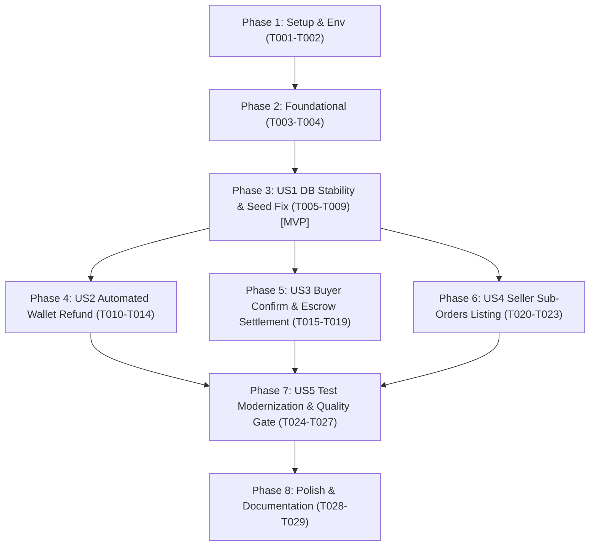

# Tasks: Order Settlement, Automated Refund, and Seed Data Alignment

**Input**: Design documents from `/specs/014-order-settlement-and-refund-alignment/`  
**Prerequisites**: `plan.md` (required), `spec.md` (required), `research.md`, `data-model.md`, `contracts/`, `quickstart.md`  
**Tests**: Automated Unit & E2E tests are required per Constitution Principle V and Quality Gate DoD.  
**Organization**: Tasks are grouped by phase and user story to enable independent implementation and testing.

## Format: `[TaskID] [P?] [Story?] Description with file path`

- **[P]**: Can run in parallel (different files, no blocking dependencies)
- **[Story]**: User story identifier ([US1], [US2], [US3], [US4], [US5])
- Exact file paths are specified for every task.

---

## Phase 1: Setup & Environment Alignment

**Purpose**: Configuration synchronization and build baseline verification.

- [X] T001 [P] Add `FULFILLMENT_SERVICE_URL: "${FULFILLMENT_SERVICE_URL:-http://fulfillment-service:8006}"` to docker-compose.yml
- [X] T002 [P] Verify baseline compilation with `dotnet build Commerce.sln -c Release`

---

## Phase 2: Foundational (Blocking Prerequisites)

**Purpose**: Shared interfaces and contract DTOs required across user stories.

- [X] T003 [P] Add `SettleSellerSubOrderAsync` contract and update refund signatures with idempotency keys in Commerce.Application/Interfaces/IWalletClient.cs
- [X] T004 [P] Define `SubOrderSummaryResponse` and `ConfirmReceiptResponse` records in Commerce.Application/Services/Order/OrderResponses.cs

**Checkpoint**: Foundation ready - User Story implementation can begin.

---

## Phase 3: User Story 1 - Database Stability: CartItem Tracking & SubOrder JSON Seed Fix (Priority: P1) 🎯 MVP

**Goal**: Ensure `CartItem` additions are reliably tracked and persisted by EF Core, and eliminate `HasData` JSON mapping conflicts during migrations.  
**Independent Test**: Add new item to cart via `POST /api/v1/carts/me/items` and verify persistence in `CartItems`; run database migration without `InvalidOperationException` on JSON-mapped `ShippingAddress`.

- [X] T005 [US1] Explicitly track new items via `_dbContext.CartItems.Add(newItem)` when not in `Local` inside `AddItemAsync` in Commerce.Application/Services/Cart/CartService.cs
- [X] T006 [US1] Remove `SeedOrders(modelBuilder)` invocation from `SeedAll(...)` in Commerce.Infrastructure/Persistence/Seeds/CommerceSeedData.cs
- [X] T007 [US1] Add migration `20261106065814_FixSubOrderJsonSeed.cs` and `.Designer.cs` in Commerce.Infrastructure/Persistence/Migrations/
- [X] T008 [US1] Synchronize model snapshot to remove hardcoded order seed entries in Commerce.Infrastructure/Persistence/Migrations/AppDbContextModelSnapshot.cs
- [X] T009 [US1] Update and verify cart item persistence test in tests/Commerce.UnitTests/Application/CartServiceTests.cs

**Checkpoint**: User Story 1 complete. Database migrations and cart item persistence are 100% stable.

---

## Phase 4: User Story 2 - Automated Wallet Refund on Order Rejection and DB Failure (Priority: P1)

**Goal**: Automatically refund buyer balance via WalletService upon seller order rejection or DB persistence failure instead of flagging for manual processing.  
**Independent Test**: Reject paid sub-order via `POST /api/v1/orders/{orderId}/reject` and verify outbound call targets Wallet refund API, `OrderRefund.Status` is `Completed`, and only rejected SKUs are released from stock.

- [X] T010 [P] [US2] Implement live HTTP POST call to `api/v1/wallets/orders/{orderId}/refund` with Bearer JWT propagation and `Idempotency-Key` in Commerce.Infrastructure/Services/Wallet/WalletClient.cs
- [X] T011 [US2] Update `SellerRejectSubOrderAsync` to invoke `_walletClient.RefundSubOrderPaymentAsync` when `wasPaid == true` and mark `refund.Status = RefundStatus.Completed` in Commerce.Application/Services/Order/OrderService.cs
- [X] T012 [US2] Verify and enforce targeted stock release for only the rejected SubOrder's items via `_fulfillmentClient.ReleaseSubOrderStockAsync` in Commerce.Application/Services/Order/OrderService.cs
- [X] T013 [US2] Ensure database compensation circuit invokes `_walletClient.RefundOrderPaymentAsync` with idempotency key `compensation-db-{orderId}` in Commerce.Application/Services/Order/OrderService.cs
- [X] T014 [US2] Update test assertions in tests/Commerce.UnitTests/Application/OrderLifecycleTests.cs to verify `_mockWalletClient.RefundSubOrderPaymentAsync` is called and `OrderRefund.Status == RefundStatus.Completed`

**Checkpoint**: User Story 2 complete. Automated refund lifecycle verified end-to-end.

---

## Phase 5: User Story 3 - Buyer Goods Receipt Confirmation & Seller Escrow Settlement (Priority: P1)

**Goal**: Allow buyers to confirm receipt of delivered goods (`Delivered` -> `Completed`) and automatically trigger escrow payout to the seller's wallet.  
**Independent Test**: Call `POST /api/v1/sub-orders/{subOrderId}/confirm-receipt` as authenticated buyer on delivered order; verify `SubOrder.Status` transitions to `Completed` and outbound HTTP call settles funds to seller.

- [X] T015 [P] [US3] Implement `SettleSellerSubOrderAsync` targeting `POST api/v1/wallets/sub-orders/{subOrderId}/settle` with Bearer JWT propagation and `Idempotency-Key: settle-{subOrderId}` in Commerce.Infrastructure/Services/Wallet/WalletClient.cs
- [X] T016 [US3] Declare `BuyerConfirmSubOrderReceiptAsync` use case in Commerce.Application/Services/Order/IOrderService.cs
- [X] T017 [US3] Implement `BuyerConfirmSubOrderReceiptAsync` with buyer ownership guard, `Delivered`/`Shipped` status check, status transition to `Completed`, and escrow settlement call in Commerce.Application/Services/Order/OrderService.cs
- [X] T018 [US3] Expose `POST /api/v1/sub-orders/{subOrderId:guid}/confirm-receipt` endpoint in Commerce.Api/Controllers/Public/OrdersController.cs
- [X] T019 [US3] Add unit test suite for buyer receipt confirmation and settlement in tests/Commerce.UnitTests/Application/OrderLifecycleTests.cs

**Checkpoint**: User Story 3 complete. Complete order fulfillment and financial settlement loop closed.

---

## Phase 6: User Story 4 - Seller Sub-Orders Listing with Database Pagination (Priority: P1)

**Goal**: Provide merchants with a dedicated REST query endpoint to view sub-orders placed at their shop, with database pagination and status filtering.  
**Independent Test**: Request `GET /api/v1/sub-orders?page=1&pageSize=20&status=Paid` with seller credentials; assert database query applies `.Skip().Take()` and returns `PagedData<SubOrderSummaryResponse>`.

- [X] T020 [P] [US4] Declare `ListSellerSubOrdersAsync` use case in Commerce.Application/Services/Order/IOrderService.cs
- [X] T021 [US4] Implement `ListSellerSubOrdersAsync` filtering by `s.SellerId == sellerId`, optional status, sorting by `CreatedAt DESC`, and database pagination via `Skip/Take` in Commerce.Application/Services/Order/OrderService.cs
- [X] T022 [US4] Expose `GET /api/v1/sub-orders` endpoint with role check and `this.TryGetUserId()` in Commerce.Api/Controllers/Public/OrdersController.cs
- [X] T023 [US4] Add unit tests for seller sub-orders listing and pagination in tests/Commerce.UnitTests/Application/OrderServiceTests.cs

**Checkpoint**: User Story 4 complete. Merchant order management endpoint operational.

---

## Phase 7: User Story 5 - Test Modernization, Error Governance & Verification (Priority: P2)

**Goal**: Update automated test suites to match new behaviors, enforce 100% English Sentence-case error messages, and achieve a 100% test pass rate.  
**Independent Test**: Execute `dotnet test Commerce.sln -c Release` and confirm 100% tests pass with 0 failures.

- [X] T024 [P] [US5] Audit all domain and validation error messages across modified services to guarantee 100% English Sentence-case and `SCREAMING_SNAKE_CASE` error codes in Commerce.Application/Services/Order/OrderService.cs
- [X] T025 [US5] Update `E2E_Flow8` in tests/Commerce.UnitTests/Application/EndToEndFlowTests.cs to assert `refund.Status.Should().Be(RefundStatus.Completed)` upon seller rejection
- [X] T026 [US5] Add `E2E_Flow9_BuyerConfirmReceiptAndEscrowSettlement` in tests/Commerce.UnitTests/Application/EndToEndFlowTests.cs testing trọn vẹn luồng từ đặt hàng đến giải ngân
- [X] T027 [US5] Run `dotnet test Commerce.sln -c Release` and confirm 100% pass rate

---

## Phase 8: Polish & Cross-Cutting Concerns

**Purpose**: Documentation synchronization and final compilation quality gate.

- [X] T028 [P] Update API contract documentation for new endpoints in docs/COMMERCE_API_CONTRACT.md
- [X] T029 Execute full compilation quality gate check with `dotnet build Commerce.sln -c Release` (assert 0 errors, 0 warnings)

---

## Dependencies & Execution Order

### Phase Dependencies

### Parallel Opportunities

- **Phase 1**: T001 (`docker-compose.yml`) and T002 (`dotnet build`) can run independently.
- **Phase 2**: T003 (`IWalletClient.cs`) and T004 (`OrderResponses.cs`) can run in parallel.
- **Across User Stories**: Once Phase 2 (Foundational) and Phase 3 (US1 DB Stability) are complete:
  - US2 (Refund), US3 (Settlement), and US4 (Seller Query) modify separate methods and can be developed concurrently.
- **Within Stories**:
  - T010 (`WalletClient.cs`) runs in parallel with T003.
  - T015 (`WalletClient.cs`) runs in parallel with T010.
  - T020 (`IOrderService.cs`) runs in parallel with T016.

---

## Implementation Strategy

### MVP First (User Story 1 Only)
1. Complete Phase 1 (Setup) and Phase 2 (Foundational).
2. Complete Phase 3 (US1: CartItem tracking & SubOrder seed migration fix).
3. **STOP and VALIDATE**: Run `dotnet build Commerce.sln -c Release` and verify migration cleanliness.

### Incremental Delivery (Stories 2 $\rightarrow$ 3 $\rightarrow$ 4 $\rightarrow$ 5)
1. Foundation + US1 $\rightarrow$ Cart & DB ready (MVP).
2. US2 $\rightarrow$ Automated refunds active; seller rejection protects buyer funds.
3. US3 $\rightarrow$ Buyer confirmation active; closed escrow payout loop for merchants.
4. US4 $\rightarrow$ Seller order portal enabled with database pagination.
5. US5 + Polish $\rightarrow$ 100% test coverage, English Sentence-case verification, clean release build.
