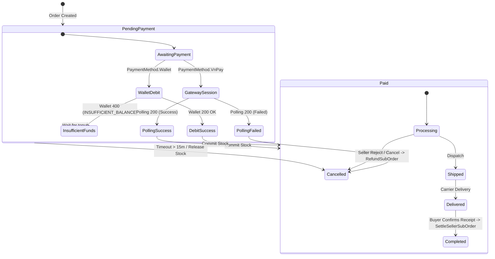

# Data Model & DTO Specification: WalletService Integration Alignment

**Feature Branch**: `017-wallet-contract-alignment`  
**Date**: 2026-11-10  
**Status**: Completed  

---

## 1. Domain Entities & Database Persistence

This feature requires zero schema migrations; existing database entities in `commerce_db:5435` already possess the necessary fields.

### 1.1. Entity: `Order` (`orders` table)
Represents the checkout group master record.

| Field Name | Type | Nullable | Description |
| :--- | :--- | :---: | :--- |
| `id` | `uuid` (Guid) | No | Primary Key; acts as the primary idempotency anchor for WalletService. |
| `buyer_id` | `uuid` (Guid) | No | Owner of the order; passed in `x-user-id` header to WalletService. |
| `status` | `integer` (`OrderStatus`) | No | State machine: `PendingPayment(0)` $\rightarrow$ `Paid(2)` $\rightarrow$ `Cancelled(3)`. |
| `total_amount` | `numeric(18,2)` | No | Grand total in VND debited from buyer or paid via VNPay. |
| `payment_method` | `integer` (`PaymentMethod`) | No | `Wallet(0)`, `VnPay(1)`, `Cod(2)`. |
| `payment_deadline_at`| `timestamp with time zone` | No | Deadline for payment (created_at + 15 minutes). |
| `wallet_transaction_id`| `uuid` (Guid) | Yes | Transaction ID returned from WalletService (`PurchaseDebit` or `DirectGatewayPayment`). |
| `row_version` | `bigint` | No | Optimistic concurrency token. |

---

### 1.2. Entity: `SubOrder` (`sub_orders` table)
Represents the individual shop order.

| Field Name | Type | Nullable | Description |
| :--- | :--- | :---: | :--- |
| `id` | `uuid` (Guid) | No | Primary Key; acts as the idempotency anchor for seller settlement & sub-order refund. |
| `order_id` | `uuid` (Guid) | No | Foreign reference to parent `orders.id`. |
| `seller_id` | `uuid` (Guid) | No | Target recipient for escrow payout via `SettleSellerSubOrderAsync`. |
| `seller_receive_amount`| `numeric(18,2)` | No | Net amount disbursed to seller after platform fee deduction. |
| `total_amount` | `numeric(18,2)` | No | Gross amount for this shop (used for refund calculation). |
| `status` | `integer` (`SubOrderStatus`) | No | Lifecycle: `PendingPayment(0)` $\rightarrow$ `Paid(1)` $\rightarrow$ `Confirmed(2)` $\rightarrow$ `Preparing(3)` $\rightarrow$ `Shipped(4)` $\rightarrow$ `Delivered(5)` $\rightarrow$ `Completed(6)` or `Cancelled(7)`. |
| `paid_at` | `timestamp with time zone` | Yes | Recorded when order is marked paid. |
| `completed_at` | `timestamp with time zone` | Yes | Recorded when buyer confirms receipt and settlement triggers. |
| `wallet_transaction_id`| `uuid` (Guid) | Yes | Inherited from parent order payment transaction. |

---

### 1.3. Entity: `OrderRefund` (`order_refunds` table)
Audit trail for all refund requests.

| Field Name | Type | Nullable | Description |
| :--- | :--- | :---: | :--- |
| `id` | `uuid` (Guid) | No | Primary Key. |
| `sub_order_id` | `uuid` (Guid) | Yes | Target sub-order being refunded. |
| `order_id` | `uuid` (Guid) | No | Target parent order. |
| `amount` | `numeric(18,2)` | No | Refund amount in VND. |
| `status` | `integer` (`RefundStatus`) | No | `Requested(0)`, `Approved(1)`, `Completed(2)`, `Rejected(3)`, `Failed(4)`. |
| `reason_code` | `character varying(50)` | No | Reason code (e.g. `SELLER_REJECTED`, `BUYER_CANCELLED`, `DB_COMPENSATION`). |
| `reason_note` | `character varying(500)` | Yes | Optional explanatory note. |
| `requested_by` | `uuid` (Guid) | No | Actor triggering the refund. |
| `completed_at` | `timestamp with time zone` | Yes | Timestamp of successful WalletService refund confirmation. |

---

## 2. Finite State Machine Transitions



---

## 3. Data Transfer Objects (DTOs) & Contract Schemas

### 3.1. Outbound Request/Response DTOs (`Commerce.Infrastructure.Services.Wallet`)

```csharp
// Response returned by WalletService S2S endpoints (Pay, Settle, Refund)
public sealed record WalletOrderTransactionResponse(
    Guid Id,
    Guid WalletId,
    Guid UserId,
    string Type,
    decimal Amount,
    string Currency,
    decimal? BalanceAfter,
    string Status,
    string? Note,
    DateTimeOffset CreatedAt);

// Request sent to POST /api/v1/wallets/checkout/direct
public sealed record DirectCheckoutRequest(
    Guid OrderId,
    decimal Amount,
    string? ReturnUrl);

// Response received from POST /api/v1/wallets/checkout/direct
public sealed record DirectCheckoutResponse(
    Guid TransactionId,
    Guid OrderId,
    decimal Amount,
    string PaymentUrl,
    string Status,
    DateTimeOffset CreatedAt);

// Response received from GET /api/v1/wallets/checkout/direct/{orderId}
public sealed record DirectCheckoutStatusResponse(
    Guid OrderId,
    Guid? TransactionId,
    string Status, // "Pending", "Success", "Failed"
    decimal Amount,
    DateTimeOffset? PaidAt);
```

### 3.2. RFC 9110 Problem Details DTO
Used by `WalletClient` for resilient error parsing:

```csharp
public sealed record WalletProblemDetails(
    string? Type,
    string? Title,
    int? Status,
    string? ErrorCode,
    string? Detail,
    string? TraceId,
    Dictionary<string, string[]>? Errors);
```

### 3.3. Application Results (`Commerce.Application.Interfaces`)

```csharp
public sealed record DirectCheckoutResult(
    bool IsSuccess,
    string? PaymentUrl,
    Guid? TransactionId,
    string? ErrorCode = null,
    string? ErrorMessage = null);
```
