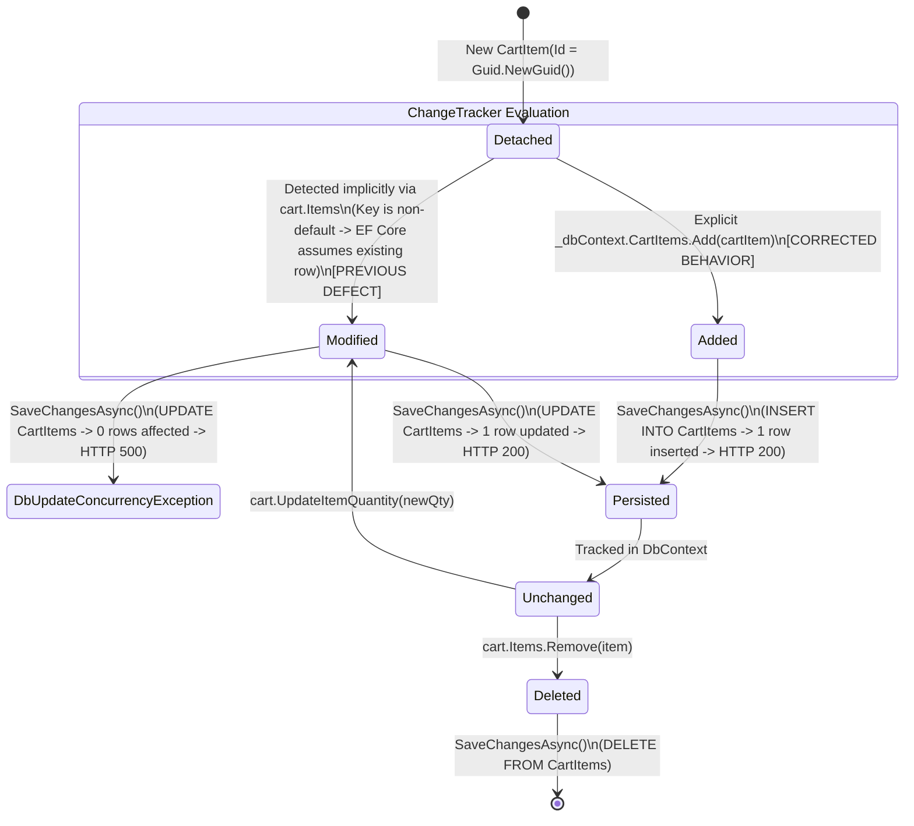

# Data Model: Cart State Tracking & Concurrency Remediation

**Feature Branch**: `018-cart-concurrency-and-state-remediation`  
**Date**: 2026-11-10  
**Status**: Completed (Phase 1)  

---

## 1. Entity Definitions & Persistence Schema

### 1.1 `Cart` (Aggregate Root)

Represents an active shopping cart owned by an authenticated buyer.

* **Database Table**: `Carts`
* **Primary Key**: `Id` (`uuid`, non-null)
* **Optimistic Concurrency**: `RowVersion` (`bigint`, configured with `.IsConcurrencyToken()`)
* **Soft Delete**: `IsDeleted` (`boolean`), `DeletedAt` (`timestamptz`, nullable)

| Column | Data Type | Nullable | Constraints & Defaults | Description |
| :--- | :--- | :---: | :--- | :--- |
| `Id` | `uuid` | No | PK | Cart unique identifier |
| `BuyerId` | `uuid` | No | | Owner buyer identifier |
| `Status` | `integer` | No | Default: 1 (`Active`) | Cart status (`Active`, `CheckedOut`, `Abandoned`) |
| `ItemCount` | `integer` | No | Default: 0 | Number of distinct items in cart |
| `SubtotalAmount` | `numeric(18,2)` | No | Default: 0.00 | Total monetary amount before vouchers |
| `LastActivityAt` | `timestamptz` | No | `UtcNow` | Timestamp of last user action |
| `RowVersion` | `bigint` | No | Default: 1 | Optimistic concurrency token |
| `CreatedAt` | `timestamptz` | No | `UtcNow` | Record creation timestamp |
| `UpdatedAt` | `timestamptz` | No | `UtcNow` | Record update timestamp |
| `IsDeleted` | `boolean` | No | Default: `false` | Soft-delete flag |
| `DeletedAt` | `timestamptz` | Yes | | Soft-delete timestamp |

* **Navigations**:
  - `Items`: `ICollection<CartItem>` (1-to-many relationship; cascade or orphan delete)
  - `Orders`: `ICollection<Order>` (1-to-many relationship)

---

### 1.2 `CartItem` (Dependent Line Item)

Represents an individual product variant placed into a buyer's cart.

* **Database Table**: `CartItems`
* **Primary Key**: `Id` (`uuid`, non-null, generated via `Guid.NewGuid()`)
* **Foreign Key**: `CartId` $\rightarrow$ `Carts.Id` (Cascade delete)
* **Unique Composite Index**: `IX_CartItems_CartId_SkuId` on `("CartId", "SkuId")`
* **Secondary Index**: `IX_CartItems_ProductId` on `("ProductId")`
* **Soft Delete**: `IsDeleted` (`boolean`), `DeletedAt` (`timestamptz`, nullable)

| Column | Data Type | Nullable | Constraints & Defaults | Description |
| :--- | :--- | :---: | :--- | :--- |
| `Id` | `uuid` | No | PK | Cart item unique identifier |
| `CartId` | `uuid` | No | FK $\rightarrow$ `Carts.Id` | Parent cart foreign key |
| `ProductId` | `uuid` | No | Index | Parent catalog product identifier |
| `SkuId` | `uuid` | No | Composite Unique | Catalog SKU / Variant identifier |
| `SellerId` | `uuid` | No | | Vendor / Shop identifier |
| `Quantity` | `integer` | No | Range: 1 .. 99 | Quantity requested by buyer |
| `UnitPriceSnapshot` | `numeric(18,2)` | No | Precision: 18, 2 | Price snapshot at time of addition |
| `ProductNameSnapshot` | `varchar(500)`| No | MaxLength: 500 | Product name snapshot at addition |
| `AddedAt` | `timestamptz` | No | `UtcNow` | Timestamp when item entered cart |
| `CreatedAt` | `timestamptz` | No | `UtcNow` | Base auditable creation timestamp |
| `UpdatedAt` | `timestamptz` | No | `UtcNow` | Base auditable update timestamp |
| `IsDeleted` | `boolean` | No | Default: `false` | Soft-delete flag |
| `DeletedAt` | `timestamptz` | Yes | | Soft-delete timestamp |

---

## 2. EF Core ChangeTracker Entity Lifecycle



---

## 3. Data Transfer Objects (DTOs)

### 3.1 Inbound Contracts

* **`AddCartItemRequest`**:
  ```csharp
  public sealed record AddCartItemRequest(
      Guid SkuId,
      int Quantity,
      Guid? ProductId = null);
  ```

* **`MergeGuestCartRequest`**:
  ```csharp
  public sealed record MergeGuestCartRequest(
      List<GuestCartItem> GuestItems);

  public sealed record GuestCartItem(
      Guid SkuId,
      int Quantity,
      Guid? ProductId = null);
  ```

### 3.2 Outbound Contracts

* **`CartDto`**:
  ```csharp
  public sealed record CartDto(
      Guid Id,
      Guid BuyerId,
      string Status,
      int ItemCount,
      decimal SubtotalAmount,
      List<CartItemDto> Items,
      DateTimeOffset LastActivityAt);
  ```

* **`CartItemDto`**:
  ```csharp
  public sealed record CartItemDto(
      Guid Id,
      Guid ProductId,
      Guid SkuId,
      Guid SellerId,
      string ProductName,
      int Quantity,
      decimal UnitPriceSnapshot,
      decimal LineTotal,
      DateTimeOffset AddedAt,
      bool IsAvailable = true,
      string? DisabledReason = null);
  ```
