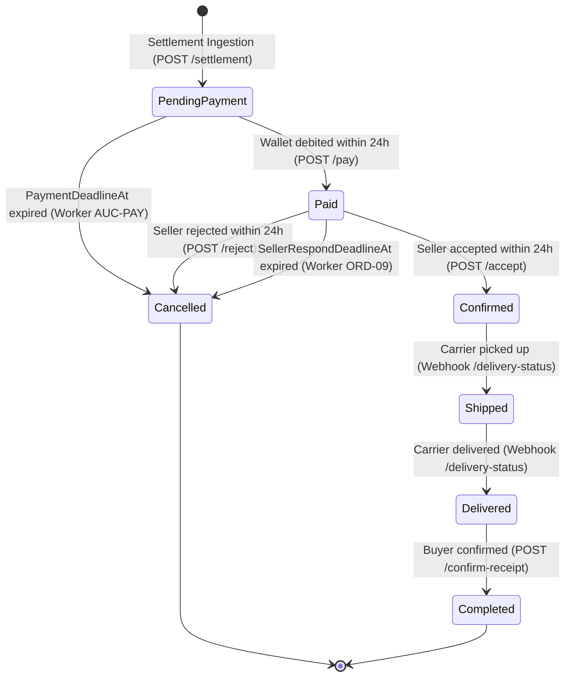

# Data Model Specification: Auction Order Lifecycle, Settlement & Automated Reversal

**Feature**: `019-auction-order-lifecycle-and-settlement`  
**Date**: 2026-11-11  
**Status**: Ready for Implementation  

---

## 1. Entity Definitions & Database Mappings

### 1.1. `AuctionOrder` (Primary Entity)
- **Table**: `AuctionOrders` (PostgreSQL)
- **Schema Mapping**: Configured via `AuctionOrderConfiguration.cs` in `Commerce.Infrastructure/Persistence/Configurations/`
- **Primary Key**: `Id` (UUID)

| Field | Type | Nullable | Constraints & Defaults | Business Description |
|---|---|---|---|---|
| `Id` | `Guid` | No | PK, `ValueGeneratedOnAdd()` | Unique identifier of the auction order |
| `OrderNo` | `string` | No | MaxLength(100), Unique Index | Display order number (`AO-YYYYMMDD-XXXXX`) |
| `AuctionId` | `Guid` | No | Non-unique Index | Reference to winning auction in Auction Service |
| `BuyerId` | `Guid` | No | Guid | Winning bidder user identifier |
| `SellerId` | `Guid` | No | Guid | Shop / seller user identifier |
| `WinningBidId` | `Guid` | No | Guid | Winning bid reference from Auction Service |
| `ProductId` | `Guid` | No | Guid | Master product reference from Catalog Service |
| `SkuId` | `Guid?` | Yes | Guid | Specific SKU variant reference from Catalog Service |
| `ProductNameSnapshot`| `string` | No | MaxLength(500) | Immutable name snapshot at time of settlement |
| `ImageUrlSnapshot` | `string?` | Yes | MaxLength(1000) | Primary product image URL snapshot |
| `SkuAttributesSnapshot`| `string` | No | `jsonb`, Default `"{}"` | Serialized variant attributes (color, size, etc.) |
| `WinningAmount` | `decimal` | No | Precision(18,2), > 0 | Winning bid price (hammer price), excluding shipping |
| `ShippingAddress` | `string?` | Yes | `jsonb` | Serialized JSON delivery address (recipient, street, ward, district, province) |
| `ContactPhone` | `string?` | Yes | MaxLength(50) | Delivery contact phone number |
| `ShippingFeeAmount` | `decimal?` | Yes | Precision(18,2) | Carrier shipping fee (calculated via Fulfillment Service) |
| `TotalAmount` | `decimal?` | Yes | Precision(18,2) | `WinningAmount + ShippingFeeAmount` (NULL until shipping quoted) |
| `SellerReceiveAmount`| `decimal` | No | Precision(18,2) | `WinningAmount - PlatformFeeAmount` |
| `PlatformFeeAmount` | `decimal` | No | Precision(18,2) | System commission retained by platform |
| `Status` | `SubOrderStatus` | No | Int / Enum, Default `0` | Order lifecycle status (`PendingPayment`, `Paid`, `Confirmed`, etc.) |
| `PaymentMethod` | `PaymentMethod` | No | Int / Enum, Default `0` | Payment method (Wallet = 0) |
| `WalletTransactionId`| `Guid?` | Yes | Guid | Debit transaction reference from Wallet Service |
| `PaymentDeadlineAt` | `DateTimeOffset` | No | UTC Timestamp | Payment expiration deadline (24 hours from settlement) |
| `SellerRespondDeadlineAt`| `DateTimeOffset?`| Yes | UTC Timestamp | Seller response deadline (PaidAt + 24 hours) |
| `PaidAt` | `DateTimeOffset?`| Yes | UTC Timestamp | Timestamp when buyer wallet debit succeeded |
| `SellerAcceptedAt` | `DateTimeOffset?`| Yes | UTC Timestamp | Timestamp when seller accepted the order |
| `ShippedAt` | `DateTimeOffset?`| Yes | UTC Timestamp | Timestamp when carrier received package |
| `DeliveredAt` | `DateTimeOffset?`| Yes | UTC Timestamp | Timestamp when carrier delivered package |
| `CompletedAt` | `DateTimeOffset?`| Yes | UTC Timestamp | Timestamp when buyer confirmed receipt or order completed |
| `CancelledAt` | `DateTimeOffset?`| Yes | UTC Timestamp | Timestamp when order was cancelled |
| `RowVersion` | `long` | No | IsConcurrencyToken() | Optimistic locking token |
| `IsDeleted` | `bool` | No | Default `false` | Soft-delete flag (filtered by `HasQueryFilter`) |
| `CreatedAt` | `DateTimeOffset` | No | UTC Timestamp | Record creation timestamp |
| `UpdatedAt` | `DateTimeOffset` | No | UTC Timestamp | Last update timestamp |

---

### 1.2. `OrderCancellation` (Remediated Relationship)
- **Table**: `OrderCancellations`
- **Relationship**: 1-to-1 with `AuctionOrder` via FK `AuctionOrderId`
- **Foreign Key**: `AuctionOrderId` (Nullable Guid $\rightarrow$ `AuctionOrders.Id`)
- **Key Fields**:
  - `Id`: Guid
  - `AuctionOrderId`: Guid? (Set to `auctionOrder.Id`; `SubOrderId` MUST be null)
  - `CancelledBy`: Guid? (SellerId, BuyerId, or null for System timeout)
  - `ActorRole`: `OrderActorRole` (`Seller`, `Buyer`, `System`)
  - `ReasonCode`: `CancellationReasonCode` (`PaymentTimeout = 2`, `SellerRejected = 3`)
  - `ReasonNote`: string? (Human explanation)
  - `WasPaid`: bool (`true` if cancelled after payment, triggering refund; `false` if unpaid)
  - `InventoryReleased`: bool (Set to `false` for auction items)

---

### 1.3. `OrderRefund` (Financial Tracking Entity)
- **Table**: `OrderRefunds`
- **Relationship**: 1-to-N with `AuctionOrder` via FK `AuctionOrderId`
- **Key Fields**:
  - `Id`: Guid
  - `AuctionOrderId`: Guid (FK $\rightarrow$ `AuctionOrders.Id`)
  - `CancellationId`: Guid? (FK $\rightarrow$ `OrderCancellations.Id`)
  - `Amount`: decimal(18,2) (Equals `auctionOrder.TotalAmount` for full refund)
  - `RefundType`: `RefundType.Full`
  - `Status`: `RefundStatus` (`Requested = 0`, `Completed = 1`, `Failed = 2`)
  - `ReasonCode`: string (`"SELLER_REJECTED"` or `"SELLER_EXPIRED"`)
  - `ActorRole`: `OrderActorRole` (`Seller` or `System`)
  - `WalletTransactionId`: Guid? (Original debit transaction ID)
  - `RefundTransactionId`: Guid? (Transaction ID from WalletService)

---

## 2. State Machine & Transition Invariants

### Transition Invariants
1. **PendingPayment $\rightarrow$ Paid**:
   - Prerequisite: `ShippingAddress` and `TotalAmount` must NOT be NULL.
   - Prerequisite: `DateTimeOffset.UtcNow <= PaymentDeadlineAt`.
   - Side-effects: `PaidAt = UtcNow`, `SellerRespondDeadlineAt = UtcNow.AddHours(24)`.
   - Outbound: Dispatch callback `status: "Paid"`.
2. **Paid $\rightarrow$ Confirmed**:
   - Prerequisite: Caller `currentUserId == SellerId`.
   - Prerequisite: `DateTimeOffset.UtcNow <= SellerRespondDeadlineAt`.
   - Side-effects: `SellerAcceptedAt = UtcNow`, create logistics shipment via `IFulfillmentClient`.
   - Outbound: Dispatch callback `status: "SellerAccepted"`.
3. **Paid $\rightarrow$ Cancelled (Seller Rejected)**:
   - Prerequisite: Caller `currentUserId == SellerId`.
   - Side-effects: `CancelledAt = UtcNow`, insert `OrderCancellation`, trigger 100% wallet refund via `IWalletClient`, insert `OrderRefund`.
   - Outbound: Dispatch callback `status: "SellerRejected"`.
4. **Paid $\rightarrow$ Cancelled (Seller Expired)**:
   - Prerequisite: `DateTimeOffset.UtcNow > SellerRespondDeadlineAt`.
   - Side-effects: `CancelledAt = UtcNow`, insert `OrderCancellation` (ActorRole: System), trigger 100% wallet refund via `IWalletClient`, insert `OrderRefund`.
   - Outbound: Dispatch callback `status: "SellerExpired"`.
5. **PendingPayment $\rightarrow$ Cancelled (Payment Timed Out)**:
   - Prerequisite: `DateTimeOffset.UtcNow > PaymentDeadlineAt`.
   - Side-effects: `CancelledAt = UtcNow`, insert `OrderCancellation` (WasPaid: false, ActorRole: System).
   - Outbound: Dispatch callback `status: "PaymentTimedOut"`.
6. **Delivered $\rightarrow$ Completed**:
   - Prerequisite: Caller `currentUserId == BuyerId`.
   - Side-effects: `CompletedAt = UtcNow`, trigger escrow release to seller via `_walletClient.SettleSellerSubOrderAsync`.
