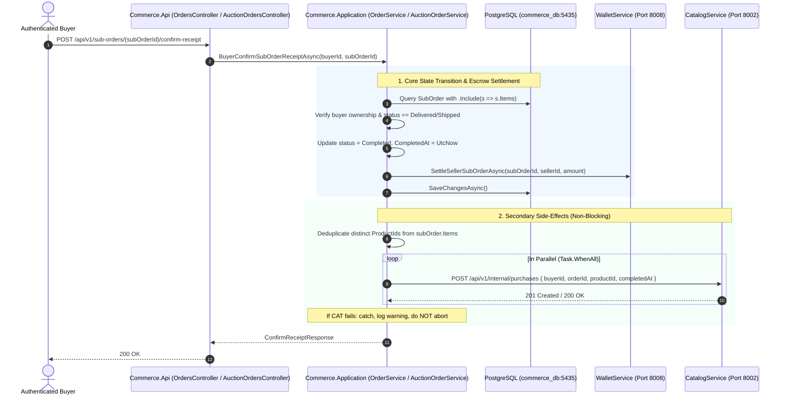

# Data Model & State Alignment: Purchase Record Synchronization

**Feature Branch**: `020-catalog-purchase-sync`  
**Date**: 2026-11-11  

---

## 1. Domain Entities & Field Mappings

No schema alterations or database migrations are required for `CommerceService`. All necessary identifier fields already exist on primary persistence models in PostgreSQL (`commerce_db:5435`).

### Entity: `SubOrderItem` (Source for Standard Order Items)
* **Table**: `SubOrderItems`
* **Relevant Fields**:
  - `Id`: `Guid` (Primary Key)
  - `SubOrderId`: `Guid` (Foreign Key $\rightarrow$ `SubOrders.Id`)
  - `ProductId`: `Guid` (Cross-service reference $\rightarrow$ Catalog Service parent Product ID)
  - `SkuId`: `Guid` (Variant ID - NOT transmitted to Catalog purchase sync)
  - `SellerId`: `Guid` (Seller reference)
  - `ProductNameSnapshot`: `string`

### Entity: `SubOrder` (Source for Order Context)
* **Table**: `SubOrders`
* **Relevant Fields**:
  - `Id`: `Guid` (Transmitted as `orderId`)
  - `OrderId`: `Guid` (Master Order ID)
  - `BuyerId`: `Guid` (Transmitted as `buyerId`)
  - `Status`: `SubOrderStatus` (Transitions to `Completed = 5`)
  - `CompletedAt`: `DateTimeOffset?` (Transmitted as `completedAt`)

### Entity: `AuctionOrder` (Source for Won Auction Orders)
* **Table**: `AuctionOrders`
* **Relevant Fields**:
  - `Id`: `Guid` (Transmitted as `orderId`)
  - `BuyerId`: `Guid` (Transmitted as `buyerId`)
  - `ProductId`: `Guid` (Transmitted as `productId`)
  - `Status`: `SubOrderStatus` (Transitions to `Completed = 5`)
  - `CompletedAt`: `DateTimeOffset?` (Transmitted as `completedAt`)

---

## 2. Application Layer Contracts & DTOs

### Contract: `CatalogPurchaseSyncRequest`
Defined in `Commerce.Application/Interfaces/ICatalogClient.cs`:

```csharp
namespace Commerce.Application.Interfaces;

public sealed record CatalogPurchaseSyncRequest(
    Guid BuyerId,
    Guid OrderId,
    Guid ProductId,
    DateTimeOffset? CompletedAt = null);
```

### Raw Internal Response Model (Private in `CatalogClient.cs`)

```csharp
private sealed class CatalogPurchaseSyncRawResponse
{
    public Guid Id { get; set; }
    public Guid BuyerId { get; set; }
    public Guid OrderId { get; set; }
    public Guid ProductId { get; set; }
    public DateTimeOffset CompletedAt { get; set; }
    public DateTimeOffset CreatedAt { get; set; }
}
```

---

## 3. Order Completion & Synchronization Lifecycle Flow



---

## 4. Invariants & Deduplication Rules

1. **Product Deduplication Rule**:
   $$\text{SyncSet} = \{ p \in \text{Items} \mid p.\text{ProductId} \neq \emptyset \}.\text{DistinctBy}(p \implies p.\text{ProductId})$$
   Never transmit multiple requests for the same `ProductId` within a single order completion invocation.

2. **Transaction Isolation**:
   The call to `_dbContext.SaveChangesAsync()` occurs prior to or alongside secondary side-effects. Catalog synchronization errors MUST NOT trigger database rollback or throw `500 Internal Server Error` to the buyer.
