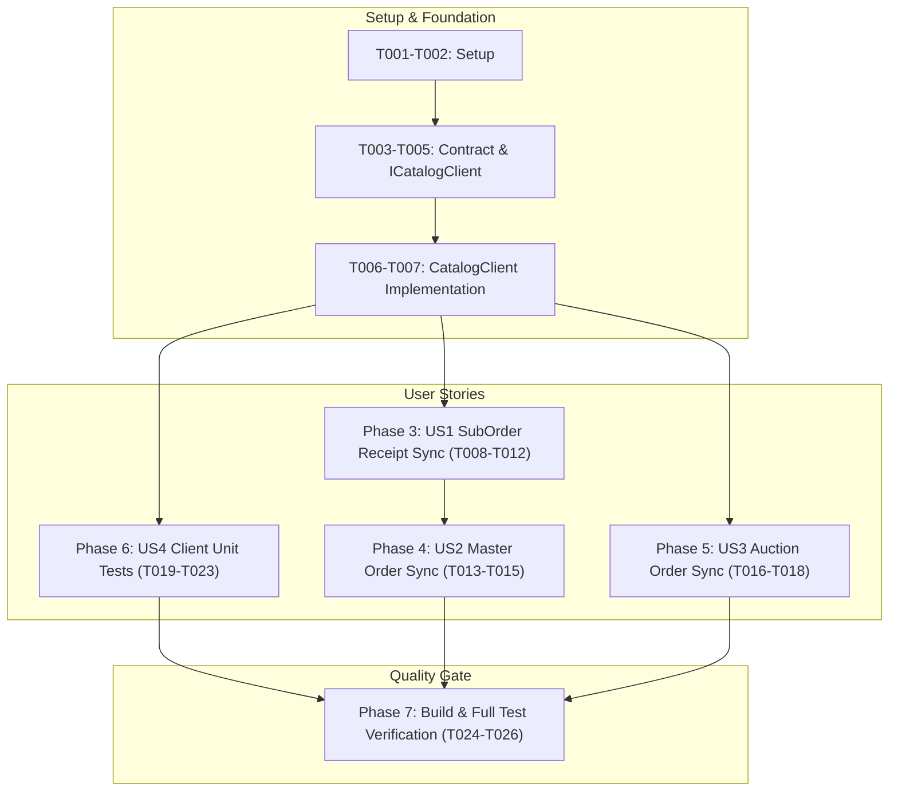

# Tasks: Purchase Record Synchronization (CommerceService ➔ CatalogService)

**Input**: Design documents from `/specs/020-catalog-purchase-sync/`  
**Prerequisites**: `plan.md`, `spec.md`, `research.md`, `data-model.md`, `contracts/catalog-purchase-sync-api.yaml`, `quickstart.md`  

---

## Phase 1: Setup (Environment & Configuration)

**Purpose**: Verify downstream Catalog Service URL configuration

- [X] T001 Verify `CATALOG_SERVICE_URL: "${CATALOG_SERVICE_URL:-http://catalog-service:8002}"` in `docker-compose.yml`
- [X] T002 [P] Verify `CatalogService:BaseUrl` configuration in `Commerce.Api/appsettings.json` and `Commerce.Api/appsettings.Development.json`

---

## Phase 2: Foundational (Contract & Outbound Client Abstractions)

**Purpose**: Core application contracts, DTOs, and client interface methods that all user stories depend on

**⚠️ CRITICAL**: Must complete before user story implementation begins

- [X] T003 [P] Define `CatalogPurchaseSyncRequest(Guid BuyerId, Guid OrderId, Guid ProductId, DateTimeOffset? CompletedAt)` record in `Commerce.Application/Interfaces/ICatalogClient.cs`
- [X] T004 [P] Declare `Task<bool> SyncPurchaseRecordAsync(CatalogPurchaseSyncRequest request, CancellationToken cancellationToken = default)` in `Commerce.Application/Interfaces/ICatalogClient.cs`
- [X] T005 [P] Declare `Task<int> SyncPurchasesBatchAsync(Guid buyerId, Guid orderId, IEnumerable<Guid> productIds, DateTimeOffset? completedAt = null, CancellationToken cancellationToken = default)` in `Commerce.Application/Interfaces/ICatalogClient.cs`
- [X] T006 Implement `SyncPurchaseRecordAsync` in `Commerce.Infrastructure/Services/Catalog/CatalogClient.cs` (target `POST api/v1/internal/purchases`, serialize JSON payload, return `true` for 201/200, catch exceptions/4xx/5xx and log warnings with non-blocking fail-safe semantics)
- [X] T007 Implement `SyncPurchasesBatchAsync` in `Commerce.Infrastructure/Services/Catalog/CatalogClient.cs` (filter distinct `ProductId`s, execute concurrent tasks via `Task.WhenAll`, count and log successes)

**Checkpoint**: Foundation ready - client abstractions and infrastructure implementation are compiled and ready for user stories.

---

## Phase 3: User Story 1 - Sub-Order Delivery Receipt Confirmation & Concurrent Purchase Sync (Priority: P1) 🎯 MVP

**Goal**: When a buyer confirms receipt of their sub-order, mark `SubOrder` as `Completed`, settle seller escrow, reward reputation, and concurrently synchronize all distinct product IDs in the sub-order to `CatalogService` to unlock verified reviews.

**Independent Test**: Call `POST /api/v1/sub-orders/{subOrderId}/confirm-receipt`. Assert `SubOrder.Status == Completed`, `CompletedAt` populated, seller escrow settled, and mock `ICatalogClient.SyncPurchaseRecordAsync` called for each distinct `ProductId` in the sub-order.

- [X] T008 [P] [US1] Create unit tests in `tests/Commerce.UnitTests/Application/OrderLifecycleTests.cs` verifying `BuyerConfirmSubOrderReceiptAsync` triggers `SyncPurchaseRecordAsync` with distinct `ProductId`s upon receipt confirmation
- [X] T009 [P] [US1] Create unit tests in `tests/Commerce.UnitTests/Application/OrderLifecycleTests.cs` verifying multiple items with duplicate `ProductId`s are deduplicated prior to Catalog synchronization
- [X] T010 [P] [US1] Create unit tests in `tests/Commerce.UnitTests/Application/OrderLifecycleTests.cs` verifying that if Catalog sync returns `false` or encounters network errors, sub-order completion and escrow settlement still succeed (non-blocking fail-safe)
- [X] T011 [US1] Update `BuyerConfirmSubOrderReceiptAsync` in `Commerce.Application/Services/Order/OrderService.cs` to add `.Include(s => s.Items)` when querying `SubOrder`
- [X] T012 [US1] Integrate `_catalogClient.SyncPurchasesBatchAsync` into `BuyerConfirmSubOrderReceiptAsync` in `Commerce.Application/Services/Order/OrderService.cs` passing `so.BuyerId`, `so.Id`, distinct `so.Items.Select(i => i.ProductId)`, and `so.CompletedAt`

**Checkpoint**: User Story 1 (MVP) is independently functional and testable.

---

## Phase 4: User Story 2 - Master Order Completion & Cascading Purchase Synchronization (Priority: P1)

**Goal**: When a buyer confirms completion of the master order, transition all non-cancelled sub-orders to `Completed`, settle funds, and synchronize distinct product IDs across all newly completed sub-orders to `CatalogService`.

**Independent Test**: Call `POST /api/v1/orders/{orderId}/complete`. Assert `Order.Status == Completed`, sub-orders become `Completed`, and all distinct products across sub-orders trigger Catalog synchronization.

- [X] T013 [P] [US2] Create unit tests in `tests/Commerce.UnitTests/Application/OrderLifecycleTests.cs` verifying `CompleteOrderAsync` triggers purchase synchronization for all products across active sub-orders
- [X] T014 [US2] Update `CompleteOrderAsync` in `Commerce.Application/Services/Order/OrderService.cs` to query `.Include(o => o.SubOrders).ThenInclude(so => so.Items)`
- [X] T015 [US2] Integrate `_catalogClient.SyncPurchasesBatchAsync` into `CompleteOrderAsync` in `Commerce.Application/Services/Order/OrderService.cs` for each newly completed sub-order's distinct `ProductId`s

**Checkpoint**: User Story 2 is independently functional and testable.

---

## Phase 5: User Story 3 - Won Auction Order Delivery Receipt Confirmation (Priority: P2)

**Goal**: When a winning buyer confirms receipt of their auction item, mark `AuctionOrder` as `Completed`, settle seller escrow, and synchronize the won product's `ProductId` to `CatalogService`.

**Independent Test**: Call `POST /api/v1/auction-orders/{id}/confirm-receipt`. Assert `AuctionOrder.Status == Completed`, escrow settled, and mock `ICatalogClient.SyncPurchaseRecordAsync` called with `{ buyerId, orderId: auctionOrder.Id, productId: auctionOrder.ProductId, completedAt }`.

- [X] T016 [P] [US3] Create unit tests in `tests/Commerce.UnitTests/Application/AuctionOrderServiceTests.cs` verifying `BuyerConfirmAuctionDeliveryAsync` triggers purchase record synchronization for `auctionOrder.ProductId`
- [X] T017 [US3] Inject `ICatalogClient` into `AuctionOrderService` in `Commerce.Application/Services/AuctionOrder/AuctionOrderService.cs`
- [X] T018 [US3] Integrate `_catalogClient.SyncPurchaseRecordAsync` into `BuyerConfirmAuctionDeliveryAsync` in `Commerce.Application/Services/AuctionOrder/AuctionOrderService.cs` passing `auctionOrder.BuyerId`, `auctionOrder.Id`, `auctionOrder.ProductId`, and `now`

**Checkpoint**: User Story 3 is independently functional and testable.

---

## Phase 6: User Story 4 - Outbound Catalog REST Client Implementation & Resilience (Priority: P1)

**Goal**: Implement unit tests for `CatalogClient.SyncPurchaseRecordAsync` with mocked `HttpMessageHandler` covering all HTTP response status codes and failure modes.

**Independent Test**: Execute `CatalogClientTests`. Verify 201 Created and 200 OK return `true`; 400 Bad Request, 404 Not Found, 500 Internal Error, and HttpRequestException return `false` without throwing.

- [X] T019 [P] [US4] Add unit tests in `tests/Commerce.UnitTests/Infrastructure/CatalogClientTests.cs` verifying HTTP 201 Created returns `true` and serializes correct request body
- [X] T020 [P] [US4] Add unit tests in `tests/Commerce.UnitTests/Infrastructure/CatalogClientTests.cs` verifying HTTP 200 OK (idempotent duplicate) returns `true`
- [X] T021 [P] [US4] Add unit tests in `tests/Commerce.UnitTests/Infrastructure/CatalogClientTests.cs` verifying HTTP 400 Bad Request returns `false` and logs warning without throwing
- [X] T022 [P] [US4] Add unit tests in `tests/Commerce.UnitTests/Infrastructure/CatalogClientTests.cs` verifying HTTP 404 Not Found returns `false` and logs warning without throwing
- [X] T023 [P] [US4] Add unit tests in `tests/Commerce.UnitTests/Infrastructure/CatalogClientTests.cs` verifying HTTP 500 / HttpRequestException / Timeout returns `false` and logs error without throwing

**Checkpoint**: User Story 4 is independently functional and testable.

---

## Phase 7: Polish, Verification & Quality Gate

**Purpose**: End-to-end verification and compliance validation

- [X] T024 Run full solution build: `dotnet build Commerce.sln -c Release -nodeReuse:false -m:1 --no-restore` and verify 0 errors and 0 warnings
- [X] T025 Execute full unit test suite: `dotnet test tests/Commerce.UnitTests/Commerce.UnitTests.csproj -c Release --no-build` and verify 100% test pass rate
- [X] T026 Execute manual quickstart verification scenarios documented in `specs/020-catalog-purchase-sync/quickstart.md`

---

## Dependencies & Execution Order

### Parallel Execution Opportunities
- Tasks T001 and T002 in Setup can execute in parallel.
- Tasks T003, T004, and T005 in Foundational can execute in parallel.
- Once Phase 2 is complete, User Story 4 (Client Tests, T019-T023), User Story 1 (SubOrder Sync, T008-T012), and User Story 3 (Auction Sync, T016-T018) can proceed in parallel.
- User Story 2 directly builds upon the patterns established in User Story 1.
