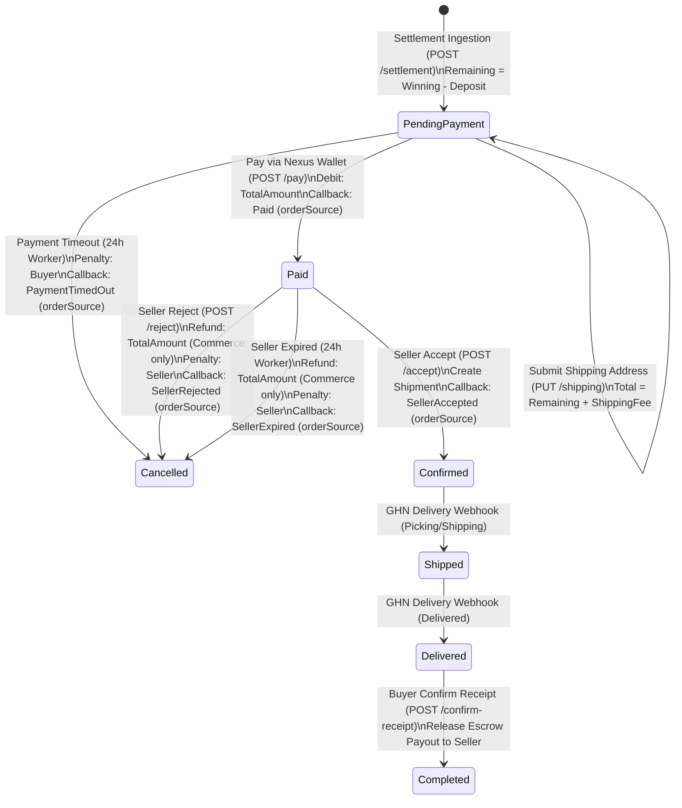

# Data Model: Auction Deposit Ingestion, Runner-Up Settlement & Split Reversal

**Feature**: `022-auction-deposit-and-runner-up-settlement`  
**Date**: 2026-11-15  
**Service**: `CommerceService` (PostgreSQL `commerce_db:5435`)  

---

## 1. Entity Definitions & Database Schema Updates

### Updated Entity: `AuctionOrder` (`Commerce.Domain/Entities/AuctionOrder.cs`)

Represents a legally binding purchase contract resulting from an auction outcome (either primary Winner or runner-up Second Chance).

```csharp
namespace Commerce.Domain.Entities;

using System;
using System.Collections.Generic;
using Commerce.Domain.Base;
using Commerce.Domain.Enums;

public class AuctionOrder : BaseEntity<Guid>
{
    public required string OrderNo { get; set; }
    public required Guid AuctionId { get; set; }
    public required Guid BuyerId { get; set; }
    public required Guid SellerId { get; set; }
    public required Guid WinningBidId { get; set; }
    public required Guid ProductId { get; set; }
    public Guid? SkuId { get; set; }
    public required string ProductNameSnapshot { get; set; }
    public string? ImageUrlSnapshot { get; set; }
    public string SkuAttributesSnapshot { get; set; } = "{}";
    
    // Financial Invariants
    public required decimal WinningAmount { get; set; }
    public decimal DepositAmount { get; set; } = 0m;              // [NEW] Held deposit amount
    public decimal RemainingAmount { get; set; }                 // [NEW] WinningAmount - DepositAmount
    public AuctionOrderSource OrderSource { get; set; } = AuctionOrderSource.Winner; // [NEW] Winner / SecondChance

    public string? ShippingAddress { get; set; }
    public string? ContactPhone { get; set; }
    public decimal? ShippingFeeAmount { get; set; }
    public decimal? TotalAmount { get; set; }                    // RemainingAmount + ShippingFeeAmount
    public required decimal SellerReceiveAmount { get; set; }    // WinningAmount * 0.95
    public required decimal PlatformFeeAmount { get; set; }      // WinningAmount * 0.05
    public required SubOrderStatus Status { get; set; } = SubOrderStatus.PendingPayment;
    public required PaymentMethod PaymentMethod { get; set; } = PaymentMethod.Wallet;
    public Guid? WalletTransactionId { get; set; }
    
    // Lifecycle Deadlines & Timestamps
    public required DateTimeOffset PaymentDeadlineAt { get; set; }
    public DateTimeOffset? SellerRespondDeadlineAt { get; set; }
    public DateTimeOffset? PaidAt { get; set; }
    public DateTimeOffset? SellerAcceptedAt { get; set; }
    public DateTimeOffset? ShippedAt { get; set; }
    public DateTimeOffset? DeliveredAt { get; set; }
    public DateTimeOffset? CompletedAt { get; set; }
    public DateTimeOffset? CancelledAt { get; set; }
    
    // Logistics Tracking
    public string? CarrierCode { get; set; }
    public string? TrackingCode { get; set; }
    public string? LabelPrintUrl { get; set; }
    public DateTimeOffset? EstimatedDeliveryAt { get; set; }
    public long RowVersion { get; set; }

    // Navigations
    public ICollection<OrderStatusHistory> StatusHistories { get; set; } = new List<OrderStatusHistory>();
    public OrderInvoice? Invoice { get; set; }
    public OrderCancellation? Cancellation { get; set; }
    public ICollection<OrderRefund> Refunds { get; set; } = new List<OrderRefund>();
}
```

---

### New Enum: `AuctionOrderSource` (`Commerce.Domain/Enums/AuctionOrderSource.cs`)

Categorizes the origin of the auction order for routing callbacks and financial validation.

```csharp
namespace Commerce.Domain.Enums;

public enum AuctionOrderSource
{
    Winner = 1,
    SecondChance = 2
}
```

---

## 2. EF Core Entity Configuration (`AuctionOrderConfiguration.cs`)

```csharp
// Commerce.Infrastructure/Persistence/Configurations/AuctionOrderConfiguration.cs
builder.Property(x => x.DepositAmount)
    .HasPrecision(18, 2)
    .HasDefaultValue(0m)
    .IsRequired();

builder.Property(x => x.RemainingAmount)
    .HasPrecision(18, 2)
    .IsRequired();

builder.Property(x => x.OrderSource)
    .HasConversion<string>()
    .HasMaxLength(32)
    .HasDefaultValue(AuctionOrderSource.Winner)
    .IsRequired();
```

---

## 3. Financial Invariants & Calculations

| Formula | Description | Code Expression |
|---|---|---|
| **Remaining Amount** | Gross winning price minus held deposit | `RemainingAmount = WinningAmount - DepositAmount` |
| **Total Cash Due** | Cash payable by buyer via wallet (post-shipping quote) | `TotalAmount = RemainingAmount + ShippingFeeAmount` |
| **Seller Payout** | 95% of gross auction winning bid | `SellerReceiveAmount = Math.Round(WinningAmount * 0.95m, 2)` |
| **Platform Fee** | 5% commission of gross auction winning bid | `PlatformFeeAmount = Math.Round(WinningAmount * 0.05m, 2)` |
| **Refund on Seller Rejection** | 100% of cash transferred to Commerce | `RefundAmount = TotalAmount` |

---

## 4. State Transitions & Lifecycle



---

## 5. Migration Plan

- **Migration Name**: `20261115000000_AddAuctionDepositAndSourceFields`
- **Table Affected**: `AuctionOrders`
- **Columns Added**:
  - `DepositAmount` (`numeric(18,2)`, default `0`, NOT NULL)
  - `RemainingAmount` (`numeric(18,2)`, NOT NULL)
  - `OrderSource` (`varchar(32)`, default `'Winner'`, NOT NULL)
- **Data Backfill**: Existing historical auction orders are backfilled with:
  - `DepositAmount = 0`
  - `RemainingAmount = WinningAmount`
  - `OrderSource = 'Winner'`
