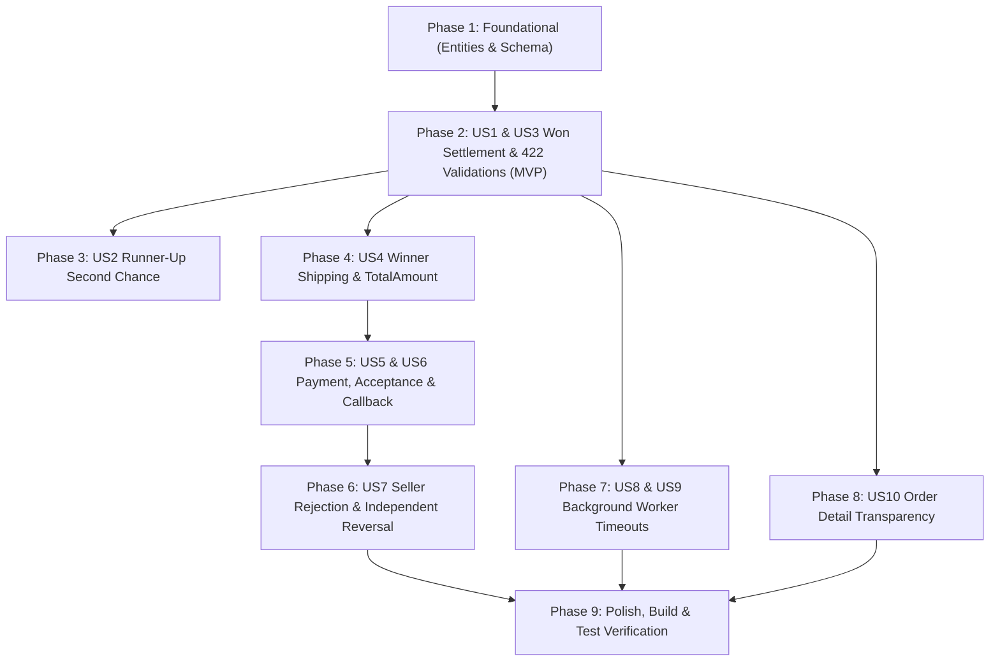

# Tasks: Auction Deposit Ingestion, Runner-Up Settlement & Split Reversal

**Input**: Design documents from `/specs/022-auction-deposit-and-runner-up-settlement/`  
**Prerequisites**: [plan.md](plan.md), [spec.md](spec.md), [research.md](research.md), [data-model.md](data-model.md), [contracts/auction-deposit-api.yaml](contracts/auction-deposit-api.yaml)  

---

## Format: `- [ ] [TaskID] [P?] [Story?] Description with file path`

- **[P]**: Can run in parallel (different files, no dependencies)
- **[Story]**: Which user story this task belongs to (e.g., US1, US2, US3)
- All descriptions reference exact file paths

---

## Phase 1: Foundational (Blocking Prerequisites & Schema)

**Purpose**: Core data model, enum definitions, and database migrations that all user stories depend on

- [X] T001 [P] Create `AuctionOrderSource` enum (`Winner = 1`, `SecondChance = 2`) in `Commerce.Domain/Enums/AuctionOrderSource.cs`
- [X] T002 Add `DepositAmount` (decimal, default 0), `RemainingAmount` (decimal), and `OrderSource` (`AuctionOrderSource`, default `Winner`) properties to `Commerce.Domain/Entities/AuctionOrder.cs`
- [X] T003 Configure EF Core precision `HasPrecision(18, 2)` for `DepositAmount` and `RemainingAmount`, and string conversion for `OrderSource` in `Commerce.Infrastructure/Persistence/Configurations/AuctionOrderConfiguration.cs`
- [X] T004 Create EF Core migration for PostgreSQL adding `DepositAmount`, `RemainingAmount`, and `OrderSource` to table `AuctionOrders` in `Commerce.Infrastructure/Persistence/Migrations/`

**Checkpoint**: Core data model and schema in place - user story implementation can begin

---

## Phase 2: User Story 1 & User Story 3 - Won Settlement Ingestion & Financial Validation (Priority: P1) 🎯 MVP

**Goal**: Ingest winning auction settlement with held deposit deduction (`depositAmount`), compute net remaining balance, and reject invalid financial values with HTTP 422

**Independent Test**: Send `POST /api/v1/auction-orders/settlement` with `depositAmount = 100000`, `winningAmount = 1000000`. Assert `AuctionOrder` has `DepositAmount = 100000`, `RemainingAmount = 900000`, `OrderSource = Winner`, and HTTP 201 Created is returned. Verify `depositAmount > winningAmount` returns 422 `DEPOSIT_EXCEEDS_WINNING_AMOUNT`.

- [X] T005 [P] [US1] Add `DepositAmount` (decimal?) and `Source` (string?) to `AuctionSettlementRequest` record in `Commerce.Application/Services/AuctionOrder/AuctionOrderRequests.cs`
- [X] T006 [US3] Add financial boundary validations in `Commerce.Application/Services/AuctionOrder/AuctionOrderService.cs` (`depositAmount <= winningAmount` $\rightarrow 422$ `DEPOSIT_EXCEEDS_WINNING_AMOUNT`, `winningAmount > 0 && depositAmount >= 0` $\rightarrow 422$ `INVALID_AMOUNT`)
- [X] T007 [US1] Update `ReceiveSettlementAsync` in `Commerce.Application/Services/AuctionOrder/AuctionOrderService.cs` to calculate `RemainingAmount = WinningAmount - (request.DepositAmount ?? 0)`, set `OrderSource = AuctionOrderSource.Winner`, and persist order
- [X] T008 [P] [US1] Add unit tests for won settlement ingestion with deposit and 422 boundary validations in `tests/Commerce.UnitTests/Application/AuctionOrderServiceTests.cs`

**Checkpoint**: User Story 1 & 3 functional and testable independently (MVP ready)

---

## Phase 3: User Story 2 - Runner-Up (Second Chance) Settlement Ingestion (Priority: P1)

**Goal**: Support runner-up (`SECOND_CHANCE`) order ingestion with zero deposit when the original winner order has been cancelled

**Independent Test**: Given an auction where original winner order is `Status == Cancelled`, send settlement with `source = "SECOND_CHANCE"`, `winnerId = <RunnerUpGuid>`, `depositAmount = 0`. Assert new `AuctionOrder` is created with `OrderSource = SecondChance`, `DepositAmount = 0`, `RemainingAmount = WinningAmount`.

- [X] T009 [US2] Add validation in `Commerce.Application/Services/AuctionOrder/AuctionOrderService.cs` that if `source == "SECOND_CHANCE"`, `DepositAmount` MUST equal 0 (or throw 422 `INVALID_RUNNER_UP_DEPOSIT`)
- [X] T010 [US2] Implement composite idempotency check in `Commerce.Application/Services/AuctionOrder/AuctionOrderService.cs`: check `(AuctionId, OrderSource, BuyerId)`. Allow creating `SECOND_CHANCE` order when existing order is `Cancelled`; reject with 409 `SETTLEMENT_CONFLICT` if active order exists
- [X] T011 [P] [US2] Add unit tests for runner-up second chance settlement creation and conflict rejection in `tests/Commerce.UnitTests/Application/AuctionOrderServiceTests.cs`

**Checkpoint**: User Story 2 independently functional and testable

---

## Phase 4: User Story 4 - Winner Shipping Submission & Net TotalAmount Calculation (Priority: P1)

**Goal**: Calculate carrier shipping fee and add it strictly to `RemainingAmount` (net merchandise price) rather than gross winning amount

**Independent Test**: Call `PUT /api/v1/auction-orders/{id}/shipping` on an order with `RemainingAmount = 900000`. With 30,000 VND shipping fee, assert `TotalAmount` is persisted as `930000` (not `1030000`).

- [X] T012 [US4] Update `SubmitShippingAsync` in `Commerce.Application/Services/AuctionOrder/AuctionOrderService.cs` to calculate `TotalAmount = auctionOrder.RemainingAmount + shippingFee`
- [X] T013 [P] [US4] Add unit tests verifying net total amount calculation with shipping fee quote in `tests/Commerce.UnitTests/Application/AuctionOrderServiceTests.cs`

**Checkpoint**: User Story 4 independently functional and testable

---

## Phase 5: User Story 5 & User Story 6 - Net Wallet Payment, Seller Acceptance & Outbound Callback (Priority: P1 / P2)

**Goal**: Debit strictly `TotalAmount` from buyer wallet, transition order to `Paid` / `Confirmed`, and emit callback containing `orderSource` to Auction Service

**Independent Test**: Pay order with `TotalAmount = 930000`. Assert wallet is debited 930,000 VND and callback to Auction Service includes `status: "Paid"`, `orderSource: "WINNER"`.

- [X] T014 [P] [US5] Add `string? OrderSource = null` property to `AuctionPaymentStatusCallbackRequest` in `Commerce.Application/Interfaces/IAuctionClient.cs`
- [X] T015 [P] [US5] Update `AuctionClient.cs` in `Commerce.Infrastructure/Services/Auction/AuctionClient.cs` to serialize `orderSource` into outgoing HTTP POST JSON payload
- [X] T016 [US5] Update `PayAuctionOrderAsync` in `Commerce.Application/Services/AuctionOrder/AuctionOrderService.cs` to pass `orderSource: auctionOrder.OrderSource.ToString().ToUpperInvariant()` in callback to Auction Service
- [X] T017 [US6] Update `SellerAcceptAsync` in `Commerce.Application/Services/AuctionOrder/AuctionOrderService.cs` to pass `orderSource: auctionOrder.OrderSource.ToString().ToUpperInvariant()` in callback to Auction Service
- [X] T018 [P] [US5] Add unit tests for net wallet payment and callback dispatch with `orderSource` in `tests/Commerce.UnitTests/Application/AuctionOrderServiceTests.cs`

**Checkpoint**: User Story 5 & 6 independently functional and testable

---

## Phase 6: User Story 7 - Seller Rejection & Independent Reversal Split (Priority: P1)

**Goal**: When seller rejects paid order, Commerce refunds strictly `TotalAmount` (merchandise + shipping paid to Commerce) without refunding deposit, applies seller penalty, and emits callback with `orderSource`

**Independent Test**: Call `POST /api/v1/auction-orders/{id}/reject` on a paid order (`TotalAmount = 930000`, `DepositAmount = 100000`). Assert wallet refund is for 930,000 VND, seller penalty is recorded, and callback includes `status: "SellerRejected"`, `orderSource: "WINNER"`.

- [X] T019 [US7] Update `SellerRejectAsync` in `Commerce.Application/Services/AuctionOrder/AuctionOrderService.cs` to refund strictly `auctionOrder.TotalAmount` (independent reversal split), pass `orderSource` in callback, and maintain fail-safe seller penalty
- [X] T020 [P] [US7] Add unit tests for seller rejection independent reversal split and penalty execution in `tests/Commerce.UnitTests/Application/AuctionOrderServiceTests.cs`

**Checkpoint**: User Story 7 independently functional and testable

---

## Phase 7: User Story 8 & User Story 9 - Background Worker Timeouts & Callbacks (Priority: P1)

**Goal**: Background worker scans expired payment and seller response deadlines, cancelling orders, refunding net cash if paid, applying penalties, and dispatching callbacks with `orderSource`

**Independent Test**: Run `PaymentTimeoutWorker.ProcessExpiredOrdersAsync` against an expired pending order and an expired paid order. Assert callbacks include `orderSource` and paid order receives refund of `TotalAmount`.

- [X] T021 [US8] Update `PaymentTimeoutWorker.cs` in `Commerce.Api/Workers/PaymentTimeoutWorker.cs` (Loop 2: 24h buyer payment timeout) to pass `orderSource: auctionOrder.OrderSource.ToString().ToUpperInvariant()` in `PaymentTimedOut` callback
- [X] T022 [US9] Update `PaymentTimeoutWorker.cs` in `Commerce.Api/Workers/PaymentTimeoutWorker.cs` (Loop 3: 24h seller response timeout) to refund `auctionOrder.TotalAmount` and pass `orderSource: auctionOrder.OrderSource.ToString().ToUpperInvariant()` in `SellerExpired` callback
- [X] T023 [P] [US8] Add unit tests for worker payment timeout and seller response timeout callbacks in `tests/Commerce.UnitTests/Application/PaymentTimeoutWorkerTests.cs`

**Checkpoint**: User Story 8 & 9 independently functional and testable

---

## Phase 8: User Story 10 - Auction Order Detail Transparency (Priority: P2)

**Goal**: Expose `depositAmount`, `remainingAmount`, and `orderSource` in the order detail query response

**Independent Test**: Call `GET /api/v1/auction-orders/{id}` as the buyer. Assert response body includes `depositAmount`, `remainingAmount`, and `orderSource`.

- [X] T024 [P] [US10] Add `DepositAmount` (decimal), `RemainingAmount` (decimal), and `OrderSource` (string) to `AuctionOrderDetailResponse` in `Commerce.Application/Services/AuctionOrder/AuctionOrderResponses.cs`
- [X] T025 [US10] Update `MapToDetailResponse` in `Commerce.Application/Services/AuctionOrder/AuctionOrderService.cs` to map `DepositAmount`, `RemainingAmount`, and `OrderSource`
- [X] T026 [P] [US10] Add unit tests for auction order detail query mapping in `tests/Commerce.UnitTests/Application/AuctionOrderServiceTests.cs`

**Checkpoint**: User Story 10 independently functional and testable

---

## Phase 9: Polish & Cross-Cutting Concerns

**Purpose**: Documentation updates, contract alignment, and end-to-end build and test verification

- [X] T027 [P] Update contract documentation in `docs/COMMERCE_API_CONTRACT.md` reflecting deposit amount, runner-up second chance, and orderSource callback
- [X] T028 Build verification: Execute `dotnet build Commerce.sln -c Release` ensuring 0 warnings and 0 errors
- [X] T029 Test suite verification: Execute `dotnet test Commerce.sln -c Release` ensuring 100% pass rate

---

## Dependencies & Execution Order

### Phase Dependencies

### Parallel Opportunities

- **Phase 1**: T001 (`AuctionOrderSource.cs`) can run in parallel with entity inspection.
- **Phase 2**: T005 (`AuctionOrderRequests.cs`) can run in parallel with service updates.
- **Phase 5**: T014 (`IAuctionClient.cs`) and T015 (`AuctionClient.cs`) can run in parallel.
- **Phase 8**: T024 (`AuctionOrderResponses.cs`) can run in parallel with controller review.
- All test tasks marked `[P]` (`T008`, `T011`, `T013`, `T018`, `T020`, `T023`, `T026`) can run in parallel once respective services are updated.

---

## Implementation Strategy

### MVP First (Phases 1 & 2)
1. Complete Phase 1: Entity updates and schema configuration.
2. Complete Phase 2: Ingest won settlement with `depositAmount`, compute `RemainingAmount`, enforce 422 validations.
3. Validate MVP: Ingest won settlement and verify database fields.

### Incremental Delivery
1. Phase 3: Add runner-up `SECOND_CHANCE` ingestion.
2. Phase 4 & 5: Add shipping fee net calculation and wallet payment.
3. Phase 6 & 7: Add seller rejection independent reversal split and worker timeout callbacks.
4. Phase 8 & 9: Expose detail view breakdown, update documentation, and verify full build/test suite.
