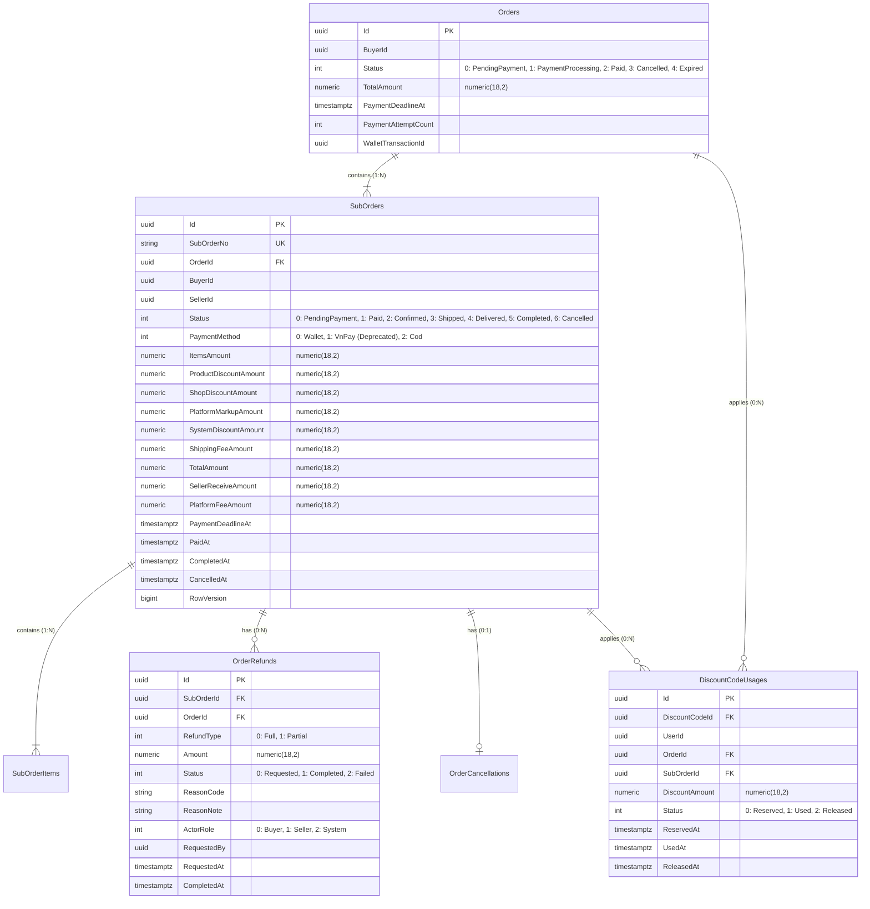
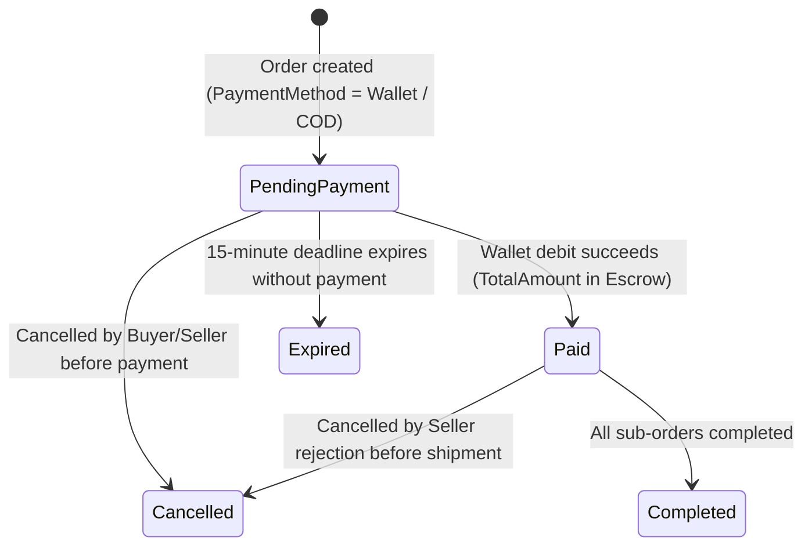
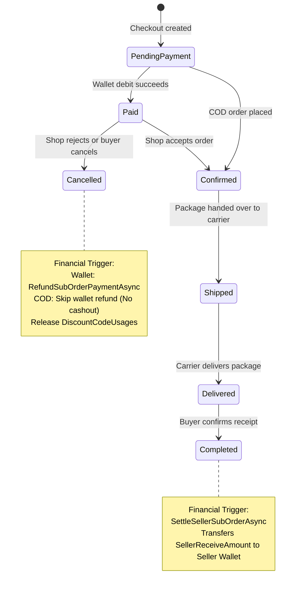

# Data Model: Order Financial Lifecycle, Staff-Managed Platform Fee & Voucher Extensibility

**Feature Branch**: `023-order-financial-lifecycle-and-voucher-extensibility`  
**Date**: 2026-11-16  
**Status**: Completed  
**Target Service**: `CommerceService` (Port 8003, Database `commerce_db:5435`)  

---

## 1. Entity Relationships & Schemas (Zero Schema Drift)

No new PostgreSQL tables or column migrations are introduced. All operations leverage existing entities in `Commerce.Domain.Entities`.



---

## 2. Mathematical Invariants & Field Definitions

### 8 Dimensions of SubOrder Financials

| Field Name | Type | Mathematical Formula | Accounting Role |
| :--- | :--- | :--- | :--- |
| `ItemsAmount` | `decimal` | $\sum (\text{Quantity} \times \text{UnitPrice})$ | Gross goods value |
| `ProductDiscountAmount` | `decimal` | $\sum \text{Quantity} \times (\text{UnitPrice} - \text{UnitPriceAfterDiscount})$ | Item-level flash sale subsidy |
| `ShopDiscountAmount` | `decimal` | Value subsidized by Seller voucher | Reduces seller receive amount |
| `SellerReceiveAmount` | `decimal` | `ItemsAmount - ProductDiscountAmount - ShopDiscountAmount` | **Net seller payout on delivery** |
| `PlatformMarkupAmount` | `decimal` | $\text{Round}(\text{SellerReceiveAmount} \times \frac{\text{PlatformMarkupPercent}}{100m}, 2)$ | Gross platform commission |
| `SystemDiscountAmount` | `decimal` | Value subsidized by Platform voucher | Platform marketing subsidy |
| `PlatformFeeAmount` | `decimal` | `PlatformMarkupAmount - SystemDiscountAmount` | **Net platform margin (can be negative)** |
| `ShippingFeeAmount` | `decimal` | Carrier rate quote (GHN dynamic fee) | Payable to logistics carrier |
| `TotalAmount` | `decimal` | `SellerReceiveAmount + PlatformFeeAmount + ShippingFeeAmount` | **Net amount billed to Buyer** |

### Strict Invariant Constraint
$$\boxed{\text{TotalAmount} = \text{SellerReceiveAmount} + \text{PlatformFeeAmount} + \text{ShippingFeeAmount}}$$
- If violated, `SubOrder.CalculateFinancials` throws `DomainException`.
- When `SystemDiscountAmount > PlatformMarkupAmount`, `PlatformFeeAmount` is negative, reflecting platform co-funding without diminishing `SellerReceiveAmount`.

---

## 3. Data Transfer Objects (DTOs) & Contracts

### Platform Fee Management DTOs
```csharp
public sealed record PlatformFeeResponse(
    decimal DefaultPercent,
    string UpdatedByRole,
    DateTimeOffset UpdatedAt);

public sealed record UpdatePlatformFeeRequest(
    [Range(0.0, 100.0, ErrorMessage = "Platform fee rate must be between 0% and 100%.")]
    decimal DefaultPercent);
```

### Voucher Extensibility Abstraction DTOs
```csharp
public sealed record VoucherCalculationResult(
    Dictionary<Guid, decimal> ShopDiscounts,
    Dictionary<Guid, decimal> SystemDiscounts,
    Dictionary<Guid, decimal> ProductDiscounts,
    List<string> AppliedVoucherCodes);
```

---

## 4. Lifecycle State Transitions

### Order Status Lifecycle


### SubOrder Status Lifecycle & Financial Triggers

