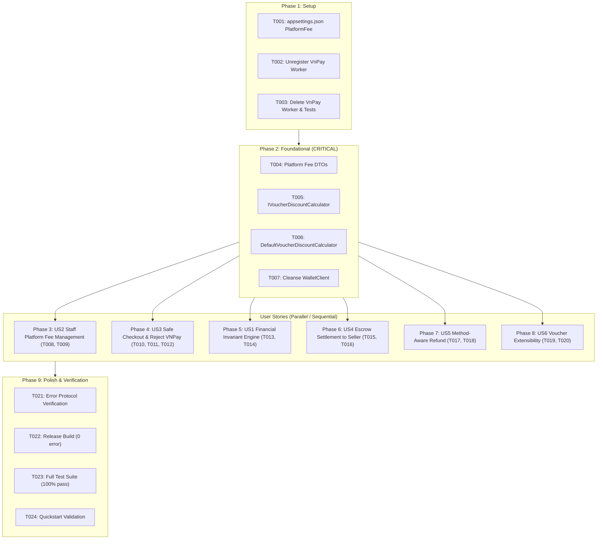

# Tasks: Order Financial Lifecycle, Staff-Managed Platform Fee & Voucher Extensibility (VNPay Decommissioned)

**Input**: Design documents from `/specs/023-order-financial-lifecycle-and-voucher-extensibility/`  
**Prerequisites**: `spec.md`, `plan.md`, `research.md`, `data-model.md`, `contracts/`, `quickstart.md`  

---

## Format: `[ID] [P?] [Story] Description`
- **[P]**: Can run in parallel (different files, no dependencies)
- **[Story]**: Which user story this task belongs to (e.g. US1, US2, US3)
- Exact file paths included in every task

---

## Phase 1: Setup & Environment Configuration

**Purpose**: Remove obsolete VNPay infrastructure and configure runtime platform fee settings

- [X] T001 Add `"PlatformFee:DefaultPercent": 0.0` configuration to `Commerce.Api/appsettings.json`
- [X] T002 [P] Unregister `VnPayPaymentPollingWorker` from background service registrations in `Commerce.Api/Program.cs`
- [X] T003 [P] Delete obsolete files `Commerce.Api/Workers/VnPayPaymentPollingWorker.cs` and `tests/Commerce.UnitTests/Application/VnPayPaymentPollingWorkerTests.cs`

---

## Phase 2: Foundational Infrastructure (Core Extensibility & Contracts)

**Purpose**: Core DTOs, interfaces, and client cleansing that block all user stories

**⚠️ CRITICAL**: Must be completed before individual user story implementation begins

- [X] T004 Create `PlatformFeeResponse` and `UpdatePlatformFeeRequest` records in `Commerce.Application/Common/Models/PlatformFeeModels.cs`
- [X] T005 [P] Define `IVoucherDiscountCalculator` interface and `VoucherCalculationResult` record in `Commerce.Application/Interfaces/IVoucherDiscountCalculator.cs`
- [X] T006 [P] Implement pass-through `DefaultVoucherDiscountCalculator` in `Commerce.Application/Services/Discount/DefaultVoucherDiscountCalculator.cs` and register in `Commerce.Application/DependencyInjection.cs`
- [X] T007 [P] Cleanse `IWalletClient.cs` and `WalletClient.cs`: remove dead direct-checkout methods (`InitiateDirectCheckoutAsync`, `GetDirectCheckoutStatusAsync`) and remove 409 conflict swallowing in `SettleSellerSubOrderAsync`

**Checkpoint**: Foundation ready - User stories can now be implemented independently.

---

## Phase 3: User Story 2 - Staff-Governed Platform Fee Rate Management (Priority: P1)

**Goal**: Expose an administrative endpoint (`PUT/GET /api/v1/admin/platform-fee`) restricted to `staff` and `admin` roles to dynamically adjust platform fee percentages with distributed cache backing.

**Independent Test**: Call `PUT /api/v1/admin/platform-fee` with role `buyer` or `seller` and verify HTTP 403 `FORBIDDEN`. Call with role `staff` and verify HTTP 200 with updated rate.

### Tests for User Story 2
- [X] T008 [P] [US2] Add unit tests for `AdminPlatformFeeController` verifying RBAC (reject buyer/seller with 403, allow staff with 200, reject invalid percentages < 0% or > 100% with 400) in `tests/Commerce.UnitTests/Controllers/AdminPlatformFeeTests.cs`

### Implementation for User Story 2
- [X] T009 [US2] Implement `AdminPlatformFeeController` at `Commerce.Api/Controllers/Admin/AdminPlatformFeeController.cs` decorated with `[Authorize]` and `[RequireRole("staff", "admin")]`, storing rates in `IDistributedCache` with fallback to `IConfiguration["PlatformFee:DefaultPercent"]`

**Checkpoint**: User Story 2 complete - Staff can independently query and update the platform fee rate.

---

## Phase 4: User Story 3 - Safe Multi-Vendor Checkout & VNPay Decommissioning Guard (Priority: P1) 🎯 MVP

**Goal**: Reject any checkout specifying `PaymentMethod.VnPay` with HTTP 400, and ensure wallet payment failures fail fast without deleting cart items.

**Independent Test**: Attempt checkout with `PaymentMethod.VnPay` and verify HTTP 400 `UNSUPPORTED_PAYMENT_METHOD`. Attempt wallet checkout with insufficient balance and verify HTTP 400 `INSUFFICIENT_WALLET_BALANCE` with cart items preserved.

### Tests for User Story 3
- [X] T010 [P] [US3] Add unit tests asserting rejected VNPay (`UNSUPPORTED_PAYMENT_METHOD`) and fail-closed wallet payments (cart items preserved, stock released) in `tests/Commerce.UnitTests/Application/OrderCheckoutTests.cs`

### Implementation for User Story 3
- [X] T011 [US3] Update `OrderService.CreateOrderAsync` in `Commerce.Application/Services/Order/OrderService.cs`: immediately reject `request.PaymentMethod == PaymentMethod.VnPay` with HTTP 400 `UNSUPPORTED_PAYMENT_METHOD`
- [X] T012 [US3] Update `OrderService.CreateOrderAsync` in `Commerce.Application/Services/Order/OrderService.cs`: if wallet debit fails with `INSUFFICIENT_BALANCE`, release reserved stock and throw HTTP 400 `INSUFFICIENT_WALLET_BALANCE` without deleting items from the cart

**Checkpoint**: User Story 3 complete - Checkout pipeline is safe from phantom orders and blocked from legacy VNPay.

---

## Phase 5: User Story 1 - Multi-Tier Financial Invariant Engine & Fee Calculation (Priority: P1)

**Goal**: Integrate `SubOrder.CalculateFinancials` into quoting and order creation, dynamically pulling the staff-configured platform fee percentage and enforcing zero-sum financial invariants.

**Independent Test**: Place an order and assert all 8 financial dimensions in `SubOrder` satisfy `TotalAmount == SellerReceiveAmount + PlatformFeeAmount + ShippingFeeAmount`.

### Tests for User Story 1
- [X] T013 [P] [US1] Add unit tests verifying domain invariant enforcement when platform fee is positive and when negative in `tests/Commerce.UnitTests/Domain/FinancialInvariantTests.cs`

### Implementation for User Story 1
- [X] T014 [US1] Update `OrderService.cs` in `Commerce.Application/Services/Order/OrderService.cs`: retrieve active platform markup percent from cache/config and invoke `subOrder.CalculateFinancials` during `CreateOrderAsync` and `QuoteCheckoutAsync`

**Checkpoint**: User Story 1 complete - Sub-orders mathematically balance and persist staff-configured fees.

---

## Phase 6: User Story 4 - Automated Seller Escrow Settlement on Goods Receipt (Priority: P1)

**Goal**: Automatically disburse `SellerReceiveAmount` from System Escrow to the seller's wallet upon delivery confirmation, retaining `PlatformFeeAmount + ShippingFeeAmount` in the escrow wallet.

**Independent Test**: Call `POST /api/v1/sub-orders/{subOrderId}/confirm-receipt` for a delivered sub-order and assert `_walletClient.SettleSellerSubOrderAsync` is called with exact `SellerReceiveAmount`.

### Tests for User Story 4
- [X] T015 [P] [US4] Add unit tests in `tests/Commerce.UnitTests/Application/OrderSettlementRefundTests.cs` verifying exact `SellerReceiveAmount` payout and proper handling of 409 settlement conflicts

### Implementation for User Story 4
- [X] T016 [US4] Verify and ensure `BuyerConfirmSubOrderReceiptAsync` and `CompleteOrderAsync` in `Commerce.Application/Services/Order/OrderService.cs` disburse `so.SellerReceiveAmount` and handle non-2xx responses cleanly

**Checkpoint**: User Story 4 complete - Sellers are disbursed exact net earnings automatically.

---

## Phase 7: User Story 5 - Payment-Method-Aware Sub-Order Refund & Voucher Reversion (Priority: P1)

**Goal**: Prevent unearned wallet refunds on COD order cancellations and automatically release reserved voucher usages upon cancellation.

**Independent Test**: Cancel a COD sub-order and verify zero calls to `_walletClient.RefundSubOrderPaymentAsync`. Cancel a wallet sub-order and verify `_walletClient.RefundSubOrderPaymentAsync` is called and `DiscountCodeUsages.Status` becomes `Released`.

### Tests for User Story 5
- [X] T017 [P] [US5] Add unit tests in `tests/Commerce.UnitTests/Application/OrderSettlementRefundTests.cs` verifying COD cancellations skip wallet refund while wallet cancellations trigger refund and release vouchers

### Implementation for User Story 7
- [X] T018 [US5] Update `CancelOrderAsync` and `SellerRejectSubOrderAsync` in `Commerce.Application/Services/Order/OrderService.cs`: guard wallet refund calls with `so.PaymentMethod == PaymentMethod.Wallet && wasPaid`, and release associated `DiscountCodeUsages`

**Checkpoint**: User Story 5 complete - COD refunds are safely blocked and vouchers are returned.

---

## Phase 8: User Story 6 - Voucher Extensibility Architecture (Priority: P2)

**Goal**: Wire `IVoucherDiscountCalculator` into `QuoteCheckoutAsync` to cleanly separate `ProductDiscountAmount`, `ShopDiscountAmount`, and `SystemDiscountAmount` for feature `024`.

**Independent Test**: Request a checkout quote and assert `IVoucherDiscountCalculator.CalculateDiscountsAsync` is called and populates shop discount fields.

### Tests for User Story 6
- [X] T019 [P] [US6] Add unit tests in `tests/Commerce.UnitTests/Application/OrderCheckoutTests.cs` verifying `IVoucherDiscountCalculator` integration into `QuoteCheckoutAsync`

### Implementation for User Story 6
- [X] T020 [US6] Inject `IVoucherDiscountCalculator` into `OrderService.cs` constructor and integrate into `QuoteCheckoutAsync` in `Commerce.Application/Services/Order/OrderService.cs`

**Checkpoint**: User Story 6 complete - Architectural boundary is ready for Feature 024.

---

## Phase 9: Polish, Quality Gates & Verification

**Purpose**: Solution compilation, full test execution, and end-to-end scenario validation

- [X] T021 [P] Verify 100% English Sentence-case error messages and `SCREAMING_SNAKE_CASE` error codes across all modified files
- [X] T022 Execute `dotnet build Commerce.sln -c Release` and assert 0 errors and 0 warnings
- [X] T023 Execute full test suite via `dotnet test Commerce.sln -c Release --no-build` and assert 100% pass rate
- [X] T024 Validate all curl scenarios defined in `specs/023-order-financial-lifecycle-and-voucher-extensibility/quickstart.md`

---

## Dependencies & Execution Order

### Parallel Execution Opportunities
- Tasks marked with `[P]` touch distinct files and can be authored or tested concurrently.
- In Phase 1: `T002` and `T003` run in parallel.
- In Phase 2: `T005`, `T006`, and `T007` run in parallel once `T004` completes.
- In User Stories: Test tasks (`T008`, `T010`, `T013`, `T015`, `T017`, `T019`) can be authored simultaneously before implementation.
- Polish phase tasks (`T021`, `T022`, `T023`) execute sequentially to validate final release readiness.

---

## Implementation Strategy

### MVP Milestone (Phase 1 through Phase 4)
1. Complete Phase 1 (Setup) and Phase 2 (Foundational).
2. Complete Phase 3 (US2: Staff Fee Management) and Phase 4 (US3: Safe Checkout & VNPay Rejection).
3. **Validate MVP**: Staff can configure fees; VNPay is blocked; Wallet checkout fails fast if balance is insufficient.

### Full Delivery Milestone (Phase 5 through Phase 9)
4. Add Phase 5 (US1: Invariant Engine), Phase 6 (US4: Escrow Settlement), and Phase 7 (US5: COD Refund Bypass).
5. Add Phase 8 (US6: Voucher Extensibility for Feature 024).
6. Execute Phase 9 (Release Build and 100% Test Suite Verification).
