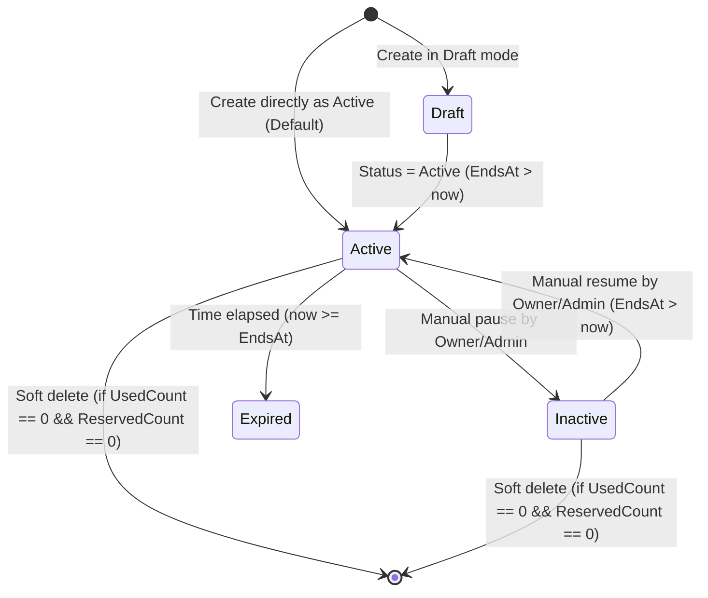
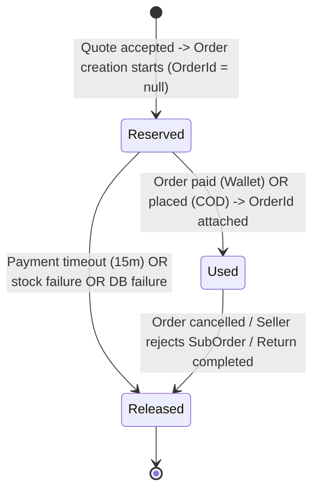

# Data Model: Voucher & Promotion Allocation Engine

**Feature**: `024-voucher-and-promotion-allocation-engine` | **Date**: 2026-11-16 | **Status**: APPROVED

---

## 1. Entity-Relationship Diagram (ERD)

```mermaid
erDiagram
    DiscountCodes ||--o{ DiscountCodeScopes : "defines scope (1:N)"
    DiscountCodes ||--o{ DiscountCodeUsages : "records redemptions (1:N)"
    Orders ||--o{ DiscountCodeUsages : "applies to master order (0:N)"
    SubOrders ||--o{ DiscountCodeUsages : "applies to sub-order (0:N)"

    DiscountCodes {
        uuid Id PK
        varchar(100) Code UK "Unique on LOWER(Code) WHERE IsDeleted = FALSE"
        varchar(255) Name "Promotion title"
        integer ScopeType "0: System, 1: Shop, 2: Product"
        uuid OwnerSellerId "FK to Seller; NULL if System"
        integer DiscountType "0: Percentage, 1: FixedAmount"
        numeric(18,2) DiscountValue "VND amount or percentage value"
        numeric(18,2) MinOrderAmount "Minimum eligible amount"
        numeric(18,2) MaxDiscountAmount "Cap for Percentage type; NULL if Fixed"
        integer MaxUsesTotal "Global maximum redemptions"
        integer MaxUsesPerUser "Per-user limit, default 1"
        integer UsedCount "Successfully paid usages"
        integer ReservedCount "Currently reserved usages (15m window)"
        boolean IsVisible "true: public, false: private"
        integer Status "0: Draft, 1: Active, 2: Inactive, 3: Expired"
        timestamptz StartsAt "Valid from UTC"
        timestamptz EndsAt "Valid until UTC"
        uuid CreatedBy "Admin/Seller ID"
        timestamptz CreatedAt
        timestamptz UpdatedAt
        boolean IsDeleted
        timestamptz DeletedAt
    }

    DiscountCodeScopes {
        uuid Id PK
        uuid DiscountCodeId FK
        integer ScopeRefType "0: Shop, 1: Product, 2: Sku, 3: Category, 4: All"
        uuid ScopeRefId "Entity ID matching ScopeRefType; NULL if All"
        timestamptz CreatedAt
        timestamptz UpdatedAt
        boolean IsDeleted
        timestamptz DeletedAt
    }

    DiscountCodeUsages {
        uuid Id PK
        uuid DiscountCodeId FK
        uuid UserId "Buyer ID"
        uuid OrderId "FK to Orders.Id; NULL while in initial reservation"
        uuid SubOrderId "FK to SubOrders.Id; NULL if System voucher"
        numeric(18,2) DiscountAmount "Effective discounted amount (VND integer)"
        integer Status "0: Reserved, 1: Used, 2: Released"
        timestamptz ReservedAt
        timestamptz UsedAt
        timestamptz ReleasedAt
        timestamptz CreatedAt
        timestamptz UpdatedAt
        boolean IsDeleted
        timestamptz DeletedAt
    }
```

---

## 2. Domain Enums (`Commerce.Domain.Enums`)

```csharp
namespace Commerce.Domain.Enums;

public enum DiscountScopeType
{
    System = 0,   // Platform-wide voucher created by Admin (OwnerSellerId = null)
    Shop = 1,     // Shop voucher created by Seller (OwnerSellerId = SellerId)
    Product = 2   // Product/SKU voucher created by Seller (OwnerSellerId = SellerId)
}

public enum DiscountType
{
    Percentage = 0,   // % discount (0 < Value <= 100)
    FixedAmount = 1   // Fixed VND discount (Value > 0)
}

public enum DiscountScopeRefType
{
    Shop = 0,     // ScopeRefId = SellerId
    Product = 1,  // ScopeRefId = ProductId
    Sku = 2,      // ScopeRefId = SkuId
    Category = 3, // ScopeRefId = CategoryId (Deferred for MVP)
    All = 4       // ScopeRefId = null (Global)
}

public enum DiscountStatus
{
    Draft = 0,    // Draft, not redeemable
    Active = 1,   // Active and applicable
    Inactive = 2, // Paused by Admin/Seller
    Expired = 3   // Computed state when now >= EndsAt
}

public enum DiscountUsageStatus
{
    Reserved = 0, // Held during checkout window (15m)
    Used = 1,     // Committed upon order payment (Wallet) or placement (COD)
    Released = 2  // Returned due to cancellation, timeout, or return
}
```

---

## 3. Financial Invariants & Mathematical Equations (Shopee / TikTok Shop Model)

### 3.1. SubOrder Invariant
For each `SubOrder` $k$:
1. $\text{ItemsAmount}_k = \sum (UnitPrice \times Quantity)$
2. $\text{NetSeller}_k = \text{ItemsAmount}_k - \text{ProductDiscountAmount}_k - \text{ShopDiscountAmount}_k$
3. $\text{PlatformFeeAmount}_k = \text{Math.Round}\left(\text{NetSeller}_k \times \frac{r}{100m}, 0, \text{MidpointRounding.AwayFromZero}\right)$ *(Seller pays 5% platform commission)*
4. $\text{SellerReceiveAmount}_k = \text{NetSeller}_k - \text{PlatformFeeAmount}_k$ *(Seller payout after platform commission)*
5. $\text{TotalAmount}_k = \text{NetSeller}_k - \text{SystemDiscountAmount}_k + \text{ShippingFeeAmount}_k$ *(Buyer pays exact catalog price minus discounts + shipping, no markup)*

$$\mathbf{Accounting\ Invariant}: \quad \text{TotalAmount}_k \equiv \text{SellerReceiveAmount}_k + (\text{PlatformFeeAmount}_k - \text{SystemDiscountAmount}_k) + \text{ShippingFeeAmount}_k$$

### 3.2. Master Order Invariant
$$\text{Orders.TotalAmount} = \sum_{k=1}^M \text{TotalAmount}_k = \sum_{k=1}^M \text{ItemsAmount}_k - \sum_{k=1}^M \text{DiscountAmount}_k + \sum_{k=1}^M \text{ShippingFeeAmount}_k$$

---

## 4. State Transitions

### 4.1. DiscountCode Lifecycle State Machine


### 4.2. DiscountCodeUsage State Machine

