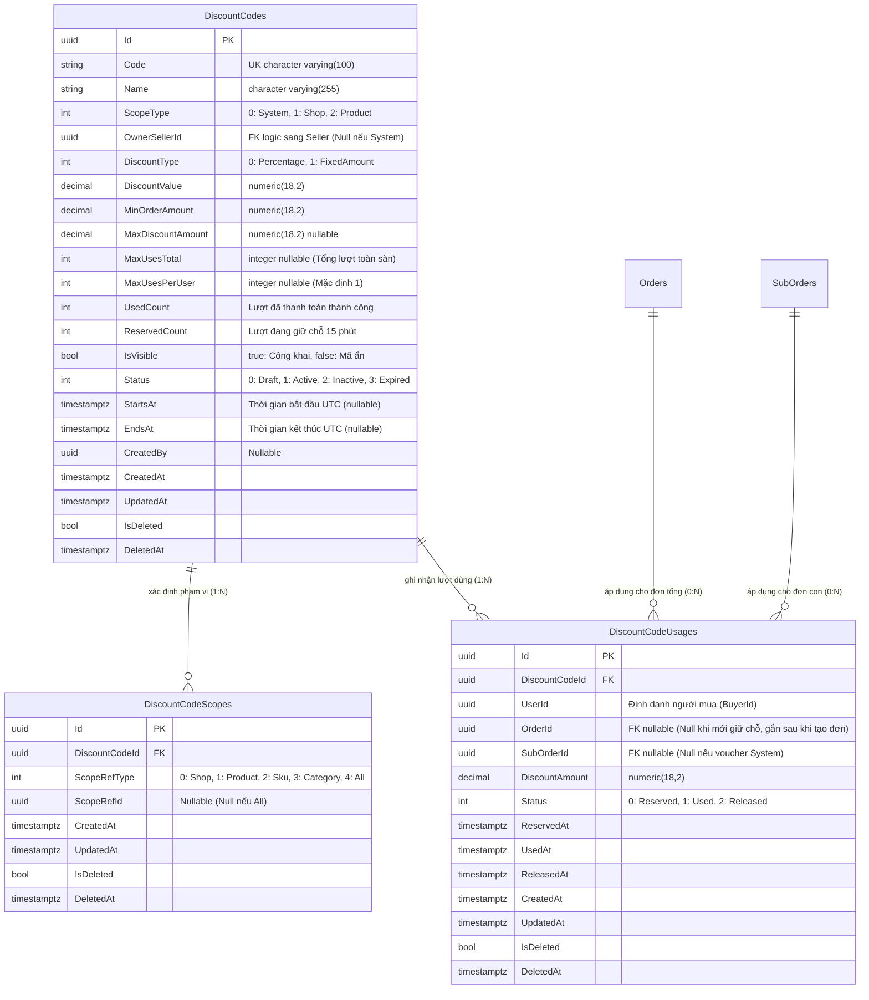

# TÀI LIỆU ĐẶC TẢ YÊU CẦU PHẦN MỀM CHO AI AGENT (AI-READY SRS)
## PHÂN HỆ: VOUCHER & PROMOTION ALLOCATION ENGINE (`Commerce.sln`)

| Thuộc tính | Giá trị |
| :--- | :--- |
| **Tên dịch vụ** | Nexus Commerce Microservice (`Commerce.Api` — Port: `8003`) |
| **Cơ sở dữ liệu** | PostgreSQL 16 (`commerce_db:5435`) — **Schema Cố Định 100% (Zero Schema Drift)** |
| **Kiến trúc mục tiêu** | 4-Layer Clean Architecture, Feature Co-location, 100% RESTful, No-Repository, No-Broker |
| **Đối tượng đọc** | AI Coding Agents, Sinh viên thực tập OJT, Senior Backend Engineers, QA Automation |
| **Trạng thái đặc tả** | `FROZEN_FOR_IMPLEMENTATION` (Chuẩn hóa toàn diện — Sẵn sàng lập Plan và Code) |

---

## PHẦN 0: CHỈ THỊ THỰC THI TỐI CAO DÀNH CHO AI AGENT (AGENT SYSTEM DIRECTIVES)

> **CẢNH BÁO DÀNH CHO AI AGENT:** Trước khi sinh bất kỳ dòng mã nguồn C# nào, Agent bắt buộc phải nạp và tuân thủ tuyệt đối 9 quy tắc bất biến (Hard Guardrails) dưới đây. Mọi hành vi vi phạm bất kỳ quy tắc nào đều khiến bản build bị từ chối.

1. **Xử lý Xung đột Tài liệu Nguồn (Source of Truth Hierarchy):**
   * Hệ thống vận hành theo Clean Architecture 4 tầng đặt tại thư mục gốc: `Commerce.Domain/`, `Commerce.Application/`, `Commerce.Infrastructure/`, `Commerce.Api/` (**TUYỆT ĐỐI KHÔNG DÙNG TIỀN TỐ `src/`**).
   * Hệ thống đã **bãi bỏ hoàn toàn Message Broker / Saga / Outbox** và vận hành theo mô hình **Master Order (`Orders`) $\rightarrow$ Shop Sub-Orders (`SubOrders`) $\rightarrow$ `SubOrderItems`**.
   * **Khai tử hoàn toàn cổng VNPay (Feature 023):** Hệ thống chỉ hỗ trợ duy nhất 2 phương thức thanh toán: `PaymentMethod.Wallet` (`0`) và `PaymentMethod.Cod` (`2`). Toàn bộ worker polling VNPay đã bị xóa sổ; request thanh toán VNPay bị chặn ngay lập tức với HTTP 400 `UNSUPPORTED_PAYMENT_METHOD`.
   * **CHỈ THỊ:** AI Agent **TUYỆT ĐỐI KHÔNG** tạo hoặc tham chiếu tới các bảng `checkout_groups`, `outbox_messages`, `inbox_messages`, `saga_state` hoặc tái kích hoạt VNPay.
2. **Bảo toàn Schema Database Cố định (Zero Schema Drift):**
   * Chỉ sử dụng đúng 3 bảng thuộc phân hệ Voucher đã có trong `AppDbContext`: `DiscountCodes`, `DiscountCodeScopes`, `DiscountCodeUsages` và liên kết với `Orders`, `SubOrders`, `AuditLogs`.
   * **TUYỆT ĐỐI KHÔNG** tạo bảng mới, không thêm migration vật lý mới. Bắt buộc dùng đúng tên cột thực tế trong DB: `MaxUsesTotal` (thay vì `UsageLimit`), `StartsAt`/`EndsAt` (thay vì `StartDate`/`EndDate`), và `UserId` (thay vì `BuyerId`).
3. **Cấm Repository Pattern (No-Repository over EF Core):**
   * **TUYỆT ĐỐI CẤM** tạo `IDiscountRepository`, `DiscountRepository`, hoặc `IUnitOfWork`.
   * Mọi truy vấn và cập nhật dữ liệu trong `DiscountService` và `OrderService` phải gọi trực tiếp qua interface `ICommerceDbContext`.
   * Bổ sung thuộc tính `DatabaseFacade Database { get; }` vào `ICommerceDbContext` để hỗ trợ transaction và execution strategy trực tiếp qua interface.
4. **Tổ chức Thư mục theo Feature Co-location & Tích Hợp Nền Móng Feature 023:**
   * Toàn bộ code tầng Application của tính năng Voucher phải đặt gọn trong thư mục `Commerce.Application/Services/Discount/`.
   * **Kế thừa nền móng Feature 023:** Thay thế `DefaultVoucherDiscountCalculator` bằng triển khai chính thức `VoucherDiscountCalculator : IVoucherDiscountCalculator` trong `Commerce.Application/DependencyInjection.cs`, kết nối trực tiếp với hàm thuần `IVoucherCalculationEngine` để phục vụ quy trình báo giá (`QuoteCheckoutAsync`) không gây breaking changes.
   * Gom toàn bộ logic giữ chỗ, xác nhận sử dụng, và giải phóng voucher vào một service chuyên biệt: `IVoucherLifecycleService.cs` / `VoucherLifecycleService.cs` để tái sử dụng thống nhất tại `OrderService` và `PaymentTimeoutWorker`.
5. **Thin Controllers & Pure DTOs:**
   * Controller đặt tại `Commerce.Api/Controllers/Public/DiscountsController.cs`.
   * Controller chỉ trích xuất `currentUserId` qua `this.TryGetUserId(out var userId, out var authError)`, kiểm tra quyền qua `[RequireRole(...)]`, gọi `IDiscountService` và trả về **Pure DTO** (tuyệt đối không bọc `ApiResponse<T>`).
6. **Quy chuẩn Casing & Tiền Tệ VND Số Nguyên (VND Integer Rounding):**
   * JSON properties: `camelCase`.
   * Enums: Lưu xuống PostgreSQL dưới dạng số nguyên (`int`). Khi tuần tự hóa ra JSON REST API bắt buộc chuyển thành chuỗi **`PascalCase`** thông qua `PascalCaseJsonStringEnumConverter`. Không dùng identifier alias trùng giá trị.
   * **Đơn vị tiền tệ:** Toàn bộ công thức tính toán tài chính và lưu trữ cho thị trường Việt Nam (VND) phải làm tròn về **số nguyên đồng (0 chữ số thập phân)** bằng `Math.Round(x, 0, MidpointRounding.AwayFromZero)` để tương thích 100% với chuẩn hạch toán Ví hệ thống và thực tế kế toán.
7. **Quy chuẩn Ngoại lệ & Bảng Mã Lỗi Duy Nhất (Single Source of Truth RFC 9110):**
   * Mọi lỗi nghiệp vụ phải quăng `CommerceDomainException(string errorCode, string message, int statusCode)`.
   * `errorCode`: 100% `SCREAMING_SNAKE_CASE` (Cấm tiền tố `ERR_`; chỉ dùng tiền tố `VAL_` cho validation).
   * `message` (`detail`): **100% tiếng Anh**, viết theo chuẩn **Sentence case** và **bắt buộc khớp chính xác từng ký tự với Phần 4 (Error Catalog)**.
8. **Chốt Chặn Phân Quyền Động Qua UserService (`:8001`):**
   * Khi Seller thực hiện các thao tác quản trị voucher (`UC-04` Tạo, `UC-07` Sửa, `UC-08` Đổi trạng thái, `UC-09` Xóa mềm), hệ thống bắt buộc gọi sang UserService qua `_userClient.CheckBuyerPermissionAsync(currentUserId, action: "manage_voucher", ct)` (với Timeout 10s) để ngăn chặn các Shop đang chịu lệnh phạt, bị khóa tài khoản hoặc có điểm uy tín thấp tự ý phát hành khuyến mãi.
9. **Khóa Giữ Chỗ Tuần Tự Hóa & Giải Phóng Idempotent:**
   * Khóa giữ chỗ per-user bằng `pg_advisory_xact_lock` trong transaction ngắn ở `UC-11`, insert bản ghi usage tạm thời (`OrderId = null`) để tránh vi phạm Foreign Key.
   * Mọi thao tác giải phóng hoặc khôi phục voucher (`UC-12`) bắt buộc phải cập nhật trạng thái bản ghi `DiscountCodeUsages` bằng điều kiện nguyên tử trước (`Status = Released WHERE Id = x AND Status = Reserved/Used`). Chỉ khi `affected == 1` mới được phép giảm `ReservedCount` hoặc `UsedCount` trên `DiscountCodes`.

---

## PHẦN 1: MÔ HÌNH MIỀN, ENUMS & ÁNH XẠ CƠ SỞ DỮ LIỆU (DOMAIN & DB MAPPING)

### 1.1. Sơ Đồ Quan Hệ Thực Thể Phân Hệ Voucher (ER Diagram Chuẩn Hóa)



### 1.2. Định nghĩa Enums Chuẩn Hóa (`Commerce.Domain/Enums/`)

```csharp
namespace Commerce.Domain.Enums;

public enum DiscountScopeType
{
    System = 0,   // Voucher toàn sàn do Admin tạo (OwnerSellerId = null)
    Shop = 1,     // Voucher gian hàng do Seller tạo (OwnerSellerId = SellerId)
    Product = 2   // Voucher sản phẩm/SKU do Seller tạo (OwnerSellerId = SellerId)
}

public enum DiscountType
{
    Percentage = 0,   // Giảm theo % (0 < Value <= 100)
    FixedAmount = 1   // Giảm số tiền cố định VND (Value > 0)
}

public enum DiscountScopeRefType
{
    Shop = 0,     // Áp dụng cho SellerId (ScopeRefId = SellerId)
    Product = 1,  // Áp dụng cho ProductId (ScopeRefId = ProductId)
    Sku = 2,      // Áp dụng đích danh cho SkuId (ScopeRefId = SkuId)
    Category = 3, // Áp dụng cho ngành hàng (ScopeRefId = CategoryId - Tạm thời hoãn cho MVP)
    All = 4       // Áp dụng toàn sàn (ScopeRefId = null)
}

public enum DiscountStatus
{
    Draft = 0,    // Bản nháp, chưa có hiệu lực
    Active = 1,   // Đang kích hoạt
    Inactive = 2, // Tạm dừng bởi Admin/Seller
    Expired = 3   // Trạng thái dẫn xuất (Computed State khi now >= EndsAt)
}

public enum DiscountUsageStatus
{
    Reserved = 0, // Đang khóa giữ chỗ 15 phút chờ thanh toán
    Used = 1,     // Đã thanh toán thành công (hoặc COD đã xác nhận)
    Released = 2  // Đã giải phóng/hoàn lại lượt dùng (do hủy đơn, timeout, hoặc từ chối đơn)
}
```

### 1.3. Từ Điển Dữ Liệu Thực Thể & Bất Biến Miền (Domain Invariants)

#### Bảng 1: `DiscountCodes` (`Commerce.Domain.Entities.DiscountCode`)
| Thuộc tính C# | Kiểu C# | Cột DB PostgreSQL | Bất Biến Miền & Ràng Buộc Nghiệp Vụ (Invariants) |
| :--- | :--- | :--- | :--- |
| `Id` | `Guid` | `uuid PK` | Khởi tạo `Guid.NewGuid()`. |
| `Code` | `string` | `varchar(100) UK` | Lưu `UPPERCASE`. Unique trên `LOWER("Code") WHERE "IsDeleted" = FALSE`. |
| `Name` | `string` | `varchar(255)` | Tên chương trình khuyến mãi ($\le 255$ ký tự). |
| `ScopeType` | `DiscountScopeType` | `integer` | `System (0)`, `Shop (1)`, `Product (2)`. |
| `OwnerSellerId` | `Guid?` | `uuid null` | **Invariant:** `(ScopeType == System) == (OwnerSellerId == null)`. |
| `DiscountType` | `DiscountType` | `integer` | `Percentage (0)`, `FixedAmount (1)`. |
| `DiscountValue` | `decimal` | `numeric(18,2)` | Phải $> 0$. Nếu `Percentage` thì bắt buộc $\le 100$. |
| `MinOrderAmount` | `decimal` | `numeric(18,2)` | Giá trị đơn hàng tối thiểu của phạm vi hợp lệ ($\ge 0$, mặc định `0`). |
| `MaxDiscountAmount` | `decimal?` | `numeric(18,2) null` | Trần giảm tối đa khi `Percentage` ($> 0$). **Invariant:** Nếu `FixedAmount` thì bắt buộc ép về `null`. |
| `MaxUsesTotal` | `int?` | `integer null` | Tổng lượt dùng tối đa toàn sàn (`null` = không giới hạn, nếu có phải $> 0$). |
| `MaxUsesPerUser` | `int?` | `integer null` | Số lần tối đa 1 người dùng (`UserId`) được dùng mã này (mặc định `1`, nếu có phải $\ge 1$). |
| `UsedCount` | `int` | `integer` | Số lượt đã thanh toán (`>= 0`, mặc định `0`). |
| `ReservedCount` | `int` | `integer` | Số lượt đang giữ chỗ 15m (`>= 0`, mặc định `0`). **Invariant:** `UsedCount + ReservedCount <= MaxUsesTotal`. |
| `IsVisible` | `bool` | `boolean` | `true`: Công khai; `false`: Mã ẩn/Private (nhập tay vẫn dùng được). Mặc định `true`. |
| `Status` | `DiscountStatus` | `integer` | Khởi tạo mặc định là `Active (1)`. |
| `StartsAt` | `DateTimeOffset?` | `timestamptz null` | Thời gian bắt đầu hiệu lực (UTC). |
| `EndsAt` | `DateTimeOffset?` | `timestamptz null` | Thời gian kết thúc hiệu lực (UTC). **Invariant:** Nếu có cả 2 thì `EndsAt > StartsAt`. |
| `CreatedBy` | `Guid?` | `uuid null` | ID người tạo (Admin/Seller). |
| `CreatedAt` ... | `DateTimeOffset` ... | `timestamptz` ... | Kế thừa từ `BaseEntity<Guid>`. |

#### Bảng 2: `DiscountCodeScopes` (`Commerce.Domain.Entities.DiscountCodeScope`)
| Thuộc tính C# | Kiểu C# | Cột DB PostgreSQL | Bất Biến Miền & Ràng Buộc Nghiệp Vụ (Invariants) |
| :--- | :--- | :--- | :--- |
| `Id` | `Guid` | `uuid PK` | Định danh phạm vi. |
| `DiscountCodeId` | `Guid` | `uuid FK` | Trỏ tới `DiscountCodes.Id`. |
| `ScopeRefType` | `DiscountScopeRefType` | `integer` | `Shop (0)`, `Product (1)`, `Sku (2)`, `Category (3)`, `All (4)`. |
| `ScopeRefId` | `Guid?` | `uuid null` | **Invariant:** `(ScopeRefType == All) == (ScopeRefId == null)`. |

#### Bảng 3: `DiscountCodeUsages` (`Commerce.Domain.Entities.DiscountCodeUsage`)
| Thuộc tính C# | Kiểu C# | Cột DB PostgreSQL | Bất Biến Miền & Ràng Buộc Nghiệp Vụ (Invariants) |
| :--- | :--- | :--- | :--- |
| `Id` | `Guid` | `uuid PK` | Định danh lượt sử dụng. |
| `DiscountCodeId` | `Guid` | `uuid FK` | Trỏ tới `DiscountCodes.Id`. |
| `UserId` | `Guid` | `uuid` | Định danh người mua sử dụng mã (`BuyerId`). |
| `OrderId` | `Guid?` | `uuid FK null` | Trỏ tới `Orders.Id` (Gắn sau khi Order tạo thành công). |
| `SubOrderId` | `Guid?` | `uuid FK null` | Trỏ tới `SubOrders.Id` (Có giá trị với mã `Shop`/`Product`, `null` với mã `System`). |
| `DiscountAmount` | `decimal` | `numeric(18,2)` | Số tiền thực tế mã này đã giảm trên đơn hàng ($\ge 0$, làm tròn đồng). |
| `Status` | `DiscountUsageStatus` | `integer` | `Reserved (0)`, `Used (1)`, `Released (2)`. |
| `ReservedAt` | `DateTimeOffset` | `timestamptz` | Thời điểm giữ chỗ (UTC). |
| `UsedAt` | `DateTimeOffset?` | `timestamptz null` | Thời điểm thanh toán thành công (UTC). |
| `ReleasedAt` | `DateTimeOffset?` | `timestamptz null` | Thời điểm hoàn/nhả lượt dùng (UTC). |

---

## PHẦN 2: QUY TẮC TÀI CHÍNH & THUẬT TOÁN TRỌNG TÂM (CORE ALGORITHMS)

### 2.1. Quy tắc Xếp chồng 3 Tầng (3-Tier Voucher Stacking Rule)
Trong một phiên Checkout (`CHK-01` & `CHK-02`), người mua được áp dụng tối đa 3 tầng khuyến mãi theo thứ tự tuần tự:
1. **Tầng 1 — `Product` Voucher:** Tối đa **01 mã / 01 dòng sản phẩm (`CartItem` / `SubOrderItem`)**.
   * *Ngữ nghĩa giảm giá:*
     * Nếu `DiscountType == Percentage`: Áp dụng phần trăm giảm trên từng dòng sản phẩm khớp scope.
     * Nếu `DiscountType == FixedAmount`: Giảm một lần duy nhất cho toàn bộ nhóm sản phẩm khớp scope của mã đó trong Shop.
   * *Ngữ nghĩa `MinOrderAmount`:* Được kiểm tra trên tổng giá trị các mặt hàng khớp scope của mã đó trong giỏ hàng.
   * *Quy tắc bản ghi:* Mỗi mã `Product` trên 1 `SubOrder` chỉ tạo **đúng 01 bản ghi `DiscountCodeUsage`** với tổng số tiền giảm gộp của các mặt hàng khớp.
2. **Tầng 2 — `Shop` Voucher:** Tối đa **01 mã / 01 gian hàng (`SellerId` / `SubOrder`)**. Tính trên tổng tiền hàng của Shop đó **sau khi đã trừ Tầng 1**.
   * *Phân bổ chiết khấu Tầng 2 xuống các mặt hàng:* Số tiền giảm của Shop voucher được phân bổ tỷ lệ pro-rata xuống từng mặt hàng trong Shop theo giá trị còn lại sau Tầng 1 của mặt hàng đó.
3. **Tầng 3 — `System` Voucher:** Tối đa **01 mã / toàn bộ phiên đặt hàng (`Master Order`)**. Tính trên tổng tiền hàng còn lại của các mặt hàng hợp lệ toàn phiên **sau khi đã trừ Tầng 1 và Tầng 2**.

* **Quy tắc Chặn Xung Đột (Conflict Guard):**
  * Danh sách `voucherCodes` chứa $\ge 2$ mã `System` $\rightarrow$ Quăng lỗi `400 VOUCHER_STACKING_CONFLICT`.
  * Danh sách chứa $\ge 2$ mã `Shop` cùng một `OwnerSellerId` $\rightarrow$ Quăng lỗi `400 VOUCHER_STACKING_CONFLICT`.
  * Danh sách chứa $\ge 2$ mã `Product` cùng khớp trên một `SkuId` $\rightarrow$ Quăng lỗi `400 VOUCHER_STACKING_CONFLICT`.

### 2.2. Công thức Tính Tiền Giảm & Phân bổ Pro-Rata Chuẩn Hóa Số Nguyên VND

#### Bước 1: Hàm tính số tiền giảm cơ bản (`CalculateRawDiscount`)
Cho giá trị cơ sở hợp lệ $B \ge 0$ và thực thể `DiscountCode` $V$ (đã thỏa mãn $B \ge V.\text{MinOrderAmount}$):
* Nếu $V.\text{DiscountType} == \text{FixedAmount}$:
  $$D = \min(V.\text{DiscountValue}, B)$$
* Nếu $V.\text{DiscountType} == \text{Percentage}$:
  $$D_{\text{pct}} = \text{Math.Round}\left(B \times \frac{V.\text{DiscountValue}}{100m}, 0, \text{MidpointRounding.AwayFromZero}\right)$$
  $$D_{\text{capped}} = V.\text{MaxDiscountAmount.HasValue} ? \min(D_{\text{pct}}, V.\text{MaxDiscountAmount.Value}) : D_{\text{pct}}$$
  $$D = \min(D_{\text{capped}}, B)$$

#### Bước 2: Tính toán Tầng 1 (`Product`) và Tầng 2 (`Shop`) cho từng Shop $k$
Với mỗi Shop $k \in \{1 \dots M\}$ có tập mặt hàng $i \in \{1 \dots N_k\}$:
1. Tổng tiền hàng gốc của Shop $k$:
   $$\text{itemsAmount}_k = \sum_{i=1}^{N_k} (\text{UnitPrice}_{k,i} \times \text{Quantity}_{k,i})$$
2. Nếu có mã `Product` $V_{\text{prod}}$: Tính tổng giảm sản phẩm $\text{productDiscountAmount}_k$ theo Bước 1.
3. Tiền hàng của Shop $k$ sau Tầng 1:
   $$\text{AfterProd}_k = \text{itemsAmount}_k - \text{productDiscountAmount}_k$$
4. Nếu Shop $k$ có áp dụng mã `Shop` $V_{\text{shop}}$: Tính cơ sở hợp lệ $\text{EligibleShopBase}_k$. Nếu $\text{EligibleShopBase}_k \ge V_{\text{shop}}.\text{MinOrderAmount}$, tính $\text{shopDiscountAmount}_k = \text{CalculateRawDiscount}(\text{EligibleShopBase}_k, V_{\text{shop}})$.
5. Doanh thu bán hàng ròng của Seller $k$ trước phí sàn (`NetSellerAmount`):
   $$\text{NetSeller}_k = \text{itemsAmount}_k - \text{productDiscountAmount}_k - \text{shopDiscountAmount}_k$$
6. **Hoa hồng sàn thu từ Seller $k$ (`PlatformFeeAmount`):**
   *(Áp dụng mô hình chuẩn Shopee / TikTok Shop: Phí sàn $r = 5\%$ khấu trừ trực tiếp từ doanh thu bán của Shop, $r$ quản trị động bởi Staff qua `AdminPlatformFeeController`)*:
   $$\text{platformFeeAmount}_k = \text{Math.Round}\left(\text{NetSeller}_k \times \frac{r}{100m}, 0, \text{MidpointRounding.AwayFromZero}\right)$$
7. **Tiền thực tế giải ngân vào ví Seller $k$ (`SellerReceiveAmount`):**
   $$\text{sellerReceiveAmount}_k = \text{NetSeller}_k - \text{platformFeeAmount}_k$$

#### Bước 3: Tính toán Tầng 3 (`System`) & Phân bổ Pro-rata (Thứ tự Xác định)
Nếu phiên đặt hàng có áp dụng mã `System` $V_{\text{sys}}$:
1. **Xác định cơ sở hợp lệ của từng Shop ($\text{EligibleSysBase}_k$):**
   * Tính tổng giá trị của các mặt hàng trong Shop $k$ **thực sự khớp với Scopes của $V_{\text{sys}}$** sau khi đã trừ chiết khấu Tầng 1 và Tầng 2 của các mặt hàng đó.
   * Lọc danh sách $L$ shop có $\text{EligibleSysBase}_k > 0$, **bắt buộc sắp xếp theo `SellerId` tăng dần**.
2. Tổng cơ sở xét điều kiện toàn sàn:
   $$\text{Base}_{\text{sys}} = \sum_{j=1}^{L} \text{EligibleSysBase}_{k_j}$$
3. Nếu $\text{Base}_{\text{sys}} \ge V_{\text{sys}}.\text{MinOrderAmount}$, tính tổng mức giảm toàn sàn $D_{\text{sys\_total}} = \text{CalculateRawDiscount}(\text{Base}_{\text{sys}}, V_{\text{sys}})$.
4. **Phân bổ tỷ lệ theo $\text{EligibleSysBase}$ làm tròn số nguyên đồng kèm khóa chống lệch xu:**
   * Khởi tạo `decimal allocatedSum = 0m;`.
   * Với các shop từ $j = 1$ đến $L - 1$:
     $$\text{systemDiscountAmount}_{k_j} = \text{Math.Round}\left(D_{\text{sys\_total}} \times \frac{\text{EligibleSysBase}_{k_j}}{\text{Base}_{\text{sys}}}, 0, \text{MidpointRounding.AwayFromZero}\right)$$
     $$\text{allocatedSum} += \text{systemDiscountAmount}_{k_j}$$
   * Với shop hợp lệ cuối cùng ($j = L$ theo thứ tự `SellerId` tăng dần):
     $$\text{systemDiscountAmount}_{k_L} = D_{\text{sys\_total}} - \text{allocatedSum}$$

#### Bước 4: Bất biến Tài chính trên `SubOrders` và `Orders` (Chuẩn Shopee / TikTok Shop Số Nguyên VND)
* **Trên từng `SubOrder` $k$:**
  * $\text{discountAmount}_k = \text{productDiscountAmount}_k + \text{shopDiscountAmount}_k + \text{systemDiscountAmount}_k$
  * **Tổng tiền Buyer thanh toán cho SubOrder $k$ (`TotalAmount`):**
    *(Buyer trả đúng giá niêm yết trừ toàn bộ voucher cộng phí ship, tuyệt đối KHÔNG bị cộng phụ thu phí sàn)*:
    $$\text{totalAmount}_k = \text{NetSeller}_k - \text{systemDiscountAmount}_k + \text{shippingFeeAmount}_k$$
    $$\text{totalAmount}_k = \text{itemsAmount}_k - \text{discountAmount}_k + \text{shippingFeeAmount}_k$$
  * **Khoản tiền Sàn thực nhận / tài trợ ròng trên đơn con (`NetPlatformRetained`):**
    $$\text{netPlatformRetained}_k = \text{platformFeeAmount}_k - \text{systemDiscountAmount}_k$$
    *(Nếu dương $\rightarrow$ Sàn có lợi nhuận hoa hồng; Nếu âm $\rightarrow$ Sàn bù chi phí marketing tài trợ voucher).*
  * **Bất biến đối ứng kế toán trên SubOrder (Financial Invariant Assertion):**
    Vì $\text{NetSeller}_k = \text{sellerReceiveAmount}_k + \text{platformFeeAmount}_k$, ta có:
    $$\boxed{\text{totalAmount}_k \equiv \text{sellerReceiveAmount}_k + (\text{platformFeeAmount}_k - \text{systemDiscountAmount}_k) + \text{shippingFeeAmount}_k}$$
* **Trên `Master Order` (`Orders`):**
  * $\text{Orders.TotalAmount} = \sum_{k=1}^{M} \text{totalAmount}_k$ (Tổng số tiền Buyer thực thanh toán qua Ví hoặc COD).
  * **Phương trình đối ứng tổng thể minh bạch 100%:**
    $$\text{Orders.TotalAmount} = \sum_{k=1}^M \text{itemsAmount}_k - \sum_{k=1}^M \text{discountAmount}_k + \sum_{k=1}^M \text{shippingFeeAmount}_k$$

---

### 2.3. Ví dụ Minh Họa Bằng Số Cụ Thể (Golden Worked Example Chuẩn Shopee Số Nguyên VND)

* **Giỏ hàng gồm 2 Shop:**
  * **Shop A:** 01 Áo sơ mi ($300.000đ$) + 01 Quần Jean ($500.000đ$). Tiền hàng: $800.000đ$. Cước ship GHN: $30.000đ$.
  * **Shop B:** 01 Giày thể thao ($600.000đ$). Tiền hàng: $600.000đ$. Cước ship GHN: $40.000đ$.
  * Tổng tiền hàng niêm yết Catalog: $1.400.000đ$.
* **Voucher áp dụng:**
  * *Tầng 1 (Product):* Mã `JEAN20` giảm $20.000đ$ cho Quần Jean tại Shop A.
  * *Tầng 2 (Shop):* Mã `SHOPA50` giảm $50.000đ$ cho đơn từ $700.000đ$ tại Shop A.
  * *Tầng 3 (System):* Mã `ALLSALL` giảm $10\%$ tối đa $100.000đ$ cho đơn toàn sàn từ $1.000.000đ$.
  * Hoa hồng sàn thu từ Shop: $r = 5\%$.

* **Các bước tính toán chi tiết:**
  1. **Shop A:**
     * `ItemsAmount` = $800.000đ$.
     * `ProductDiscountAmount` = $20.000đ \rightarrow \text{AfterProd} = 780.000đ$.
     * `ShopDiscountAmount` = $50.000đ$.
     * `NetSeller` (Shop A) = $780.000đ - 50.000đ = \mathbf{730.000đ}$.
     * `PlatformFeeAmount` (Shop A) = $\text{Round}(730.000 \times 5\%) = \mathbf{36.500đ}$ (Hoa hồng sàn thu từ Shop A).
     * `SellerReceiveAmount` (Shop A) = $730.000 - 36.500 = \mathbf{693.500đ}$ (Tiền giải ngân vào ví Shop A sau trừ phí sàn).
  2. **Shop B:**
     * `ItemsAmount` = $600.000đ$.
     * `ProductDiscountAmount` = $0đ$.
     * `ShopDiscountAmount` = $0đ$.
     * `NetSeller` (Shop B) = $\mathbf{600.000đ}$.
     * `PlatformFeeAmount` (Shop B) = $\text{Round}(600.000 \times 5\%) = \mathbf{30.000đ}$ (Hoa hồng sàn thu từ Shop B).
     * `SellerReceiveAmount` (Shop B) = $600.000 - 30.000 = \mathbf{570.000đ}$ (Tiền giải ngân vào ví Shop B sau trừ phí sàn).
  3. **Tầng 3 (System Voucher Toàn Sàn $100.000đ$ do Sàn Tài Trợ):**
     * Cơ sở xét điều kiện sàn: $\text{Base}_{\text{sys}} = 730.000 + 600.000 = 1.330.000đ$ ($> 1.000.000đ$ min order).
     * Mức giảm lý thuyết: $1.330.000 \times 10\% = 133.000đ$. Bị chặn trần `MaxDiscountAmount` $\rightarrow D_{\text{sys\_total}} = \mathbf{100.000đ}$.
     * Phân bổ Shop A: $\text{Round}(100.000 \times \frac{730.000}{1.330.000}, 0) = \mathbf{54.887đ}$.
     * Phân bổ Shop B (Penny Rounding lock): $100.000 - 54.887 = \mathbf{45.113đ}$.
     * Tổng phân bổ: $54.887 + 45.113 = 100.000đ$ (Khớp tuyệt đối $100\%$).
  4. **Quyết toán tài chính cuối cùng:**
     * **Shop A:**
       * `TotalAmount` (Shop A) = $730.000 - 54.887 + 30.000 = \mathbf{705.113đ}$.
     * **Shop B:**
       * `TotalAmount` (Shop B) = $600.000 - 45.113 + 40.000 = \mathbf{594.887đ}$.
     * **Master Order (Khách thực thanh toán qua Ví hoặc COD):**
       * `TotalAmount` = $705.113 + 594.887 = \mathbf{1.300.000đ}$.
       * **Kiểm tra trực quan chuẩn TMĐT:**
         $$\text{Tổng tiền hàng Catalog } (1.400.000) - \text{Tổng giảm giá } (170.000) + \text{Tổng ship } (70.000) = \mathbf{1.300.000đ}$$
         *(Khách hàng thanh toán đúng từng đồng theo giá niêm yết Catalog, không bị bất kỳ phụ thu bất ngờ nào).*
     * **Đối soát Ví Ký Quỹ Sàn (System Escrow Balance):**
       * Tiền khách nộp: $1.300.000đ$.
       * Tiền giải ngân: Shop A ($693.500đ$) + Shop B ($570.000đ$) + GHN ($70.000đ$) = $1.333.500đ$.
       * Chênh lệch Ví Ký Quỹ: $1.300.000 - 1.333.500 = \mathbf{-33.500đ}$.
       * Khớp đúng bằng: Tổng hoa hồng Sàn thu ($36.500 + 30.000 = 66.500đ$) - Voucher Sàn tài trợ ($100.000đ$) = $\mathbf{-33.500đ}$ (Sàn tài trợ marketing ròng).

---

## PHẦN 3: ĐẶC TẢ CHI TIẾT 13 USE CASES THỰC THI (USE CASE SPECIFICATIONS)

### NHÓM A: 09 REST API ENDPOINTS TẠI `DiscountsController` (`/api/v1/discounts`)
*Vị trí file controller:* `Commerce.Api/Controllers/Public/DiscountsController.cs`.

#### `UC-01` (`DSC-01`): Lấy Danh Sách Voucher Khả Dụng Cho Buyer
* **Endpoint:** `GET /api/v1/discounts/available?sellerId={guid}&cartItemIds={guid1,guid2}&page=1&pageSize=20`
* **Role:** `[RequireRole("buyer")]`
* **Logic thực thi:**
  1. Lấy `buyerId` từ `this.TryGetUserId(out var buyerId, out var authError)`. Nếu lỗi $\rightarrow$ Trả về `authError`.
  2. Lấy giỏ hàng `Active` của `buyerId` (kèm `CartItems`). Nếu `cartItemIds` có truyền, lọc các `CartItem` tương ứng; nếu không, lấy toàn bộ `CartItems` trong giỏ.
  3. Truy vấn `_dbContext.DiscountCodes.AsNoTracking().Include(d => d.Scopes)` với điều kiện: `!d.IsDeleted && d.IsVisible && d.Status == DiscountStatus.Active && (d.StartsAt == null || d.StartsAt <= now) && (d.EndsAt == null || now < d.EndsAt) && (d.MaxUsesTotal == null || d.UsedCount + d.ReservedCount < d.MaxUsesTotal)`.
  4. Nếu có truyền `sellerId`: Lọc `d.ScopeType == DiscountScopeType.System || d.OwnerSellerId == sellerId`.
  5. Truy vấn bảng `DiscountCodeUsages` để đếm số lượt `Reserved` + `Used` của `buyerId` đối với các voucher tìm được (`userUsedCount`).
  6. Với mỗi voucher, tính toán `isEligible`, `ineligibleReason`, và `estimatedDiscountAmount`:
     * Nếu `userUsedCount >= (d.MaxUsesPerUser ?? 1)` $\rightarrow$ `isEligible = false`, `ineligibleReason = "You have already reached the maximum redemption limit for this voucher."`.
     * Tính tổng tiền các `CartItems` khớp với `d.Scopes` (`eligibleAmount`).
     * Nếu `eligibleAmount == 0` $\rightarrow$ `isEligible = false`, `ineligibleReason = "Voucher is not applicable to any selected items in your cart."`.
     * Nếu `eligibleAmount < d.MinOrderAmount` $\rightarrow$ `isEligible = false`, `ineligibleReason = string.Create(CultureInfo.InvariantCulture, $"Order amount does not meet the minimum requirement of {d.MinOrderAmount:0.##}.")`.
     * Ngược lại $\rightarrow$ `isEligible = true`, `ineligibleReason = null`, `estimatedDiscountAmount = CalculateRawDiscount(eligibleAmount, d)`.
  7. Trả về `PagedData<BuyerAvailableVoucherDto>` (HTTP `200 OK`).

---

#### `UC-02` (`DSC-02`): Thẩm Định Nhanh 01 Mã Nhập Tay (Hỗ Trợ Cả Mã Ẩn `IsVisible = false`)
* **Endpoint:** `POST /api/v1/discounts/validate`
* **Role:** `[RequireRole("buyer")]`
* **Request DTO:** `ValidateVoucherRequest(string Code, List<Guid> CartItemIds)`
* **Logic thực thi (6 bước kiểm tra nghiêm ngặt + 1 bước phản hồi):**
  1. Tìm voucher theo `!d.IsDeleted && d.Code.ToLower() == request.Code.Trim().ToLower()`. Nếu `null` $\rightarrow$ Quăng `404 VOUCHER_NOT_FOUND`.
  2. Nếu `d.Status != DiscountStatus.Active` $\rightarrow$ Quăng `400 VOUCHER_INACTIVE`.
  3. Nếu `(d.StartsAt.HasValue && now < d.StartsAt.Value) || (d.EndsAt.HasValue && now >= d.EndsAt.Value)` $\rightarrow$ Quăng `400 VOUCHER_EXPIRED`.
  4. Nếu `d.MaxUsesTotal.HasValue && (d.UsedCount + d.ReservedCount) >= d.MaxUsesTotal.Value` $\rightarrow$ Quăng `400 VOUCHER_USAGE_LIMIT_EXCEEDED`.
  5. Đếm số bản ghi trong `DiscountCodeUsages` của `buyerId` có `DiscountCodeId == d.Id && UserId == buyerId && !IsDeleted && Status IN (Reserved, Used)`. Nếu $\ge (d.\text{MaxUsesPerUser} ?? 1)$ $\rightarrow$ Quăng `400 VOUCHER_USER_LIMIT_EXCEEDED`.
  6. Tải các `CartItems` thuộc giỏ hàng `Active` của `buyerId` nằm trong `request.CartItemIds`.
     * Lọc các dòng khớp `d.Scopes`. Nếu không có dòng nào khớp $\rightarrow$ Quăng `400 VOUCHER_SCOPE_MISMATCH`.
     * Tính tổng tiền các dòng khớp (`eligibleAmount`). Nếu `eligibleAmount < d.MinOrderAmount` $\rightarrow$ Quăng `400 VOUCHER_MIN_ORDER_AMOUNT_NOT_MET`.
  7. Trả về `ValidateVoucherResponse(true, d.Id, d.Code, d.ScopeType, estimatedDiscountAmount)` (HTTP `200 OK`).

---

#### `UC-03` (`DSC-03`): Tự Động Gợi Ý Tổ Hợp Voucher Tối Ưu (`Auto-Suggest Best Vouchers`)
* **Endpoint:** `POST /api/v1/discounts/recommend`
* **Role:** `[RequireRole("buyer")]`
* **Request DTO:** `RecommendVouchersRequest(List<Guid> CartItemIds)`
* **Logic thực thi:**
  1. Lấy danh sách `CartItems` của `buyerId` theo `request.CartItemIds`. Nếu rỗng $\rightarrow$ Quăng `400 CART_EMPTY`.
  2. Tải toàn bộ các `DiscountCodes` đang `Active`, `IsVisible == true`, còn hạn (`now < EndsAt`), còn `MaxUsesTotal`, và `buyerId` chưa dùng hết `MaxUsesPerUser`.
  3. **Tối ưu Tầng 1 (`Product`):** Với mỗi dòng `CartItem`, chọn 01 mã `Product` hợp lệ cho số tiền giảm lớn nhất.
  4. **Tối ưu Tầng 2 (`Shop`):** Với mỗi `SellerId` trong giỏ, tính số tiền còn lại sau Tầng 1 và chọn 01 mã `Shop` hợp lệ của `SellerId` đó cho số tiền giảm lớn nhất.
  5. **Tối ưu Tầng 3 (`System`):** Tính tổng tiền hàng ròng toàn phiên sau Tầng 1 & Tầng 2, chọn 01 mã `System` hợp lệ cho số tiền giảm lớn nhất.
  6. Trả về `RecommendVouchersResponse` chứa mảng `recommendedVoucherCodes` và chi tiết số tiền tiết kiệm được ở từng tầng (HTTP `200 OK`).

---

#### `UC-04` (`DSC-04`): Khởi Tạo Mã Giảm Giá Mới (Admin & Seller)
* **Endpoint:** `POST /api/v1/discounts`
* **Role:** `[RequireRole("admin", "seller")]`
* **Request DTO:** `CreateDiscountRequest`
* **Logic thực thi:**
  1. **Chốt chặn Quyền Động (`IUserClient`):** Nếu người gọi là `"seller"`, gọi `_userClient.CheckBuyerPermissionAsync(currentUserId, action: "manage_voucher", ct)` (Timeout 10s):
     * Nếu UserService lỗi kết nối $\rightarrow$ Quăng `503 USER_SERVICE_UNAVAILABLE`.
     * Nếu không được phép $\rightarrow$ Quăng `403 SELLER_ACTION_RESTRICTED`.
  2. **Validate dữ liệu đầu vào:**
     * `Code`: Chuẩn hóa `Trim().ToUpperInvariant()`, khớp Regex `^[A-Z0-9_-]{4,32}$`. Sai $\rightarrow$ Quăng `400 VAL_INVALID_INPUT`.
     * `Name`: Không rỗng, $\le 255$ ký tự.
     * `DiscountValue > 0`; nếu `DiscountType == Percentage` thì `DiscountValue <= 100`.
     * `MinOrderAmount >= 0`; `MaxUsesPerUser >= 1`; Nếu có cả 2 mốc thì `EndsAt > StartsAt && EndsAt > DateTimeOffset.UtcNow`.
  3. **Kiểm tra Quyền & Chủ sở hữu (`Ownership Guard`):**
     * Nếu `ScopeType == DiscountScopeType.System`: Chỉ role `"admin"` được phép tạo (`OwnerSellerId = null`). Nếu `"seller"` gọi $\rightarrow$ Quăng `403 VOUCHER_ADMIN_ONLY`.
     * Nếu `ScopeType == DiscountScopeType.Shop` hoặc `Product`: Gán `OwnerSellerId = isAdmin && request.OwnerSellerId.HasValue ? request.OwnerSellerId.Value : currentUserId`.
  4. **Kiểm tra trùng mã:** Bắt `DbUpdateException` khi vi phạm Unique Index trên cột `Code` (mã lỗi PostgreSQL `23505`) $\rightarrow$ Quăng `409 VOUCHER_CODE_ALREADY_EXISTS`.
  5. **Xác thực Phạm vi (`Scopes`) & Đối chiếu Catalog Service (`:8002`):**
     * Nếu `ScopeType == Shop`: Tự động tạo 1 dòng `DiscountCodeScope(ScopeRefType.Shop, ownerSellerId)`.
     * Nếu `ScopeType == Product`: Bắt buộc `request.Scopes` không rỗng và chỉ chứa `Product` hoặc `Sku`. Với các dòng `Sku`, gọi `_catalogClient.GetSkuBatchDetailsAsync(skuIds, ct)` (Timeout 10s):
       * Nếu Catalog lỗi $\rightarrow$ Quăng `503 CATALOG_SERVICE_UNAVAILABLE`.
       * Nếu thiếu SKU $\rightarrow$ Quăng `404 CATALOG_SKU_NOT_FOUND`.
       * Nếu có SKU mà `variant.SellerId != ownerSellerId` $\rightarrow$ Quăng `403 VOUCHER_SELLER_SKU_FORBIDDEN`.
     * Nếu `ScopeType == System`: Nếu `request.Scopes` rỗng, mặc định tạo 1 dòng `DiscountCodeScope(ScopeRefType.All, null)`.
  6. Lưu `DiscountCode`, `DiscountCodeScopes` và ghi `AuditLog` (`Action = Create`), trả về `DiscountDetailResponse` (HTTP `201 Created`).

---

#### `UC-05` (`DSC-05`): Danh Sách Quản Trị Mã Giảm Giá (Phân Trang DB)
* **Endpoint:** `GET /api/v1/discounts?page=1&pageSize=20&scopeType=Shop&status=Active&search=SALE`
* **Role:** `[RequireRole("admin", "seller", "staff")]` (Lưu ý: `staff` chỉ có quyền read-only).
* **Logic thực thi:**
  1. Lọc `!d.IsDeleted`. Nếu người gọi là `"seller"`, bắt buộc ép điều kiện `d.OwnerSellerId == currentUserId`.
  2. Lọc theo `scopeType`, từ khóa `search` (`Code` hoặc `Name`).
  3. **Lọc trạng thái bao gồm `Expired`:**
     * Nếu `status == DiscountStatus.Expired`: Lọc `d.Status == DiscountStatus.Active && d.EndsAt != null && d.EndsAt <= DateTimeOffset.UtcNow`.
     * Nếu `status == DiscountStatus.Active`: Lọc `d.Status == DiscountStatus.Active && (d.EndsAt == null || d.EndsAt > DateTimeOffset.UtcNow)`.
     * Ngược lại: Lọc theo `d.Status == status`.
  4. Phân trang trực tiếp trên PostgreSQL bằng `.CountAsync()` và `.Skip((page - 1) * pageSize).Take(pageSize)`. Trả về `PagedData<DiscountSummaryDto>` (HTTP `200 OK`).

---

#### `UC-06` (`DSC-06`): Xem Chi Tiết Mã Giảm Giá
* **Endpoint:** `GET /api/v1/discounts/{discountId:guid}`
* **Role:** `[RequireRole("admin", "seller", "staff")]`
* **Logic thực thi:** Tìm theo `discountId && !IsDeleted` (kèm `.Include(d => d.Scopes)`). Nếu `null` $\rightarrow$ `404 VOUCHER_NOT_FOUND`. Nếu là `"seller"` và `d.OwnerSellerId != currentUserId` $\rightarrow$ `403 FORBIDDEN`. Trả về `DiscountDetailResponse` (HTTP `200 OK`).

---

#### `UC-07` (`DSC-07`): Cập Nhật Mã Giảm Giá
* **Endpoint:** `PUT /api/v1/discounts/{discountId:guid}`
* **Role:** `[RequireRole("admin", "seller")]`
* **Request DTO:** `UpdateDiscountRequest`
* **Logic thực thi:**
  1. Nếu là `"seller"`, kiểm tra quyền qua `_userClient.CheckBuyerPermissionAsync(currentUserId, action: "manage_voucher", ct)`:
     * Nếu lỗi kết nối $\rightarrow$ `503 USER_SERVICE_UNAVAILABLE`.
     * Nếu bị cấm $\rightarrow$ `403 SELLER_ACTION_RESTRICTED`.
  2. Kiểm tra tồn tại (`404 VOUCHER_NOT_FOUND`) và quyền sở hữu (`403 FORBIDDEN`).
  3. **Rào chắn bảo toàn lịch sử (`UsedCount + ReservedCount > 0`):**
     * Nếu mã đã có người giữ chỗ hoặc sử dụng: **CẤM** thay đổi `DiscountType`, `DiscountValue`, `MinOrderAmount`, `MaxDiscountAmount`, hoặc xóa bớt `Scopes` $\rightarrow$ Vi phạm quăng `400 VOUCHER_ALREADY_IN_USE`.
     * Cho phép cập nhật `Name`, `IsVisible`, `MaxUsesPerUser`, kéo dài `EndsAt`, và cập nhật `MaxUsesTotal` (với điều kiện `MaxUsesTotal >= UsedCount + ReservedCount`, nếu nhỏ hơn $\rightarrow$ `400 VAL_INVALID_INPUT`).
  4. Lưu thay đổi kèm `AuditLog` (`Action = Update`), trả về `DiscountDetailResponse` (HTTP `200 OK`).

---

#### `UC-08` (`DSC-08`): Chuyển Đổi Trạng Thái Kích Hoạt / Tạm Dừng
* **Endpoint:** `PATCH /api/v1/discounts/{discountId:guid}/status`
* **Role:** `[RequireRole("admin", "seller")]`
* **Request DTO:** `UpdateDiscountStatusRequest(DiscountStatus Status)`
* **Logic thực thi:**
  1. Nếu là `"seller"`, kiểm tra quyền qua `_userClient.CheckBuyerPermissionAsync(currentUserId, action: "manage_voucher", ct)`:
     * Nếu lỗi kết nối $\rightarrow$ `503 USER_SERVICE_UNAVAILABLE`.
     * Nếu bị cấm $\rightarrow$ `403 SELLER_ACTION_RESTRICTED`.
  2. Kiểm tra tồn tại và quyền sở hữu.
  3. Chỉ cho phép chuyển sang `Active` hoặc `Inactive` (nếu truyền `Draft` hoặc `Expired` $\rightarrow$ `400 INVALID_STATUS`).
  4. Nếu chuyển sang `Active` mà `EndsAt.HasValue && DateTimeOffset.UtcNow >= EndsAt.Value` $\rightarrow$ Quăng `400 VOUCHER_EXPIRED`.
  5. Lưu DB kèm `AuditLog`, trả về `DiscountDetailResponse` (HTTP `200 OK`).

---

#### `UC-09` (`DSC-09`): Xóa Mềm Mã Giảm Giá (`Soft Delete`)
* **Endpoint:** `DELETE /api/v1/discounts/{discountId:guid}`
* **Role:** `[RequireRole("admin", "seller")]`
* **Logic thực thi:**
  1. Nếu là `"seller"`, kiểm tra quyền qua `_userClient.CheckBuyerPermissionAsync(currentUserId, action: "manage_voucher", ct)`:
     * Nếu lỗi kết nối $\rightarrow$ `503 USER_SERVICE_UNAVAILABLE`.
     * Nếu bị cấm $\rightarrow$ `403 SELLER_ACTION_RESTRICTED`.
  2. Kiểm tra tồn tại và quyền sở hữu.
  3. Nếu `UsedCount > 0 || ReservedCount > 0` $\rightarrow$ Quăng `400 VOUCHER_ALREADY_IN_USE`.
  4. Gán `IsDeleted = true`, `DeletedAt = DateTimeOffset.UtcNow`, `Status = DiscountStatus.Inactive`, `UpdatedAt = DateTimeOffset.UtcNow`, ghi `AuditLog` (`Action = Delete`), lưu DB và trả về `200 OK`.

---

### NHÓM B: 04 INTERNAL HOOKS TÍCH HỢP VÀO `OrderService` & `PaymentTimeoutWorker`

#### `UC-10` (`CHK-01` Hook): Áp Dụng & Phân Bổ Voucher Trong Báo Giá (`OrderService.QuoteCheckoutAsync`)
* **Vị trí tích hợp:** Hàm `QuoteCheckoutAsync` trong `Commerce.Application/Services/Order/OrderService.cs`.
* **Luồng xử lý chi tiết:**
  1. Lấy đơn giá SKU hiện hành và cước ship từng Shop từ Fulfillment. Lấy tỷ lệ hoa hồng sàn động $r$ từ `GetActivePlatformMarkupPercentAsync(ct)` (quản trị bởi `AdminPlatformFeeController`).
  2. Nếu `request.VoucherCodes` có phần tử:
     * Chuẩn hóa danh sách mã (`Distinct(StringComparer.OrdinalIgnoreCase)`).
     * Gọi facade `IVoucherDiscountCalculator.CalculateDiscountsAsync(vCalcRequest, ct)`. Triển khai `VoucherDiscountCalculator` (thay thế `DefaultVoucherDiscountCalculator` từ Feature 023) sẽ thực thi:
       * Tải các bản ghi `DiscountCodes` khớp danh sách từ `_dbContext` kèm `.Include(d => d.Scopes)`.
       * **Kiểm tra Xung đột Xếp chồng:** Nếu vi phạm $\rightarrow$ Quăng `400 VOUCHER_STACKING_CONFLICT`.
       * **Thẩm định Mềm (`Graceful Validation`):** Kiểm tra từng mã theo 6 điều kiện. Nếu mã nào không thỏa mãn, **không quăng lỗi** mà thêm cảnh báo tiếng Anh chuẩn hóa vào danh sách `warnings` của `CheckoutQuoteResponse`, chỉ đưa các mã hợp lệ vào tính toán:
         * Mã không tồn tại: `"Voucher code '{code}' was not found."`
         * Mã không hoạt động: `"Voucher code '{code}' is currently inactive."`
         * Mã hết hạn: `"Voucher code '{code}' has expired."`
         * Hết lượt dùng sàn: `"Voucher code '{code}' usage limit has been reached."`
         * Hết lượt dùng cá nhân: `"You have reached the redemption limit for voucher '{code}'."`
         * Không đủ giá trị tối thiểu: `"Order amount does not meet the minimum requirement for voucher '{code}'."`
         * Không khớp sản phẩm: `"Voucher '{code}' is not applicable to any selected items."`
       * **Chạy `IVoucherCalculationEngine.EvaluateAndApplyVouchers` (Pure Function):** Tính toán chiết khấu tuần tự 3 tầng (`Product`, `Shop`, `System`) theo Mục 2.2 hoàn toàn trên RAM với số nguyên VND.
       * Ánh xạ kết quả trả về `VoucherCalculationResult` gồm `ShopDiscounts` (phân định `ProductDiscountAmount`, `ShopDiscountAmount`, `SystemDiscountAmount`), `AppliedVouchers`, và `RejectedVouchers`.
  3. Map số tiền giảm vào từng `ShopOrderQuote`:
     * `ProductDiscountAmount` = số tiền giảm sản phẩm.
     * `ShopDiscountAmount` = số tiền giảm gian hàng.
     * `SystemDiscountAmount` = số tiền sàn tài trợ.
     * `SellerReceiveAmount = ItemsAmount - ProductDiscountAmount - ShopDiscountAmount`.
     * `PlatformFeeAmount = PlatformMarkupAmount - SystemDiscountAmount`.
     * `TotalAmount = SellerReceiveAmount + PlatformFeeAmount + ShippingFeeAmount`.
  4. Lưu toàn bộ kết quả báo giá vào `IDistributedCache` qua `CachedQuote` (`checkout_quote:{quoteId}`, TTL 15 phút).
  5. **Không** tăng `ReservedCount` tại bước này.

---

#### `UC-11` (`CHK-02` Hook): Khóa Giữ Chỗ Nguyên Tử & Tạo Đơn Hàng An Toàn (`OrderService.CreateOrderAsync`)
* **Vị trí tích hợp:** Hàm `CreateOrderAsync` trong `Commerce.Application/Services/Order/OrderService.cs`.
* **Luồng xử lý chi tiết:**
  1. **Atomic Pop Cache:** Đọc và xóa ngay `checkout_quote:{quoteId}` khỏi cache.
  2. **Tái Thẩm Định Giá SKU & Recompute Voucher Từ DB Hiện Hành:**
     * Gọi `_catalogClient.GetSkuBatchDetailsAsync` lấy giá mới nhất.
     * Tải lại các thực thể `DiscountCodes` từ DB (không tin tưởng giá trị cũ trong cache) và chạy lại `IVoucherCalculationEngine` trên giá mới kèm tỷ lệ hoa hồng sàn động từ `GetActivePlatformMarkupPercentAsync(ct)`.
     * Nếu SKU tăng giá $\rightarrow$ Cập nhật giỏ hàng và quăng `409 PRICE_CHANGED` kèm thông báo: `"Product price has increased. Please review your updated quote."`.
     * Nếu SKU giảm giá làm tổng tiền hợp lệ tụt xuống $< \text{MinOrderAmount}$ $\rightarrow$ Quăng `409 PRICE_CHANGED` kèm thông báo: `"Product price has dropped, causing the order total to fall below the minimum requirement for applied vouchers. Please review your updated quote."`.
     * Nếu thỏa mãn $\rightarrow$ Cập nhật số tiền giảm mới và `GrandTotal` mới.
  3. **Khóa Giữ Chỗ Qua `IVoucherLifecycleService.ReserveVouchersAsync`:**
     * Gọi `_voucherLifecycleService.ReserveVouchersAsync(buyerId, appliedVouchers, ct)`:
       * Mở transaction ngắn cục bộ kèm `pg_advisory_xact_lock(hashtext(concat(voucherId, ':', buyerId)))`.
       * Kiểm tra per-user usage count $\rightarrow$ Chạy SQL `UPDATE` tăng `ReservedCount`.
       * Insert bản ghi `DiscountCodeUsage` với `Status = Reserved`, `OrderId = null, SubOrderId = null` (tránh FK violation).
       * Commit transaction ngắn ngay lập tức (giải phóng khóa row trước khi gọi mạng).
  4. **Giữ Kho Fulfillment & Trừ Tiền Ví (Nằm ngoài Transaction):**
     * Gọi `_fulfillmentClient.ReserveStockAsync(orderId, reservationItems, ttlMinutes: 15, ct)`. Nếu thất bại:
       * Kích hoạt bù trừ: Gọi `_voucherLifecycleService.ReleaseReservationsAsync(createdUsageIds, ct)` $\rightarrow$ Quăng `400 INSUFFICIENT_STOCK`.
     * Nếu thanh toán Ví: Gọi `_walletClient.PayOrderAsync(orderId, buyerId, grandTotal)`. Nếu thất bại:
       * Kích hoạt bù trừ: Nhả kho Fulfillment + Giải phóng voucher $\rightarrow$ Quăng `400 PAYMENT_FAILED` hoặc `400 INSUFFICIENT_WALLET_BALANCE`.
  5. **Lưu Đơn Hàng & Gắn Khóa Ngoại Trong 01 Transaction Duy Nhất:**
     * Mở transaction lưu đơn:
       * Xác định trạng thái Order:
         * Nếu là **Ví** (`PaymentMethod.Wallet`): Thanh toán thành công $\rightarrow$ Order `Paid`, SubOrder `Paid`, commit kho vĩnh viễn, chuyển `usage.Status = Used`, gọi `_voucherLifecycleService.CommitOrderVouchersAsync(order.Id, ct)`.
         * Nếu là **COD** (`PaymentMethod.Cod`): Order `PendingPayment`, SubOrder `Confirmed`, commit trừ kho ngay lập tức, chuyển `usage.Status = Used`, gọi `_voucherLifecycleService.CommitOrderVouchersAsync(order.Id, ct)` (vì COD là cam kết chắc chắn giao hàng).
         * *(Bãi bỏ hoàn toàn VNPay: nếu client gửi VNPay $\rightarrow$ từ chối ngay với HTTP 400 `UNSUPPORTED_PAYMENT_METHOD`)*.
       * Lưu `Order` và các `SubOrders`.
       * Cập nhật các bản ghi `DiscountCodeUsages`: Gán `usage.OrderId = order.Id`, `usage.SubOrderId = targetSubOrderId`.
       * Lưu toàn bộ xuống DB và Commit transaction.
  6. **Mạch Bù Trừ Khẩn Cấp (Compensation Rollback):**
     * Trong khối `catch` bao quanh bước 5: Nếu `SaveChangesAsync()` sập:
       * Nhả kho Fulfillment qua `_fulfillmentClient.ReleaseStockAsync`.
       * Nếu ví đã trừ tiền, hoàn tiền ví qua `_walletClient.RefundOrderPaymentAsync`.
       * Gọi `_voucherLifecycleService.ReleaseReservationsAsync(createdUsageIds, ct)` để hoàn trả lượt voucher nguyên vẹn.

---

#### `UC-12` (`ORD-05`, `ORD-06`, `ORD-11` & Sweeper Hook): Giải Phóng Voucher Idempotent & Tự Đối Soát Cân Bằng
* **Vị trí tích hợp:**
  - `OrderService.CancelOrderAsync` (`ORD-06`)
  - `OrderService.SellerRejectSubOrderAsync` (`ORD-05`)
  - `OrderService.UpdateSubOrderDeliveryStatusAsync` (`ORD-11`)
  - `PaymentTimeoutWorker.cs` (`Commerce.Api/Workers/PaymentTimeoutWorker.cs`)
* **Quy tắc giải phóng Idempotent (Chống trừ 2 lần):**
  1. **Khi Hủy Master Order đang `PendingPayment` (Buyer hủy hoặc Timeout):**
     * Gọi `_voucherLifecycleService.ReleaseOrderVouchersAsync(order.Id, ct)`:
       * Thực thi cập nhật nguyên tử trên bảng usage trước:
         ```sql
         UPDATE "DiscountCodeUsages"
         SET "Status" = 2, "ReleasedAt" = NOW(), "UpdatedAt" = NOW()
         WHERE "Id" = {usage.Id} AND "Status" = 0;
         ```
       * Chỉ khi `affected == 1`, mới chạy SQL giảm `ReservedCount = GREATEST(ReservedCount - 1, 0)`.
  2. **Khi Hủy 01 SubOrder đã `Paid` hoặc `Confirmed` (Seller từ chối, Giao thất bại, Hàng hoàn):**
     * Đóng gói logic qua `_voucherLifecycleService.ReleaseSubOrderVouchersAsync(subOrder.Id, ct)` (thay thế và chuẩn hóa hàm private `ReleaseVoucherUsagesForSubOrderAsync` trong `OrderService`):
       * Hoàn tiền ví đúng bằng `subOrder.TotalAmount` nếu đã thanh toán.
       * Với mã `Shop`/`Product`: Cập nhật `Status = Released WHERE Status = Used`, nếu `affected == 1` thì giảm `UsedCount`.
       * Với mã `System`: Nếu **tất cả** các SubOrders khác trong đơn đều đã hủy $\rightarrow$ Release mã System và giảm `UsedCount`. Nếu còn ít nhất 1 SubOrder khác đang hoạt động $\rightarrow$ Giữ nguyên mã System và bảo toàn chiết khấu cho các Shop còn lại (không tính toán lại số tiền của Shop còn lại).
  3. **Reconciliation Sweeper Job (Xử lý Usage Mồ Côi Trong `PaymentTimeoutWorker`):**
     * Tích hợp vào worker (chạy mỗi 15 phút): Tự động chuyển `Released` cho các usage `Reserved` quá 16 phút mà không có `OrderId` hoặc `Order` đã bị `Cancelled`:
       ```sql
       UPDATE "DiscountCodeUsages"
       SET "Status" = 2, "ReleasedAt" = NOW(), "UpdatedAt" = NOW()
       WHERE "Status" = 0
         AND "ReservedAt" < (NOW() - INTERVAL '16 minutes')
         AND ("OrderId" IS NULL OR EXISTS (
             SELECT 1 FROM "Orders" o WHERE o."Id" = "DiscountCodeUsages"."OrderId" AND o."Status" = 6
         ));
       ```

---

#### `UC-13` (Hook Cam Kết Sử Dụng Voucher Khi Đơn Hàng Hoàn Tất Thanh Toán - Wallet & COD): Cam Kết Sử Dụng Voucher
* **Vị trí tích hợp:**
  - `OrderService.CreateOrderAsync` (Thanh toán Ví hoặc COD)
  - `OrderService.UpdateSubOrderDeliveryStatusAsync` (Khi hoàn tất giao hàng COD)
  - *(Lưu ý: Dự án đã bãi bỏ hoàn toàn cổng VNPay và worker polling VNPay)*
* **Logic thực thi:**
  1. Khi đơn hàng `orderId` hoàn tất thanh toán thành công (qua Ví hoặc đơn COD):
  2. Gọi `_voucherLifecycleService.CommitOrderVouchersAsync(orderId, ct)`:
     * Cập nhật nguyên tử trên bảng usage: `UPDATE "DiscountCodeUsages" SET "Status" = 1, "UsedAt" = NOW() WHERE "OrderId" = {orderId} AND "Status" = 0;`.
     * Với mỗi usage cập nhật thành công (`affected == 1`), chạy SQL: `UPDATE "DiscountCodes" SET "UsedCount" = "UsedCount" + 1, "ReservedCount" = GREATEST("ReservedCount" - 1, 0) WHERE "Id" = {usage.DiscountCodeId};`.

---

## PHẦN 4: BẢNG MÃ LỖI CHUẨN HÓA RFC 9110 (ERROR CATALOG — NGUỒN DUY NHẤT)

AI Agent bắt buộc sử dụng chính xác từng ký tự của `errorCode` và `detail` dưới đây khi quăng `CommerceDomainException`:

| HTTP Status | `errorCode` (`SCREAMING_SNAKE_CASE`) | `detail` (100% English Sentence case) |
| :-: | :--- | :--- |
| **400** | `VAL_INVALID_INPUT` | `"Voucher input parameters are invalid."` |
| **400** | `VOUCHER_INACTIVE` | `"Voucher code is currently inactive and cannot be applied."` |
| **400** | `VOUCHER_EXPIRED` | `"Voucher code has expired or is not yet active."` |
| **400** | `VOUCHER_USAGE_LIMIT_EXCEEDED` | `"Voucher usage limit or personal redemption limit has been reached."` |
| **400** | `VOUCHER_USER_LIMIT_EXCEEDED` | `"You have already reached the maximum redemption limit for this voucher."` |
| **400** | `VOUCHER_MIN_ORDER_AMOUNT_NOT_MET` | `"Order amount does not meet the minimum requirement for this voucher."` |
| **400** | `VOUCHER_SCOPE_MISMATCH` | `"Voucher is not applicable to any selected items in your cart."` |
| **400** | `VOUCHER_STACKING_CONFLICT` | `"Only one voucher of the same scope type can be applied per shop or order."` |
| **400** | `VOUCHER_ALREADY_IN_USE` | `"Cannot modify core financial fields or delete a voucher that has already been used."` |
| **400** | `INVALID_STATUS` | `"Voucher status can only be manually set to Active or Inactive."` |
| **400** | `CART_EMPTY` | `"No valid items selected for checkout."` |
| **400** | `INSUFFICIENT_STOCK` | `"One or more items in the order have insufficient stock."` |
| **400** | `PAYMENT_FAILED` | `"Payment processing failed for this order."` |
| **403** | `FORBIDDEN` | `"You do not have permission to access or manage this resource."` |
| **403** | `SELLER_ACTION_RESTRICTED` | `"Your seller account is restricted from managing promotion vouchers."` |
| **403** | `VOUCHER_ADMIN_ONLY` | `"Only administrators can create system-wide vouchers."` |
| **403** | `VOUCHER_SELLER_SKU_FORBIDDEN` | `"You do not have permission to attach products owned by another seller."` |
| **404** | `VOUCHER_NOT_FOUND` | `"Voucher code was not found."` |
| **404** | `CATALOG_SKU_NOT_FOUND` | `"Product SKU was not found in catalog."` |
| **409** | `VOUCHER_CODE_ALREADY_EXISTS` | `"Voucher code already exists in the system."` |
| **409** | `PRICE_CHANGED` | `"Product price has dropped, causing the order total to fall below the minimum requirement for applied vouchers. Please review your updated quote."` |
| **503** | `CATALOG_SERVICE_UNAVAILABLE` | `"Catalog service is temporarily unavailable. Please try again later."` |
| **503** | `USER_SERVICE_UNAVAILABLE` | `"User service is temporarily unavailable. Please try again later."` |

---

## PHẦN 5: HỢP ĐỒNG DTO & ABSTRACTIONS TẦNG APPLICATION

Toàn bộ code phân hệ Voucher đặt tại `Commerce.Application/Services/Discount/`:

### 5.1. Facade Chiết Khấu Tích Hợp Cho `OrderService` (`IVoucherDiscountCalculator.cs`)

> **Kế thừa kiến trúc từ Feature 023:** `OrderService.QuoteCheckoutAsync` đã tích hợp sẵn `IVoucherDiscountCalculator` tại `Commerce.Application.Interfaces`. Phân hệ Voucher triển khai `VoucherDiscountCalculator` để thay thế `DefaultVoucherDiscountCalculator` trong DI:

```csharp
namespace Commerce.Application.Interfaces;

public sealed record ShopDiscountBreakdown(
    decimal ProductDiscountAmount = 0m,
    decimal ShopDiscountAmount = 0m,
    decimal SystemDiscountAmount = 0m,
    decimal ShippingDiscountAmount = 0m
);

public sealed record VoucherCalculationRequest(
    Guid BuyerId,
    IReadOnlyList<string> VoucherCodes,
    IReadOnlyDictionary<Guid, decimal> SellerItemsAmounts,
    IReadOnlyDictionary<Guid, decimal> SellerShippingFees,
    IReadOnlyList<CalculationItemInput>? Items = null
);

public sealed record VoucherCalculationResult(
    IReadOnlyDictionary<Guid, ShopDiscountBreakdown> ShopDiscounts,
    IReadOnlyList<string> AppliedVouchers,
    IReadOnlyList<string> RejectedVouchers,
    IReadOnlyList<string>? Warnings = null
);

public interface IVoucherDiscountCalculator
{
    Task<VoucherCalculationResult> CalculateDiscountsAsync(
        VoucherCalculationRequest request,
        CancellationToken ct = default);
}
```

### 5.2. Abstraction Động Cơ Tính Toán Thuần Túy (`IVoucherCalculationEngine.cs`)

```csharp
namespace Commerce.Application.Services.Discount;

public sealed record CalculationItemInput(
    Guid CartItemId,
    Guid ProductId,
    Guid SkuId,
    Guid SellerId,
    string ProductName,
    int Quantity,
    decimal UnitPrice);

public sealed record EvaluateVouchersRequest(
    List<CalculationItemInput> Items,
    List<DiscountCode> AvailableVouchers,
    decimal PlatformMarkupPercent = 0.0m); // Lấy động từ GetActivePlatformMarkupPercentAsync(ct) (quản trị bởi AdminPlatformFeeController)

public sealed record AllocatedVoucherUsage(
    Guid DiscountCodeId,
    string Code,
    DiscountScopeType ScopeType,
    Guid? SubOrderSellerId,
    decimal DiscountAmount);

public sealed record ShopCalculationResult(
    Guid SellerId,
    decimal ItemsAmount,
    decimal ProductDiscountAmount,
    decimal ShopDiscountAmount,
    decimal SystemDiscountAmount,
    decimal DiscountAmount,
    decimal PlatformMarkupAmount,
    decimal PlatformFeeAmount,
    decimal SellerReceiveAmount);

public sealed record EvaluateVouchersResult(
    Dictionary<Guid, ShopCalculationResult> ShopResults,
    List<AllocatedVoucherUsage> AllocatedUsages,
    List<string> ValidVoucherCodes,
    List<string> Warnings,
    decimal TotalDiscountAmount);

/// <summary>
/// Hàm thuần (Pure Function): Không phụ thuộc DbContext, chỉ nhận dữ liệu và tính toán tài chính VND số nguyên.
/// </summary>
public interface IVoucherCalculationEngine
{
    EvaluateVouchersResult EvaluateAndApplyVouchers(EvaluateVouchersRequest request);
}
```

### 5.3. Service Quản Lý Vòng Đời Voucher (`IVoucherLifecycleService.cs`)

```csharp
namespace Commerce.Application.Services.Discount;

public interface IVoucherLifecycleService
{
    Task<List<Guid>> ReserveVouchersAsync(Guid buyerId, List<AllocatedVoucherUsage> vouchers, CancellationToken ct = default);
    Task CommitOrderVouchersAsync(Guid orderId, CancellationToken ct = default);
    Task ReleaseOrderVouchersAsync(Guid orderId, CancellationToken ct = default);
    Task ReleaseSubOrderVouchersAsync(Guid subOrderId, CancellationToken ct = default);
    Task ReleaseReservationsAsync(List<Guid> usageIds, CancellationToken ct = default);
    Task ReleaseExpiredReservationsAsync(CancellationToken ct = default);
}
```

### 5.4. Các Hợp Đồng DTO Chuẩn Hóa (`DiscountRequests.cs` & `DiscountResponses.cs`)

```csharp
namespace Commerce.Application.Services.Discount;

public sealed record ValidateVoucherRequest(
    string Code,
    List<Guid> CartItemIds);

public sealed record ValidateVoucherResponse(
    bool IsValid,
    Guid DiscountId,
    string Code,
    DiscountScopeType ScopeType,
    decimal EstimatedDiscountAmount);

public sealed record RecommendVouchersRequest(
    List<Guid> CartItemIds);

public sealed record TierSavingsDto(
    decimal ProductDiscount,
    decimal ShopDiscount,
    decimal SystemDiscount,
    decimal TotalSavings);

public sealed record RecommendVouchersResponse(
    List<string> RecommendedVoucherCodes,
    TierSavingsDto SavingsBreakdown);

public sealed record CreateDiscountScopeInput(
    DiscountScopeRefType ScopeRefType,
    Guid? ScopeRefId);

public sealed record CreateDiscountRequest(
    string Code,
    string Name,
    DiscountScopeType ScopeType,
    Guid? OwnerSellerId,
    DiscountType DiscountType,
    decimal DiscountValue,
    decimal MinOrderAmount = 0m,
    decimal? MaxDiscountAmount = null,
    int? MaxUsesTotal = null,
    int MaxUsesPerUser = 1,
    bool IsVisible = true,
    DateTimeOffset? StartsAt = null,
    DateTimeOffset? EndsAt = null,
    List<CreateDiscountScopeInput>? Scopes = null);

public sealed record UpdateDiscountRequest(
    string Name,
    bool IsVisible,
    int MaxUsesPerUser,
    int? MaxUsesTotal,
    DateTimeOffset? EndsAt);

public sealed record UpdateDiscountStatusRequest(
    DiscountStatus Status);

public sealed record DiscountScopeDto(
    Guid Id,
    DiscountScopeRefType ScopeRefType,
    Guid? ScopeRefId);

public sealed record DiscountDetailResponse(
    Guid Id,
    string Code,
    string Name,
    DiscountScopeType ScopeType,
    Guid? OwnerSellerId,
    DiscountType DiscountType,
    decimal DiscountValue,
    decimal MinOrderAmount,
    decimal? MaxDiscountAmount,
    int? MaxUsesTotal,
    int MaxUsesPerUser,
    int UsedCount,
    int ReservedCount,
    bool IsVisible,
    DiscountStatus Status,
    DateTimeOffset? StartsAt,
    DateTimeOffset? EndsAt,
    DateTimeOffset CreatedAt,
    List<DiscountScopeDto> Scopes);

public sealed record DiscountSummaryDto(
    Guid Id,
    string Code,
    string Name,
    DiscountScopeType ScopeType,
    Guid? OwnerSellerId,
    DiscountType DiscountType,
    decimal DiscountValue,
    decimal MinOrderAmount,
    decimal? MaxDiscountAmount,
    int? MaxUsesTotal,
    int UsedCount,
    int ReservedCount,
    bool IsVisible,
    DiscountStatus Status,
    DateTimeOffset? StartsAt,
    DateTimeOffset? EndsAt);

public sealed record BuyerAvailableVoucherDto(
    Guid Id,
    string Code,
    string Name,
    DiscountScopeType ScopeType,
    Guid? OwnerSellerId,
    DiscountType DiscountType,
    decimal DiscountValue,
    decimal MinOrderAmount,
    decimal? MaxDiscountAmount,
    DateTimeOffset? StartsAt,
    DateTimeOffset? EndsAt,
    bool IsEligible,
    string? IneligibleReason,
    decimal EstimatedDiscountAmount);
```

---

## PHẦN 6: TIÊU CHUẨN HOÀN THÀNH DÀNH CHO AI AGENT (DEFINITION OF DONE)

AI Agent chỉ được phép kết thúc quy trình triển khai khi thỏa mãn toàn bộ 4 tiêu chí kiểm chứng sau:
1. **Biên dịch sạch 100%:** Chạy lệnh `dotnet build Commerce.sln -c Release -m:1 /p:UseSharedCompilation=false` đạt **0 Error, 0 Warning**.
2. **Đầy đủ 8 Bài Unit Tests Cốt Lõi Cho Engine Thuần:**
   * Case 1: Xếp chồng `Shop` + `System`, tổng phân bổ khớp tuyệt đối từng đồng VND số nguyên.
   * Case 2: Phân bổ Pro-rata 3 shop có tổng tiền lẻ không chia hết (Penny Rounding gán đúng phần dư cho shop cuối theo thứ tự `SellerId` tăng dần).
   * Case 3: Voucher % bị chặn đúng trần `MaxDiscountAmount`.
   * Case 4: Giữ nguyên `SellerReceiveAmount` của Seller khi khách áp mã `System` (Sàn chịu qua `PlatformFeeAmount`).
   * Case 5: Chặn `400 VOUCHER_STACKING_CONFLICT` khi truyền 2 mã cùng cấp.
   * Case 6: Chặn `400 VOUCHER_ALREADY_IN_USE` khi sửa `DiscountValue` hoặc xóa mềm mã có `UsedCount > 0`.
   * Case 7: Chặn `403 VOUCHER_SELLER_SKU_FORBIDDEN` khi Seller A gắn SKU của Seller B.
   * Case 8: Kiểm tra đúng biên thời gian `EndsAt` (`now < EndsAt` hợp lệ, `now >= EndsAt` hết hạn).
3. **01 Bài Test Đồng Thời (Concurrency Test):**
   * Giả lập 20 request song song tranh nhau 1 mã voucher có số lượng còn lại = 1. Đảm bảo đúng 1 request thành công, 19 request còn lại nhận `400 VOUCHER_USAGE_LIMIT_EXCEEDED`.
4. **Pass 100% Test Suite:** Chạy lệnh `dotnet test Commerce.sln` vượt qua 100% bài test.

---

## PHẦN 7: HẠN CHẾ ĐÃ BIẾT & HƯỚNG PHÁT TRIỂN (DÀNH CHO BÁO CÁO OJT)

> Phần này được đúc kết để sinh viên đưa trực tiếp vào Báo cáo thực tập và Slide bảo vệ đồ án:

1. **Chưa hỗ trợ mã voucher theo ngành hàng (`Category`):** Tạm thời hoãn để tập trung làm xuất sắc 4 phạm vi cốt lõi (`Shop`, `Product`, `Sku`, `All`).
2. **Đối soát tự động phía Ví khi sập mạng:** Nếu server sập đúng khoảnh khắc ví đã trừ tiền nhưng chưa kịp lưu đơn hàng, hệ thống hiện cần đối soát qua log giao dịch của WalletService thay vì tự động bù trừ.
3. **Chưa có Rate Limit cho API kiểm tra mã nhập tay:** Người dùng có thể dùng công cụ tự động để dò mã ẩn (Private Voucher). Hướng phát triển là bổ sung Redis Rate Limiting 10 req/phút.
4. **Tối ưu hóa Cache Báo giá:** Hiện tại cơ chế đọc và xóa cache báo giá (`checkout_quote`) hoạt động ở mức ứng dụng; hướng phát triển là nâng cấp lên Redis Lua Script `GETDEL` khi vận hành ở quy mô lớn.
5. **Chính sách hoàn lượt voucher khi giao hàng thất bại:** Hiện tại hệ thống hoàn lại lượt dùng khi đơn bị hủy; hướng phát triển là bổ sung cờ phát hiện khách hàng bom hàng cố ý để không hoàn mã.
