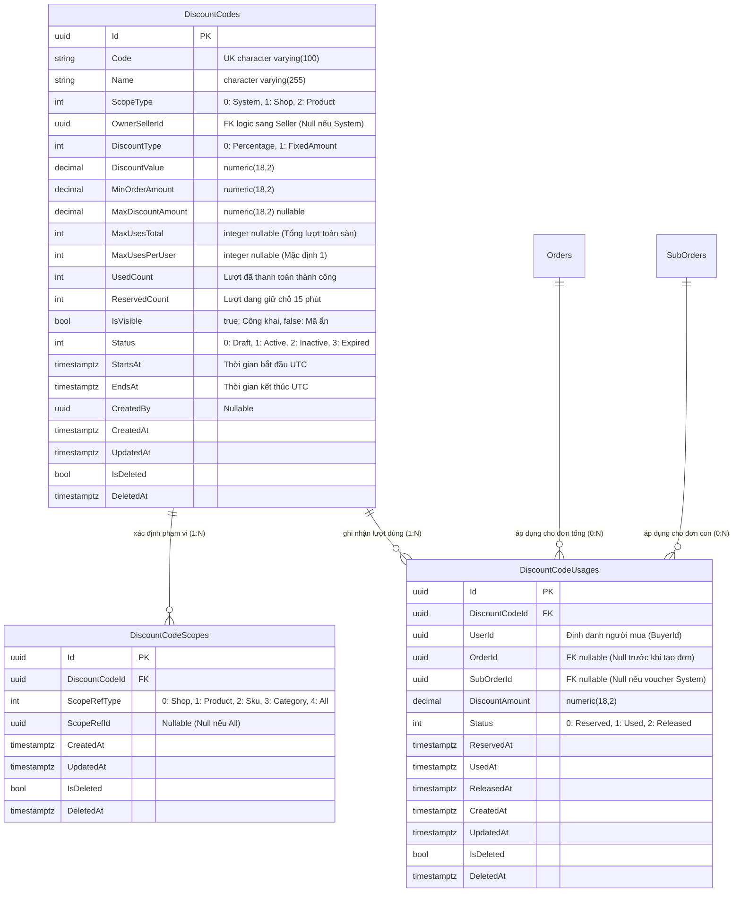

# TÀI LIỆU ĐẶC TẢ YÊU CẦU PHẦN MỀM CHO AI AGENT (AI-READY SRS)
## PHÂN HỆ: VOUCHER & PROMOTION ALLOCATION ENGINE (`Commerce.sln`)

| Thuộc tính | Giá trị |
| :--- | :--- |
| **Tên dịch vụ** | Nexus Commerce Microservice (`Commerce.Api` — Port: `8003`) |
| **Cơ sở dữ liệu** | PostgreSQL 16 (`commerce_db:5435`) — **Schema Cố Định 100% (Zero Schema Drift)** |
| **Kiến trúc mục tiêu** | 4-Layer Clean Architecture, Feature Co-location, 100% RESTful, No-Repository, No-Broker |
| **Đối tượng đọc** | AI Coding Agents (Spec-Kit / AI Harness / SDD), Senior Backend Engineers, QA Automation |
| **Trạng thái đặc tả** | `FROZEN_FOR_IMPLEMENTATION` (Đã điều chỉnh đồng bộ 100% với codebase thực tế) |

---

## PHẦN 0: CHỈ THỊ THỰC THI TỐI CAO DÀNH CHO AI AGENT (AGENT SYSTEM DIRECTIVES)

> **CẢNH BÁO DÀNH CHO AI AGENT:** Trước khi sinh bất kỳ dòng mã nguồn C# nào, Agent bắt buộc phải nạp và tuân thủ tuyệt đối 8 quy tắc bất biến (Hard Guardrails) dưới đây. Mọi hành vi vi phạm bất kỳ quy tắc nào đều khiến bản build bị từ chối.

1. **Xử lý Xung đột Tài liệu Nguồn (Source of Truth Hierarchy):**
   * Hệ thống vận hành theo mô hình Clean Architecture 4 tầng tại thư mục gốc: `Commerce.Domain/`, `Commerce.Application/`, `Commerce.Infrastructure/`, `Commerce.Api/` (**TUYỆT ĐỐI KHÔNG DÙNG TIỀN TỐ `src/`**).
   * Hệ thống đã **bãi bỏ hoàn toàn Message Broker / Saga / Outbox** và vận hành theo mô hình **Master Order (`Orders`) $\rightarrow$ Shop Sub-Orders (`SubOrders`) $\rightarrow$ `SubOrderItems`**.
   * **CHỈ THỊ:** AI Agent **TUYỆT ĐỐI KHÔNG** tạo hoặc tham chiếu tới các bảng `checkout_groups`, `outbox_messages`, `inbox_messages`, `saga_state`. Toàn bộ code phải bám sát cấu trúc 17 bảng của `commerce_db` và hợp đồng REST API hiện hành.
2. **Bảo toàn Schema Database Cố định (Zero Schema Drift):**
   * Chỉ sử dụng đúng 3 bảng thuộc phân hệ Voucher đã có trong `AppDbContext`: `DiscountCodes`, `DiscountCodeScopes`, `DiscountCodeUsages` và liên kết với `Orders`, `SubOrders`, `AuditLogs`.
   * **TUYỆT ĐỐI KHÔNG** tạo bảng mới, không thêm migration vật lý mới, và không tự ý bịa tên cột. Bắt buộc dùng đúng tên cột thực tế: `MaxUsesTotal` (thay vì `UsageLimit`), `StartsAt`/`EndsAt` (thay vì `StartDate`/`EndDate`), và `UserId` (thay vì `BuyerId`).
3. **Cấm Repository Pattern (No-Repository over EF Core):**
   * **TUYỆT ĐỐI CẤM** tạo `IDiscountRepository`, `DiscountRepository`, hoặc `IUnitOfWork`.
   * Mọi truy vấn và cập nhật dữ liệu trong `DiscountService` và `OrderService` phải gọi trực tiếp qua interface `ICommerceDbContext`.
   * Bổ sung thuộc tính `DatabaseFacade Database { get; }` vào `ICommerceDbContext` để hỗ trợ gọi SQL nguyên tử `ExecuteSqlInterpolatedAsync` trực tiếp qua interface.
4. **Tổ chức Thư mục theo Feature Co-location:**
   * Toàn bộ code tầng Application của tính năng Voucher phải đặt gọn trong thư mục `Commerce.Application/Services/Discount/` (bao gồm `IDiscountService.cs`, `DiscountService.cs`, `IVoucherCalculationEngine.cs`, `VoucherCalculationEngine.cs`, `DiscountRequests.cs`, `DiscountResponses.cs`, `DiscountDtos.cs`).
5. **Thin Controllers & Pure DTOs:**
   * Controller đặt tại `Commerce.Api/Controllers/Public/DiscountsController.cs`.
   * Controller chỉ làm nhiệm vụ trích xuất `currentUserId` qua `this.TryGetUserId(out var userId, out var authError)`, kiểm tra quyền qua `[RequireRole(...)]`, gọi `IDiscountService` và trả về **Pure DTO** (tuyệt đối không bọc `ApiResponse<T>` vì API Gateway đã tự bọc ở tầng ngoài).
6. **Quy chuẩn Casing & Serialization:**
   * JSON properties: `camelCase`.
   * Enums: Lưu xuống PostgreSQL dưới dạng số nguyên (`int`), nhưng khi tuần tự hóa ra JSON REST API bắt buộc chuyển thành chuỗi **`PascalCase`** thông qua `PascalCaseJsonStringEnumConverter`.
7. **Quy chuẩn Ngoại lệ & Thông báo Lỗi (RFC 9110 Problem Details):**
   * Mọi lỗi nghiệp vụ phải quăng `CommerceDomainException(string errorCode, string message, int statusCode)`.
   * `errorCode`: 100% `SCREAMING_SNAKE_CASE` (Cấm tiền tố `ERR_`; chỉ dùng tiền tố `VAL_` cho lỗi validation dữ liệu đầu vào).
   * `message` (`detail`): **100% tiếng Anh**, viết theo chuẩn **Sentence case** (Chỉ viết hoa chữ cái đầu tiên của câu và các từ viết tắt `ID`, `SKU`, `GHN`, `JWT`, `API`, `HTTP`. Cấm dùng tiếng Việt hoặc viết hoa toàn bộ câu thông báo).
8. **Chống Race Condition bằng SQL Nguyên tử (Atomic Conditional SQL):**
   * Khi giữ chỗ (`ReservedCount`) hoặc trừ lượt dùng (`UsedCount`), **CẤM** đọc entity ra RAM rồi cộng `voucher.ReservedCount++` và gọi `SaveChangesAsync()`. Bắt buộc dùng `_dbContext.Database.ExecuteSqlInterpolatedAsync` với mệnh đề `WHERE` kiểm tra điều kiện trần sử dụng trực tiếp tại PostgreSQL với tên cột chính xác.

---

## PHẦN 1: MÔ HÌNH MIỀN, ENUMS & ÁNH XẠ CƠ SỞ DỮ LIỆU (DOMAIN & DB MAPPING)

### 1.1. Sơ Đồ Quan Hệ Thực Thể Phân Hệ Voucher (ER Diagram Chuẩn Hóa)



### 1.2. Định nghĩa Enums Hiện Hành Chuẩn Hóa (`Commerce.Domain/Enums/`)

> **LƯU Ý QUAN TRỌNG:** Giá trị số nguyên (`int`) của Enums dưới đây bắt buộc phải khớp 100% với file mã nguồn hiện có trong `Commerce.Domain/Enums/` để không làm sai lệch dữ liệu đã migrate và đã seed trong database.

```csharp
namespace Commerce.Domain.Enums;

// Khớp file Commerce.Domain/Enums/DiscountScopeType.cs
public enum DiscountScopeType
{
    System = 0,   // Voucher toàn sàn do Admin tạo (OwnerSellerId = null)
    Global = 0,   // Alias tương đương System
    Shop = 1,     // Voucher gian hàng do Seller tạo (OwnerSellerId = SellerId)
    Product = 2   // Voucher sản phẩm/SKU do Seller tạo (OwnerSellerId = SellerId)
}

// Khớp file Commerce.Domain/Enums/DiscountType.cs
public enum DiscountType
{
    Percent = 0,      // Giảm theo % (0 < Value <= 100)
    Percentage = 0,   // Alias tương đương Percent
    Fixed = 1,        // Giảm số tiền cố định (Value > 0)
    FixedAmount = 1   // Alias tương đương Fixed
}

// Khớp file Commerce.Domain/Enums/DiscountScopeRefType.cs (CẤM ĐỔI THỨ TỰ INT)
public enum DiscountScopeRefType
{
    Shop = 0,     // Áp dụng cho SellerId (ScopeRefId = SellerId)
    Product = 1,  // Áp dụng cho ProductId (ScopeRefId = ProductId)
    Sku = 2,      // Áp dụng đích danh cho SkuId (ScopeRefId = SkuId)
    Category = 3, // Áp dụng cho ngành hàng (ScopeRefId = CategoryId)
    All = 4       // Áp dụng toàn sàn (ScopeRefId = null)
}

// Khớp file Commerce.Domain/Enums/DiscountStatus.cs
public enum DiscountStatus
{
    Draft = 0,    // Bản nháp, chưa có hiệu lực
    Active = 1,   // Đang kích hoạt
    Inactive = 2, // Tạm dừng bởi Admin/Seller
    Expired = 3   // Đã hết hạn (EndsAt < UtcNow)
}

// Khớp file Commerce.Domain/Enums/DiscountUsageStatus.cs
public enum DiscountUsageStatus
{
    Reserved = 0, // Đang khóa giữ chỗ 15 phút chờ thanh toán
    Used = 1,     // Đã thanh toán thành công (Order Status = Paid)
    Released = 2  // Đã giải phóng/hoàn lại lượt dùng (do hủy đơn, timeout, hoặc từ chối đơn)
}
```

### 1.3. Từ Điển Dữ Liệu Thực Thể (`Commerce.Domain/Entities/`)

#### Bảng 1: `DiscountCodes` (`Commerce.Domain.Entities.DiscountCode`)
| Thuộc tính C# | Kiểu C# | Cột DB PostgreSQL | Quy tắc Nghiệp vụ & Bất biến (Invariants) |
| :--- | :--- | :--- | :--- |
| `Id` | `Guid` | `uuid PK` | Khởi tạo `Guid.NewGuid()`. |
| `Code` | `string` | `varchar(100) UK` | Lưu `UPPERCASE`. Unique trên `LOWER("Code") WHERE "IsDeleted" = FALSE`. |
| `Name` | `string` | `varchar(255)` | Tên chương trình khuyến mãi ($\le 255$ ký tự). |
| `ScopeType` | `DiscountScopeType` | `integer` | `System (0)`, `Shop (1)`, `Product (2)`. |
| `OwnerSellerId` | `Guid?` | `uuid null` | **Invariant:** `(ScopeType == System) == (OwnerSellerId == null)`. |
| `DiscountType` | `DiscountType` | `integer` | `Percentage (0)`, `FixedAmount (1)`. |
| `DiscountValue` | `decimal` | `numeric(18,2)` | Phải $> 0$. Nếu `Percentage` thì bắt buộc $\le 100$. |
| `MinOrderAmount` | `decimal` | `numeric(18,2)` | Giá trị đơn hàng tối thiểu của phạm vi hợp lệ ($\ge 0$, mặc định `0`). |
| `MaxDiscountAmount` | `decimal?` | `numeric(18,2) null` | Trần giảm tối đa khi `Percentage` ($> 0$). Nếu `FixedAmount` thì ép về `null`. |
| `MaxUsesTotal` | `int?` | `integer null` | Tổng lượt dùng tối đa toàn sàn (`null` = không giới hạn, nếu có phải $> 0$). |
| `MaxUsesPerUser` | `int?` | `integer null` | Số lần tối đa 1 người dùng (`UserId`) được dùng mã này (mặc định `1`). |
| `UsedCount` | `int` | `integer` | Số lượt đã thanh toán (`>= 0`, mặc định `0`). |
| `ReservedCount` | `int` | `integer` | Số lượt đang giữ chỗ 15m (`>= 0`, mặc định `0`). **Invariant:** `UsedCount + ReservedCount <= MaxUsesTotal`. |
| `IsVisible` | `bool` | `boolean` | `true`: Công khai; `false`: Mã ẩn/Private (nhập tay vẫn dùng được). Mặc định `true`. |
| `Status` | `DiscountStatus` | `integer` | `Draft (0)`, `Active (1)`, `Inactive (2)`, `Expired (3)`. |
| `StartsAt` | `DateTimeOffset?` | `timestamptz null` | Thời gian bắt đầu hiệu lực (UTC). |
| `EndsAt` | `DateTimeOffset?` | `timestamptz null` | Thời gian kết thúc hiệu lực (UTC). **Invariant:** `EndsAt > StartsAt`. |
| `CreatedBy` | `Guid?` | `uuid null` | ID người tạo (Admin/Seller). |
| `CreatedAt` | `DateTimeOffset` | `timestamptz` | Kế thừa từ `BaseEntity<Guid>`. |
| `UpdatedAt` | `DateTimeOffset` | `timestamptz` | Kế thừa từ `BaseEntity<Guid>`. |
| `IsDeleted` | `bool` | `boolean` | Kế thừa từ `BaseEntity<Guid>`. |
| `DeletedAt` | `DateTimeOffset?` | `timestamptz null` | Kế thừa từ `BaseEntity<Guid>`. |

#### Bảng 2: `DiscountCodeScopes` (`Commerce.Domain.Entities.DiscountCodeScope`)
| Thuộc tính C# | Kiểu C# | Cột DB PostgreSQL | Quy tắc Nghiệp vụ & Bất biến (Invariants) |
| :--- | :--- | :--- | :--- |
| `Id` | `Guid` | `uuid PK` | Định danh phạm vi. |
| `DiscountCodeId` | `Guid` | `uuid FK` | Trỏ tới `DiscountCodes.Id`. |
| `ScopeRefType` | `DiscountScopeRefType` | `integer` | `Shop (0)`, `Product (1)`, `Sku (2)`, `Category (3)`, `All (4)`. |
| `ScopeRefId` | `Guid?` | `uuid null` | **Invariant:** `(ScopeRefType == All) == (ScopeRefId == null)`. |
| `CreatedAt` ... | `DateTimeOffset` ... | `timestamptz` ... | Kế thừa từ `BaseEntity<Guid>`. |

#### Bảng 3: `DiscountCodeUsages` (`Commerce.Domain.Entities.DiscountCodeUsage`)
| Thuộc tính C# | Kiểu C# | Cột DB PostgreSQL | Quy tắc Nghiệp vụ & Bất biến (Invariants) |
| :--- | :--- | :--- | :--- |
| `Id` | `Guid` | `uuid PK` | Định danh lượt sử dụng. |
| `DiscountCodeId` | `Guid` | `uuid FK` | Trỏ tới `DiscountCodes.Id`. |
| `UserId` | `Guid` | `uuid` | Định danh người mua sử dụng mã (`BuyerId`). |
| `OrderId` | `Guid?` | `uuid FK null` | Trỏ tới `Orders.Id` (Master Order). |
| `SubOrderId` | `Guid?` | `uuid FK null` | Trỏ tới `SubOrders.Id` (Có giá trị với mã `Shop`/`Product`, `null` với mã `System`). |
| `DiscountAmount` | `decimal` | `numeric(18,2)` | Số tiền thực tế mã này đã giảm trên đơn hàng ($\ge 0$). |
| `Status` | `DiscountUsageStatus` | `integer` | `Reserved (0)`, `Used (1)`, `Released (2)`. |
| `ReservedAt` | `DateTimeOffset` | `timestamptz` | Thời điểm giữ chỗ (UTC). |
| `UsedAt` | `DateTimeOffset?` | `timestamptz null` | Thời điểm thanh toán thành công (UTC). |
| `ReleasedAt` | `DateTimeOffset?` | `timestamptz null` | Thời điểm hoàn/nhả lượt dùng (UTC). |
| `CreatedAt` ... | `DateTimeOffset` ... | `timestamptz` ... | Kế thừa từ `BaseEntity<Guid>`. |

---

## PHẦN 2: QUY TẮC TÀI CHÍNH & THUẬT TOÁN TRỌNG TÂM (CORE ALGORITHMS)

### 2.1. Quy tắc Xếp chồng 3 Tầng (3-Tier Voucher Stacking Rule)
Trong một phiên Checkout (`CHK-01` & `CHK-02`), người mua được phép áp dụng đồng thời tối đa 3 tầng khuyến mãi theo thứ tự ưu tiên trừ tiền tuần tự như sau:
1. **Tầng 1 — `Product` Voucher:** Tối đa **01 mã / 01 dòng sản phẩm (`CartItem` / `SubOrderItem`)**. Trừ trực tiếp trên thành tiền gốc của dòng sản phẩm đó.
2. **Tầng 2 — `Shop` Voucher:** Tối đa **01 mã / 01 gian hàng (`SellerId` / `SubOrder`)**. Tính trên tổng tiền hàng của Shop đó **sau khi đã trừ Tầng 1**.
3. **Tầng 3 — `System` Voucher:** Tối đa **01 mã / toàn bộ phiên đặt hàng (`Master Order`)**. Tính trên tổng tiền hàng còn lại của các mặt hàng hợp lệ toàn phiên **sau khi đã trừ Tầng 1 và Tầng 2**.

* **Quy tắc Chặn Xung Đột (Conflict Guard):**
  * Nếu danh sách `voucherCodes` đầu vào chứa $\ge 2$ mã có `ScopeType == System` $\rightarrow$ Quăng lỗi `400 VOUCHER_STACKING_CONFLICT`.
  * Nếu chứa $\ge 2$ mã có `ScopeType == Shop` thuộc cùng một `OwnerSellerId` $\rightarrow$ Quăng lỗi `400 VOUCHER_STACKING_CONFLICT`.
  * Nếu chứa $\ge 2$ mã có `ScopeType == Product` cùng khớp trên một `SkuId` $\rightarrow$ Quăng lỗi `400 VOUCHER_STACKING_CONFLICT`.

### 2.2. Công thức Tính Tiền Giảm & Phân bổ Pro-Rata (Chống Lệch Xu — Penny Rounding)

#### Bước 1: Hàm tính số tiền giảm cơ bản (`CalculateRawDiscount`)
Cho giá trị cơ sở hợp lệ $B \ge 0$ và một thực thể `DiscountCode` $V$ (đã thỏa mãn $B \ge V.\text{MinOrderAmount}$):
* Nếu $V.\text{DiscountType} == \text{FixedAmount}$ (hoặc `Fixed`):
  $$D = \min(V.\text{DiscountValue}, B)$$
* Nếu $V.\text{DiscountType} == \text{Percentage}$ (hoặc `Percent`):
  $$D_{\text{pct}} = \text{Math.Round}\left(B \times \frac{V.\text{DiscountValue}}{100m}, 2, \text{MidpointRounding.AwayFromZero}\right)$$
  $$D_{\text{capped}} = V.\text{MaxDiscountAmount.HasValue} ? \min(D_{\text{pct}}, V.\text{MaxDiscountAmount.Value}) : D_{\text{pct}}$$
  $$D = \min(D_{\text{capped}}, B)$$

#### Bước 2: Tính toán Tầng 1 (`Product`) và Tầng 2 (`Shop`) cho từng Shop $k$
Với mỗi Shop $k \in \{1 \dots M\}$ có tập mặt hàng $i \in \{1 \dots N_k\}$:
1. Tổng tiền hàng gốc của Shop $k$:
   $$\text{itemsAmount}_k = \sum_{i=1}^{N_k} (\text{UnitPrice}_{k,i} \times \text{Quantity}_{k,i})$$
2. Nếu dòng $(k, i)$ khớp với mã `Product` $V_{\text{prod}}$ và $(\text{UnitPrice}_{k,i} \times \text{Quantity}_{k,i}) \ge V_{\text{prod}}.\text{MinOrderAmount}$, tính $D_{\text{prod}}(k, i)$ theo Bước 1. Tổng giảm sản phẩm của Shop $k$:
   $$\text{productDiscountAmount}_k = \sum_{i=1}^{N_k} D_{\text{prod}}(k, i)$$
3. Tiền hàng của Shop $k$ sau Tầng 1:
   $$\text{AfterProd}_k = \text{itemsAmount}_k - \text{productDiscountAmount}_k$$
4. Nếu Shop $k$ có áp dụng mã `Shop` $V_{\text{shop}}$ (`OwnerSellerId == k`): Tính tổng giá trị các mặt hàng trong Shop $k$ khớp với `V_shop.Scopes` (sau khi trừ giảm giá sản phẩm của các dòng đó), gọi là $\text{EligibleShopBase}_k$. Nếu $\text{EligibleShopBase}_k \ge V_{\text{shop}}.\text{MinOrderAmount}$, tính $\text{shopDiscountAmount}_k = \text{CalculateRawDiscount}(\text{EligibleShopBase}_k, V_{\text{shop}})$.
5. Doanh thu hàng hóa ròng của Seller $k$ (`NetSellerAmount`):
   $$\text{NetSeller}_k = \text{itemsAmount}_k - \text{productDiscountAmount}_k - \text{shopDiscountAmount}_k$$

#### Bước 3: Tính toán Tầng 3 (`System`) & Phân bổ Pro-rata xuống từng Shop
Nếu phiên đặt hàng có áp dụng mã `System` $V_{\text{sys}}$:
1. Xác định danh sách các Shop $k$ có mặt hàng khớp với `V_sys.Scopes` và có $\text{NetSeller}_k > 0$. Giả sử có $L$ shop hợp lệ ($j = 1 \dots L$).
2. Tổng cơ sở xét điều kiện toàn sàn:
   $$\text{Base}_{\text{sys}} = \sum_{j=1}^{L} \text{NetSeller}_{k_j}$$
3. Nếu $\text{Base}_{\text{sys}} \ge V_{\text{sys}}.\text{MinOrderAmount}$, tính tổng mức giảm toàn sàn $D_{\text{sys\_total}} = \text{CalculateRawDiscount}(\text{Base}_{\text{sys}}, V_{\text{sys}})$.
4. **Phân bổ tỷ lệ (Pro-rata Allocation) kèm khóa chống lệch xu (Penny Rounding Protection):**
   * Khởi tạo `decimal allocatedSum = 0m;`.
   * Với các shop từ $j = 1$ đến $L - 1$:
     $$\text{systemDiscountAmount}_{k_j} = \text{Math.Round}\left(D_{\text{sys\_total}} \times \frac{\text{NetSeller}_{k_j}}{\text{Base}_{\text{sys}}}, 2, \text{MidpointRounding.AwayFromZero}\right)$$
     $$\text{allocatedSum} += \text{systemDiscountAmount}_{k_j}$$
   * Với shop hợp lệ cuối cùng ($j = L$):
     $$\text{systemDiscountAmount}_{k_L} = D_{\text{sys\_total}} - \text{allocatedSum}$$

#### Bước 4: Bất biến Tài chính trên `SubOrders` và `Orders` (Đồng bộ với `SubOrder.cs` hiện tại)
Mọi đối tượng `ShopOrderQuote`, `SubOrder` và `Order` bắt buộc tuân thủ phương thức `SubOrder.CalculateFinancials`:
* **Trên từng `SubOrder` $k$:**
  * $\text{discountAmount}_k = \text{productDiscountAmount}_k + \text{shopDiscountAmount}_k + \text{systemDiscountAmount}_k$
  * **Tiền giải ngân Escrow vào ví Seller (`SellerReceiveAmount`):** Seller chỉ chịu chiết khấu mã `Product` và `Shop`, **không bị trừ tiền** khi khách dùng mã `System` (tiền ship trả thẳng đơn vị vận chuyển GHN):
    $$\text{sellerReceiveAmount}_k = \text{itemsAmount}_k - \text{productDiscountAmount}_k - \text{shopDiscountAmount}_k = \text{NetSeller}_k$$
  * Gọi $r$ là tỷ lệ hoa hồng sàn (`PlatformMarkupPercent`, lấy từ `SystemSettings` key `"PLATFORM_MARKUP_PERCENT"`, mặc định `5.0m`):
    $$\text{platformMarkupAmount}_k = \text{Math.Round}\left(\text{sellerReceiveAmount}_k \times \frac{r}{100m}, 2, \text{MidpointRounding.AwayFromZero}\right)$$
  * **Phí sàn thực thu trên đơn con (`PlatformFeeAmount`):** Sàn tự lấy hoa hồng ra tài trợ cho mã `System` (có thể âm nếu sàn trợ giá lớn hơn hoa hồng thu được):
    $$\text{platformFeeAmount}_k = \text{platformMarkupAmount}_k - \text{systemDiscountAmount}_k$$
  * **Tổng tiền Buyer thanh toán cho SubOrder $k$ (`TotalAmount`):**
    $$\text{totalAmount}_k = \text{sellerReceiveAmount}_k + \text{platformFeeAmount}_k + \text{shippingFeeAmount}_k$$
    $$\equiv \text{itemsAmount}_k - \text{discountAmount}_k + \text{shippingFeeAmount}_k + \text{platformMarkupAmount}_k$$
  * **Bất biến kiểm tra (Financial Invariant Assertion):**
    Bắt buộc $\text{totalAmount}_k == \text{sellerReceiveAmount}_k + \text{platformFeeAmount}_k + \text{shippingFeeAmount}_k$.
* **Trên `Master Order` (`Orders`):**
  * $\text{Orders.TotalAmount} = \sum_{k=1}^{M} \text{totalAmount}_k$ (Tổng số tiền Buyer thực thanh toán qua Ví hoặc VNPay).
  * **LƯU Ý:** Bảng `Orders` không chứa các cột vật lý `ShippingFee` hay `DiscountAmount`. Các thông tin tổng hợp này chỉ tính động và trả về trong `OrderResponses.cs` / `CheckoutQuoteResponse`.

---

## PHẦN 3: ĐẶC TẢ CHI TIẾT 12 USE CASES THỰC THI (USE CASE SPECIFICATIONS)

### NHÓM A: 09 REST API ENDPOINTS TẠI `DiscountsController` (`/api/v1/discounts`)
*Vị trí file controller:* `Commerce.Api/Controllers/Public/DiscountsController.cs`.

#### `UC-01` (`DSC-01`): Lấy Danh Sách Voucher Khả Dụng Cho Buyer
* **Endpoint:** `GET /api/v1/discounts/available?sellerId={guid}&cartItemIds={guid1,guid2}&page=1&pageSize=20`
* **Role:** `[RequireRole("buyer")]`
* **Logic thực thi:**
  1. Lấy `buyerId` từ `this.TryGetUserId(out var buyerId, out var authError)`. Nếu lỗi $\rightarrow$ Trả về `authError`.
  2. Lấy giỏ hàng `Active` của `buyerId` (kèm `CartItems`). Nếu `cartItemIds` có truyền trên query string, lọc các `CartItem` nằm trong danh sách đó; nếu không truyền, lấy toàn bộ `CartItems` trong giỏ.
  3. Truy vấn `_dbContext.DiscountCodes.AsNoTracking().Include(d => d.Scopes)` với điều kiện: `!d.IsDeleted && d.IsVisible && d.Status == DiscountStatus.Active && (d.StartsAt == null || d.StartsAt <= now) && (d.EndsAt == null || d.EndsAt >= now) && (d.MaxUsesTotal == null || d.UsedCount + d.ReservedCount < d.MaxUsesTotal)`.
  4. Nếu có truyền `sellerId`: Lọc `d.ScopeType == DiscountScopeType.System || d.OwnerSellerId == sellerId`.
  5. Truy vấn bảng `DiscountCodeUsages` để đếm số lượt `Reserved` + `Used` của `buyerId` (`UserId == buyerId && !IsDeleted`) đối với các voucher tìm được (`userUsedCount`).
  6. Với mỗi voucher, tính toán cờ `isEligible`, `ineligibleReason`, và `estimatedDiscountAmount`:
     * Nếu `userUsedCount >= (d.MaxUsesPerUser ?? 1)` $\rightarrow$ `isEligible = false`, `ineligibleReason = "You have already reached the maximum redemption limit for this voucher."`.
     * Tính tổng tiền các `CartItems` khớp với `d.Scopes` (`eligibleAmount`).
     * Nếu `eligibleAmount == 0` $\rightarrow$ `isEligible = false`, `ineligibleReason = "Voucher is not applicable to any selected items in your cart."`.
     * Nếu `eligibleAmount < d.MinOrderAmount` $\rightarrow$ `isEligible = false`, `ineligibleReason = $"Order amount does not meet the minimum requirement of {d.MinOrderAmount:0.##}."`.
     * Ngược lại $\rightarrow$ `isEligible = true`, `ineligibleReason = null`, `estimatedDiscountAmount = CalculateRawDiscount(eligibleAmount, d)`.
  7. Trả về `PagedData<BuyerAvailableVoucherDto>` (HTTP `200 OK`).

---

#### `UC-02` (`DSC-02`): Thẩm Định Nhanh 01 Mã Nhập Tay (Hỗ Trợ Cả Mã Ẩn `IsVisible = false`)
* **Endpoint:** `POST /api/v1/discounts/validate`
* **Role:** `[RequireRole("buyer")]`
* **Request DTO:** `ValidateVoucherRequest(string Code, List<Guid> CartItemIds)`
* **Logic thực thi (6 bước kiểm tra nghiêm ngặt):**
  1. Tìm voucher theo `!d.IsDeleted && d.Code.ToLower() == request.Code.Trim().ToLower()` (**Không** lọc `IsVisible` để hỗ trợ mã Private/KOL). Nếu `null` $\rightarrow$ Quăng `404 VOUCHER_NOT_FOUND`: `"Voucher code was not found."`.
  2. Nếu `d.Status != DiscountStatus.Active` $\rightarrow$ Quăng `400 VOUCHER_INACTIVE`: `"Voucher code is currently inactive and cannot be applied."`.
  3. Nếu `(d.StartsAt.HasValue && now < d.StartsAt.Value) || (d.EndsAt.HasValue && now > d.EndsAt.Value)` $\rightarrow$ Quăng `400 VOUCHER_EXPIRED`: `"Voucher code has expired or is not yet active."`.
  4. Nếu `d.MaxUsesTotal.HasValue && (d.UsedCount + d.ReservedCount) >= d.MaxUsesTotal.Value` $\rightarrow$ Quăng `400 VOUCHER_USAGE_LIMIT_EXCEEDED`: `"Voucher usage limit has been reached."`.
  5. Đếm số bản ghi trong `DiscountCodeUsages` của `buyerId` có `DiscountCodeId == d.Id && UserId == buyerId && !IsDeleted` và `Status IN (Reserved, Used)`. Nếu $\ge (d.\text{MaxUsesPerUser} ?? 1)$ $\rightarrow$ Quăng `400 VOUCHER_USER_LIMIT_EXCEEDED`: `"You have already reached the maximum redemption limit for this voucher."`.
  6. Tải các `CartItems` thuộc giỏ hàng `Active` của `buyerId` nằm trong `request.CartItemIds`.
     * Lọc các dòng khớp `d.Scopes`. Nếu không có dòng nào khớp $\rightarrow$ Quăng `400 VOUCHER_SCOPE_MISMATCH`: `"Voucher is not applicable to any selected items in your cart."`.
     * Tính tổng tiền các dòng khớp (`eligibleAmount`). Nếu `eligibleAmount < d.MinOrderAmount` $\rightarrow$ Quăng `400 VOUCHER_MIN_ORDER_AMOUNT_NOT_MET`: `"Order amount does not meet the minimum requirement for this voucher."`.
  7. Trả về `ValidateVoucherResponse(true, d.Id, d.Code, d.ScopeType, estimatedDiscountAmount)` (HTTP `200 OK`).

---

#### `UC-03` (`DSC-03`): Tự Động Gợi Ý Tổ Hợp Voucher Tối Ưu (`Auto-Suggest Best Vouchers`)
* **Endpoint:** `POST /api/v1/discounts/recommend`
* **Role:** `[RequireRole("buyer")]`
* **Request DTO:** `RecommendVouchersRequest(List<Guid> CartItemIds)`
* **Logic thực thi:**
  1. Lấy danh sách `CartItems` của `buyerId` theo `request.CartItemIds`. Nếu rỗng $\rightarrow$ Quăng `400 CART_EMPTY`: `"No valid items selected for checkout."`.
  2. Tải toàn bộ các `DiscountCodes` đang `Active`, `IsVisible == true`, còn hạn, còn `MaxUsesTotal`, và `buyerId` chưa dùng hết `MaxUsesPerUser`.
  3. **Tối ưu Tầng 1 (`Product`):** Với mỗi dòng `CartItem`, chọn 01 mã `Product` hợp lệ cho số tiền giảm lớn nhất.
  4. **Tối ưu Tầng 2 (`Shop`):** Với mỗi `SellerId` trong giỏ, tính số tiền còn lại sau Tầng 1 và chọn 01 mã `Shop` hợp lệ của `SellerId` đó cho số tiền giảm lớn nhất.
  5. **Tối ưu Tầng 3 (`System`):** Tính tổng tiền hàng ròng toàn phiên sau Tầng 1 & Tầng 2, chọn 01 mã `System` hợp lệ cho số tiền giảm lớn nhất.
  6. Trả về `RecommendVouchersResponse` chứa mảng `recommendedVoucherCodes` và chi tiết số tiền tiết kiệm được ở từng tầng (HTTP `200 OK`).

---

#### `UC-04` (`DSC-04`): Khởi Tạo Mã Giảm Giá Mới (Admin & Seller)
* **Endpoint:** `POST /api/v1/discounts`
* **Role:** `[RequireRole("admin", "seller")]`
* **Logic thực thi:**
  1. **Validate dữ liệu đầu vào:**
     * `Code`: Chuẩn hóa `Trim().ToUpperInvariant()`, khớp Regex `^[A-Z0-9_-]{4,32}$`. Sai $\rightarrow$ `400 VAL_INVALID_INPUT`: `"Voucher code must be between 4 and 32 alphanumeric characters."`.
     * `Name`: Không rỗng, $\le 255$ ký tự.
     * `DiscountValue > 0`; nếu `DiscountType == Percentage` thì `DiscountValue <= 100`.
     * `MinOrderAmount >= 0`; `MaxUsesPerUser >= 1`; `EndsAt > StartsAt && EndsAt > DateTimeOffset.UtcNow`.
  2. **Kiểm tra Quyền & Chủ sở hữu (`Ownership Guard`):**
     * Nếu `ScopeType == DiscountScopeType.System`: Chỉ role `"admin"` được phép tạo (`OwnerSellerId = null`). Nếu `"seller"` gọi $\rightarrow$ Quăng `403 FORBIDDEN`: `"Only administrators can create system-wide vouchers."`.
     * Nếu `ScopeType == DiscountScopeType.Shop` hoặc `Product`: Gán `OwnerSellerId = isAdmin && request.OwnerSellerId.HasValue ? request.OwnerSellerId.Value : currentUserId`.
  3. **Kiểm tra trùng mã:** Kiểm tra `AnyAsync(d => !d.IsDeleted && d.Code.ToLower() == normalizedCode.ToLower())`. Nếu tồn tại $\rightarrow$ Quăng `409 VOUCHER_CODE_ALREADY_EXISTS`: `"Voucher code already exists in the system."`.
  4. **Xác thực Phạm vi (`Scopes`) & Đối chiếu Catalog Service (`:8002`):**
     * Nếu `ScopeType == Shop`: Tự động tạo 1 dòng `DiscountCodeScope(ScopeRefType.Shop, ownerSellerId)`.
     * Nếu `ScopeType == Product`: Bắt buộc `request.Scopes` không rỗng và chỉ chứa `Product` hoặc `Sku`. Với các dòng `Sku`, gọi `_catalogClient.GetSkuBatchDetailsAsync(skuIds, ct)`:
       * Nếu thiếu SKU trong kết quả trả về $\rightarrow$ Quăng `404 CATALOG_SKU_NOT_FOUND`: `"Product SKU was not found in catalog."`.
       * Nếu có bất kỳ SKU nào có `variant.SellerId != ownerSellerId` $\rightarrow$ Quăng `403 FORBIDDEN`: `"You do not have permission to attach products owned by another seller."`.
     * Nếu `ScopeType == System`: Nếu `request.Scopes` rỗng, mặc định tạo 1 dòng `DiscountCodeScope(ScopeRefType.All, null)`.
  5. Lưu `DiscountCode`, `DiscountCodeScopes` và 1 bản ghi `AuditLog` (`Action = Create`), trả về `DiscountDetailResponse` (HTTP `201 Created`).

---

#### `UC-05` (`DSC-05`): Danh Sách Quản Trị Mã Giảm Giá (Phân Trang DB)
* **Endpoint:** `GET /api/v1/discounts?page=1&pageSize=20&scopeType=Shop&status=Active&search=SALE`
* **Role:** `[RequireRole("admin", "seller", "staff")]`
* **Logic thực thi:**
  1. Lọc `!d.IsDeleted`. Nếu người gọi là `"seller"` (không phải `"admin"` / `"staff"`), bắt buộc ép điều kiện `d.OwnerSellerId == currentUserId`.
  2. Lọc theo `scopeType`, `status`, và từ khóa `search` (`Code` hoặc `Name`).
  3. Phân trang trực tiếp trên PostgreSQL bằng `.CountAsync()` và `.Skip((page - 1) * pageSize).Take(pageSize)`. Trả về `PagedData<DiscountSummaryDto>` (HTTP `200 OK`).

---

#### `UC-06` (`DSC-06`): Xem Chi Tiết Mã Giảm Giá
* **Endpoint:** `GET /api/v1/discounts/{discountId:guid}`
* **Role:** `[RequireRole("admin", "seller", "staff")]`
* **Logic thực thi:** Tìm theo `discountId && !IsDeleted` (kèm `.Include(d => d.Scopes)`). Nếu `null` $\rightarrow$ `404 VOUCHER_NOT_FOUND`. Nếu là `"seller"` và `d.OwnerSellerId != currentUserId` $\rightarrow$ `403 FORBIDDEN`. Trả về `DiscountDetailResponse` (HTTP `200 OK`).

---

#### `UC-07` (`DSC-07`): Cập Nhật Mã Giảm Giá
* **Endpoint:** `PUT /api/v1/discounts/{discountId:guid}`
* **Role:** `[RequireRole("admin", "seller")]`
* **Logic thực thi:**
  1. Kiểm tra tồn tại (`404 VOUCHER_NOT_FOUND`) và quyền sở hữu (`403 FORBIDDEN`).
  2. **Rào chắn bảo toàn lịch sử (`UsedCount + ReservedCount > 0`):**
     * Nếu mã đã có người giữ chỗ hoặc sử dụng: **CẤM** thay đổi `DiscountType`, `DiscountValue`, `MinOrderAmount`, `MaxDiscountAmount`, hoặc xóa bớt `Scopes` $\rightarrow$ Nếu vi phạm, quăng `400 VOUCHER_ALREADY_IN_USE`: `"Cannot modify core financial fields or scopes of a voucher that has already been used."`.
     * Cho phép cập nhật `Name`, `IsVisible`, `MaxUsesPerUser`, kéo dài `EndsAt`, và cập nhật `MaxUsesTotal` (với điều kiện `MaxUsesTotal >= UsedCount + ReservedCount`, nếu nhỏ hơn $\rightarrow$ `400 VAL_INVALID_INPUT`).
  3. Lưu thay đổi kèm `AuditLog` (`Action = Update`), trả về `DiscountDetailResponse` (HTTP `200 OK`).

---

#### `UC-08` (`DSC-08`): Chuyển Đổi Trạng Thái Kích Hoạt / Tạm Dừng
* **Endpoint:** `PATCH /api/v1/discounts/{discountId:guid}/status`
* **Role:** `[RequireRole("admin", "seller")]`
* **Request DTO:** `UpdateDiscountStatusRequest(DiscountStatus Status)`
* **Logic thực thi:**
  1. Kiểm tra tồn tại và quyền sở hữu.
  2. Chỉ cho phép chuyển sang `Active` hoặc `Inactive` (nếu truyền `Draft` hoặc `Expired` $\rightarrow$ `400 INVALID_STATUS`: `"Voucher status can only be manually set to Active or Inactive."`).
  3. Nếu chuyển sang `Active` mà `EndsAt.HasValue && EndsAt.Value <= DateTimeOffset.UtcNow` $\rightarrow$ Quăng `400 VOUCHER_EXPIRED`: `"Cannot activate a voucher that has already expired."`.
  4. Lưu DB kèm `AuditLog`, trả về `DiscountDetailResponse` (HTTP `200 OK`).

---

#### `UC-09` (`DSC-09`): Xóa Mềm Mã Giảm Giá (`Soft Delete`)
* **Endpoint:** `DELETE /api/v1/discounts/{discountId:guid}`
* **Role:** `[RequireRole("admin", "seller")]`
* **Logic thực thi:**
  1. Kiểm tra tồn tại và quyền sở hữu.
  2. Nếu `UsedCount > 0 || ReservedCount > 0` $\rightarrow$ Quăng `400 VOUCHER_ALREADY_IN_USE`: `"Cannot delete a voucher that has already been reserved or used. Please deactivate it instead."`.
  3. Gán `IsDeleted = true`, `DeletedAt = DateTimeOffset.UtcNow`, `Status = DiscountStatus.Inactive`, `UpdatedAt = DateTimeOffset.UtcNow`, ghi `AuditLog` (`Action = Delete`), lưu DB và trả về `200 OK`.

---

### NHÓM B: 03 INTERNAL HOOKS TÍCH HỢP VÀO `OrderService` & `PaymentTimeoutWorker`

#### `UC-10` (`CHK-01` Hook): Áp Dụng & Phân Bổ Voucher Trong Báo Giá (`OrderService.QuoteCheckoutAsync`)
* **Vị trí tích hợp:** Hàm `QuoteCheckoutAsync` trong `Commerce.Application/Services/Order/OrderService.cs`.
* **Luồng xử lý chi tiết:**
  1. Sau khi lấy giá SKU từ `_catalogClient.GetSkuBatchDetailsAsync` và tính phí ship từng Shop từ `_fulfillmentClient`, kiểm tra danh sách `request.VoucherCodes`.
  2. Nếu `request.VoucherCodes` có phần tử:
     * Chuẩn hóa danh sách mã (loại bỏ trùng lặp `Distinct(StringComparer.OrdinalIgnoreCase)`).
     * Tải các bản ghi `DiscountCodes` (kèm `.Include(d => d.Scopes)`) khớp với danh sách mã.
     * **Kiểm tra Xung đột Xếp chồng (`Stacking Conflict`):** Nếu có $> 1$ mã `System`, hoặc $> 1$ mã `Shop` cùng `OwnerSellerId`, hoặc $> 1$ mã `Product` cùng khớp 1 `SkuId` $\rightarrow$ Quăng `400 VOUCHER_STACKING_CONFLICT`: `"Only one voucher of the same scope type can be applied per shop or order."`.
     * **Thẩm định Mềm (`Graceful Validation`):** Kiểm tra từng mã theo 6 điều kiện (như `UC-02`). Nếu mã nào không hợp lệ (không tồn tại, hết hạn, hết lượt, không khớp sản phẩm, chưa đủ `MinOrderAmount`), **không quăng Exception** mà thêm chuỗi giải thích tiếng Anh vào danh sách `warnings` của `CheckoutQuoteResponse`, chỉ giữ lại các mã hợp lệ để đưa vào `IVoucherCalculationEngine`.
     * **Chạy `IVoucherCalculationEngine.EvaluateAndApplyVouchers`:** Tính `productDiscountAmount`, `shopDiscountAmount`, `systemDiscountAmount` (Pro-rata + Penny Rounding), `discountAmount`, và `totalAmount` cho từng `ShopOrderQuote` theo đúng công thức tại Mục 2.2.
  3. Lưu toàn bộ kết quả báo giá (bao gồm danh sách `AppliedVoucherItem` chứa `DiscountCodeId`, `Code`, `ScopeType`, `OwnerSellerId`, `AllocatedSubOrderSellerId`, `DiscountAmount`) vào `IDistributedCache` qua `CachedQuote` (`checkout_quote:{quoteId}`, TTL 15 phút).
  4. **Không** tăng `ReservedCount` tại bước này.

---

#### `UC-11` (`CHK-02` Hook): Khóa Giữ Chỗ Nguyên Tử, Tái Tính Toán Khi Biến Động Giá & Cam Kết Sử Dụng (`OrderService.CreateOrderAsync`)
* **Vị trí tích hợp:** Hàm `CreateOrderAsync` trong `Commerce.Application/Services/Order/OrderService.cs`.
* **Luồng xử lý chi tiết:**
  1. **Atomic Pop:** Đọc và xóa ngay key `checkout_quote:{quoteId}` khỏi `_cache`.
  2. **Kiểm tra Biến động Giá (`Asymmetric Price Drift`) & Tái thẩm định Voucher:**
     * Gọi `_catalogClient.GetSkuBatchDetailsAsync` lấy giá hiện hành.
     * Nếu có SKU **tăng giá** $\rightarrow$ Cập nhật giỏ hàng và quăng `409 PRICE_CHANGED`.
     * Nếu có SKU **giảm giá** và đơn hàng có áp dụng Voucher:
       * Chạy lại `IVoucherCalculationEngine` trên mức giá SKU mới rẻ hơn.
       * Nếu do giá giảm làm tổng tiền hợp lệ tụt xuống $< \text{MinOrderAmount}$ của bất kỳ Voucher nào đã áp dụng trong Quote $\rightarrow$ Quăng `409 PRICE_CHANGED`: `"Product price has dropped, causing the order total to fall below the minimum requirement for applied vouchers. Please review your updated quote."`.
       * Nếu vẫn đạt `MinOrderAmount` $\rightarrow$ Cập nhật lại số tiền giảm mới và `GrandTotal` mới.
  3. **Khóa Giữ Chỗ Nguyên Tử bằng SQL (`Atomic Conditional Reservation`):**
     * Sắp xếp danh sách voucher áp dụng theo `DiscountCodeId` tăng dần (chống Deadlock).
     * Tạo danh sách `var reservedVoucherIds = new List<Guid>();`.
     * Với mỗi `voucherId`:
       ```csharp
       int affected = await _dbContext.Database.ExecuteSqlInterpolatedAsync($@"
           UPDATE ""DiscountCodes""
           SET ""ReservedCount"" = ""ReservedCount"" + 1,
               ""UpdatedAt"" = NOW()
           WHERE ""Id"" = {voucherId}
             AND ""IsDeleted"" = FALSE
             AND ""Status"" = {(int)DiscountStatus.Active}
             AND (""StartsAt"" IS NULL OR ""StartsAt"" <= NOW())
             AND (""EndsAt"" IS NULL OR ""EndsAt"" >= NOW())
             AND (""MaxUsesTotal"" IS NULL OR (""UsedCount"" + ""ReservedCount"") < ""MaxUsesTotal"")
             AND (
                 SELECT COUNT(1) FROM ""DiscountCodeUsages"" u
                 WHERE u.""DiscountCodeId"" = {voucherId}
                   AND u.""UserId"" = {buyerId}
                   AND u.""Status"" IN ({(int)DiscountUsageStatus.Reserved}, {(int)DiscountUsageStatus.Used})
                   AND u.""IsDeleted"" = FALSE
             ) < COALESCE(""MaxUsesPerUser"", 1);", ct);
       ```
     * Nếu `affected == 0`:
       * Lập tức chạy vòng lặp hoàn trả `ReservedCount = GREATEST(ReservedCount - 1, 0)` cho các mã trong `reservedVoucherIds`.
       * Quăng `400 VOUCHER_USAGE_LIMIT_EXCEEDED`: `"Voucher usage limit or personal redemption limit has been reached."`.
     * Nếu `affected == 1`: Thêm `voucherId` vào `reservedVoucherIds`.
  4. **Giữ Kho Fulfillment & Trừ Tiền Ví Wallet:**
     * Gọi `_fulfillmentClient.ReserveStockAsync(orderId, reservationItems, ttlMinutes: 15, ct)`. Nếu thất bại $\rightarrow$ Chạy SQL giảm `ReservedCount` cho toàn bộ `reservedVoucherIds` rồi quăng `400 INSUFFICIENT_STOCK`.
     * Nếu `PaymentMethod == PaymentMethod.Wallet`, gọi `_walletClient.PayOrderAsync(order.Id, order.BuyerId, order.TotalAmount, cancellationToken: ct)`. Nếu thất bại $\rightarrow$ Nhả kho Fulfillment + Giảm `ReservedCount` cho toàn bộ `reservedVoucherIds` $\rightarrow$ Quăng `400 PAYMENT_FAILED`.
  5. **Ghi nhận `DiscountCodeUsages` & Chuyển trạng thái khi lưu Đơn hàng:**
     * Thiết lập đầy đủ các trường tài chính trên từng `SubOrder` (`ProductDiscountAmount`, `ShopDiscountAmount`, `SystemDiscountAmount`, `PlatformMarkupAmount`, `PlatformFeeAmount`, `SellerReceiveAmount`, `TotalAmount`) qua `SubOrder.CalculateFinancials`.
     * `order.TotalAmount = createdSubOrders.Sum(s => s.TotalAmount)`.
     * Nếu đơn hàng đã thanh toán (`order.Status == OrderStatus.Paid`):
       * Với mỗi `voucherId` trong `reservedVoucherIds`, chuyển từ `ReservedCount` sang `UsedCount`:
         ```csharp
         await _dbContext.Database.ExecuteSqlInterpolatedAsync($@"
             UPDATE ""DiscountCodes""
             SET ""UsedCount"" = ""UsedCount"" + 1,
                 ""ReservedCount"" = GREATEST(""ReservedCount"" - 1, 0),
                 ""UpdatedAt"" = NOW()
             WHERE ""Id"" = {voucherId};", ct);
         ```
       * Tạo bản ghi `DiscountCodeUsage` với `UserId = buyerId`, `Status = DiscountUsageStatus.Used`, `ReservedAt = now`, `UsedAt = now`.
     * Nếu đơn hàng chờ thanh toán (`order.Status == OrderStatus.PendingPayment`):
       * Tạo bản ghi `DiscountCodeUsage` với `UserId = buyerId`, `Status = DiscountUsageStatus.Reserved`, `ReservedAt = now`.
     * Gọi `await _dbContext.SaveChangesAsync(ct);`.
  6. **Mạch Bù Trừ khi `SaveChangesAsync()` sập (`Compensation Rollback`):**
     * Trong khối `catch`: Ngoài việc nhả kho Fulfillment và hoàn tiền Wallet, bắt buộc chạy lệnh SQL hoàn trả lại `ReservedCount` / `UsedCount` cho toàn bộ `reservedVoucherIds`.

---

#### `UC-12` (`ORD-05`, `ORD-06`, `ORD-11` & Sweeper Hook): Giải Phóng & Khôi Phục Voucher Khi Hủy Đơn / Quá Hạn 15m
* **Vị trí tích hợp:**
  - `OrderService.CancelOrderAsync` (`ORD-06`)
  - `OrderService.SellerRejectSubOrderAsync` (`ORD-05`)
  - `OrderService.UpdateSubOrderDeliveryStatusAsync` (`ORD-11`)
  - `PaymentTimeoutWorker.cs` (`Commerce.Api/Workers/PaymentTimeoutWorker.cs` — Active Sweeper)
* **Quy tắc xử lý 2 kịch bản:**
  1. **Kịch bản 1 — Hủy `Master Order` khi đang `PendingPayment` (Buyer hủy hoặc Quá hạn 15m):**
     * Tìm tất cả `DiscountCodeUsages` có `OrderId == order.Id && Status == DiscountUsageStatus.Reserved && !IsDeleted`.
     * Chuyển `usage.Status = DiscountUsageStatus.Released`, `usage.ReleasedAt = DateTimeOffset.UtcNow`.
     * Chạy SQL nguyên tử:
       ```sql
       UPDATE "DiscountCodes"
       SET "ReservedCount" = GREATEST("ReservedCount" - 1, 0),
           "UpdatedAt" = NOW()
       WHERE "Id" = {usage.DiscountCodeId};
       ```
  2. **Kịch bản 2 — Hủy 01 `SubOrder` đã `Paid` do Seller từ chối (`ORD-05`) hoặc Giao thất bại (`DeliveryFailed` / `Returned`):**
     * **Hoàn tiền Ví:** Hoàn cho Buyer đúng bằng `subOrder.TotalAmount` qua `_walletClient.RefundSubOrderPaymentAsync`.
     * **Khôi phục Voucher `Shop` & `Product` của riêng `SubOrder` bị hủy:**
       * Tìm các `DiscountCodeUsages` có `OrderId == subOrder.OrderId && SubOrderId == subOrder.Id && Status == DiscountUsageStatus.Used && !IsDeleted`.
       * Chuyển `Status = DiscountUsageStatus.Released`, `ReleasedAt = DateTimeOffset.UtcNow`.
       * Chạy SQL:
         ```sql
         UPDATE "DiscountCodes"
         SET "UsedCount" = GREATEST("UsedCount" - 1, 0),
             "UpdatedAt" = NOW()
         WHERE "Id" = {usage.DiscountCodeId};
         ```
     * **Khôi phục có điều kiện cho Voucher `System`:**
       * Kiểm tra xem còn bất kỳ `SubOrder` nào khác trong cùng `Master Order` (`OrderId`) đang ở trạng thái hoạt động (`Status != SubOrderStatus.Cancelled`) hay không.
       * Nếu **tất cả** các `SubOrders` trong `Master Order` đều đã bị hủy: Tìm `DiscountCodeUsage` của mã `System` (`OrderId == subOrder.OrderId && SubOrderId == null && Status == DiscountUsageStatus.Used`), chuyển sang `Released` và giảm `UsedCount` đi 1 bằng lệnh SQL nguyên tử.
       * Nếu vẫn còn ít nhất 01 `SubOrder` khác đang giao bình thường: Giữ nguyên trạng thái `Used` của mã `System` và bảo toàn nguyên vẹn số tiền giảm của các Shop còn lại.

---

## PHẦN 4: BẢNG MÃ LỖI CHUẨN HÓA RFC 9110 (ERROR CODE CATALOG)

AI Agent bắt buộc sử dụng chính xác từng ký tự của `errorCode` và `detail` dưới đây khi quăng `CommerceDomainException`:

| HTTP Status | `errorCode` (`SCREAMING_SNAKE_CASE`) | `detail` (100% English Sentence case) |
| :-: | :--- | :--- |
| **400** | `VAL_INVALID_INPUT` | `"Voucher input parameters are invalid."` (Hoặc câu cụ thể theo từng trường tại UC-04) |
| **400** | `VOUCHER_INACTIVE` | `"Voucher code is currently inactive and cannot be applied."` |
| **400** | `VOUCHER_EXPIRED` | `"Voucher code has expired or is not yet active."` |
| **400** | `VOUCHER_USAGE_LIMIT_EXCEEDED` | `"Voucher usage limit has been reached."` |
| **400** | `VOUCHER_USER_LIMIT_EXCEEDED` | `"You have already reached the maximum redemption limit for this voucher."` |
| **400** | `VOUCHER_MIN_ORDER_AMOUNT_NOT_MET` | `"Order amount does not meet the minimum requirement for this voucher."` |
| **400** | `VOUCHER_SCOPE_MISMATCH` | `"Voucher is not applicable to any selected items in your cart."` |
| **400** | `VOUCHER_STACKING_CONFLICT` | `"Only one voucher of the same scope type can be applied per shop or order."` |
| **400** | `VOUCHER_ALREADY_IN_USE` | `"Cannot modify core financial fields or delete a voucher that has already been used."` |
| **400** | `INVALID_STATUS` | `"Voucher status can only be manually set to Active or Inactive."` |
| **403** | `FORBIDDEN` | `"You do not have permission to manage this voucher or attach the specified products."` |
| **404** | `VOUCHER_NOT_FOUND` | `"Voucher code was not found."` |
| **404** | `CATALOG_SKU_NOT_FOUND` | `"Product SKU was not found in catalog."` |
| **409** | `VOUCHER_CODE_ALREADY_EXISTS` | `"Voucher code already exists in the system."` |
| **409** | `PRICE_CHANGED` | `"Product price has dropped, causing the order total to fall below the minimum requirement for applied vouchers. Please review your updated quote."` |

---

## PHẦN 5: TIÊU CHUẨN HOÀN THÀNH DÀNH CHO AI AGENT (DEFINITION OF DONE)

AI Agent chỉ được phép kết thúc quy trình triển khai khi thỏa mãn toàn bộ 4 tiêu chí kiểm chứng sau:
1. **Biên dịch sạch 100%:** Chạy lệnh `dotnet build Commerce.sln -c Release -m:1 /p:UseSharedCompilation=false` đạt **0 Error, 0 Warning**.
2. **Đầy đủ Unit Tests (`tests/Commerce.UnitTests`):** Viết mới tối thiểu 12 Unit Tests bằng `xUnit`, `Moq`, `FluentAssertions` bao phủ:
   * Xếp chồng 3 tầng (`Product` + `Shop` + `System`) và kiểm tra tổng phân bổ Pro-rata khớp tuyệt đối đến từng xu (`0.01`) nhờ Penny Rounding.
   * Giữ nguyên `SellerReceiveAmount` của Seller khi khách áp dụng mã `System` (tiền trợ giá trừ vào `PlatformFeeAmount`).
   * Chặn `400 VOUCHER_STACKING_CONFLICT` khi truyền 2 mã cùng cấp.
   * Chặn `400 VOUCHER_ALREADY_IN_USE` khi sửa `DiscountValue` hoặc xóa mềm mã có `UsedCount > 0`.
   * Chặn `403 FORBIDDEN` khi Seller A gắn SKU của Seller B vào mã `Product`.
   * Khôi phục đúng mã `Shop` của Shop A khi Shop A từ chối đơn (`ORD-05`) mà không làm hỏng mã `System` của Shop B trong cùng Master Order.
3. **Pass 100% Test Suite:** Chạy lệnh `dotnet test Commerce.sln` vượt qua 100% toàn bộ các bài test cũ và mới.
4. **Tuân thủ tuyệt đối Kiến trúc:** Không sinh thêm bảng DB, không tạo lớp Repository, không dùng gRPC hay Message Broker.
