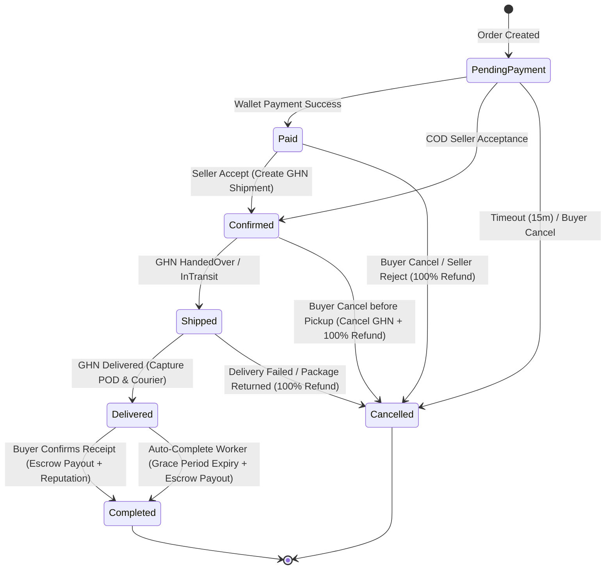

# Data Model & State Architecture: Fulfillment Delivery & Sub-Order Lifecycle

**Feature Branch**: `025-fulfillment-delivery-and-suborder-lifecycle`  
**Date**: 2026-11-17  
**Target Service**: `CommerceService` (Port 8003, Database `commerce_db:5435`)  

---

## 1. Domain Entities & State Invariants

### 1.1. SubOrder (`Commerce.Domain.Entities.SubOrder`)
The core aggregate child entity representing an individual shop's fulfillment boundary.

| Field | Type | Description | Invariant / Governance |
| :--- | :--- | :--- | :--- |
| `Id` | `Guid` | Primary key | Unique UUID |
| `OrderId` | `Guid` | Parent Master Order reference | Immutable |
| `BuyerId` | `Guid` | Buyer identifier | Immutable, checked for ownership |
| `SellerId` | `Guid` | Seller/Shop identifier | Immutable, checked for shop actions |
| `Status` | `SubOrderStatus` | Current lifecycle status | Strictly progressive; transitions governed by state machine |
| `PaymentMethod` | `PaymentMethod` | `Wallet` (0) or `Cod` (2) | Invariant: Escrow settlement executed only when `Wallet` |
| `CarrierCode` | `string?` | Carrier code (e.g., "GHN") | Updated from logistics webhook |
| `TrackingCode` | `string?` | Logistics carrier tracking code | Updated from carrier dispatch or delivery webhook |
| `DeliveredAt` | `DateTimeOffset?` | Timestamp of physical parcel delivery | Set when status becomes `Delivered` |
| `CompletedAt` | `DateTimeOffset?` | Timestamp of final receipt confirmation | Set when status becomes `Completed` |
| `CancelledAt` | `DateTimeOffset?` | Timestamp of cancellation | Set when status becomes `Cancelled` |
| `RowVersion` | `long` | Optimistic concurrency token | Incremented on each state mutation |

### 1.2. Order (`Commerce.Domain.Entities.Order`)
The parent aggregate entity representing the overall checkout transaction.

| Field | Type | Description | Invariant / Governance |
| :--- | :--- | :--- | :--- |
| `Id` | `Guid` | Primary key | Unique UUID |
| `BuyerId` | `Guid` | Buyer identifier | Immutable |
| `Status` | `OrderStatus` | Parent aggregate status | Synchronized: `Delivered` when all active sub-orders are delivered; `Completed` when all active sub-orders are completed; `Cancelled` when all are cancelled |
| `TotalAmount` | `decimal` | Aggregate checkout total | Sum of all sub-orders |

### 1.3. OrderStatusHistory (`Commerce.Domain.Entities.OrderStatusHistory`)
Audit trail capturing every lifecycle milestone and external carrier event.

| Field | Type | Description |
| :--- | :--- | :--- |
| `Id` | `Guid` | Primary key |
| `SubOrderId` | `Guid?` | Target sub-order |
| `FromStatus` | `SubOrderStatus?` | Previous state |
| `ToStatus` | `SubOrderStatus` | New state |
| `ActorRole` | `OrderActorRole` | `System`, `Buyer`, `Seller` |
| `Reason` | `string?` | Structured message containing status note, location, courier info, and POD URL |
| `CreatedAt` | `DateTimeOffset` | Event timestamp |

---

## 2. DTO Specifications

### 2.1. Inbound Delivery Status Webhook (`UpdateDeliveryStatusRequest`)
```csharp
public sealed record UpdateDeliveryStatusRequest(
    string Status,
    DateTimeOffset? DeliveredAt = null,
    string? CarrierCode = null,
    string? TrackingCode = null,
    string? Note = null,
    string? Location = null,
    string? PodUrl = null,
    string? ShipperName = null,
    string? ShipperPhone = null);
```

### 2.2. Inbound Sub-Order Cancellation (`CancelSubOrderRequest`)
```csharp
public sealed record CancelSubOrderRequest(
    CancellationReasonCode ReasonCode = CancellationReasonCode.BuyerChangedMind,
    string? ReasonNote = null);
```

### 2.3. Outbound Sub-Order Cancellation Response (`CancelSubOrderResponse`)
```csharp
public sealed record CancelSubOrderResponse(
    Guid SubOrderId,
    string Status,
    DateTimeOffset CancelledAt,
    decimal RefundAmount,
    bool InventoryReleased,
    bool CarrierShipmentCancelled);
```

---

## 3. Sub-Order State Machine & Transition Invariants



### Transition Guard Rules

1. **Rule S1 (Strict Confirmation Gate)**:
   - Transition to `SubOrderStatus.Completed` is permitted **ONLY IF** current status is `SubOrderStatus.Delivered`.
   - Attempting confirmation from `Shipped`, `Confirmed`, or `Paid` throws `INVALID_STATUS` (HTTP 400).
2. **Rule S2 (Sub-Order Cancellation Gate)**:
   - Transition to `SubOrderStatus.Cancelled` via Buyer action is permitted **ONLY IF** current status is `PendingPayment`, `Paid`, or `Confirmed`.
   - Once a sub-order reaches `Shipped` or `Delivered`, cancellation is rejected (`SUB_ORDER_CANNOT_BE_CANCELLED`, HTTP 400).
3. **Rule S3 (Idempotent Webhook Guard)**:
   - Webhook events arriving within 2 seconds with identical status and reason prefix are treated as duplicate carrier retries and ignored safely (`200 OK`).
4. **Rule S4 (Financial Escrow Isolation)**:
   - When a sub-order transitions to `Completed`:
     - If `PaymentMethod == PaymentMethod.Wallet`: Settle seller escrow payout via `_walletClient.SettleSellerSubOrderAsync`.
     - If `PaymentMethod == PaymentMethod.Cod`: Skip wallet settlement (courier handles physical cash reconciliation).
