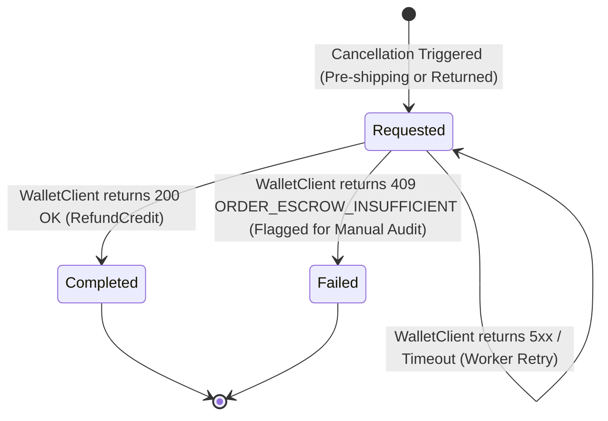

# Data Model Specification: Wallet Escrow Contract Alignment & Advanced Financial Error Handling

**Feature**: `026-wallet-escrow-contract-alignment`  
**Date**: 2026-11-17  
**Status**: Completed  

---

## 1. Entities & Schema Alignment

### 1.1 `OrderRefund` Entity (`Commerce.Domain.Entities`)
Represents an individual financial refund transaction tracked by CommerceService.

```csharp
public class OrderRefund : AuditableEntity
{
    public Guid Id { get; set; }

    /// <summary>
    /// Master Order ID. Required when the entire master order is refunded.
    /// </summary>
    public Guid? OrderId { get; set; }

    /// <summary>
    /// SubOrder ID. Required when a single sub-order is refunded. Nullable for full master order refunds.
    /// </summary>
    public Guid? SubOrderId { get; set; }

    public Guid? AuctionOrderId { get; set; }
    public Guid? CancellationId { get; set; }

    public RefundType RefundType { get; set; } = RefundType.Full;
    public decimal Amount { get; set; }
    public RefundStatus Status { get; set; } = RefundStatus.Requested;

    public string ReasonCode { get; set; } = string.Empty;
    public string? ReasonNote { get; set; }
    public OrderActorRole ActorRole { get; set; } = OrderActorRole.System;
    public Guid? RequestedBy { get; set; }
    public DateTimeOffset RequestedAt { get; set; } = DateTimeOffset.UtcNow;
    public DateTimeOffset? CompletedAt { get; set; }

    // Navigation properties
    public Order? Order { get; set; }
    public SubOrder? SubOrder { get; set; }
    public OrderCancellation? Cancellation { get; set; }
}
```

### 1.2 `RefundStatus` Enum
```csharp
public enum RefundStatus
{
    Requested = 0,   // Request logged, awaiting or processing refund
    Completed = 1,   // Refund credited successfully via WalletService
    Failed = 2       // Irrecoverable failure (e.g. escrow conflict, audit required)
}
```

### 1.3 `RefundType` Enum
```csharp
public enum RefundType
{
    Full = 0,        // 100% of the target order or sub-order amount
    Partial = 1      // Partial refund (future extensibility)
}
```

---

## 2. In-Memory & Inter-Service DTOs

### 2.1 `WalletPaymentResult` (`Commerce.Application.Interfaces`)
Returned by `IWalletClient` methods:
```csharp
public record WalletPaymentResult(
    bool IsSuccess,
    string? TransactionId = null,
    decimal? BalanceAfter = null,
    string? ErrorCode = null,
    string? ErrorMessage = null,
    bool IsTransientFailure = false
);
```

### 2.2 `WalletTransactionDto` (`Commerce.Infrastructure.Services.Wallet`)
Raw DTO returned by WalletService on HTTP 200:
```csharp
public sealed class WalletTransactionDto
{
    public string? Id { get; set; }
    public string? WalletId { get; set; }
    public string? UserId { get; set; }
    public string? Type { get; set; } // "PurchaseDebit", "EscrowRelease", "RefundCredit"
    public decimal Amount { get; set; }
    public string? Currency { get; set; } // "Vnd"
    public decimal? BalanceAfter { get; set; }
    public string? Status { get; set; } // "Success"
    public string? Note { get; set; }
    public DateTimeOffset? CreatedAt { get; set; }
}
```

---

## 3. State Transition Matrix for Refunds



### Transition Validation Rules
1. **Master Order Cancellation**:
   - `OrderId` MUST be populated.
   - `Amount` MUST equal `order.TotalAmount`.
   - `RefundType` MUST be `Full`.
2. **Sub-Order Cancellation**:
   - `SubOrderId` MUST be populated.
   - `Amount` MUST equal `subOrder.TotalAmount`.
3. **COD Payment Guard**:
   - If `order.PaymentMethod == PaymentMethod.Cod`, `OrderRefund` entity is NEVER created.
