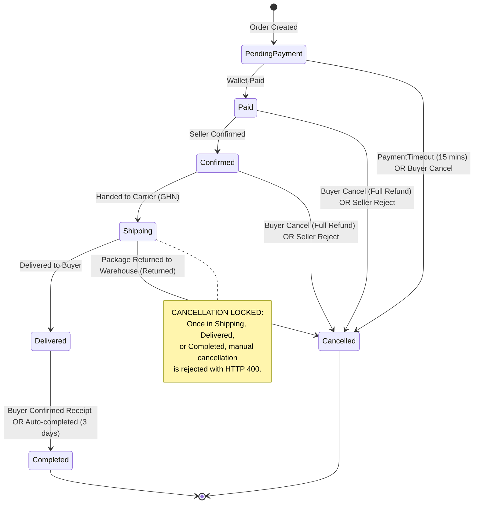

# Data Model Specification: Comprehensive Order Cancellation & Resource Rollback Lifecycle

**Feature**: `027-order-cancellation-and-resource-lifecycle`  
**Date**: 2026-11-17  
**Status**: Completed  

---

## 1. Entities & Data Models

### 1.1 `OrderCancellation` Entity (`Commerce.Domain.Entities`)
Tracks the explicit metadata and justification for an order or sub-order cancellation event.

```csharp
public class OrderCancellation : BaseEntity<Guid>
{
    public Guid? SubOrderId { get; set; }
    public Guid? AuctionOrderId { get; set; }
    public Guid? CancelledBy { get; set; }
    public required OrderActorRole ActorRole { get; set; }
    public required CancellationReasonCode ReasonCode { get; set; }
    public string? ReasonNote { get; set; }
    public bool WasPaid { get; set; }
    public bool InventoryReleased { get; set; }
    public long RowVersion { get; set; }

    // Navigation properties
    public SubOrder? SubOrder { get; set; }
    public AuctionOrder? AuctionOrder { get; set; }
    public ICollection<OrderRefund> Refunds { get; set; } = new List<OrderRefund>();
}
```

### 1.2 `CancellationReasonCode` Enum
```csharp
public enum CancellationReasonCode
{
    BuyerChangedMind = 0,
    OutOfStock = 1,
    PaymentTimeout = 2,
    SellerRejected = 3,
    Other = 4,
    DeliveryFailed = 5,
    PackageReturned = 6,
    CancellationWithoutReason = 7
}
```

### 1.3 `OrderActorRole` Enum
```csharp
public enum OrderActorRole
{
    Buyer = 0,
    Seller = 1,
    System = 2,
    Admin = 3
}
```

---

## 2. State Progression & Cancellation Matrix



### Cancellation Eligibility Rules
| Current Status | Buyer Can Cancel? | Seller Can Cancel/Reject? | System Worker Can Cancel? | Carrier Webhook Can Cancel? |
|:---|:---:|:---:|:---:|:---:|
| `PendingPayment` | ✅ Yes | ❌ No | ✅ Yes (after 15 mins) | ❌ No |
| `Paid` | ✅ Yes | ✅ Yes (Reject) | ❌ No | ❌ No |
| `Confirmed` | ✅ Yes | ✅ Yes (Reject, penalty applied) | ❌ No | ❌ No |
| `Shipping` | 🛑 **BLOCKED** | 🛑 **BLOCKED** | 🛑 **BLOCKED** | ✅ Yes (only if `Returned`) |
| `Delivered` | 🛑 **BLOCKED** | 🛑 **BLOCKED** | 🛑 **BLOCKED** | 🛑 **BLOCKED** |
| `Completed` | 🛑 **BLOCKED** | 🛑 **BLOCKED** | 🛑 **BLOCKED** | 🛑 **BLOCKED** |
| `Cancelled` | 🛑 Already Cancelled | 🛑 Already Cancelled | 🛑 Already Cancelled | 🛑 Already Cancelled |
