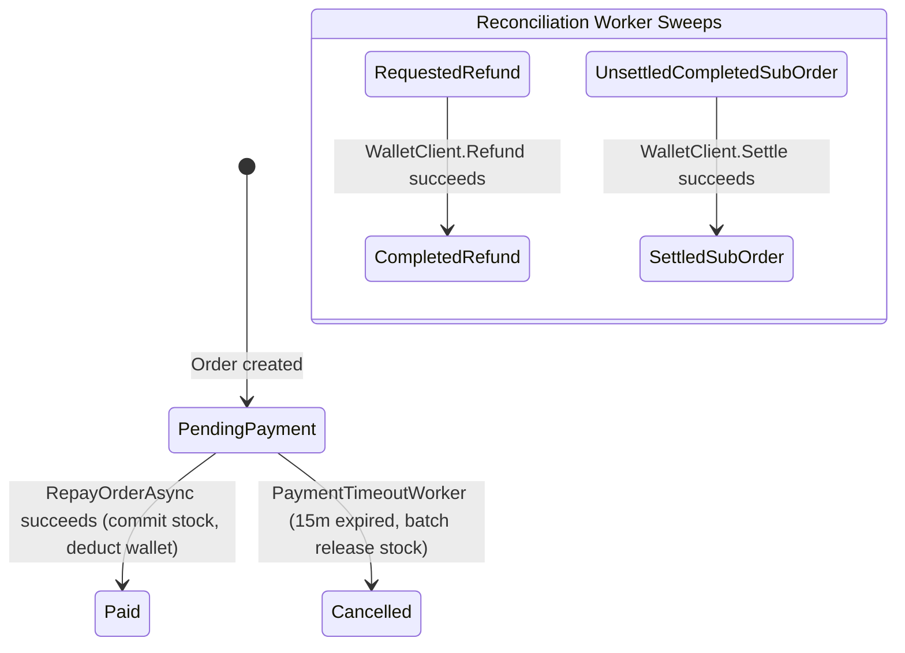

# Data Model: Payment Retry & Reconciliation Engine

**Feature**: `028-payment-retry-and-reconciliation-worker`  
**Date**: 2026-11-17  
**Status**: Completed  

---

## 1. Domain Entities & Database Schema Changes

### Entity: `SubOrder` (Modifications)
`Commerce.Domain/Entities/SubOrder.cs`

| Field | Type | Nullable | Default | Description |
| :--- | :--- | :---: | :---: | :--- |
| `IsEscrowSettled` | `bool` | No | `false` | Indicates whether seller payout has been settled to seller wallet (or reconciled). For COD, marked `true` upon completion. |

#### EF Core Configuration
`Commerce.Infrastructure/Persistence/Configurations/SubOrderConfiguration.cs`
```csharp
builder.Property(x => x.IsEscrowSettled)
    .HasDefaultValue(false);
```

---

## 2. Existing Entities Utilized

### Entity: `OrderRefund` (Read-only Reference)
`Commerce.Domain/Entities/OrderRefund.cs`

| Field | Type | Description |
| :--- | :--- | :--- |
| `Id` | `Guid` | Primary key |
| `OrderId` | `Guid` | Master order reference |
| `SubOrderId` | `Guid?` | Target sub-order reference (null if master refund) |
| `CancellationId` | `Guid?` | Cancellation audit reference |
| `RefundType` | `RefundType` | Full (0) or Partial (1) |
| `Amount` | `decimal` | Refund amount in VND |
| `Status` | `RefundStatus` | Requested (0), Completed (1), Rejected (2), Failed (3) |
| `ReasonCode` | `string` | Audit reason code |
| `ReasonNote` | `string?` | Descriptive note |
| `RequestedAt` | `DateTimeOffset` | Timestamp requested |
| `CompletedAt` | `DateTimeOffset?` | Timestamp completed |

---

## 3. Data Transfer Objects (Contracts)

### `RepayOrderResponse`
`Commerce.Application/DTOs/Order/RepayOrderResponse.cs`
```csharp
namespace Commerce.Application.DTOs.Order;

public sealed record RepayOrderResponse(
    Guid OrderId,
    string Status,
    decimal TotalAmount,
    DateTimeOffset PaidAt,
    Guid? WalletTransactionId);
```

### `OrderRefundResponse`
`Commerce.Application/DTOs/Order/OrderRefundResponse.cs`
```csharp
namespace Commerce.Application.DTOs.Order;

public sealed record OrderRefundResponse(
    Guid Id,
    Guid OrderId,
    Guid? SubOrderId,
    decimal Amount,
    string RefundType,
    string Status,
    string ReasonCode,
    string? ReasonNote,
    DateTimeOffset RequestedAt,
    DateTimeOffset? CompletedAt);
```

### `SubOrderFinancialBreakdownResponse`
`Commerce.Application/DTOs/Order/SubOrderFinancialBreakdownResponse.cs`
```csharp
namespace Commerce.Application.DTOs.Order;

public sealed record SubOrderFinancialBreakdownResponse(
    Guid SubOrderId,
    string SubOrderNo,
    Guid SellerId,
    Guid BuyerId,
    decimal TotalAmount,
    decimal ItemsAmount,
    decimal ProductDiscountAmount,
    decimal ShopDiscountAmount,
    decimal SystemDiscountAmount,
    decimal ShippingFeeAmount,
    decimal PlatformFeeAmount,
    decimal SellerReceiveAmount,
    bool IsEscrowSettled,
    string Status,
    string PaymentMethod,
    DateTimeOffset? CompletedAt);
```

---

## 4. State Transitions & Invariants



### Financial Invariant Check
For each `SubOrder`:
$$\text{TotalAmount} = \text{SellerReceiveAmount} + (\text{PlatformFeeAmount} - \text{SystemDiscountAmount}) + \text{ShippingFeeAmount}$$
- When `Status == Completed`:
  - If `PaymentMethod == PaymentMethod.Wallet`: `IsEscrowSettled == true` confirms `SellerReceiveAmount` has been transferred to seller wallet.
  - If `PaymentMethod == PaymentMethod.Cod`: `IsEscrowSettled == true` (courier collects cash, no wallet transfer needed).
