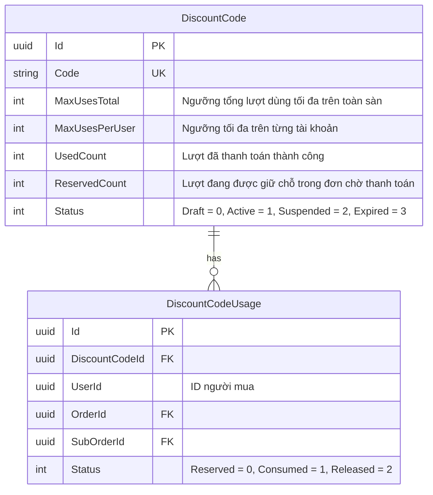

# Data Model Specification: Core Remediation, Security Hardening & Essential Endpoints

**Feature Branch**: `030-core-remediation-and-essential-endpoints`  
**Created**: 2026-11-18  
**Target Service**: `CommerceService`

---

## 1. Entity Schema Updates

### 1.1. `SubOrder` (Bổ sung cột theo dõi quyết toán Escrow)

| Tên cột | Kiểu dữ liệu (C#) | Kiểu dữ liệu (PostgreSQL) | Nullable | Giá trị mặc định | Diễn giải |
|---|---|---|---|---|---|
| `IsEscrowSettled` | `bool` | `boolean` | `false` | `false` | Đánh dấu tiền hàng của đơn con đã được quyết toán giải ngân sang ví người bán thành công qua WalletService hay chưa. |

- **Thuộc tính & Ràng buộc**:
  - Khi tạo đơn: `IsEscrowSettled = false`.
  - Khi thanh toán COD hoặc khi `SettleSellerSubOrderAsync` thành công: `IsEscrowSettled = true`.
  - Phục vụ `PaymentTimeoutWorker` quét đối soát bù tự động cho các đơn `Completed` nhưng chưa giải ngân ví do sự cố mạng.

---

## 2. API Data Transfer Objects (DTOs)

### 2.1. DTOs phục vụ API `GET /api/v1/auction-orders/me`

Tái sử dụng DTO chuẩn đã có tại `Commerce.Application/Services/AuctionOrder/AuctionOrderResponses.cs`:

```csharp
public sealed record AuctionOrderSummaryResponse(
    Guid Id,
    string OrderNo,
    Guid AuctionId,
    Guid WinningBidId,
    string OrderSource,
    SubOrderStatus Status,
    Guid SellerId,
    decimal WinningAmount,
    decimal DepositAmount,
    decimal? ShippingFeeAmount,
    decimal? TotalAmount,
    DateTimeOffset? PaymentDeadlineAt,
    DateTimeOffset CreatedAt
);
```

Đóng gói dữ liệu trả về theo chuẩn phân trang `PagedData<AuctionOrderSummaryResponse>`:

```csharp
public sealed record PagedData<T>(
    IReadOnlyList<T> Items,
    PaginationMetadata Pagination
);

public sealed record PaginationMetadata(
    int PageIndex,
    int PageSize,
    int TotalCount,
    int TotalPages,
    bool HasPreviousPage,
    bool HasNextPage
);
```

---

## 3. Discount Validation State & Constraints

### 3.1. Entity: `DiscountCode` & `DiscountCodeUsage`

Cấu trúc kiểm tra giới hạn lượt dùng trong `DiscountService`:



- **Quy tắc tính khả dụng (Invariants)**:
  1. `Voucher khả dụng khi`: `(UsedCount + ReservedCount) < MaxUsesTotal` (nếu `MaxUsesTotal.HasValue`).
  2. `Người mua khả dụng khi`: Số bản ghi trong `DiscountCodeUsage` có `UserId == buyerId && Status != Released` < `MaxUsesPerUser` (nếu `MaxUsesPerUser.HasValue`).
  3. `Giỏ hàng hợp lệ khi`: Tất cả `CartItems` gửi lên đều thuộc về `Cart` của chính `buyerId`.
