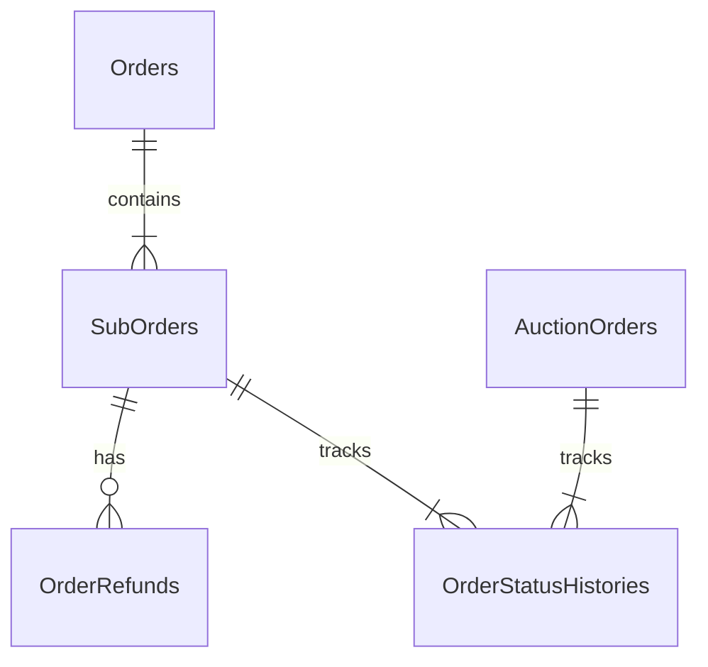

# Data Model: Post-Order Lifecycle, Address Modification and Refund Governance

**Feature Branch**: `032-post-order-lifecycle-and-refund-governance`  
**Created**: 2026-11-19  
**Status**: Completed  

---

## 1. DTO Specifications

### 1.1. Change Shipping Address DTOs

```csharp
namespace Commerce.Application.Services.Order;

public sealed record ChangeShippingAddressRequest(
    Guid? AddressId = null,
    ShippingAddressInput? ShippingAddress = null,
    string? ContactPhone = null
);

public sealed record ChangeShippingAddressResponse(
    Guid TargetId,
    string TargetType, // "SubOrder", "Order", "AuctionOrder"
    string NewAddressText,
    decimal OldShippingFee,
    decimal NewShippingFee,
    decimal TotalAmount,
    DateTimeOffset UpdatedAt
);
```

### 1.2. Refund Governance DTOs

```csharp
namespace Commerce.Application.Services.Order;

public sealed record ApproveRefundRequest(
    string? Note = null
);

public sealed record RejectRefundRequest(
    [Required] string Reason,
    string? Note = null
);

public sealed record RefundDetailResponse(
    Guid Id,
    Guid SubOrderId,
    string SubOrderNo,
    Guid BuyerId,
    Guid SellerId,
    decimal Amount,
    string Reason,
    string Status, // "Requested", "Completed", "Rejected"
    string? SellerNote,
    string? RejectReason,
    DateTimeOffset RequestedAt,
    DateTimeOffset? CompletedAt
);
```

### 1.3. Auction Order Extended DTOs

```csharp
namespace Commerce.Application.Services.AuctionOrder;

public sealed record CancelAuctionOrderRequest(
    string? Reason = null
);

public sealed record CancelAuctionOrderResponse(
    Guid AuctionOrderId,
    string OrderNo,
    string Status,
    decimal RefundedAmount,
    DateTimeOffset CancelledAt
);

public sealed record RetryAuctionShipmentResponse(
    Guid AuctionOrderId,
    string OrderNo,
    string TrackingCode,
    string CarrierCode,
    string? LabelPrintUrl,
    DateTimeOffset RetriedAt
);
```

---

## 2. Validation & Business Rule Matrix

| DTO / Trường dữ liệu | Quy tắc xác thực | Mã lỗi nếu vi phạm |
|---|---|---|
| `ChangeShippingAddressRequest` | Phải có ít nhất `AddressId` hoặc `ShippingAddress` hợp lệ kèm mã GHN | `VAL_INVALID_INPUT`, `INVALID_SHIPPING_ADDRESS` |
| `RejectRefundRequest.Reason` | Bắt buộc không được để trống | `VAL_INVALID_INPUT` |
| `CancelAuctionOrderRequest` | Trạng thái AuctionOrder phải là `PendingPayment` hoặc `Paid` chưa accept | `INVALID_STATUS`, `AUCTION_CANNOT_BE_CANCELLED` |
| `RetryAuctionShipment` | Trạng thái AuctionOrder phải là `Confirmed` và chưa có `TrackingCode` | `INVALID_STATUS` |

---

## 3. Entity Relationships


